# Fermi-LAT 2FLE: Reusable Spectral Screening and Scientific Validation with paceval

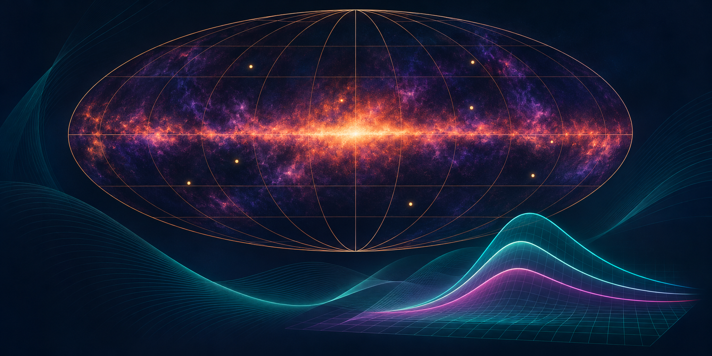

*Concept illustration; not a measured gamma-ray sky map or a computed research result.*

**A reproducible C++/paceval research demonstrator combining the 60 source-metadata records transcribed from the supplied 2FLE V4 whitepaper with a distinctly labeled synthetic spectral-model and Poisson-likelihood methods pilot.** It evaluates 17 actual persistent paceval graphs through real Multi-Graph-Batch API calls. **It does not establish an astrophysical class, anomaly, extraterrestrial origin, or technosignature for any Fermi source.**

[**English research whitepaper (PDF)**](paceval_Fermi_2FLE_Spectral_Screening_Whitepaper_EN.pdf) · [C++ code](src/fermi_2fle_demo.cpp) · [CMake](src/CMakeLists.txt) · [Mathematical execution inventory](results/math_execution_inventory.csv) · [Original German research proposal (V4)](docs/Fermi_2FLE_Research_Proposal_V4_DE.pdf)

## 1. Scientific use case and current state of the art

The Fermi Large Area Telescope (LAT) has surveyed the gamma-ray sky for many years. The **Second Fermi-LAT Catalog of Low-Energy Sources (2FLE)**, released as preliminary catalog data in October 2026 and published in the *Astrophysical Journal Supplement Series* on 12 November 2026, analyzes 14 years of observations in the 20–200 MeV band and reports **450 cataloged sources**. The collaboration associates 377 with known multi-wavelength counterparts; 73 lack such associations. Of those 73, 13 have unclassified 4FGL associations and **60 are newly cataloged gamma-ray sources**. These published totals are sourced from the 2026 catalog paper and NASA FSSC, not recomputed from the original FITS in this package. See the [2026 peer-reviewed 2FLE paper (DOI: 10.3847/1538-4365/aeb54d)](https://doi.org/10.3847/1538-4365/aeb54d), [arXiv preprint](https://arxiv.org/abs/2610.18972) and [NASA FSSC 2FLE products](https://fermi.gsfc.nasa.gov/ssc/data/access/lat/2FLE/).

An unidentified source is not an unnatural source. Astrophysical alternatives include active galaxies, pulsars, supernova remnants, unresolved source populations, diffuse-background mismodeling and detector/reconstruction artifacts. The supplied V4 paper includes a structured list of **22 natural/nontechnical hypotheses (N01–N22)** and **seven speculative technical hypotheses (T01–T07)**. All require distinct observational signatures, natural alternative models and careful false-discovery control. An inconclusive source remains *unclassified*.

The accepted workflow uses calibrated LAT photon and spacecraft data, instrument response functions (IRFs), diffuse foregrounds, regions of interest, and forward-folded Poisson likelihoods. [Fermipy](https://fermipy.readthedocs.io/en/latest/) supports LAT ROI models, likelihood analyses, SEDs and residual maps. Multiwavelength identifications additionally require catalogs and chance-association estimates. The **original 2FLE FITS file, event data, IRFs, photon observations and previous research companion ZIP are not attached to this project** and could not be retrieved into this runtime. Consequently **neither the historical 110,700-value Katalog-Screen nor a real photon-based likelihood or 60-source classification has been reproduced here**.

The application-specific research question we can rigorously test is narrower: can an **extensible library of analytical spectral models, count-expectation kernels, log-likelihood contributions, mathematical differences and explicit sensitivities** be built once and evaluated reproducibly on many synthetic trial inputs with the real paceval mathematical engine? This demonstrator answers that *methods* question with real SDK execution, independent numerical checks, and a carefully separated real source-metadata table.

## 2. Scope and provenance: source data versus simulated signals

The first source table is a **faithful transcription of Appendix A, pages 11–13, of the user-provided V4 German research proposal**. The source includes 60 rows, split into 22 without an ASSOC3 hint and 38 with an unconfirmed ASSOC3 hint; only 10 entries have three band values meeting the proposal's broad-band TS threshold. See the [actual transcribed CSV](examples/unidentified_60_from_user_whitepaper.csv) and [source provenance and SHA-256](results/source_provenance.txt). These are published catalog *metadata as transcribed in the supplied report*, not newly measured spectra.

The second dataset is an entirely different scientific object: 60 **synthetic Poisson-drawn spectral datasets**, each assigned a test spectrum of 24 synthetic energy-bin centers and a known injected curvature. We use 61 trial curvature values per synthetic spectrum and compute a 65 × 65 mathematical response surface. The source names are reused only as stable row identifiers; their reported catalog TS and ASSOC3 fields **do not enter the mock spectral fit**. Synthetic spectral inputs are **not derived from Fermi photons**, cannot classify the real objects and must never be merged with real source evidence.

| Dataset | Rows | Provenance / meaning |
|---|---:|---|
| [60 source metadata records](examples/unidentified_60_from_user_whitepaper.csv) | 60 | Transcribed from attached V4 PDF; not a new FITS verification |
| [Synthetic mock counts](examples/synthetic_photon_counts.csv) | 1,440 | Generated via paceval expectation + seeded C++ Poisson draw |
| [Synthetic curvature trials](examples/synthetic_curvature_parameter_scan.csv) | 3,660 | All per-bin mathematical contributions evaluated by paceval |
| [Synthetic recovery](examples/synthetic_injection_recovery.csv) | 60 | Known injected versus selected model parameter |
| [Synthetic two-parameter surface](examples/synthetic_spectral_surface.csv) | 4,225 | Actual paceval model outputs across energy and curvature |
| [Hypothesis matrix](examples/source_hypothesis_matrix_not_tested.csv) | 1,740 | Explicitly **NOT_TESTED** in all 60 × 29 cells |

## 3. Mathematical model and paceval formulas

Reference energy is fixed at $E_0=100\,\mathrm{MeV}$. The two primary alternative analytical spectral functions are:

```math
F_{\mathrm{PL}}(E)=N\exp\left(-\gamma\ln\frac{E}{E_0}\right)
```

```math
F_{\mathrm{LP}}(E)=N\exp\left(-\gamma\ln\frac{E}{E_0}-q\left[\ln\frac{E}{E_0}\right]^2\right).
```

Also implemented are a deliberately simplified exponential-cutoff reference family, a smoothly bent power law and a separately preserved cubic-logarithm model version. These are **illustrative functions**; their suitability for an individual LAT source is not established. An analytic curvature sensitivity is independently checked:

```math
\frac{\partial\ln F_{\mathrm{LP}}}{\partial q}=-\left(\ln\frac{E}{E_0}\right)^2.
```

For a **toy detector**, not a real Fermi IRF response, we define a positive expected count:

```math
\mu_i=b_i+A\,w_i\,F_{\mathrm{LP}}(E_i).
```

The model evaluates per-bin Poisson log-likelihood terms **without the factorial term**, which cancels in within-data model ranking:

```math
\ell_i=n_i\ln\mu_i-\mu_i.
```

A per-bin Poisson deviance and Pearson residual are also computed as actual paceval graphs. The C++ host sums evaluated per-bin contributions, chooses the fixed-grid maximum and handles the stochastic draw. **The toy response has no instrument energy dispersion, PSF, GTI exposure modeling, sky background or other physical LAT calibration.** Its likelihood values and likelihood differences are **not catalog significance or technosignature evidence**.

## 4. Real paceval execution architecture

The C++ program registers 17 graphs once with `paceval_CreateComputation`, verifies individual graphs with `paceval_dGetComputationResult`, and evaluates large sets via the actual `paceval_dGetMultipleComputationsResultsExt` API. The full experiment was run with the original provided Linux SDK library, with independently checked output values.

| Mathematical function / scientific role | Actual execution | Published evidence |
|---|---|---|
| Power law, log parabola, cutoff and smooth-bend spectra | paceval, persistent graphs | [Formula registry](examples/formula_registry.csv) |
| Two simultaneous versions of log-parabola spectrum | paceval, distinct graphs | [Spectral surface](examples/synthetic_spectral_surface.csv) |
| Expected synthetic count contributions and log-likelihoods | paceval Multi-Graph batches | [Synthetic mock counts](examples/synthetic_photon_counts.csv), [parameter trials](examples/synthetic_curvature_parameter_scan.csv) |
| Synthetic Poisson deviance and Pearson residual | paceval Multi-Graph batches | [Formula registry](examples/formula_registry.csv) |
| Flux ratios, likelihood differences and analytic q sensitivity | paceval Multi-Graph batches | [Surface CSV](examples/synthetic_spectral_surface.csv) |
| Accumulation of bin contributions, maximum over q grid | C++ host | A stateful reduction/selection process |
| Seeded Poisson draws for the synthetic observations | C++ host | Stochastic data generation, **not** sky observation |
| Actual LAT IRF folding, photon fitting, crossmatching, hypothesis classification | **Not performed** | Requires real observational data and calibrated external analysis |

The [machine-readable mathematical function inventory](results/math_execution_inventory.csv) includes graph identifiers, expressions, units, version labels, real execution paths and explicitly unimplemented components.

## 5. Executed experimental results

The full C++/paceval demonstration created **17 reusable graphs**, evaluated **1,566,545 genuine SDK graph outputs** through **378 batch invocations** and independently checked **11,062 native-reference numerical outputs**. The independent high-precision Python reference additionally verifies **1,096 values using 80-decimal-digit arithmetic**. The CTest SDK integration test and a second complete execution passed. Eight tracked output files were byte-for-byte identical in a full replay.

The synthetic-only injection-recovery recovered **59 of the 60 known injected curvature parameters within an absolute tolerance of 0.05**. This is a diagnostic of the **defined synthetic model and fixed search grid**; it is *not* the proportion of true or unusual astrophysical sources, and no corresponding measured Fermi detection sensitivity has been established. Numeric reference audit details are available in [`results/`](results/), rather than being reported as C++-paceval numerical-difference claims in this public research narrative.

The earlier V4 paper reports a distinct historical **110,700-evaluation** 2FLE FITS-based catalog-screen. Without its original FITS/input files and source code that exact result has **not** been independently reproduced by this package, and the present synthetic output count must not be added to or conflated with it.

## 6. Genuine scientific figures

The first two figures visualize **real catalog metadata transcribed from the supplied whitepaper**, while the remaining figures are computed exclusively from actual paceval-generated **synthetic** data.

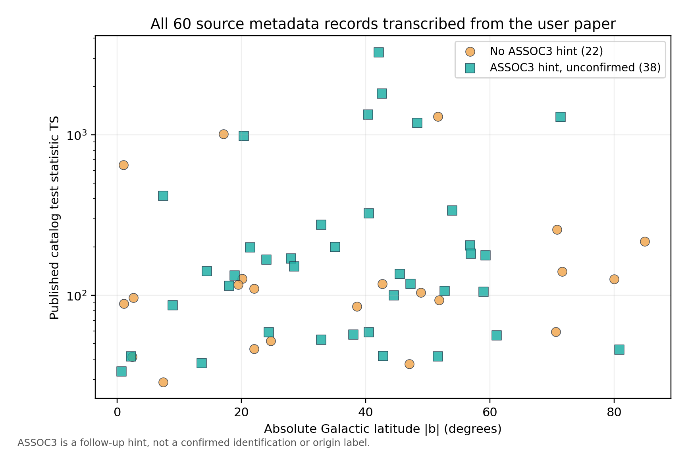
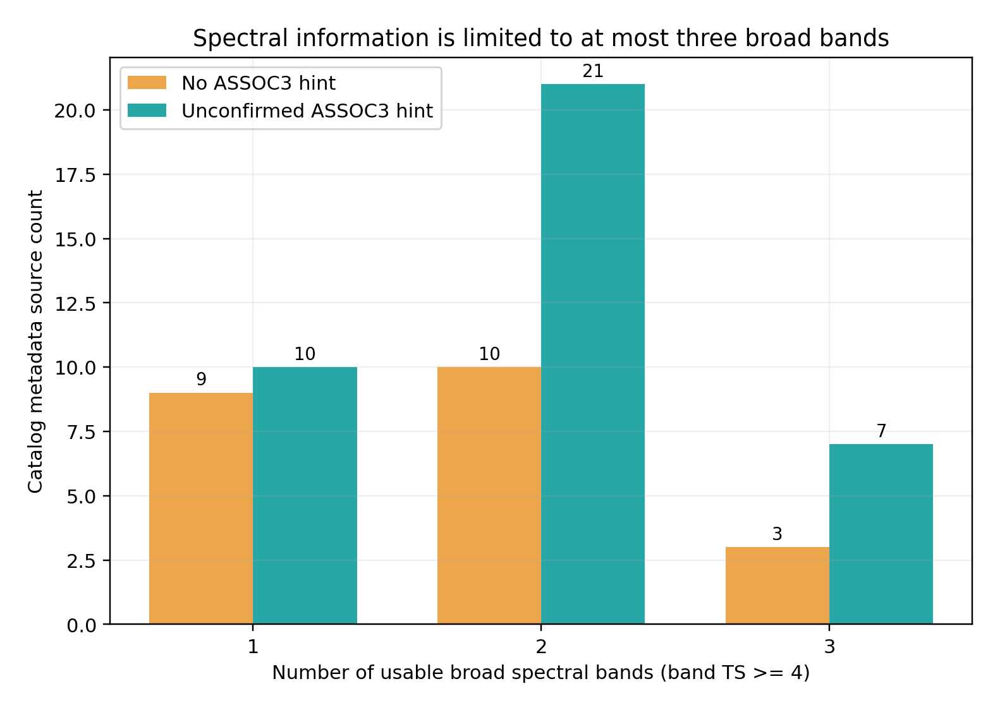

| Computed mathematical study | Computed visualization |
|---|---|
| Synthetic log-parabolic 3D surface | 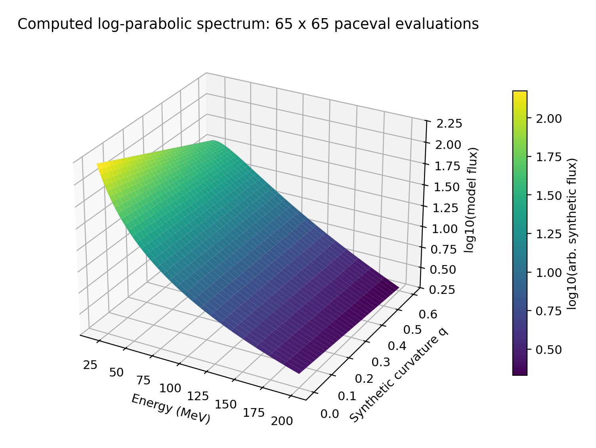 |
| Synthetic curvature ratio contours | 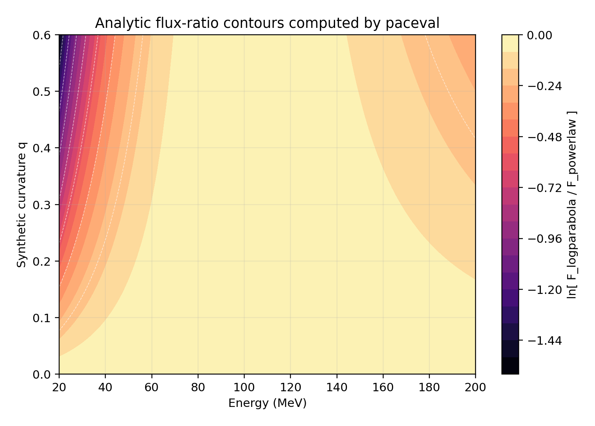 |
| Multiple mathematical model families | 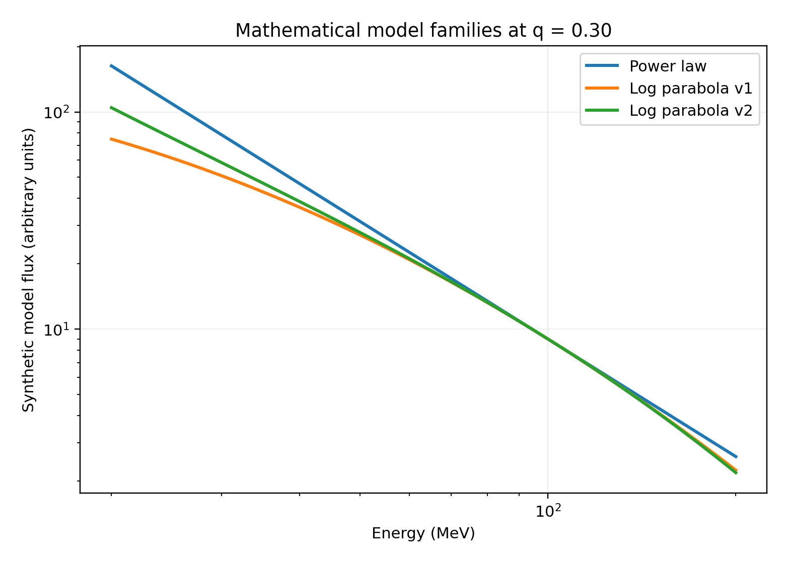 |
| Fixed-grid Poisson toy objective | 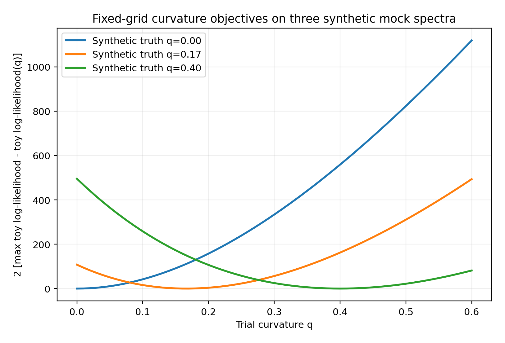 |
| Injection-recovery, not real source classification | 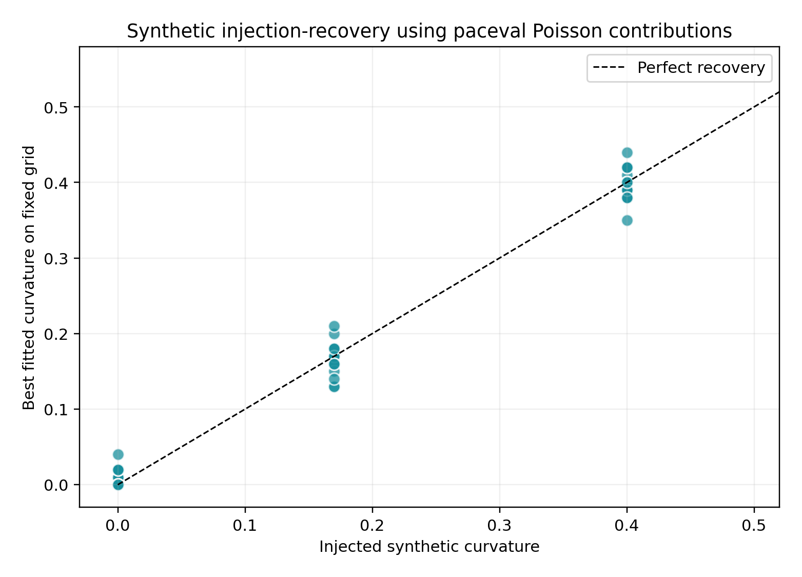 |
| Synthetic parameter group variability | 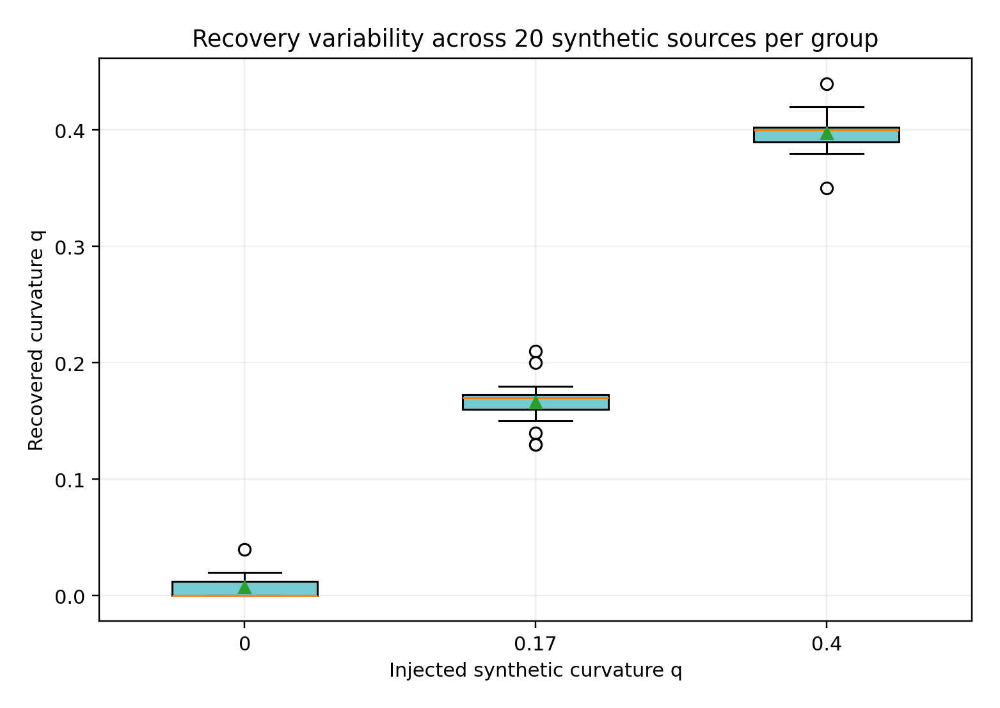 |
| Synthetic photon-bin simulation | 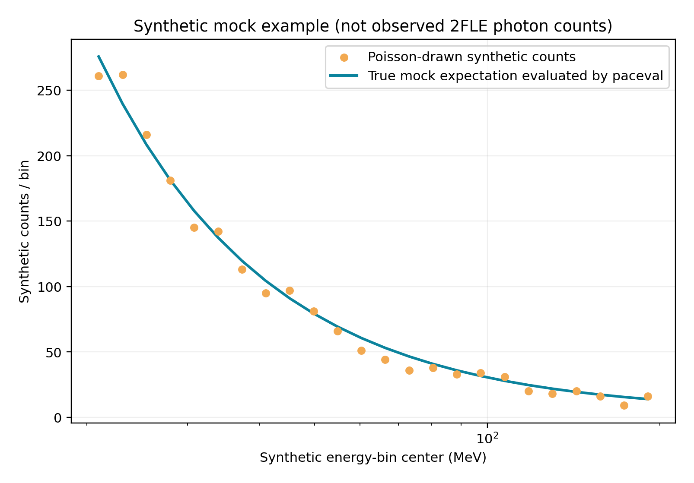 |
| Analytical curvature derivative | 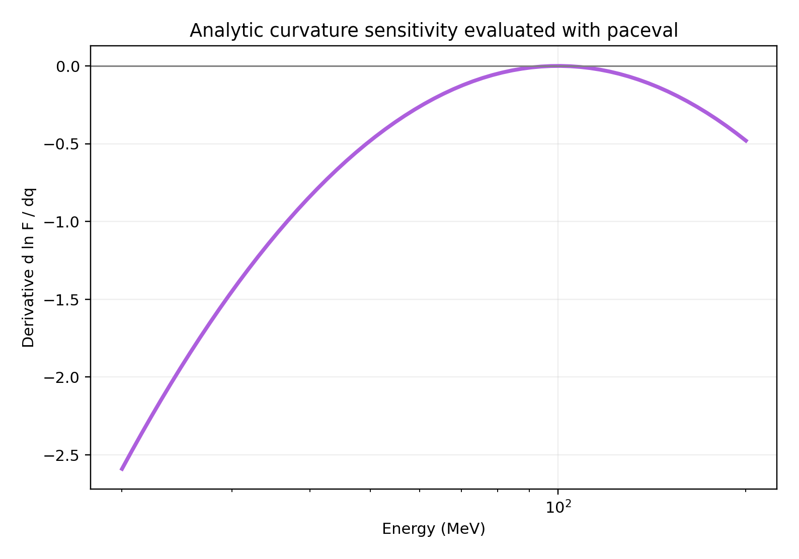 |

Each figure is provided as a high-resolution PNG and vector PDF. All scientific figures can be regenerated from their source CSVs by [`src/make_figures.py`](src/make_figures.py). The title artwork is a **2400 × 1200 pixel** conceptual illustration, not a measured Fermi sky rendering.

## 7. Build, run, reproduce and verify

Requirements: Linux x86-64, a compatible external paceval shared library, GCC/Clang with C++17, CMake >= 3.16 and Python packages `numpy`, `matplotlib`, `mpmath`, `PyMuPDF`, `Pillow`, and `reportlab` for optional graphics/PDF reproduction. The project uses the **original paceval SDK bridge files** `src/paceval_main.h` and `src/paceval_main.cpp`. The external paceval `.so` is not redistributed.

```bash
cmake -S src -B build -DCMAKE_BUILD_TYPE=Release \
  -DPACEVAL_RUNTIME=/absolute/path/to/libpaceval_linux_sharedLIB.so
cmake --build build -j
ctest --test-dir build --output-on-failure
./build/fermi_2fle_demo --out . --sources 60 --bins 24 --grid 61
python3 src/high_precision_reference.py
python3 src/build_hypothesis_matrix.py
python3 src/verify_results.py
python3 src/make_figures.py
python3 src/make_whitepaper.py
python3 src/check_readme_math.py
```

The source extraction helper [`src/extract_catalog_from_report.py`](src/extract_catalog_from_report.py) can regenerate the **60 metadata records** directly from the [supplied German PDF](docs/Fermi_2FLE_Research_Proposal_V4_DE.pdf). The metadata CSV must exist before the C++ run. The build's short CTest copies this CSV into an isolated test output folder. Exact replay command, SHA-256 fingerprints and audit summaries are in [`results/reproducibility.txt`](results/reproducibility.txt), [`results/high_precision_audit.json`](results/high_precision_audit.json), and [`results/verification_audit.json`](results/verification_audit.json).

The README checker includes positive and negative regression tests for unsupported operator-name macros and nested dollar delimiters in `math` blocks, plus verification of all local links. It is a **static structural check, not evidence that GitHub's live renderer has been viewed**.

## 8. Scientific limits and full astrophysical research roadmap

This package demonstrates a **mathematical spectral-computation kernel**, not a complete 2FLE scientific investigation. Before comparing physical models or evaluating any unusual signal, follow the original V4 roadmap: verify the original FITS; obtain validated Pass-8 photon and spacecraft files, matching IRFs, diffuse models and GTIs; reproduce LAT ROI likelihood analyses with Fermitools/Fermipy; test natural model classes; conduct robust associations accounting for positional errors and random associations; perform blinded injection-recovery/false-positive calibration; require independent time and instrument confirmation. See the [practical validation plan](docs/observational_validation_roadmap.md) and [hypothesis registry](docs/hypothesis_library.csv).

The [source-hypothesis matrix](examples/source_hypothesis_matrix_not_tested.csv) has **1,740 explicitly `NOT_TESTED` entries** for the 60 source metadata rows and 29 hypotheses. It is a completeness checklist and **must not be interpreted as evidence of exclusion or support of any hypothesis**. In particular, **0 confirmed technological signatures** in a limited previous catalog screen does not estimate the fraction of extraterrestrial sources. A new research phase would need independent, calibrated observational tests and statistical power before stating any scientific limits.

## 9. References and reproducibility

1. Adelfio et al. / Fermi-LAT Collaboration (2026), *The Second Catalog of Low-Energy Fermi-LAT Sources*, *Astrophysical Journal Supplement Series* **287**(2), 40, published 12 November 2026. [DOI: 10.3847/1538-4365/aeb54d](https://doi.org/10.3847/1538-4365/aeb54d); [arXiv:2610.18972](https://arxiv.org/abs/2610.18972).
2. NASA Fermi Science Support Center, [2FLE catalog data products, FITS and associated regions](https://fermi.gsfc.nasa.gov/ssc/data/access/lat/2FLE/).
3. NASA Fermi Science Support Center, [LAT photon and spacecraft file access](https://fermi.gsfc.nasa.gov/ssc/data/access/).
4. NASA Fermi Science Support Center, [LAT diffuse background templates](https://fermi.gsfc.nasa.gov/ssc/data/access/lat/BackgroundModels.html).
5. Fermipy collaboration, [Fermipy likelihood analysis and ROI modeling](https://fermipy.readthedocs.io/en/latest/).
6. NASA/HEASARC, [4FGL-DR4 catalog background and caveats](https://heasarc.gsfc.nasa.gov/W3Browse/fermi/fermilpsc.html).
7. [Original German V4 source document, uploaded by the user](docs/Fermi_2FLE_Research_Proposal_V4_DE.pdf).

**Research status:** Compiled and executed real paceval numerical pilot; source metadata verified against supplied document; **no observational photon likelihood, source identification, external 60-position crossmatching, or technological discovery**. Release date: 13 November 2026.
