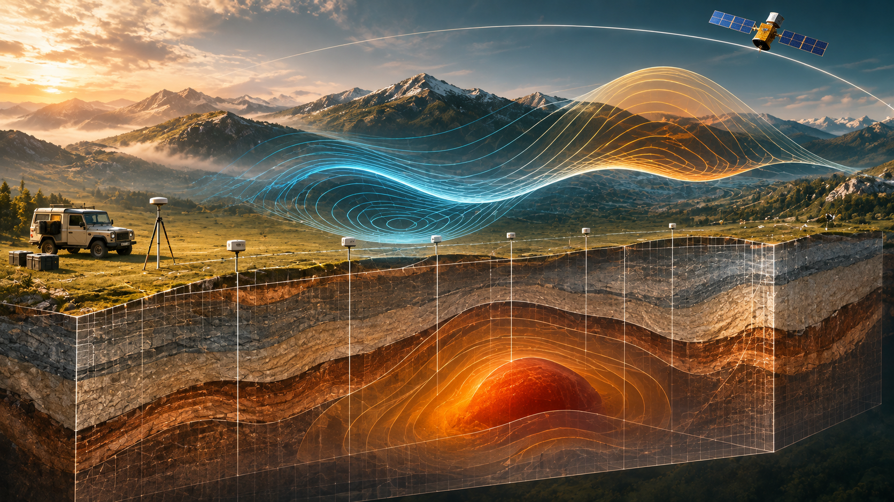

# WP_033 · Forward Expressions in Gravitational Inversion



*Cover image: conceptual geophysical visualization, **not** a measured gravity survey or paceval result. All numbered scientific plots below are generated from the actual paceval numerical exports.*

**Research outcome:** An executable C++ demonstration of a parameterized degree-2 gravitational potential, its radial derivative and analytical sensitivities, with a two-parameter inverse experiment on deterministic synthetic observations. Reusable paceval graphs supply the forward mathematical quantities; the host conducts the least-squares inverse procedure. The English PDF is [paceval_Gravitational_Inversion_Whitepaper_EN.pdf](paceval_Gravitational_Inversion_Whitepaper_EN.pdf).

## 1. Industrial use case and current state of the art

Geophysical and geodetic practitioners compare *predicted* gravitational fields from a specified Earth or subsurface model with observations, then adjust model parameters to reduce the mismatch. Applications include global gravity-field determination, satellite orbit support, reference gravity modeling and surveys of subsurface density structure. In practical workflows, gravity data interpretation involves survey geometry, measurement error, density assumptions, nonuniqueness, and regularization. The forward numerical formula is only one stage of a broader inverse problem.

Modern global Earth gravity representations commonly use spherical harmonics ([ICGEM theory](https://icgem.gfz.de/theory)); geophysical inverse frameworks such as [SimPEG](https://simpeg.xyz/) provide general 3D gravity forward/inversion methods and explicit sensitivities. A publicly released combined gravity model in 2026 further illustrates the much higher model resolution used in actual research ([GFZ/ICGEM dataset](https://doi.org/10.5880/icgem.2026.002)). This project intentionally investigates a much narrower, analytically tractable **degree-2 potential**, not a full gravity field or subsurface density inversion.

A practical illustrative workflow is: choose satellite/survey observation radii and colatitudes; evaluate the specified gravitational model with paceval; assemble residuals; recover the model parameters with host-side least squares; compare recovered parameters and holdout predictions against synthetic truth; preserve the old and revised forward mathematical expressions for later review.

## 2. Defined mathematical model

Use geocentric spherical coordinates with $r$ in km, $c=\cos\theta$, $R=6378.137\ \mathrm{km}$, $\mu$ in km³/s² and dimensionless $J_2$. The *defined synthetic potential* (excluding centrifugal potential) is:

```math
V(r,\theta)=\frac{\mu}{r}\left[1-J_2\left(\frac{R}{r}\right)^2 P_2(\cos\theta)\right],\quad P_2(c)=\frac{3c^2-1}{2}.
```

The inward radial component (magnitude/sign convention $g_r=-\partial V/\partial r$ for this positive-potential convention) is:

```math
g_r(r,\theta)=\frac{\mu}{r^2}\left[1-3J_2\left(\frac{R}{r}\right)^2 P_2(\cos\theta)\right].
```

Analytical sensitivity graphs (note the radial gravity derivative is with respect to *model parameters*, not time):

```math
\frac{\partial g_r}{\partial\mu}=\frac{1-3J_2(R/r)^2P_2(c)}{r^2},\qquad \frac{\partial g_r}{\partial J_2}=-\frac{3\mu R^2P_2(c)}{r^4}.
```

The sensitivity with respect to colatitude is also implemented, with $c=\cos\theta$ and $\sin\theta\ge 0$ on $0\le\theta\le\pi$:

```math
\frac{\partial g_r}{\partial\theta}=\frac{9\mu J_2R^2\cos\theta\sin\theta}{r^4}.
```

The inverse host solves a least-squares problem after reparameterizing the coefficients as $m=\mu/\mu_0$ and $b=\mu J_2/(\mu_0J_{2,0})$. The forward model is linear in $m,b$ for the fixed observation locations. Finite synthetic perturbations are added to a 960-point observation survey; an independent clean-data inversion is also evaluated. **Parameter recovery is conditioned on this particular two-parameter model and observation geometry**; no uniqueness claim for general geological mass distributions follows.

## 3. paceval execution architecture

The original `src/paceval_main.h` and `src/paceval_main.cpp` are compiled with `src/gravity_inversion.cpp`. Eight ordinary reusable paceval graphs cover potential, radial gravity, three derivatives, monopole baseline, a local residual example and an explicit versioned J2 change. Scalar graph evaluation creates the synthetic observations, while batch evaluation produces the scientific 3D field surface and verifies 2,048 additional results. The host performs observation generation, independent native checks, parameter inversion, holdout assessment, file writing and safety/error checks. A true distributed or geophysical numerical inverse solver is not claimed.

## 4. Actual executed research workload

| Item | Verified output |
|---|---:|
| Reusable ordinary paceval computations | 8 |
| Deterministic synthetic observations | 960 |
| Surface grid samples | 3,721 |
| Scalar paceval calls | 3,008 |
| Independently checked batch outputs | 2,048 |
| Analytical derivative spot checks | 32 |
| Independent 80-digit reference outputs | 202 |
| CMake/CTest SDK integration | Passed |

See [execution summary](examples/execution_summary.txt), [parameter inversion summary](examples/inversion_summary.csv), [high-precision audit](results/high_precision_audit.json), [raw observations](examples/synthetic_observations.csv), [surface values](examples/gravity_surface.csv), and the [exact expression registry](examples/formula_registry.csv). These are **synthetic** tests and are not geodetic measurement products.

## 5. Scientific visualizations from paceval results

| Figure | PNG | Vector PDF |
|---|---|---|
| Radial gravity 3D surface | [PNG](figures/01_radial_gravity_surface.png) | [PDF](figures/01_radial_gravity_surface.pdf) |
| Radial gravity contours | [PNG](figures/02_gravity_contours.png) | [PDF](figures/02_gravity_contours.pdf) |
| Gravitational potential 3D surface | [PNG](figures/03_potential_surface.png) | [PDF](figures/03_potential_surface.pdf) |
| Quadrupole contribution | [PNG](figures/04_quadrupole_contours.png) | [PDF](figures/04_quadrupole_contours.pdf) |
| J2 sensitivity | [PNG](figures/05_j2_sensitivity.png) | [PDF](figures/05_j2_sensitivity.pdf) |
| Synthetic forward observations | [PNG](figures/06_synthetic_observations.png) | [PDF](figures/06_synthetic_observations.pdf) |
| Parameter recovery | [PNG](figures/07_recovered_j2.png) | [PDF](figures/07_recovered_j2.pdf) |
| Controlled formula revision | [PNG](figures/08_versioned_forward_models.png) | [PDF](figures/08_versioned_forward_models.pdf) |

## 6. Build and reproduce

A compatible original paceval Linux shared library is required **externally**. The library is not distributed with this archive. From the repository root:

```bash
cmake -S src -B build -DCMAKE_BUILD_TYPE=Release -DPACEVAL_RUNTIME=/absolute/path/to/libpaceval_linux_sharedLIB.so
cmake --build build -j
ctest --test-dir build --output-on-failure
./build/gravity_inversion --out examples
python3 src/verify_results.py
python3 src/high_precision_reference.py
python3 src/make_figures.py
python3 src/check_readme_math.py
python3 src/make_whitepaper.py
```

Python figure-generation dependencies: `numpy`, `matplotlib`; high-precision check: `mpmath`; PDF authoring: `reportlab`. Python tools are not necessary to compile the C++ demonstration.

## 7. Scientific interpretation and limits

The principal result is **a successfully executed and independently audited reusable mathematical forward/inverse kernel**, not a new gravitational field solution. The Earth-radius/GM/J2 constants serve as frozen numerical inputs, not a statement of an epoch-specific geodetic reference system. The forward model excludes higher harmonics, tides, topography, rotational effects, measurement calibration and full gravitational vector components. The deterministic observation perturbation is not real instrument noise. The host uses a small two-parameter linear least-squares inversion, not a general unconstrained or regularized Earth/ground inversion. Neither a globally certified error guarantee nor operational inversion accuracy is established.

## 8. Sources

- [ICGEM theory: gravity-field functionals and spherical harmonics](https://icgem.gfz.de/theory)
- [ICGEM FAQs: models, observables and coefficient conventions](https://icgem.gfz.de/faq)
- [SimPEG: gravity integral forward/inverse modeling](https://github.com/simpeg/simpeg/blob/main/simpeg/potential_fields/gravity/simulation.py)
- [GFZ 2026 gravity field model, DOI 10.5880/icgem.2026.002](https://doi.org/10.5880/icgem.2026.002)
- [Official paceval Mathematical Engine C/C++ API](https://paceval.com/api/)

This repository does not include `LICENSE_NOTICE.md`, a Markdown copy of the whitepaper, any vendor runtime shared object, or timing/speed comparison claims. Upstream notices within the original SDK wrapper files remain intact; users are responsible for applicable runtime licensing.
