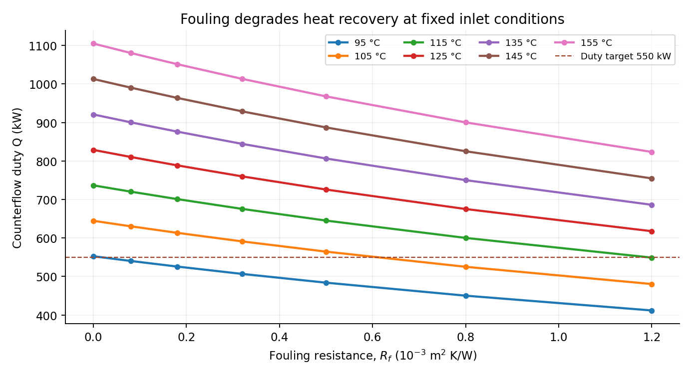
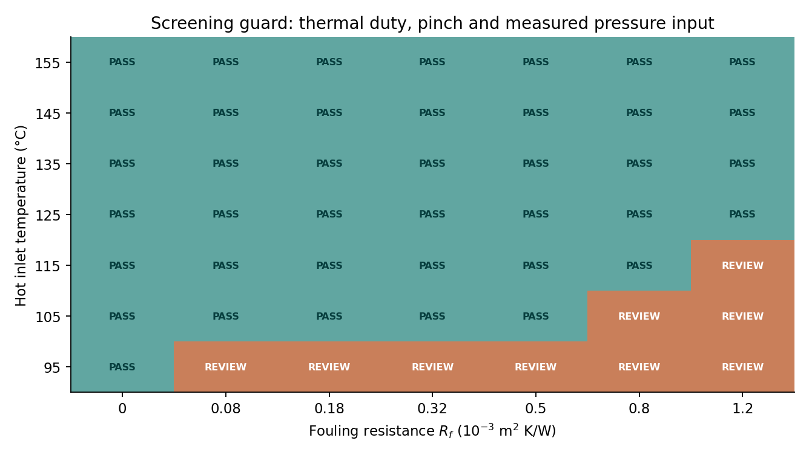

# Programmable Heat-Exchanger Fouling, Duty and Cleaning-Screening Models with paceval


*Industrial mathematical research demonstrator | 14 November 2026 | English edition | Synthetic engineering scenarios*

This project demonstrates how persistent mathematical execution graphs can link fouling resistance, heat duty, outlet temperature, pinch constraints and a transparent hypothetical cleaning score. **The original paceval Mathematical Engine has actually executed 24 mathematical model graphs on 49 parameter combinations through its remote MCP interface, version 4.26.** The included C++ application uses the original local paceval SDK and is source- and syntax-checked, but has **not** been linked or executed with the unavailable compatible Linux shared library. Remote and local evidence are separate.

## 1. Industrial use case and current state of the art

In chemical plants, food processing and district heating, a heat exchanger transfers energy between hot and cold fluids through a separating wall. Mineral scale, polymers, proteins, corrosion products or particulates can accumulate on that surface, adding thermal resistance and affecting duty. Operators compare inlet and outlet temperatures, flow-dependent heat capacities and pressure loss to decide whether the equipment still meets its process requirements and whether cleaning merits investigation.

A common engineering approach uses the logarithmic mean temperature difference (LMTD) for **known terminal temperature differences**. For **known inlet states and flow heat-capacity rates**, counterflow effectiveness and the number of transfer units (epsilon–NTU) give a different, energy-consistent calculation. Both are documented in ASHRAE Fundamentals. IDAES provides a general heat-exchanger NTU unit model for process-systems analysis. Industrial monitoring research in 2022–2023 studies joint thermal and hydraulic indicators. A 2025 taxonomy and 2026 reviews describe more detailed physical and data-driven fouling models. This research does not replace those plant-calibrated approaches or claim generic heat-exchanger design capability.

A hypothetical operator may ask: *At which of several specified fouling levels and hot-side inlet temperatures will a countercurrent unit still meet its heat-duty and minimum-temperature-approach constraints? Under explicit hypothetical economic assumptions, which cases produce a positive score for considering cleaning?* The demonstrator answers these narrowly defined mathematical questions without inventing measured fouling trajectories, pressure correlations, operating histories or economic savings.

## 2. Mathematical model and versions

For effective clean coefficient \(U_c\) and total fouling resistance \(R_f\), the model uses

\[
U_{eff}=\frac{1}{1/U_c+R_f}.
\]

**Model v1, terminal-data LMTD screening:** With two externally supplied, positive terminal temperature differences \(\Delta T_1\) and \(\Delta T_2\),

\[
Q_{LMTD}=U_{eff} A F_c\frac{\Delta T_1-\Delta T_2}{\ln(\Delta T_1/\Delta T_2)}.
\]

This is not a coupled model of hot and cold outlet temperatures. At equal terminal differences, the analytic LMTD limit is that common difference. A separate persistent paceval graph implements a near-equality series rather than the singular direct quotient.

**Model v2, counterflow epsilon–NTU:** Let \(C_{min}=\min(C_h,C_c)\), \(C_r=C_{min}/C_{max}\), \(NTU=U_{eff}A/C_{min}\), and \(z=e^{-NTU(1-C_r)}\). For \(C_r \ne 1\),

\[
\varepsilon=\frac{1-z}{1-C_r z},\qquad Q_{NTU}=\varepsilon C_{min}(T_{h,in}-T_{c,in}).
\]

For the balanced-capacity limit \(C_r=1\), the separate paceval expression is \(\varepsilon=NTU/(1+NTU)\). From the v2 duty, paceval graphs compute both outlet temperatures, the minimum terminal approach, duty and approach margins, and the hot/cold energy-balance residual. The host checks that parameters are within the mathematical domain before graph evaluation. In the main dataset \(C_r=0.8\).

The cleaning option uses a *specified* residual resistance after cleaning \(R_{remain}\). Both the current duty and the post-cleaning duty are calculated through actual paceval graphs. An **illustrative** cost score uses a chosen time horizon, an assumed utility cost per kWh of thermal shortfall, and a chosen cleaning expense. A positive signed advantage is an **input-dependent mathematical score**, not evidence of a measured economic benefit. A logical guard also requires a positive duty margin, sufficient temperature approach and an externally supplied pressure-drop measurement below the declared limit.

## 3. Inputs, outputs and actual mathematics execution

The synthetic examples contain 49 combinations of seven hot inlet temperatures (95–155 °C) and seven fouling resistances (0–0.0012 m² K/W). They fix cold inlet temperature, two heat-capacity rates, area and the remaining named assumptions in `examples/synthetic_corner_scenarios.csv`. The two terminal differences in v1 are specified independently and must **not** be inferred from the v2 outlet temperatures. The available data are not measured plant signals.

| Mathematical function / industrial purpose | Actual implementation | Graph / version or rationale |
|---|---|---|
| Fouled heat-transfer coefficient and terminal LMTD | paceval MCP, executed; local C++ source included | `Ueff`, `LMTD_direct`, `LMTD_series`, v1 |
| LMTD-proxy duty | paceval MCP, executed | `Q_LMTD_v1`, `Q_LMTD_series_v1`, v1 |
| Counterflow capacity ratio, NTU, effectiveness and duty | paceval MCP, executed | `capacity_ratio`, `NTU_v2`, `effectiveness_v2`, `Q_NTU_v2`, v2 |
| Outlet temperatures, pinch and conservation | paceval MCP, executed | `hot_out_v2`, `cold_out_v2`, `pinch_min_v2`, `energy_balance_residual_v2`, v2 |
| Signed duty/pinch margins and logical operation rule | paceval MCP, executed | `duty_margin_v2`, `pinch_margin_v2`, `operation_guard`, v2 |
| Hypothetical cleaning scenario and economic scores | paceval MCP, executed | `Q_clean_option`, `wait_cost_score`, `clean_cost_score`, `cleaning_advantage_score`, `cleaning_guard` |
| Sensitivity to fouling resistance | paceval MCP, executed | `sensitivity_U_Rf`, `sensitivity_Q_Rf` |
| Equal-capacity special limit | paceval MCP, registered and evaluated in the main unequal-capacity raster; mathematically meaningful branch only when equal | `balanced_effectiveness`; three equal-capacity remote cases also independently checked; local SDK branch selftest pending |
| Input validation, CSV parsing, choice of stable analytic branch and final status interpretation | C++ host source | Domain and I/O logic, not attributed to paceval |

The exact 24 expressions, owner, version and status are in [`results/math_execution_inventory.csv`](results/math_execution_inventory.csv) and [`src/formula_manifest.json`](src/formula_manifest.json). The source uses persistent handles, one-graph scalar and batch checks and a multi-graph batch path. The *local SDK path remains unexecuted*. `results/execution_evidence.json` distinguishes remote graph execution from source-only local functions.

## 4. Observed mathematical results

The remote MCP main calculation executed **24 graph formulas across 49 synthetic cases (1,176 graph-point evaluations)** without reported errors. A selected decimal transcription of actual returned results is in [`results/mcp_selected_observations.csv`](results/mcp_selected_observations.csv); it is *not* a lossless binary-precision export of the full MCP response. All selected numerical entries passed independent high-precision checks. The five additional TINC-tested v2 duty samples passed pointwise inclusion checks using the printed decimal interval bounds. Three equal-capacity limit evaluations were separately confirmed against a high-precision reference. This is not a global certificate or a guarantee for uncertain inputs.





The model-specific operation flag is true for **40 of 49** scenarios under the *declared synthetic assumptions*. The illustrative cleaning-score flag is true for **2 of 49**, both at the lowest hot inlet temperature and high fouling resistance. This should not be interpreted as an optimized cleaning calendar. The independent native/high-precision audit files remain in `results/` rather than turning the public publication into an engine-versus-native numerical comparison.

## 5. Original SDK reproduction on Linux

The original SDK files `paceval_main.h` and `paceval_main.cpp` are included unchanged under `src/`, preserving their copyright notices. A compatible external Linux runtime **must be provided separately**. No binary shared library is redistributed.

```bash
cmake -S src -B build -DCMAKE_BUILD_TYPE=Release \
  -DPACEVAL_RUNTIME=/absolute/path/to/libpaceval_linux_sharedLIB.so
cmake --build build -j
ctest --test-dir build --output-on-failure
```

When a compatible library is available, the program will parse the actual input CSV numeric cells using the original `paceval_dConvertStringToFloat` *after strict literal-only validation*, evaluate the real graphs through the SDK and write results using `paceval_dConvertFloatToString`. It also tests the `%`/`mod`, infix `min`/`max`, relational and boolean syntax. For audit-grade byte-exact serialization, preserve original IEEE-754 binary inputs separately; the SDK text representation is not claimed to be lossless.

Offline reference checks (do not need a local SDK runtime):

```bash
python validation/high_precision_reference.py .
python validation/check_project.py .
```

**Verification status, 14 November 2026:** Remote paceval MCP model evaluation succeeded. C++17 syntax compilation of application plus original SDK bridge succeeded. `cmake --build` with the original runtime and CTest **were not executed** because no compatible Linux library was present. The included test program and test declarations are not evidence of successful runtime tests.

## 6. Scientific boundaries and next investigation

The U-based model does not identify deposit composition, fouling kinetics, actual pressure drop, heat-transfer coefficient dependence on flow, phase change, bypass, shell-side maldistribution or temperature-dependent material properties. The synthetic cleaning model assumes that cleaning changes resistance to a specified residual value and neglects downtime and dynamic fouling recurrence beyond the entered lump-sum cost. Real deployment requires calibrated terminal measurements, hydraulic observations, mass and energy reconciliation, model identification and engineering safety review.

A **very-near-equal LMTD TINC trial** returned error code 145 on the remote engine. The same dedicated series graph evaluated exact and near equality successfully without interval mode. That TINC trial is an unresolved case, not a passed test. All five printed v2-duty TINC point samples passed their stated high-precision inclusion checks. Interval arithmetic on point inputs is distinct from propagating measurement uncertainty and from bounding every input in a continuum.

The best next pilot would use permitted plant snapshots to fit clean-condition coefficients and fouling trajectories, validate independent pressure-drop behavior, compare predicted outlet temperatures with holdout measurements, and test cleaning decisions against operational records. A genuine techno-economic decision would also have to incorporate production downtime, cleaning effectiveness and uncertainty.

## 7. Scientific references

- ASHRAE, *2025 Fundamentals*, Chapter 4, Heat Transfer, LMTD and effectiveness–NTU methods: https://handbook.ashrae.org/Handbooks/F25/SI/f25_ch04/f25_ch04_si.aspx
- IDAES PSE, *Heat Exchanger using the NTU Method*, v2.13.0: https://idaes-pse.readthedocs.io/en/stable/reference_guides/model_libraries/generic/unit_models/heat_exchanger_ntu.html
- Patil et al., *Monitoring fouling in heat exchangers under temperature control*, Chemical Engineering Research and Design 181 (2022): https://doi.org/10.1016/j.cherd.2022.02.032
- *Performance monitoring of heat exchanger networks using excess thermal and hydraulic loads*, Chemical Engineering Research and Design (2023): https://doi.org/10.1016/j.cherd.2023.10.031
- Augustin, Melo & Wilson, *Towards a common taxonomy for heat exchanger fouling*, Heat and Mass Transfer (2025): https://doi.org/10.1007/s00231-025-03595-z
- *MLP-based dynamic fouling prediction and health monitoring for plate heat exchangers*, Energy and Built Environment (2026): https://doi.org/10.1016/j.enbenv.2025.06.002
- Madhu et al., *Hybrid Intelligence for Fouling Prediction and Adaptive Clean-in-Place Optimization in Food Processing Heat Exchangers*, Journal of Food Science 91 (2026): https://doi.org/10.1111/1750-3841.71435
- paceval Mathematical Engine, public API and Product Brief: https://paceval.com/api/ and https://paceval.com/product-brief/

The research report [`paceval_Heat_Exchanger_Fouling_Whitepaper_EN.pdf`](paceval_Heat_Exchanger_Fouling_Whitepaper_EN.pdf) is the standalone scientific publication. The title artwork is a conceptual illustration, not an industrial photograph or a computed result.
