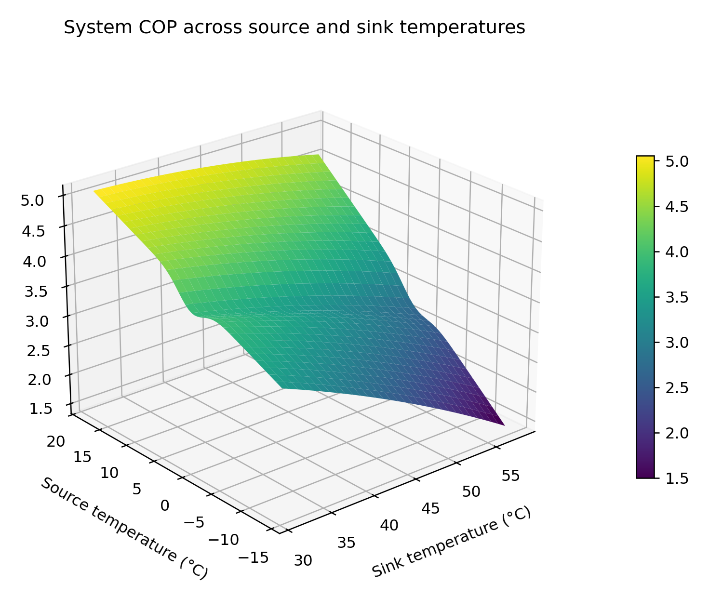
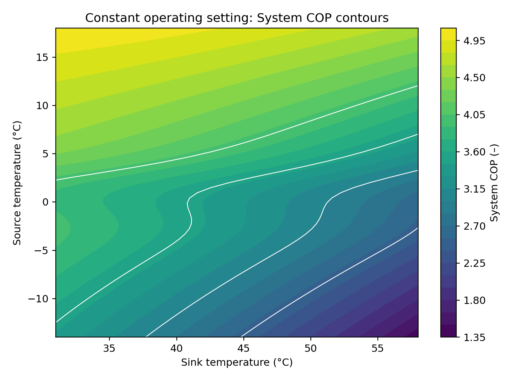
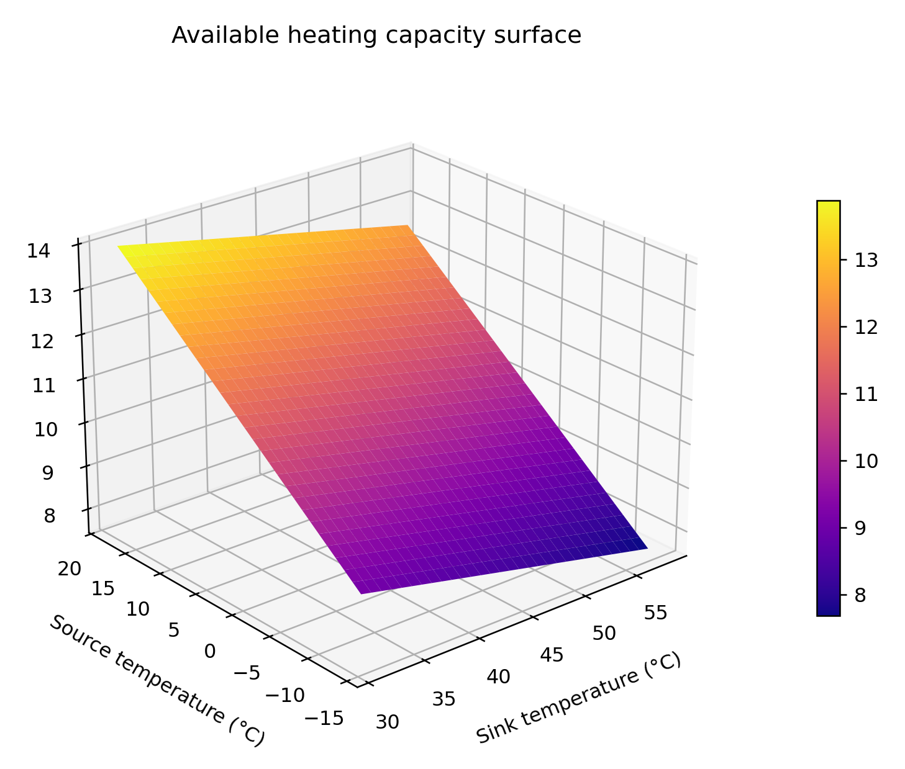
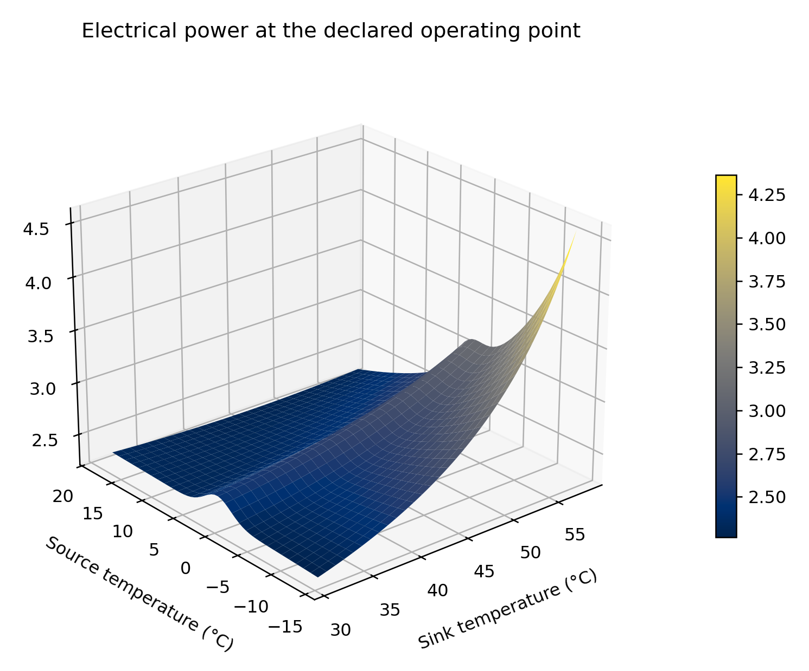
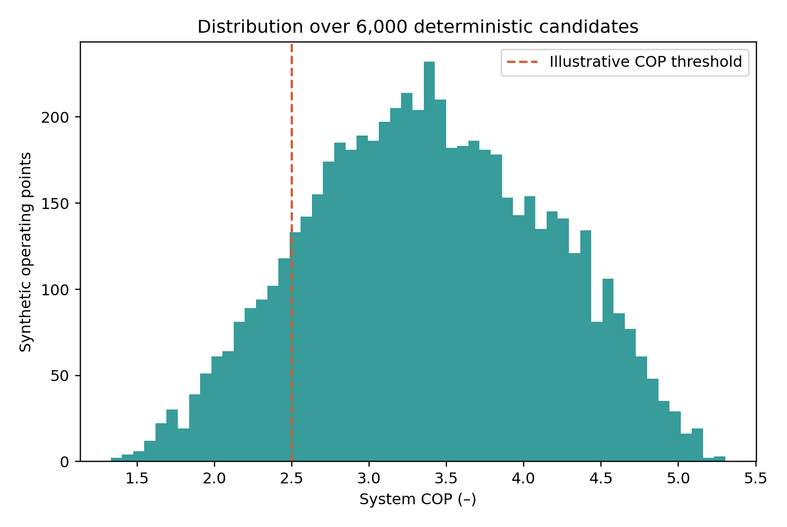
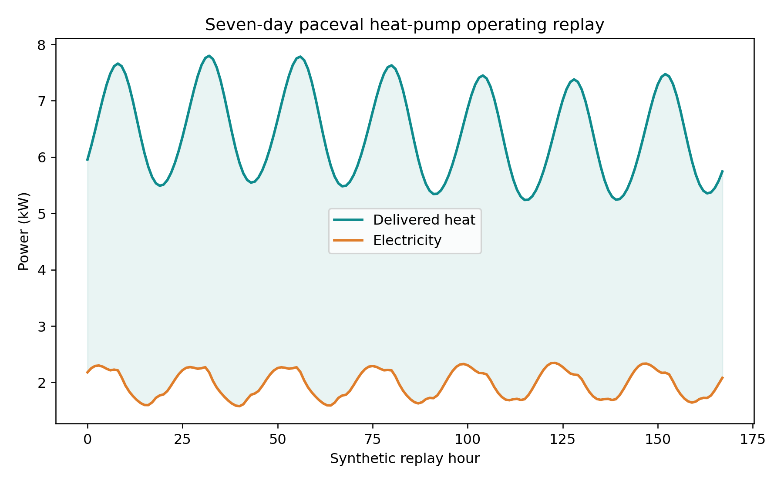
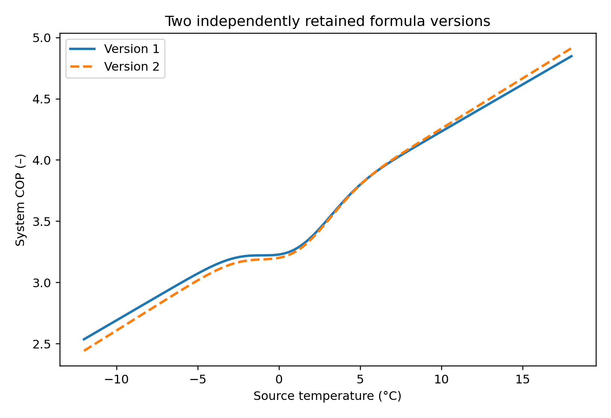
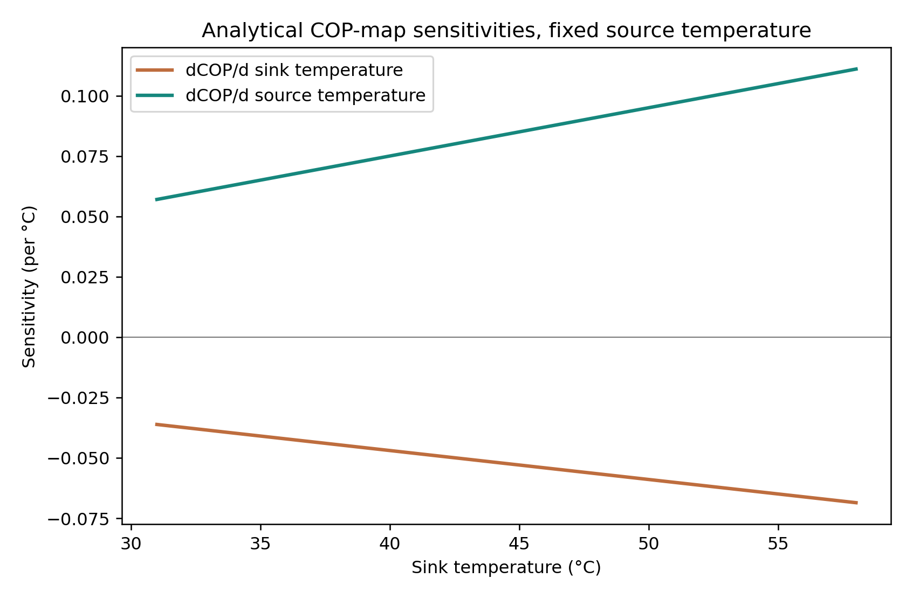
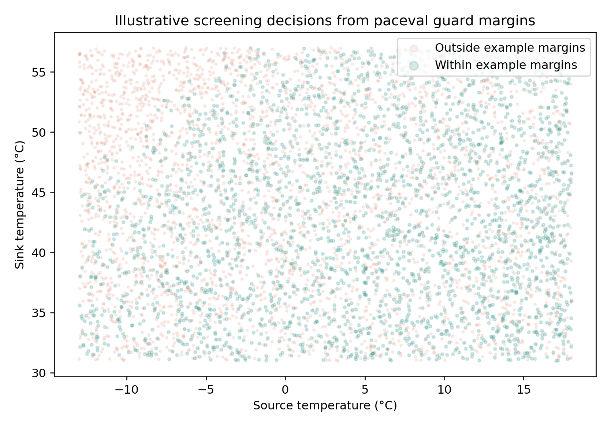

# Reusable Heat-Pump Twin Performance Expressions with paceval


*Concept illustration; not a computed research result or a calibrated equipment design. The scientific charts below use the actual paceval calculation outputs.*

**WP_038** is a reproducible C++ research demonstrator for persistent, versioned, batch-evaluated mathematical heat-pump operating maps. Its measured outcome is the successful execution of 23 relevant mathematical graphs, **6,000 synthetic operating points** and an independent numerical verification of the resulting performance expressions. These are **mathematical feasibility results**, not calibrated equipment predictions, an EN test, energy-saving measurements or a deployed building digital twin.

[**English scientific whitepaper (PDF)**](paceval_Heat_Pump_Twin_Whitepaper_EN.pdf) · [C++ implementation](src/heat_pump_twin.cpp) · [CMake project](src/CMakeLists.txt) · [Verified mathematics inventory](results/math_execution_inventory.csv) · [Original numerical outputs](examples/) · [Technical checks](results/)

## 1. Industrial use case and current state of the art

An installer, equipment manufacturer or energy-management developer needs to estimate heating output and electrical consumption as source temperature, heating water temperature and partial load change. In a practical digital twin, operating conditions may arrive from field devices and building models, and alternative performance maps may be assessed using the **same reproducible mathematics**. The input to this demonstrator is a synthetic set of operating points, not live telemetry: source and sink temperatures (°C), part-load ratio, demand (kW), nominal heating capacity (kW), auxiliary power (kW), electricity tariff (EUR/kWh), and time interval (h). Outputs are the mapped COP, available/delivered heat, electrical demand, system COP, source-side heat, costs, analytical sensitivities and declared screening margins.

Real engineering approaches range from component-based vapor-compression models and calibrated performance maps to data-driven surrogates and building simulation or co-simulation. **EnergyPlus** uses explicit temperature-dependent heating-capacity and energy-input-ratio curves; **Modelica** and the **Functional Mock-up Interface (FMI)** support equipment and system simulation or exchange. Recent 2026 reviews emphasize reliability, generalizability and real operating scenarios rather than judging a digital twin exclusively from a fit score. Separate experimental investigations of EN 14511 / EN 14825 testing report that frost, cycling and control-system interactions can materially affect seasonal results. See the [scientific sources](#9-scientific-references).

**Role of paceval:** the original mathematical engine evaluates all 23 important operating-map, derived-output, constraint-margin, model-version and sensitivity expressions as retained executable graphs, including composite end results. The host C++ program only generates valid operating points, runs the official batch API, chooses candidates from the calculated scores, checks inputs and exports results. No replacement paceval kernel is implemented.

## 2. Mathematical model and boundary

The research model is **synthetic, dimensionally declared and algebraic**. It is neither a refrigerant-cycle solver nor an experimentally calibrated heat-pump map. The base COP is an illustration of the polynomial family proposed in the WP_038 research outline, extended to a controlled sink-temperature curvature and source/sink interaction.

```math
C_1(T_s,T_k)=4.4+0.065T_s-0.045(T_k-35)-0.0006(T_k-35)^2+0.002T_s(T_k-35).
```

The independent, simultaneously retained V2 COP map has explicitly different coefficients (see [formula registry](examples/formula_registry.csv)). The declared operating domain is source temperature -15 to 20 °C, sink temperature 30 to 60 °C, 0.25 to 1.0 partial-load ratio, rated heat 5 to 20 kW, with valid positive efficiency throughout the tested domain.

```math
\begin{aligned}
F_{\mathrm{cap}} &= 1+0.014T_s-0.005(T_k-35),\\
F_{\mathrm{PLR}} &= 0.82+0.18\lambda-0.06(1-\lambda)^2,\\
F_{\mathrm{cold}} &=1-0.08\exp\left(-\left(\frac{T_s-1}{3}\right)^2\right),\\
Q_{\mathrm{avail}} &= Q_{\mathrm{rated}}F_{\mathrm{cap}},\\
Q_{\mathrm{heat}} &=\lambda Q_{\mathrm{avail}}.
\end{aligned}
```

The synthetic cold-weather factor is a **shape assumption**, not a calibrated defrost law. The model has no time-dependent compressor, refrigerant or ice state. Power and performance are computed as follows:

```math
\begin{aligned}
C_{\mathrm{eff}}&=C_1F_{\mathrm{PLR}}F_{\mathrm{cold}},\\
P_{\mathrm{comp}}&=Q_{\mathrm{heat}}/C_{\mathrm{eff}},\\
P_{\mathrm{el}}&=P_{\mathrm{comp}}+P_{\mathrm{aux}},\\
C_{\mathrm{system}}&=Q_{\mathrm{heat}}/P_{\mathrm{el}},\\
Q_{\mathrm{source}}&=Q_{\mathrm{heat}}-P_{\mathrm{comp}},\\
E_{\mathrm{heat}}&=Q_{\mathrm{heat}}\Delta t,\\
\mathrm{Cost}&=P_{\mathrm{el}}\Delta t\,c_{\mathrm{electric}}.
\end{aligned}
```

The model evaluates **signed margins**, not certified operating limits: delivered heat minus demand; 4.8 kW minus input electric power; and system COP minus 2.5. A host policy accepts a synthetic point only if all three margins are nonnegative. Two retained formula versions implement different weighting of electric input, unmet demand and inverse COP, and the host selects a candidate by minimizing the paceval-computed score. This selection is explicitly not an operational controller.

Analytical expressions for sensitivity of the *raw polynomial* COP map (not the derivative of the full dynamic system COP) are also paceval graphs:

```math
\begin{aligned}
\frac{\partial C_1}{\partial T_s}&=0.065+0.002(T_k-35),\\
\frac{\partial C_1}{\partial T_k}&=-0.045-0.0012(T_k-35)+0.002T_s.
\end{aligned}
```

## 3. Verified calculations and paceval execution ownership

The full calculation path was executed against the **real original paceval Linux SDK**, not a mock or native-only application. Graph objects are constructed once and reused on many independent input sets. The official `paceval_dGetMultipleComputationsResultsExt` API drives the main workload. A scalar call checks the one-point interpretation of every graph. Version 1 and 2 are preserved simultaneously.

| Mathematical function / industrial purpose | Actual execution | Graph or scope |
|---|---|---|
| COP surfaces and parameter sensitivities | **paceval** | COP V1, V2, two partial derivatives |
| Temperature-dependent heating capacity and heat delivery | **paceval** | Capacity modifier, available capacity, delivered heat |
| Part-load and synthetic cold-weather modifiers | **paceval** | PLR modifier, cold factor, effective COP |
| Compressor and total electrical input | **paceval** | Compressor power, electric power |
| System COP and source-side heat | **paceval** | Composite COP V1/V2, source extraction |
| Heat-demand, electric-power and COP margins | **paceval** | Three signed constraint expressions |
| Composite alternative policy costs | **paceval** | Policy scores V1 and V2 |
| Thermal energy and electric cost | **paceval** | Energy and tariff-based cost functions |
| Input validity, candidate selection, CSV export | **C++ host** | Deterministic application control |
| Independent mathematical oracle | **C++ and Python only for verification** | Not public result generation |

The scalar aggregated replay-energy ratio is also a dedicated paceval graph after host temporal summation. The complete verified register of all expressions and their owners is [`results/math_execution_inventory.csv`](results/math_execution_inventory.csv). The registered expression text is recorded in [`examples/formula_registry.csv`](examples/formula_registry.csv).

| Actual outcome | Completed scope |
|---|---:|
| Independently registered reusable paceval graphs | 23 |
| Synthetic operating candidates | 6,000 |
| Multi-graph candidate batch values | 132,000 |
| Source/sink surface points | 3,721 |
| Synthetic seven-day operating periods | 168 |
| Model-version sweep points | 101 |
| Independent native C++ values audited | 4,963 |
| Independent 80-digit decimal values audited | 880 |
| Example policy accepted candidates | 2,613 |
| Linux CMake + CTest | PASS |

The synthetic seven-day replay produces **1,080.19 kWh delivered heat** and **331.20 kWh electricity consumption** in its fixed scenario, a ratio of **3.2615**. This is a *replay energy ratio* for a defined synthetic profile, not a measured seasonal performance factor, SCOP rating or claim about a commercially available unit.

## 4. Nine computed scientific visualizations

Every numbered figure below is produced from the real paceval result CSVs by [`src/make_figures.py`](src/make_figures.py). Each exists as PNG and vector PDF. The hero above is a concept illustration and is not derived from those calculations.

| Operating-map results | Sensitivity and time studies |
|---|---|
|  |  |
|  |  |
|  |  |
|  |  |



## 5. Build and full reproduction

Requirements: Linux x86-64, compatible external paceval runtime (not distributed in this package), a C++17 compiler and CMake 3.16 or later. The original `paceval_main.h` and `paceval_main.cpp` are in `src/`. Their existing upstream notices are preserved. The C++ project was tested with the external original paceval shared library.

```bash
cmake -S src -B build -DCMAKE_BUILD_TYPE=Release \
  -DPACEVAL_RUNTIME=/absolute/path/to/libpaceval_linux_sharedLIB.so
cmake --build build -j
ctest --test-dir build --output-on-failure
./build/heat_pump_twin --out . --cases 6000
python3 -m pip install -r src/requirements.txt
python3 src/high_precision_reference.py
python3 src/verify_results.py
python3 src/make_figures.py
python3 src/make_whitepaper.py
python3 src/check_readme_math.py
```

The deterministic C++ application produces the [`examples/`](examples/) CSVs, model registry and [`results/execution_summary.txt`](results/execution_summary.txt). Independent audit records include [`results/high_precision_audit.json`](results/high_precision_audit.json), [`results/scientific_consistency_audit.json`](results/scientific_consistency_audit.json), and the [reproduction log](results/reproducibility.txt). The CTest integration case runs a smaller **real SDK** workload.

## 6. Scientific limitations and industrial interpretation

This work establishes mathematical execution and reuse, **not a physical digital twin** with sensor synchronization, thermal storage, compressor cycling, transport delay, refrigerant properties or empirically measured frost/defrost. It uses fictional coefficients, fixed synthetic operating profiles and an explicitly declared policy threshold. Its simple energy aggregation is not EN 14825-compliant SCOP, and temperatures or energy measurements are not attributable to any manufacturer. Not all physical operating states can be represented by a static COP polynomial; performance verification against measured laboratory maps and explicit transient models would be essential before practical deployment. There is no established whole-system performance, energy-saving or speed claim.

The appropriate industrial continuation is to fit on **licensed laboratory or in-field datasets**, preserve calibration and validation partitions, connect an FMI/Modelica or EnergyPlus host, and investigate frost, part-load cycling, auxiliary electricity and uncertainty separately. These tasks go beyond the demonstrated mathematical kernel.

## 7. Reproducibility and research integrity

Graph construction, model versions, input domains, deterministic seeds and generation paths are visible in [`src/heat_pump_twin.cpp`](src/heat_pump_twin.cpp). No measured equipment readings were substituted for synthetic data. All independent numerical audits are provided in `results/`, but the public README and whitepaper intentionally do not present competitive C++-versus-paceval precision tables or processor-dependent runtime speed comparisons. The result verification relies on executed code, not a pictorial assertion.

The checker [`src/check_readme_math.py`](src/check_readme_math.py) validates `math` fences, prohibited commands, basic bracket balance and every local markdown link; it contains successful and intentionally failing regression examples. This is a static preflight and does not replace viewing the deployed README with GitHub's rendering engine.

## 8. Scope of potential industrial integration

An application could use a heat-pump map graph as a repeatable, version-controlled mathematical kernel for checking many candidate operating points, combining it with a separate building model or supervisory controller. To turn the demonstration into a real digital twin, an integrator would need manufacturer measurements, certification context, interoperable system integration, fault handling, calibrated uncertainty and a validated control policy.

## 9. Scientific references

1. [Applied Energy (2026): Modeling methods for chiller and heat pump systems in buildings, digital-twin systematic review](https://doi.org/10.1016/j.apenergy.2026.127632).
2. [Renewable and Sustainable Energy Reviews (2026): State-of-the-art digital twins in HVAC+R systems](https://doi.org/10.1016/j.rser.2025.116601).
3. [EnergyPlus Engineering Reference: Plant Loop Heat Pumps](https://energyplus.readthedocs.io/en/stable/guides/engineering-reference/16.6-plant-loop-heat-pumps.html).
4. [IEA Heat Pumping Technologies (2026): EN 14825 versus dynamic load testing](https://heatpumpingtechnologies.org/publications/experimental-comparison-of-heat-pump-seasonal-efficiency-using-en14825-and-a-dynamic-load-emulation-approach/).
5. [Functional Mock-up Interface (FMI) specification](https://fmi-standard.org/docs/main/).
6. [Modelica language specification](https://specification.modelica.org/).
7. [paceval Mathematical Engine](https://github.com/paceval/paceval).

**Research demonstrator • November 2026 • No product certification or industrial deployment is claimed.**
