# Hydraulic Digital Twin: Pump-Efficiency and Network Formula Modules with paceval

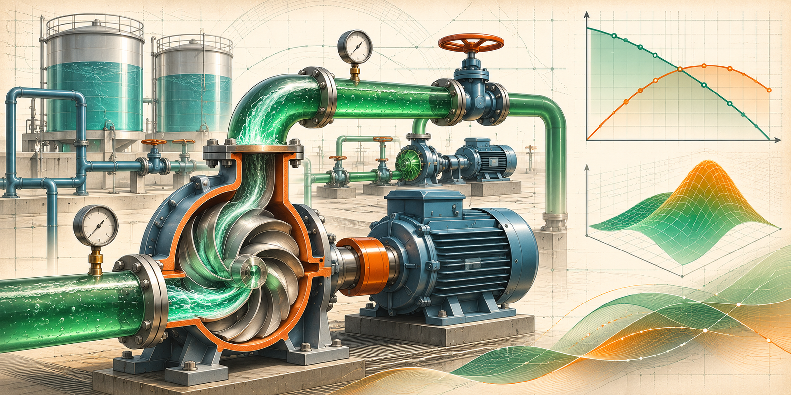

*Original cover concept illustration (2400 × 1200 pixels, 2:1). It is not a photograph of an installed pumping station or a result of computational fluid dynamics. The numbered scientific diagrams below are created from executed original paceval SDK output files.*

**A fully reproducible, original-SDK C++ research demonstrator with 86 persistent paceval expression graphs, 20 interchangeable pump-efficiency versions, and actual multi-graph batch execution.** The example investigates a synthetic two-branch hydraulic network, a pump/system operating-point calculation, efficiency and power models, analytical sensitivities, hourly energy cost and a clearly labeled steady water-quality surrogate.

**[English research whitepaper (PDF)](paceval_Hydraulic_Pump_Twin_Whitepaper_EN.pdf)** · [Complete C++ program](src/hydraulic_pump_twin.cpp) · [CMake configuration](src/CMakeLists.txt) · [Formula inventory](examples/formula_registry.csv) · [Mathematical execution inventory](results/math_execution_inventory.csv)

## 1. Industrial motivation and current research context

Pump stations, industrial process-water networks and other fluid-handling systems need to predict delivered flow, head, electricity demand and operating limits when pump speed, piping resistance or equipment assumptions change. A mathematical Digital Twin can evaluate precise, versioned pump-curve and efficiency formulas repeatedly while retaining a separately verified network topology and operating policy.

The **[U.S. EPA EPANET 2.2](https://usepa.github.io/EPANET2.2/)** network model uses pump head-flow curves, speed settings, efficiency functions and energy-price schedules. The [U.S. Department of Energy's Pump Systems](https://www.energy.gov/cmei/ito/pump-systems) guidance emphasizes matching pumps to operating requirements, whereas [UNIDO pump-system guidance](https://www.imeep-eg.org/wp-content/uploads/2022/08/9-UNIDO-PSO-Manual_optimized.pdf) cautions that affinity relationships alone do not determine the actual network operating point.

This research intentionally **does not implement or replace EPANET**. It tests the reusable mathematical kernels of a smaller network with an analytic solution and independently verified physical balances. That narrower scope is appropriate to testing paceval's expression-graph execution, but not to declaring a real pumping plant efficient, safe or compliant.

### What is new compared with the original WP_043 proposal?

The supplied [five-page original WP_043 proposal](inputs/WP_043_Hydraulic_Twin_Pump_Efficiency_Functions.pdf) began with a pump-power expression and a suggested small hydraulic network. Here we execute the complete defined *mathematical* pump, network and operating-point functions: the energy calculation is not supplied an unexplained constant head. Twenty independently registered formula versions, their resulting power and cost graphs, additional flow/quality equations, analytical sensitivities, and complete batch-output validation make the demonstration more substantial.

## 2. Defined mathematical model and operating envelope

A pump supplies a common pressure head to two parallel branches. Flow rate is in cubic metres per second, hydraulic head in metres and power in kilowatts. For a speed ratio \(n\), the simplified hydraulic pump and network curves are:

```math
H_p(Q,n)=H_0 n^2-aQ^2,
\qquad
H_s(Q)=H_{static}+k_{eq}Q^2.
```

The branch head losses satisfy \(k_A Q_A^2=k_BQ_B^2\) and \(Q_A+Q_B=Q\). The equivalent network resistance and operating flow are consequently:

```math
k_{eq}=\left(\frac{1}{\sqrt{k_A}}+\frac{1}{\sqrt{k_B}}\right)^{-2},
\qquad
Q_*=\sqrt{\frac{H_0 n^2-H_{static}}{a+k_{eq}}}.
```

All of these expressions are executed by paceval, including two separate branch-flow formulas, branch head-loss formulas, the pump–system residual and the explicit operating-flow expression. C++ validates the head-balance result after evaluating it, without replacing the paceval calculation with its own numerical hydraulic solver.

The base synthetic hydraulic-efficiency map is:

```math
\eta_0(Q,n)=0.78-0.20\left(\frac{Q/n-0.145}{0.12}\right)^2.
```

The independently registered version \(j\) changes the map by a declared, small shape perturbation:

```math
\eta_j(Q,n)=\eta_0(Q,n)\left[1+0.0006(j-11)\sin(12Q/n)\right],
\qquad j=1,\ldots,20.
```

**No efficiency curve is based on measured pump tests.** The model is evaluated only over its prescribed finite flow/speed range; extrapolation, pump startup, cavitation, wear and viscosity variation are outside its tested scope.

For each registered efficiency function, paceval also evaluates electrical input power and hourly cost:

```math
P_{hyd}=\frac{\rho gQH_p}{1000},
\qquad
P_{elec,j}=\frac{P_{hyd}}{\eta_j\eta_m},
\qquad
C_j=p_{el}P_{elec,j}.
```

The motor efficiency \(\eta_m=0.94\) is distinct from the hydraulic efficiency. Price \(p_{el}\) has an **illustrative arbitrary currency per kWh**, and an hourly price multiplied by kW yields an illustrative hourly cost. The time-series sum is a stateful aggregation in the C++ host, documented rather than misattributed to paceval.

### Two-branch synthetic tracer surrogate

A mathematical concentration model is included as a test of the engine's compositional expressions:

```math
c_A=c_{in}\exp(-k_dV_A/Q_A),
\quad
c_B=c_{in}\exp(-k_dV_B/Q_B),
\quad
c_{mix}=\frac{Q_Ac_A+Q_Bc_B}{Q}.
```

This is a **steady attenuation surrogate**, not a physically validated water-quality transport solver. It does not simulate transient advection, dispersion, storage tanks, mixing dynamics, hydraulic contamination sources or chemical kinetics.

## 3. Reference model assumptions

| Declared input | Synthetic value |
|---|---:|
| Pump shutoff head \(H_0\) | 58 m |
| Head-flow coefficient \(a\) | 1,250 in consistent quadratic units |
| Static head \(H_{static}\) | 15 m in the main trace |
| Pipe coefficients \(k_A,k_B\) | 2,800 and 3,700 |
| Fluid density \(\rho\) | 998.2 kg/m³ |
| Gravitational acceleration \(g\) | 9.81 m/s² |
| Motor efficiency \(\eta_m\) | 94% |
| Synthetic inlet concentration | 1.0 mg/L |
| Decay coefficient and residence-volume terms | 0.012 s⁻¹, 3.5 m³, 5.0 m³ |
| Time discretization for schedule | 1 hour |

The C++ application rejects non-finite or out-of-contract numeric inputs before graph evaluation. The generated samples and scalar tolerance checks are deterministic. Each formula definition and input assumption is preserved in the source and generated CSV files.

## 4. Real paceval SDK execution results

The following numbers come from the **actual original runtime execution**, not a projected or simulated API call count.

| Executed metric | Verified result |
|---|---:|
| Persistent original paceval computation graphs | **86** |
| Independently versioned efficiency formulas | **20** |
| Versioned electrical-power formulas | **20** |
| Versioned hourly-cost formulas | **20** |
| Additional network/physical/quality/derivative graphs | **26** |
| Successful multi-graph batch outputs | **1,164,440** |
| Prescribed parameter-sweep samples | **6,000** |
| Pump/system operating-surface points | **3,721** (61 × 61) |
| Hourly operating points | **48** |
| Independently audited C++ values | **23,520** |
| Independently checked 80-digit values | **3,559** |
| CMake / CTest | **1 / 1 passed** |

For the illustrative 48-hour speed and tariff profile, the base model sums to **2,865.48 kWh** and **555.41 arbitrary currency units**. The different formula versions change these values by construction. They are not field measurements or credible estimates of energy savings in a factory.

The [execution summary](results/execution_summary.json), [SDK run log](results/sdk_execution_log.txt) and [independent high-precision audit](results/high_precision_validation.json) preserve the verification context. The actual mathematical definitions and execution ownership are independently inspectable in [examples/formula_registry.csv](examples/formula_registry.csv) and [results/math_execution_inventory.csv](results/math_execution_inventory.csv).

## 5. Scientific diagrams from executed paceval outputs

The figures are generated from recorded original-SDK CSVs, **not image-generation approximations**. Each numbered figure has an equivalent vector PDF in [figures/](figures/).

| Function family | Figure |
|---|---|
| Pump and network heads | 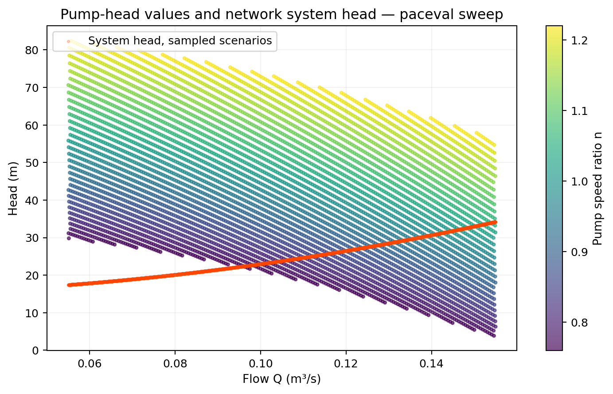 |
| Pump hydraulic efficiency | 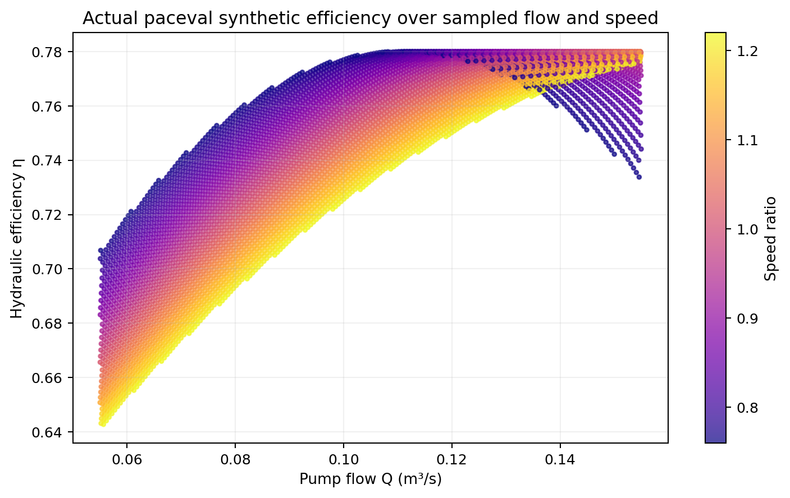 |
| Operating-point flow | 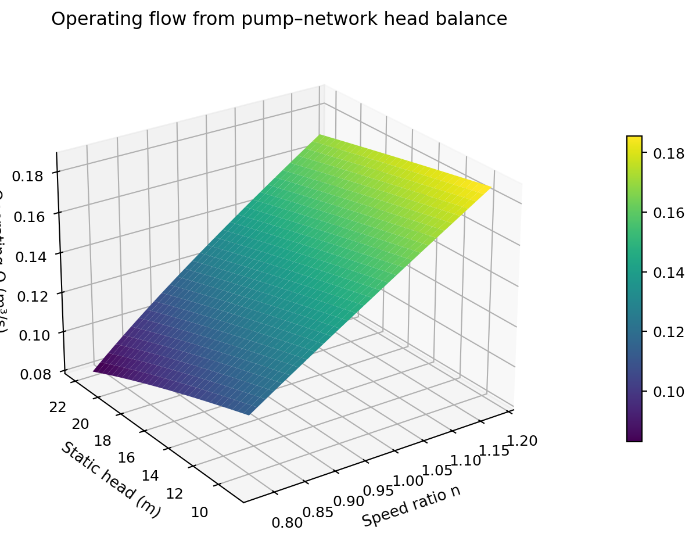 |
| Electrical power | 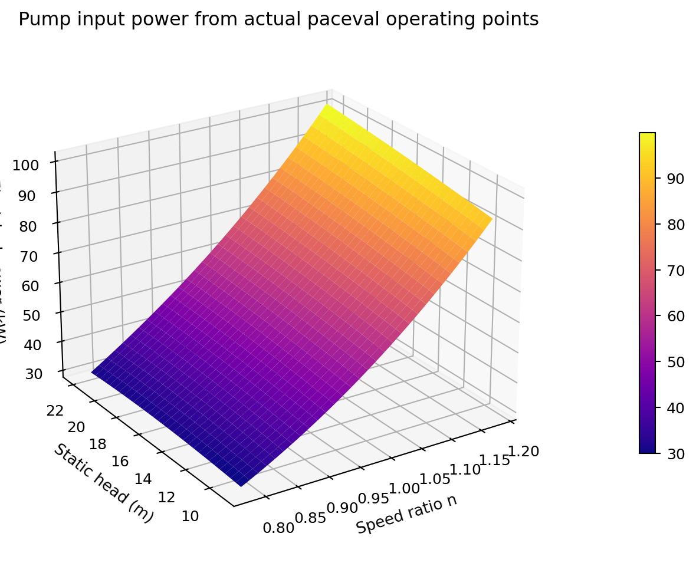 |
| Steady tracer surrogate | 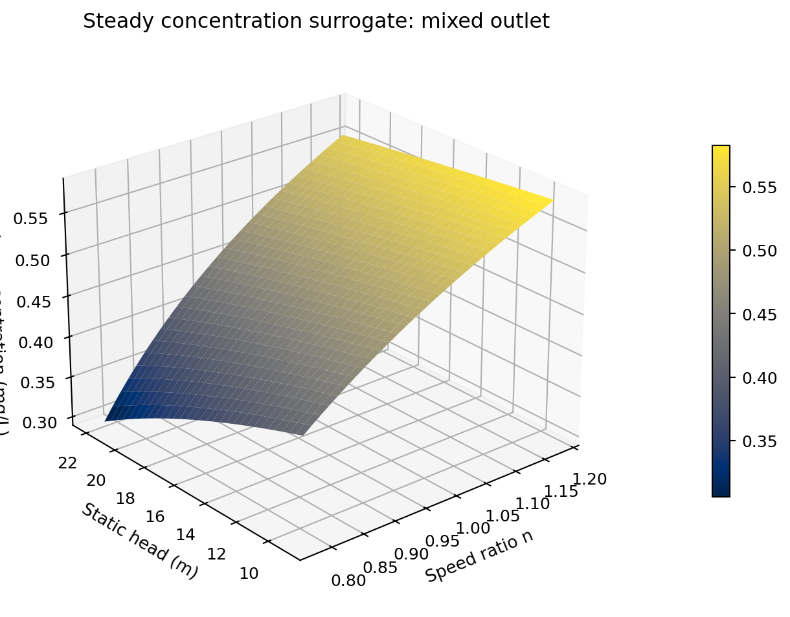 |
| Hydraulic head balance | 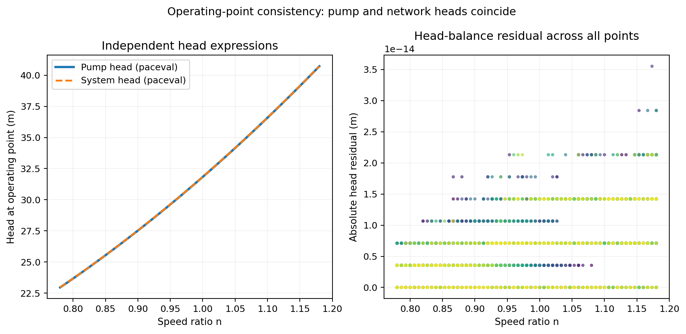 |
| Branch-flow split | 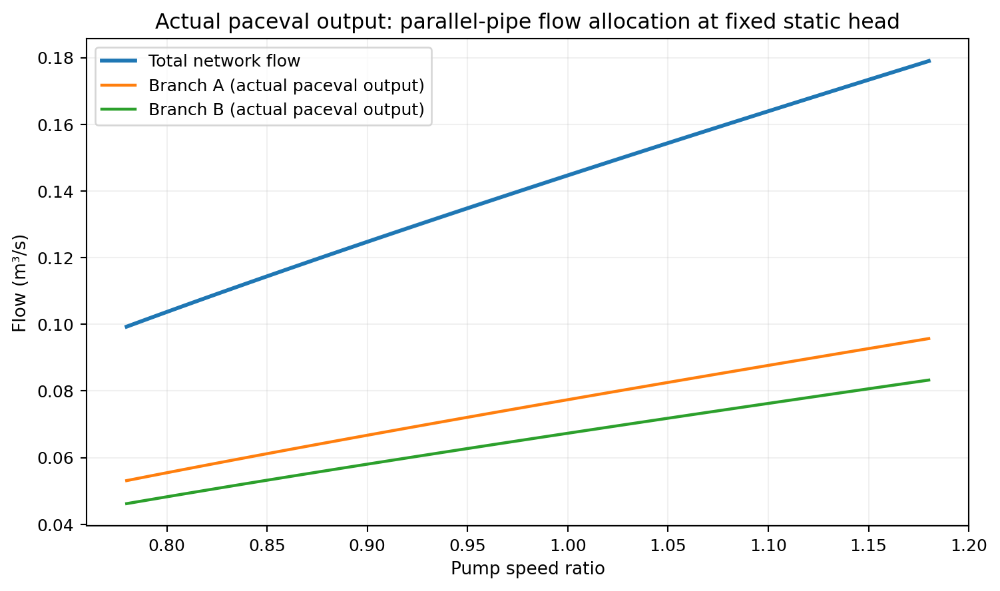 |
| Power during the operating schedule | 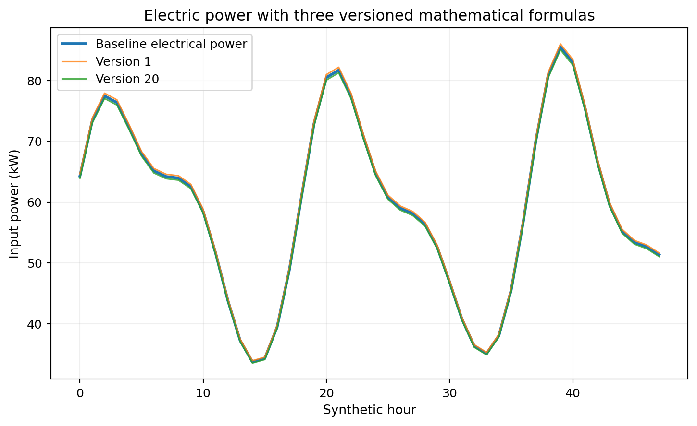 |
| Accumulated electricity use | 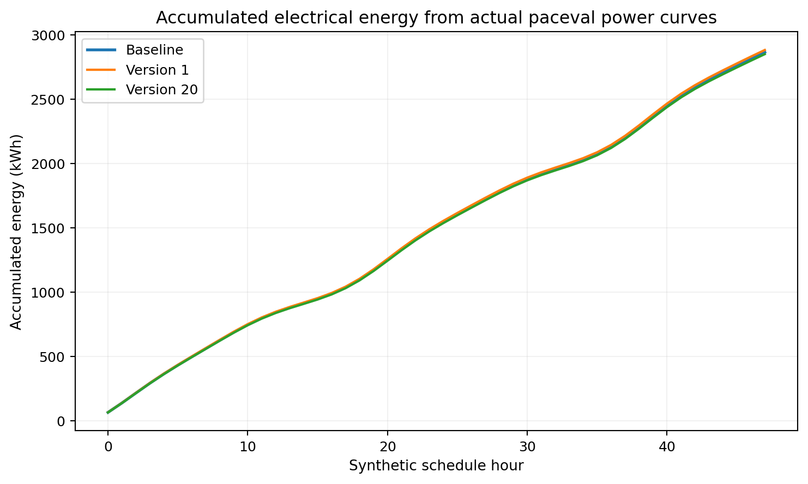 |
| Twenty formula versions | 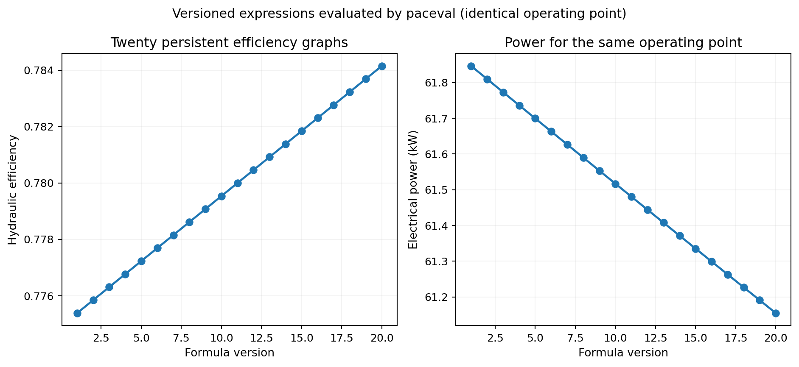 |
| Off-equilibrium residual screening | 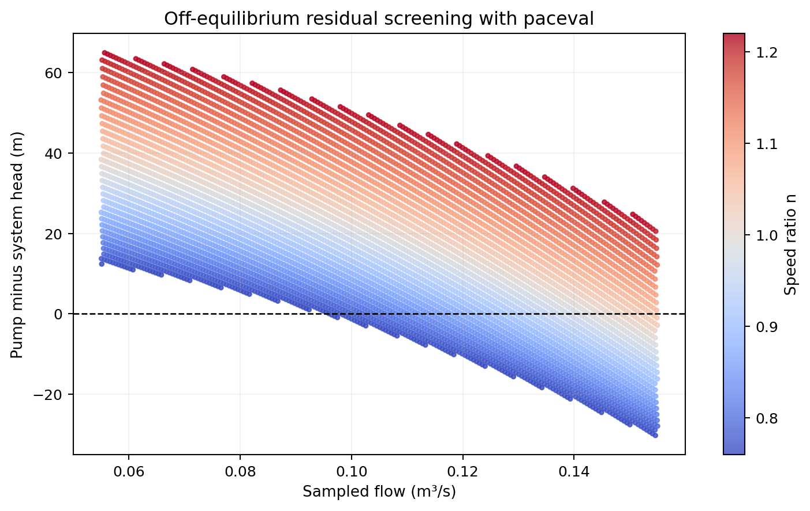 |
| Mathematical quality/energy interaction | 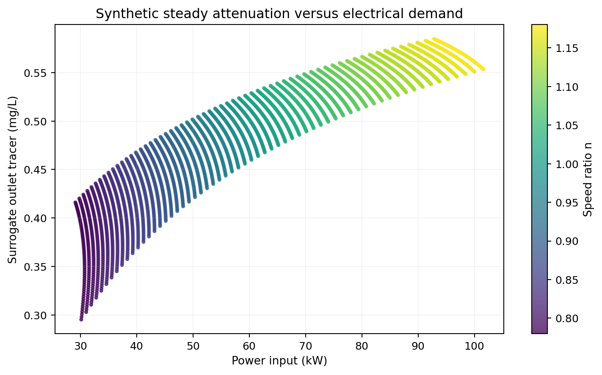 |

## 6. Build and execute using the original paceval engine

**Dependencies:** Linux x86-64, C++17, CMake ≥ 3.16, external compatible original paceval Linux shared library. `src/paceval_main.h` and `src/paceval_main.cpp` are the SDK interface files. No externally licensed original runtime binary is redistributed in this GitHub project.

```bash
cmake -S src -B build -DCMAKE_BUILD_TYPE=Release \
  -DPACEVAL_RUNTIME=/absolute/path/to/libpaceval_linux_sharedLIB.so
cmake --build build -j
ctest --test-dir build --output-on-failure
./build/hydraulic_pump_twin --out . --surface 61 --sweep 6000 --hours 48
```

Graph construction uses `paceval_CreateComputation`; all of the formula families are evaluated via `paceval_dGetMultipleComputationsResultsExt`, including the operating-point graph. The host checks the SDK's return status **and each individual error code**; for this runtime revision the multi-graph batch return is `false` on success. Graphs are registered once and destroyed at the end of execution.

The program exports [operating sweep data](examples/paceval_operating_sweep.csv), [operating surface data](examples/paceval_operating_surface.csv), [hourly trace data](examples/paceval_operating_trace.csv) and [the 20-formula profile](examples/paceval_formula_version_profile.csv). These files can be independently inspected before running any graph generator.

## 7. Independent validation and repeatability

The C++ program compares selected values against a separate native numerical oracle. A Python validation re-evaluates selected persisted outputs at **80 decimal digits** and checks them against each reference expression. The audit checks real exported flow, energy, head, concentration and formula-version values without overwriting any SDK result.

```bash
python3 -m pip install numpy pandas matplotlib pillow mpmath reportlab
python3 src/high_precision_reference.py
python3 src/verify_results.py
python3 src/make_figures.py
python3 src/make_whitepaper.py
python3 src/check_readme_math.py
```

The result verifier inspects all exported operating, batch and trace rows, including mass balance, model consistency, head residuals and hourly aggregation. Mathematical expression support is documented in the C++ source, rather than presumed from mathematical display notation. The source code differentiates the true SDK evaluation from independently calculated reference values.

## 8. Scientific limitations and possible follow-up

This study demonstrates the feasibility of **a mathematical hydraulic digital twin kernel**, not real-world hydraulic accuracy. The coefficients are synthetic. The simplified two-branch network uses a closed-form operating point, while a general EPANET-quality solver would handle time-varying controls, valves, tanks, loops, pressure-dependent demands and transport. The cost values are only illustrative. A real industrial follow-up should replace the synthetic coefficients with measured and provenance-tracked pump curves, demonstrate physical-model residuals on held-out measured data and test integration with an independent hydraulic network solver.

The original five-page proposal discussed comparative runtime benchmarks. Following the current publication standard, this research package **does not claim a processor-independent speedup**, an application-level energy saving or any financial outcome from adopting paceval. Independent correctness checks remain available in the audit files; no C++-paceval numerical difference tables are advertised in the scientific whitepaper.

## 9. Primary references

1. U.S. EPA, [EPANET 2.2 User Manual](https://usepa.github.io/EPANET2.2/), pump curves, efficiency maps and network hydraulics.
2. U.S. Department of Energy, [Pump Systems and assessment tools](https://www.energy.gov/cmei/ito/pump-systems).
3. UNIDO, [Manual for Industrial Pump Systems Assessment and Optimization](https://www.imeep-eg.org/wp-content/uploads/2022/08/9-UNIDO-PSO-Manual_optimized.pdf).
4. [paceval Mathematical Engine source and SDK](https://github.com/paceval/paceval).
5. [Original WP_043 research proposal](inputs/WP_043_Hydraulic_Twin_Pump_Efficiency_Functions.pdf).

**Release:** 13 November 2026. Research demonstrator, not a calibrated operational or safety-certified system.
