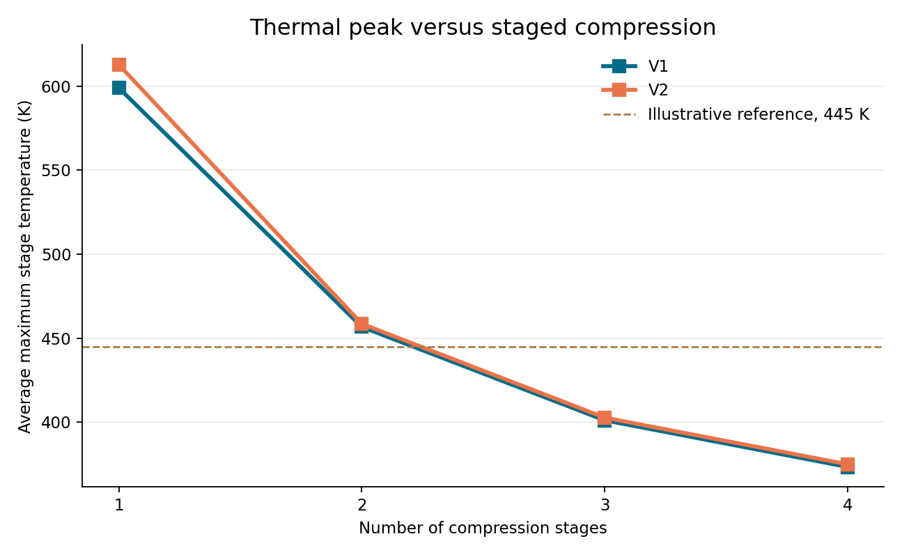
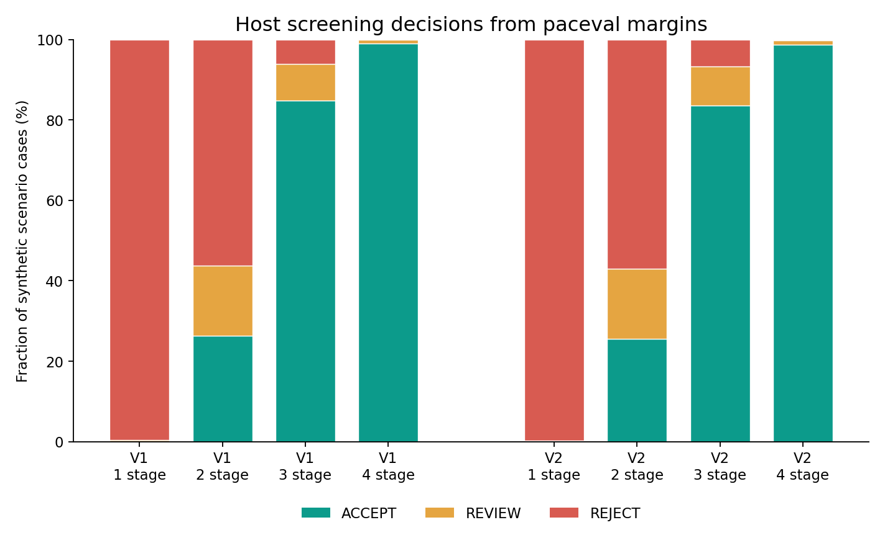
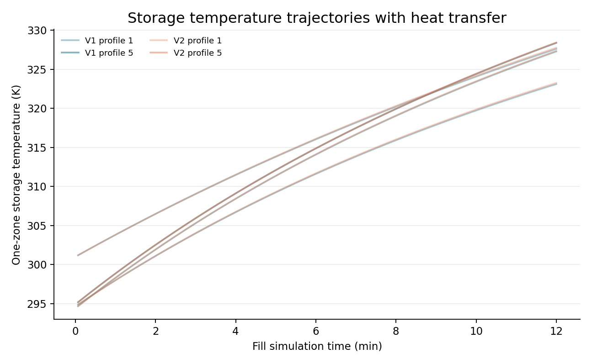

# Hydrogen Compression and Storage Thermal Envelope with paceval


**WP24 | Original paceval Mathematical Engine | Functionality and feasibility study | 15 November 2026**

This reproducible C++ research demonstrator uses the genuine paceval Mathematical Engine to evaluate an explicit polytropic hydrogen-compression model, multi-stage intercooling, a one-zone compressed-hydrogen storage energy balance and mathematical operating margins. The study is **not** an engineering qualification, a hydrogen-safety assessment, a fueling protocol or a validated real-gas design tool. The input parameters and process scenarios are synthetic.

The [English scientific whitepaper](paceval_Hydrogen_Compression_Storage_Whitepaper_EN.pdf) describes the industrial context, mathematical models, figures, results and research limits.

## 1. Industrial use case and current state of the art

Hydrogen produced at comparatively low pressure often requires compression before storage, transport or dispensing. Compressor staging and intercooling affect discharge temperature, specific work and heat rejection. During filling, a rigid storage vessel also heats up because pressurized hydrogen brings enthalpy into the system while heat is exchanged with its surroundings. Engineers must screen many combinations of inlet conditions, pressure targets, efficiency assumptions, cooling effectiveness and thermal limits.

The U.S. Department of Energy [explains gaseous hydrogen compression](https://www.energy.gov/cmei/fuels/gaseous-hydrogen-compression), including reciprocating, diaphragm, ionic and centrifugal technologies. Accurate high-pressure thermophysical calculations instead require a suitable real-gas property model. The [NIST/Leachman hydrogen equations of state](https://www.nist.gov/publications/fundamental-equations-state-parahydrogen-normal-hydrogen-and-orthohydrogen) are a relevant established foundation. Studies published in [2025 on non-uniform tank filling temperatures](https://doi.org/10.1016/j.ijhydene.2025.152513) highlight why the simple single-zone storage model used here is not a substitute for experimentally validated high-pressure flow/heat-transfer modeling. For fueling-station applications, [ISO 19880-1:2020](https://www.iso.org/standard/71940.html) provides the relevant regulatory context but is not demonstrated as satisfied by this study.

**What paceval does:** persistent mathematical execution graphs evaluate temperature, pressure, shaft-work proxies, cooling heat removal, sensitivity derivatives, versioned composite scores, storage state-update equations and Boolean operating guards. **What C++ does:** CSV validation, candidate selection, multi-stage orchestration, time stepping, result collection, statuses and I/O. A separately written native C++ reference and 80-decimal-place Python calculations check the recorded numerical results; they do **not** generate the published paceval outputs.

## 2. Mathematical models

**Polytropic ideal-gas approximation.** For one compression stage with inlet/outlet pressure $P_1,P_2>0$, inlet temperature $T_1$ and effective polytropic efficiency $\eta_p$:

```math
a=\frac{\gamma-1}{\gamma\eta_p},\qquad T_2=T_1\left(\frac{P_2}{P_1}\right)^a
```

The specific enthalpy-rise proxy is $w=c_p(T_2-T_1)$ in J/kg, with specific work reported in kJ/kg. Stages have equal pressure ratios. Each stage's intercooler outlet is $T_{c}=T_{cool}+(1-\varepsilon)(T_2-T_{cool})$. The host carries the **actual paceval-computed** cooled temperature into the next paceval stage evaluation. The total power and heat-duty accumulators are themselves updated by paceval graphs.

**Two model versions.** V1 uses a fixed input $\eta_p$. V2 uses a clearly hypothetical pressure-ratio- and inlet-temperature-dependent correction:

```math
\eta_{p,2}=\eta_p-0.027\frac{(P_2/P_1-2.5)^2}{1+(P_2/P_1-2.5)^2}-0.00016(T_1-300)
```

This coefficient choice is a synthetic model revision, not a measured compressor performance map.

**Single-zone rigid storage screening.** For ideal-gas inventory mass $M$, tank temperature $T$, inflow $\dot m$, constant heat capacities $c_p,c_v$ and heat conductance $UA$, the model is:

```math
M c_v\frac{dT}{dt}=\dot m\,(c_p T_{in}-c_v T)-UA(T-T_{amb})
```

```math
M_{n+1}=M_n+\dot m\,\Delta t,\quad T_{n+1}=T_n+\Delta t\left.\frac{dT}{dt}\right|_n,\quad P_{n+1}=\frac{M_{n+1}R_{H_2}T_{n+1}}{V}
```

The program uses explicit Euler for state orchestration with a fixed synthetic four-second step; the temperature slope, new temperature, new mass and new pressure are calculated in genuine paceval graphs. The model omits non-ideal compressibility, variable gas properties, spatial temperature gradients, stratification, hydrogen leakage, valve throttling, pressure-drop losses and mechanical pressure-vessel design.

**Guards.** Continuous and discrete paceval outputs include $T_{max}-T_2$, $P_{rated}-P_2$, power/cooling margins, storage pressure and temperature margins, normalized $\min$ guards and explicitly parenthesized relational/Boolean conditions. C++ then assigns synthetic ACCEPT / REVIEW / REJECT categories. They are not safety clearances.

## 3. Research execution and results

The main recorded study uses **100,000 distinct synthetic compressor scenarios**, evaluated under **two simultaneously registered models**. All independent stage configurations have been evaluated with persistent handles via the actual `paceval_dGetMultipleComputationsResultsExt` API. There are **16 independent one-zone storage profiles per version**.

| Source of evidence | Verified result |
|---|---:|
| Genuine unique paceval graphs created and executed | 49 / 49 |
| Compression input scenarios / model cases | 100,000 / 200,000 |
| Individual stage visits | 500,000 |
| Multi-graph batch calls | 12,016 |
| Total scalar + batch graph-point evaluations | 9,081,056 |
| Independent native reference checks | 6,046,722 |
| Storage state steps, both versions | 5,760 |
| Independent 80-digit field checks | 4,494 |
| Storage ideal-gas identity checks | 5,760 |
| Storage steps exceeding at least one synthetic limit | 1,052 |

The data are recorded in [`results/execution_evidence.json`](results/execution_evidence.json), [`results/compression_summary.csv`](results/compression_summary.csv) and [`results/independent_validation.json`](results/independent_validation.json). Exact pass criteria, numerical audit samples and domain limitations are in the repository. The public comparison concerns mathematical **functionality**, not computation speed.

<details><summary>Recorded decision totals</summary>

| Version | ACCEPT | REVIEW | REJECT |
|---|---:|---:|---:|
| V1 | 52,602 | 6,927 | 40,471 |
| V2 | 51,970 | 7,135 | 40,895 |

These labels derive only from synthetic engineering margins and the stated host decision policy. They do not refer to real equipment certification.
</details>







A complete list of figures is available in the whitepaper, and every numerical research figure can be recreated with [`src/make_figures.py`](src/make_figures.py) from the recorded paceval CSV files.

## 4. Actual execution responsibility

| Mathematical function / industrial purpose | Actual implementation | Graph family or rationale |
|---|---|---|
| Pressure targets and equal stage ratios | paceval | `COMMON_PRESSURE/stage_pressure_target_bar` |
| V1 and V2 temperature, efficiency and work | paceval | `V1` / `V2` compressor graphs |
| Intercooler temperature and heat removal | paceval | `intercooler_outlet_K`, `cooling_duty_kW` |
| Stage-wise accumulated work and heat | paceval | `cumulative_power_kW`, `cumulative_cooling_kW` |
| Explicit pressure/efficiency sensitivities | paceval | temperature sensitivity graphs |
| Continuous margins and compound Boolean guards | paceval | compressor and storage `margin` / `valid` graphs |
| Storage energy slope, mass/temperature/pressure updates | paceval | 14 `COMMON_STORAGE` graphs |
| Iteration over stages and vessel integration steps | C++ host | Stateful loops; paceval computes the update expressions |
| CSV field validation and status choices | C++ host | I/O/decision governance, not formula execution |
| Independent native and 80-digit checks | validation only | C++ reference and `validation/check_high_precision.py` |

The [`results/math_execution_inventory.csv`](results/math_execution_inventory.csv) identifies all mathematical functions, formulas, actual owners and version labels.

## 5. Build, test, reproduce

Linux x86-64, C++17, CMake, Python 3. The original public `paceval_main.h` and `paceval_main.cpp` are in [`src/`](src/paceval_main.h). You must supply a compatible **external** original paceval shared library yourself; the binary **is not redistributed** in this ZIP. Use only the actual version whose SDK and runtime are compatible. Python figure/report generation requires packages in [`src/requirements.txt`](src/requirements.txt).

```bash
cmake -S src -B build -DCMAKE_BUILD_TYPE=Release \
  -DPACEVAL_RUNTIME=/absolute/path/to/libpaceval_linux_sharedLIB.so
cmake --build build -j
ctest --test-dir build --output-on-failure
# Re-run complete deterministic research experiment
./build/hydrogen_thermal_kernels --run 100000 16 /path/to/new_results
# Independent verification
python3 validation/check_high_precision.py /path/to/new_results
```

The generated numerical CSV data follow a fixed dot-decimal and comma-separated format. The productive C++ CSV path uses `paceval_dConvertFloatToString` for numeric writing and `paceval_dConvertStringToFloat` **after strict literal-only validation** for numeric reading. Untrusted CSV expressions such as `1+2` are rejected. The engine's own representational precision is documented, and byte-identical output files are distinct from bit-perfect float text roundtrip guarantees. See [reproducibility and mathematical boundaries](docs/REPRODUCIBILITY.md).

## 6. Repository contents

[`docs/REPRODUCIBILITY.md`](docs/REPRODUCIBILITY.md) describes inputs, equations, limitations, provenance, reruns and test obligations. [`docs/SCIENTIFIC_SCOPE.md`](docs/SCIENTIFIC_SCOPE.md) defines the studied thermodynamic assumptions and approval boundary. `results/` contains scenario outputs, 80-digit audit checks, formula registration and machine-readable counts. `figures/` contains the new marketing image and all scientific plots. The original 2-page [WP24 proposal](docs/original_WP24_proposal.pdf) is retained for provenance; historical or proposed benchmarks from that older document are **not** results of this study.

**GitHub mathematical syntax is checked archive-wide, including nested Markdown files, with a real Markdown math parser and negative regression cases.** The automated checks reject raw `\(...\)` and `\[...\]` delimiters, invalid math fences and prohibited macros. No rendering in GitHub's own production UI is claimed.

## 7. Scientific limits and next experiment

This positive functional result does **not** establish real-gas property accuracy, hydrogen-compressor performance, validated polytropic efficiency curves, tank wall stress, hot-spot temperature, ignition risk, leak integrity, or suitability for a real refueling/industrial storage plant. The two formulas for efficiency and every operating limit are deliberately synthetic. More realistic research requires audited Leachman/NIST or REFPROP-quality properties, measured compressor maps, validated thermal vessel data, alternative integration schemes and independent safety specialists.

The credible conclusion is that the **specific mathematical graph architecture** was genuinely executed and independently checked. No numerical performance comparisons, market economics or hardware speedup claims are part of this publication.
