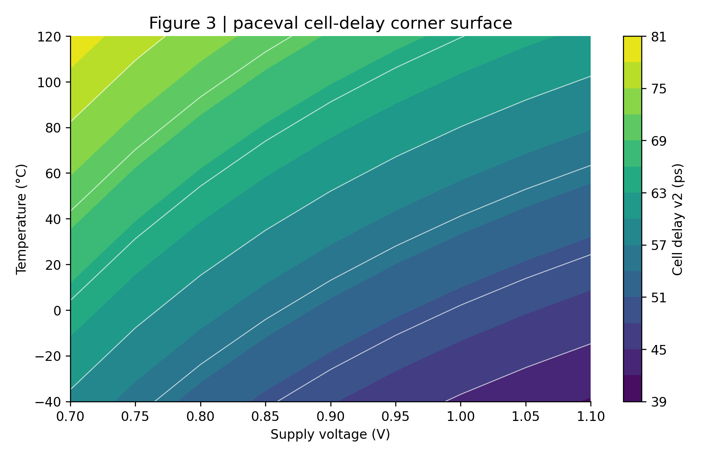
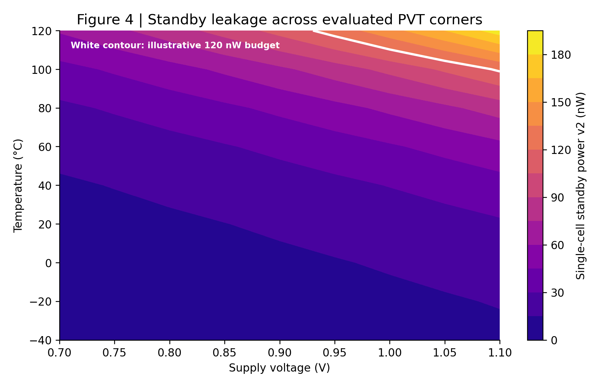
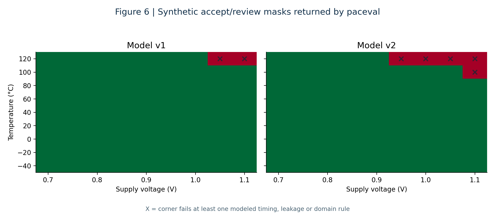

# Programmable IC Timing and Leakage Corner Sweeps with paceval


*Concept illustration; not a computed research result. The curves and structures in the cover image are not measured silicon data.*

**Scientific functionality demonstrator | WP 08 | 14 November 2026 | paceval MCP v4.26 results**

This research package investigates reusable mathematical expressions for cell-level delay, standby leakage current, static power, path slack and versioned screening rules across synthetic voltage-temperature-load conditions. The application is a **pre-screening and traceable model-evaluation component** for electronic-design-automation (EDA) workflows, not a replacement for Liberty library characterization, gate-level static timing analysis, or foundry signoff.

[Full English whitepaper (PDF)](paceval_IC_Timing_Leakage_Corner_Whitepaper_EN.pdf) · [C++ integration source](src/ic_corner_paceval.cpp) · [Formula manifest](src/formula_manifest.json) · [Execution evidence](results/execution_evidence.json) · [Independent numerical audit](results/high_precision_audit.json)

## 1. Industrial use case and current state of the art

An integrated-circuit designer must determine whether logic paths satisfy a clock requirement under many combinations of process, supply voltage, temperature, input slew and output capacitance. Leakage power must often be assessed at the same corners. Real engineering signoff commonly relies on library-characterized cell arcs, interconnected timing graphs, net parasitics and multi-corner/multi-mode constraints. Liberty tables typically describe rise/fall arc behavior as a function of transition and effective load rather than a single universal closed-form cell equation. OpenSTA reads Liberty libraries, netlists, parasitics and SDC constraints to calculate checks on a full timing graph.

This demonstrator isolates an **interpretable mathematical screening layer**. In a hypothetical cell-library development workflow, an engineer supplies explicit parameterized formulas and a declared operating-point schema. The same persistent graphs evaluate voltage-temperature-load corner sweeps and compare unchanged model versions. paceval calculates model temperatures, delays, power, slacks, continuous constraint margins, Boolean admissibility rules, and sensitivity functions. The C++ application controls records, resources and selection of the worst returned corner. The output can identify illustrative mathematical concern areas for follow-up with actual library-characterization and OpenSTA flows. **The synthetic equations are not fitted Liberty data and are not SPICE, transistor simulations or STA.**

A notable 2026 development is OpenSTA's March 12, 2026 support for statistical timing with Liberty Variation Format (LVF), including normal and skew-normal variability models. This belongs to the established signoff-oriented ecosystem; the present deterministic formulas neither reproduce LVF uncertainty nor claim to replace it. The ASAP7 predictive process design kit provides an academic route toward future open PVT comparisons, but this package does not ingest ASAP7 or Nangate Liberty tables. The distinction between industrial practice and this reduced-order research experiment is deliberate. Sources are collected in Section 11.

## 2. Research question and independently demonstrated scope

Can a small collection of persistent paceval formula graphs execute meaningful **versioned, multi-output** timing and leakage screening mathematics across many corner records, while the same actual outputs independently satisfy an analytical high-precision reference?

The answer is positive for the **specified synthetic models and tested operating points**. Using the original paceval MCP service reporting version **4.26**, 22 substantive graph expressions were registered and evaluated for 81 PVT grid points and 16 additional synthetic path scenarios. The remote engine reported no per-result error for these batches. A separate high-precision mpmath implementation checked 1,162 archived ordinary values with the documented tolerance. All 24 separately recorded pointwise TINC printed intervals contained their respective high-precision references. An additional 21 operator checks were executed successfully.

This evidence does **not** mean the local Linux C++ application has been run. The compatible x86-64 paceval shared library was unavailable in this environment. The C++17 translation units pass a syntax-only compilation, but linking, API/ABI runtime tests, converter behavior, local TINC results and CTest remain unexecuted.

## 3. Mathematical models and units

The inputs represent a hypothetical standard-cell family and a simplified repeated-cell path. Supply voltage $V$ and reference voltage $V_{\mathrm{ref}}$ are in volts, temperature $T$ and $T_{\mathrm{ref}}$ are in degrees Celsius, load $C$ is in femtofarads, input slew $S$ is in picoseconds, and the path delay requirement is in picoseconds. A temperature difference in °C is numerically a difference in kelvins. All model coefficients, ranges and illustrative budget limits are contained in the [manifest](src/formula_manifest.json) and [CSV schema](data/units_and_schema.json).

Version 1 retains the original WP 08 additive delay model:

```math
D_1=t_0+a_C C+a_S S+a_T(T-T_{\mathrm{ref}})+a_V\left(\frac{V_{\mathrm{ref}}}{V}\right)^p.
```

Version 2 adds a voltage-dependent load coefficient, load-temperature coupling and load-slew coupling:

```math
\begin{aligned}
D_2={}&t_0+a_C C\left(\frac{V_{\mathrm{ref}}}{V}\right)^q+a_S S+a_T(T-T_{\mathrm{ref}})\\
&+a_V\left(\frac{V_{\mathrm{ref}}}{V}\right)^p+a_{CT}C(T-T_{\mathrm{ref}})+a_{CS}CS.
\end{aligned}
```

The independent standby-current models are:

```math
\begin{aligned}
I_1&=I_0\exp\left[b_T\Delta T+b_V(V-V_{\mathrm{ref}})\right],\\
I_2&=I_0\exp\left[b_T\Delta T+b_V(V-V_{\mathrm{ref}})+b_{TT}\Delta T^2+b_{VT}\Delta T(V-V_{\mathrm{ref}})\right],\\
\Delta T&=T-T_{\mathrm{ref}},\qquad P_i=V I_i.
\end{aligned}
```

Here $I$ is in nanoamperes and the product $VI$ is in nanowatts. This is **single-cell standby leakage**, not full-chip leakage or dynamic switching power. The illustrative path repeats the same delay model $N$ times, adds a fixed wire delay $D_{\mathrm{wire}}$, and calculates the slack:

```math
\begin{aligned}
D_{\mathrm{path},i}&=N D_i+D_{\mathrm{wire}},\\
\mathrm{slack}_i&=T_{\mathrm{required}}-T_{\mathrm{arrival}}-D_{\mathrm{path},i}.
\end{aligned}
```

A power budget $P_{\mathrm{cap}}$ applies to the modeled cell. The composite score has **picosecond-equivalent units** because $s$ is explicitly expressed in ps/nW:

```math
g_i=\min\left(\mathrm{slack}_i,\;s\,[P_{\mathrm{cap}}-P_i]\right).
```

The actual paceval expression uses infix `min` rather than an unverified `min(x,y)` function call. A separate Boolean graph checks nonnegative slack, nonnegative power margin, and operating-domain bounds. A nonnegative graph margin is not an approval for a physical product. The host decides whether to inspect a corner further.

## 4. Verified paceval computation ownership

The table below reflects **actual MCP graph execution** of the mathematical functions. The independent C++ reference is a test oracle, not an alternative productive path.

| Mathematical function / industrial purpose | Actual implementation | Graph / version or rationale |
|---|---|---|
| Cell delay and modified load/temperature coupling | paceval MCP | `delay_v1_ps`, `delay_v2_ps` |
| Exponential standby leakage current | paceval MCP | `leak_v1_nA`, `leak_v2_nA` |
| Standby power and budget margins | paceval MCP | `leak_power_v1_nW`, `leak_power_v2_nW`, `leak_margin_v1_nW`, `leak_margin_v2_nW` |
| Simplified repeated-cell path and timing slack | paceval MCP | `path_delay_v1_ps`, `path_delay_v2_ps`, `slack_v1_ps`, `slack_v2_ps` |
| Composite timing/power objective | paceval MCP | `composite_score_v1_ps`, `composite_score_v2_ps` |
| Boolean admissibility and explicit corner constraints | paceval MCP | `corner_guard_v1`, `corner_guard_v2` |
| Analytical voltage and temperature sensitivities | paceval MCP | `delay_sensitivity_voltage_v2`, `delay_sensitivity_temp_v2`, `leak_sensitivity_temp_v2` |
| Model change and normalized leakage | paceval MCP | `model_delta_delay_ps`, `model_delta_power_nW`, `leakage_power_fraction_v2` |
| Domain validation, CSV schema enforcement, loop and worst-corner selection | C++ host | State and decisions, not formula graphs |
| Independent numeric reference | C++ and Python | Audit only, not productive results |

The formulas are registered as persistent original paceval computation handles with immutable versions. They were evaluated with the remote multi-computation, multi-scenario route. The local C++ source similarly includes the original paceval SDK files and calls `paceval_CreateComputation`, `paceval_dGetComputationResult`, `paceval_dGetComputationResultExt`, and `paceval_dGetMultipleComputationsResultsExt`. The **local path remains unexecuted**, since the required external library is not packaged or available here.

## 5. Results from actual paceval MCP 4.26 execution

| Evidence category | Actually recorded result |
|---|---:|
| Distinct substantive model graphs created and executed | 22 |
| Voltage-temperature grid scenarios | 81 |
| Additional synthetic path scenarios | 16 |
| Model graph-point evaluations across both main batches | 2,134 |
| Archived ordinary numerical values | 1,162 |
| Archived ordinary values passing independent 90-digit reference | 1,162 |
| Additional TINC-enabled point evaluations | 24 |
| TINC printed endpoints enclosing high-precision point references | 24 |
| Additional operator-semantic graph-point evaluations | 21 |
| Operator cases with correct results | 21 |
| Local SDK runtime tests / CTest executions | Not executed |

The [machine-readable evidence](results/execution_evidence.json) defines the difference between graph creation, graph-point evaluations, stored output values, independent checks and separately repeated computations. The 81-row grid records ten selected output columns from a successful 22-graph batch; all 22 outputs were recorded for every one of the 16 snapshot scenarios. No fabricated runtime output is substituted for missing local C++ results.

At the synthetic corner **1.10 V, 100 °C, 12 fF output load and 45 ps input slew**, model v2 produced a delay of **59.6882 ps per cell**, an illustrative repeated-path slack of **109.2470 ps**, and **122.3307 nW** of modeled single-cell standby power. The stipulated power budget is 120 nW, so the v2 composite margin is negative and its corner flag is **0**, despite positive slack. At the same grid point v1 returned flag **1**. Three of the 81 synthetic grid points changed their binary decision between the model versions.

Model differences here reflect the stipulated formulas and parameters. They do not demonstrate a better predictive silicon model, quality of a new foundry library, or a validated digital-twin function.

## 6. Scientific figures from retained paceval output

The architecture diagram is a conceptual schematic. All other scientific figures are regenerated exclusively from the recorded paceval MCP numeric results in `results/`. The plotted contours interpolate a sampled grid for visualization, not a certified continuous corner envelope.



*Figure 3. Modeled cell delay for the actual executed 81-point paceval grid, displayed with illustrative contours.*



*Figure 4. Standby power from paceval model v2 with the illustrative 120 nW budget contour.*



*Figure 6. Two simultaneous mathematical versions yield different synthetic corner-screening outcomes.*

The complete set of numbered figures, including a 3D model-revision surface, independent timing and leakage diagrams, and TINC output widths, is available in [`figures/`](figures/01_architecture_schematic.png) and in the PDF. Every result graphic has both PNG and vector-PDF representations.

## 7. C++ build and safe numerical CSV flow

On Linux x86-64, provide the original SDK-compatible shared library separately. The SDK library is not redistributed in this research package.

```bash
cmake -S src -B build -DCMAKE_BUILD_TYPE=Release \
  -DPACEVAL_RUNTIME=/absolute/path/libpaceval_linux_sharedLIB.so
cmake --build build -j
ctest --test-dir build --output-on-failure
```

Or use [scripts/build_and_test.sh](scripts/build_and_test.sh) with the absolute library path. The executable reads the two reproducible CSV input files from `data/` and writes newly computed output files into `results/`. It never labels the shipped MCP CSV files as outputs of the local C++ executable. The wrapper checks actual return values and per-element error codes and compares representative scalar and batch results before writing.

The input parser applies an explicit **decimal-literal whitelist** before using `paceval_dConvertStringToFloat` so that a field such as `1+2` is rejected, even if the converter could interpret expressions. The output path uses `paceval_dConvertFloatToString` and checks success and termination. Canonical numbers use a dot decimal separator and comma-delimited UTF-8 CSV. The SDK text formatter is **not claimed to preserve every IEEE-754 binary64 bit**, and independent audit routines preserve their binary64 interpretation separately.

A standalone converter and operator test is provided through the executable's `--selftest` route, and CTest definitions execute it when the compatible original SDK is available. Independent native C++ and 90-digit Python checks protect the central composite results. The C++ source has been syntax-checked but **its converter and SDK-specific tests have not been executed in this environment**.

## 8. Reproduction and independent numerical verification

```bash
python3 validation/validate_records.py
python3 scripts/build_evidence.py
python3 scripts/make_figures.py
python3 src/check_readme_math.py
python3 validation/check_project.py
```

`validate_records.py` is an independently coded mpmath reference which reconstructs each JSON-provided input as its **exact IEEE-754 binary64 fraction** before independent algebra and exponentiation. The technical audit in [`results/high_precision_audit.json`](results/high_precision_audit.json) documents numeric checks and all TINC pointwise inclusion decisions. It does not equate finite checks with a formal global interval guarantee or with PVT measurement uncertainty.

The original API integration and remote MCP evidence are kept distinct. An external paceval runtime is necessary for full local reproduction of `paceval_main.cpp` and its CMake/CTest workflow. To regenerate historical MCP values through the service, re-create the manifest expressions and re-evaluate them for the supplied CSV input vectors; service handles are opaque, temporary identifiers.

## 9. Scientific limitations and interpretation

These coefficients, corners, path topology, leakage budget and model relationships are deterministic **synthetic assumptions**. The path repeats one cell's delay without slew propagation, realistic net-dependent capacitance or incremental STA traversal. The experiment omits rise/fall arc distinctions, hazards and state-dependent leakage, process-transistor models, IR drop, aging, multi-mode constraints, clock skew, setup/hold timing, electrical-rule checks, detailed net parasitics, dynamic power, LVF variation and correlated uncertainty. It does not represent fitted Liberty data, OpenSTA timing signoff, a foundry PDK release, a production chip measurement or a verified hardware benefit.

A domain-specific next experiment could ingest a permissively licensed Liberty cell table and demonstrate how versioned, explicit mathematical post-processing rules relate to an independently reproduced table interpolation. True silicon validation would then require separately measured characterization, matched voltage/temperature reference conditions, waveforms and STA paths. The value tested here is the **functional programmability and auditability of the mathematical kernel**, not physical predictive superiority.

## 10. Source files and execution inventory

The [original WP 08 proposal](docs/Original_WP08_Research_Proposal.pdf) defines the initial equations. The [machine-readable inventory](results/math_execution_inventory.csv) identifies each core output's execution owner, graph ID and evidence path. The [research validation note](RESEARCH_VALIDATION.md) summarizes what did and did not run. All scientific graphics are reproducible from the attached records using [scripts/make_figures.py](scripts/make_figures.py). The [PDF generation source](scripts/make_whitepaper.py) is also provided.

## 11. Selected scientific and technical references

1. OpenROAD, [Parallax / OpenSTA Static Timing Analyzer documentation](https://openroad.readthedocs.io/en/latest/main/src/sta/README.html). Establishes the Liberty, SDC, parasitic and timing-graph workflow.
2. OpenROAD, [OpenSTA Examples: multi-corner scenes and statistical timing with LVF](https://openroad.readthedocs.io/en/latest/main/src/sta/doc/Examples.html). Includes original corner and variance examples.
3. OpenROAD, [OpenSTA release notes](https://openroad.readthedocs.io/en/latest/main/src/sta/doc/ChangeLog.html). Release 3.0.1, 12 March 2026: statistical timing with LVF; plus the July 2026 changelog entry.
4. Arizona State University, [ASAP7 Predictive PDK](https://asap.asu.edu/). An academic predictive process-design environment, not a manufactured foundry technology.
5. Vashishtha et al., [ASAP7: A 7-nm finFET predictive process design kit](https://doi.org/10.1016/j.mejo.2016.04.006), *Microelectronics Journal* 53, 2016.
6. [paceval original C/C++ API reference](https://paceval.com/api/) and [operator reference](https://paceval.com/product-brief/). Runtime features must be verified against the included header and a compatible binary.

Research artifact date: 14 November 2026. All examples are synthetic and intended for reproducible mathematical research only.
