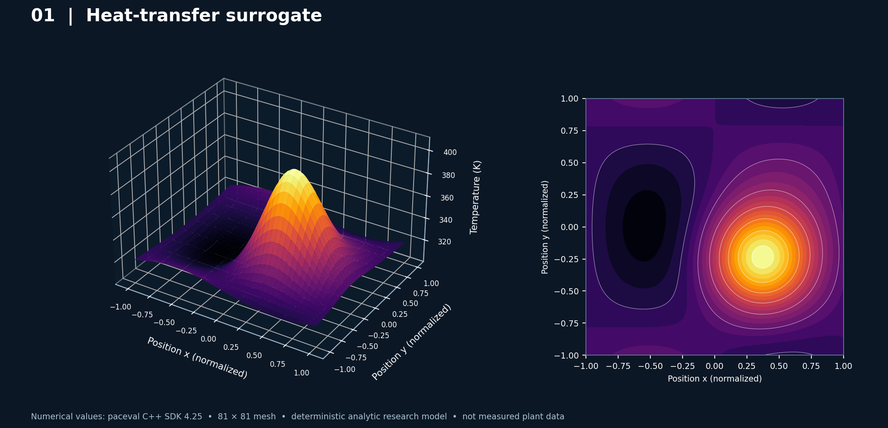
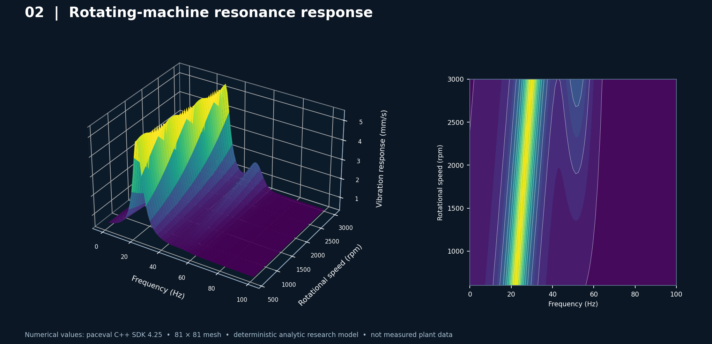
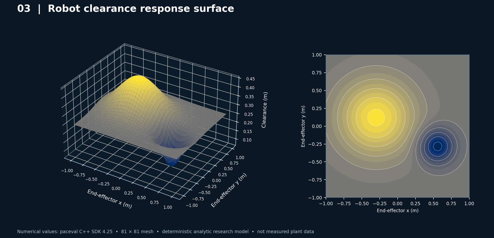
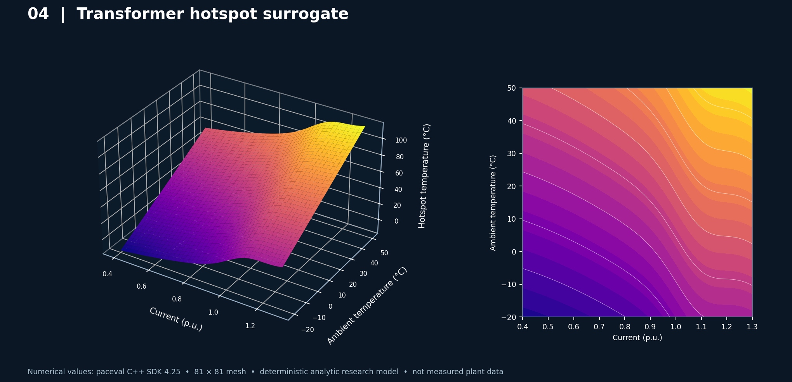
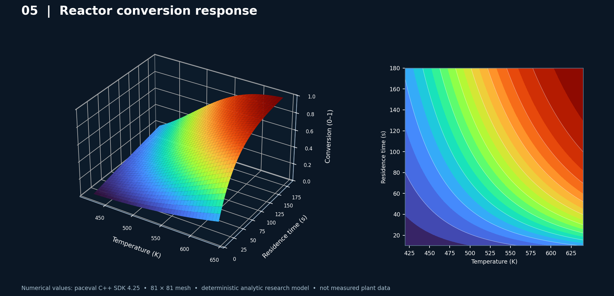
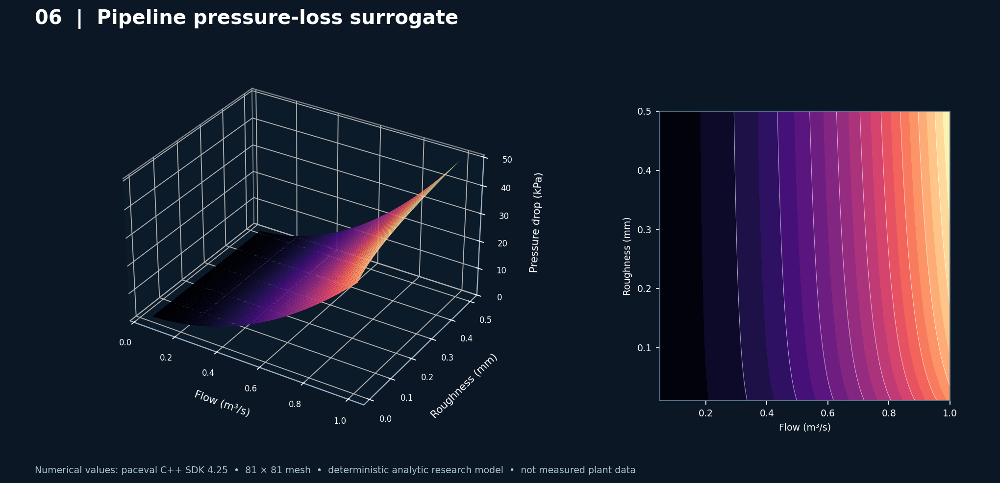

# paceval. | Scientific Mathematical 3D Industrial Diagrams



**A reproducible C++ research demonstrator generating six real numerical 3D surface diagrams from reusable paceval computation graphs.** The plotted values are calculated by the original paceval C/C++ SDK, *not generated by image AI*. Charts represent clearly identified **synthetic analytic industrial response models**, not measurements or results from CFD, FEM, multiphysics solvers, production assets, or plant-certified digital twins.

[English research whitepaper (PDF)](paceval_Industrial_3D_Diagrams_Whitepaper_EN.pdf) · [C++ source](src/industrial_3d.cpp) · [CMake project](src/CMakeLists.txt) · [Raw output manifest](examples/manifest.csv) · [Original upstream API](https://paceval.com/api/)

## 1. Demonstrated scope

The compiled application directly creates **six paceval expression graphs**, each evaluated over an **81 × 81** structured physical-parameter grid (6,561 points). It exports every evaluated result as CSV, with an independent native C++ result and an absolute numerical discrepancy in the same row. Each graph is also reused for a separate 32-sample batch-API call. The host checks numeric finiteness, paceval error status and independently coded numeric agreement; graph lifetime is managed using RAII.

| Industrial use case | Actual output | Input coordinates | Scope |
|---|---|---|---|
| Heat-transfer response | Temperature (K) | Normalized planar position x,y | Defined analytic spatial hotspot, not solved heat equation |
| Rotating-machine resonance | Vibration response (mm/s) | Frequency (Hz), speed (rpm) | Resonance surrogate, not machine diagnostics |
| Robot workcell clearance | Clearance (m) | End-effector x,y (m) | Analytic clearance proxy, not collision certification |
| Transformer hotspot | Hotspot temperature (°C) | Current (p.u.), ambient °C | Steady empirical-style relation, not a transformer thermal standard model |
| Chemical reactor conversion | Conversion fraction | Temperature (K), residence time (s) | Explicit first-order surrogate, not CFD kinetics validation |
| Pipe pressure loss | Pressure drop (kPa) | Volumetric flow (m³/s), roughness (mm) | Declared surrogate, not Darcy–Weisbach prediction |

These formula contracts are embedded in [the commented C++ source](src/industrial_3d.cpp) and included verbatim in the generated [manifest](examples/manifest.csv). The term *three-dimensional diagram* means a numeric response surface z=f(x,y) represented in 3D Cartesian coordinates; it does not imply a three-dimensional governing PDE was solved.

## 2. Verified numerical execution

| SDK verification (provided compatible Linux runtime) | Observed |
|---|---:|
| Reusable paceval computation objects | 6 |
| paceval scalar values evaluated and independently checked | 39,366 / 39,366 |
| paceval batch values evaluated and independently checked | 192 / 192 |
| Structured samples per industrial model | 81 × 81 |
| Maximum absolute difference against separate native C++ formulas | 2.84217 × 10⁻¹⁴ |
| CMake/CTest integration | 1 / 1 passed |

**What this verifies:** Correctly calling the paceval SDK with registered nontrivial analytic functions, reusing handles for parameter-sweep evaluation and producing independently auditable numerical surfaces. This is evidence of numerical execution, not evidence of experimental industrial accuracy, verified safety, or a CPU/GPU/FPGA speed advantage. No speed comparisons are reported.

[SDK execution log](results/sdk_execution.txt) · [CTest log](results/ctest_sdk.txt) · [Complete CSV datasets](examples/manifest.csv)

## 3. Six industrial 3D figures generated from paceval data

Every image below shows a rendered **paceval-generated numerical surface at left** and a contour map of **the same CSV values at right**. The plotting script does not evaluate the underlying physics or synthesize alternative data.

### Heat-transfer hotspot


[Numeric CSV](examples/heat_transfer.csv) · [Vector figure](figures/01_heat_transfer.pdf)

### Rotating machinery resonance



[Numeric CSV](examples/motor_resonance.csv) · [Vector figure](figures/02_motor_resonance.pdf)

### Robot workcell clearance



[Numeric CSV](examples/robot_clearance.csv) · [Vector figure](figures/03_robot_clearance.pdf)

### Power transformer hotspot



[Numeric CSV](examples/transformer_hotspot.csv) · [Vector figure](figures/04_transformer_hotspot.pdf)

### Chemical reactor conversion



[Numeric CSV](examples/reactor_conversion.csv) · [Vector figure](figures/05_reactor_conversion.pdf)

### Pipeline pressure loss



[Numeric CSV](examples/pressure_loss.csv) · [Vector figure](figures/06_pressure_loss.pdf)

## 4. Compile with original paceval C/C++ SDK

This archive includes the provided **official SDK public facade files** [`paceval_main.h`](src/paceval_main.h) and [`paceval_main.cpp`](src/paceval_main.cpp). Only the relative `#include` path in the `.cpp` was adapted for their adjacent location. Their original copyright and AGPL notices remain in place. The engine shared library is deliberately **not** redistributed.

```bash
cmake -S src -B build -DCMAKE_BUILD_TYPE=Release \
  -DPACEVAL_RUNTIME=/absolute/path/to/libpaceval_linux_sharedLIB.so
cmake --build build -j
ctest --test-dir build --output-on-failure
./build/industrial_3d --out examples
python3 src/make_figures.py --data examples --figures figures
```

`--out` creates the specified directory if needed. Figures require Python 3, NumPy and Matplotlib. The `.so` supplied separately must be ABI-compatible with the header and compiled platform. A tested Linux x86-64 runtime was supplied for this research. SDK licensing conditions must be respected before reuse or redistribution.

## 5. Numerical provenance, limitations and interpretation

- Source expressions are explicitly whitelisted and stored as six constant strings. This is not arbitrary mathematical-expression execution from untrusted files.
- Exactly two numeric independent variables (`x y`) are declared for each graph; dimensions and numeric domains are documented in the model registry and report.
- The SDK's `paceval_CreateComputation` creates a reusable handle; `paceval_dGetComputationResult` calculates each grid sample; `paceval_dGetComputationResultExt` validates a separate 32-point batch for each graph.
- Input validation, data-grid creation, CSV output, independent formulas, acceptance criteria, chart design and interpretation belong to the host, not to paceval.
- Every CSV row includes the paceval output and native C++ answer. Small discrepancies reflect finite-precision arithmetic. Sample agreement cannot prove correctness of a real industrial model outside its stated domain.
- No real operating data, thermal calibration, rotating-machinery fault labels, verified robot collision geometry, power-system grid solver or mass-transfer reactor simulation are included.

The [whitepaper](paceval_Industrial_3D_Diagrams_Whitepaper_EN.pdf) describes each model, the visualizations and specific possible industrial validation steps. Its diagrams are based on the exact CSV files included in this repository.

## 6. Selected external context

The purpose of the examples was informed by published digital-twin research, not by claimed customer deployments: [NIST JARVIS](https://jarvis.nist.gov/) (materials modeling); [industrial thermal system digital twin](https://www.mdpi.com/2076-3417/15/5/2350); [industrial prognostics review](https://www.nature.com/articles/s41598-024-63990-0); [robotic manufacturing digital-twin research](https://arxiv.org/abs/2410.14934); [electrical-substation digital twin](https://www.mdpi.com/1424-8220/25/18/5689); and the [paceval C/C++ API](https://paceval.com/api/). These references establish domain relevance; they do **not** validate the six illustrative formulas or their parameter constants.
