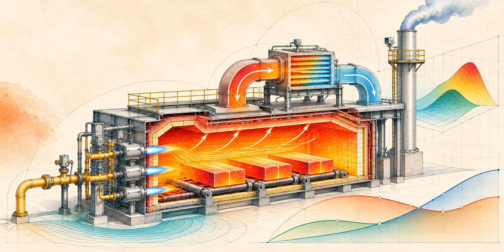
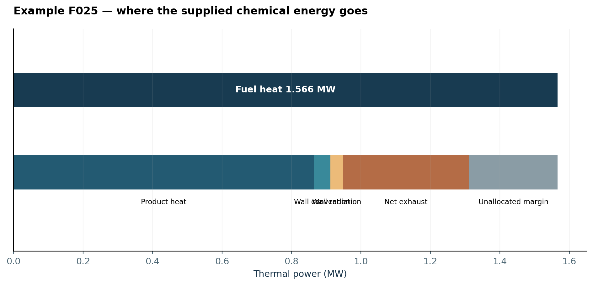
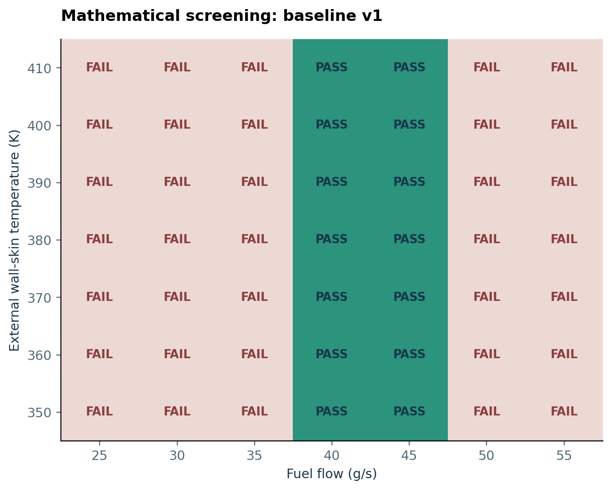
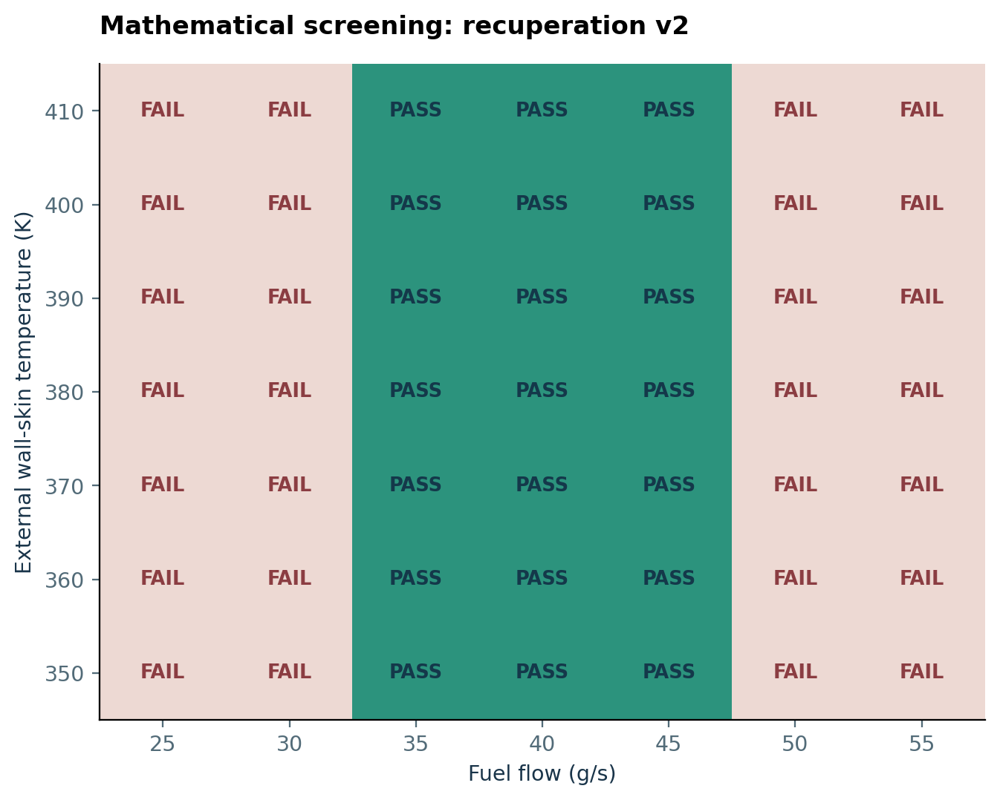
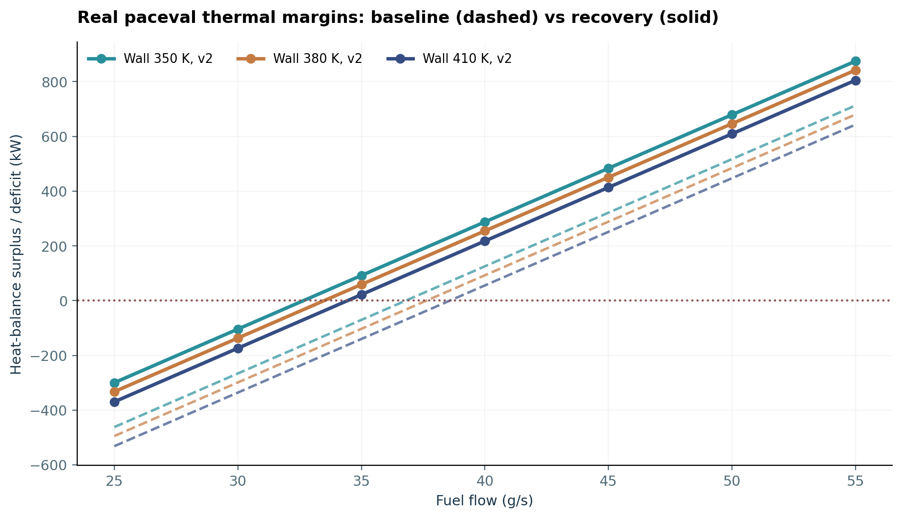
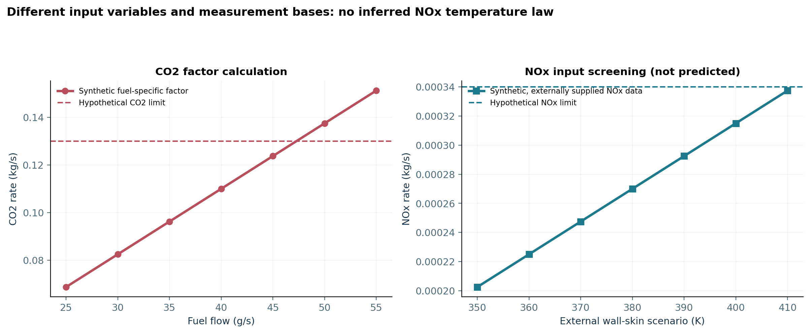
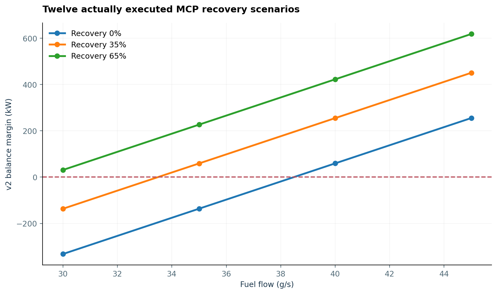
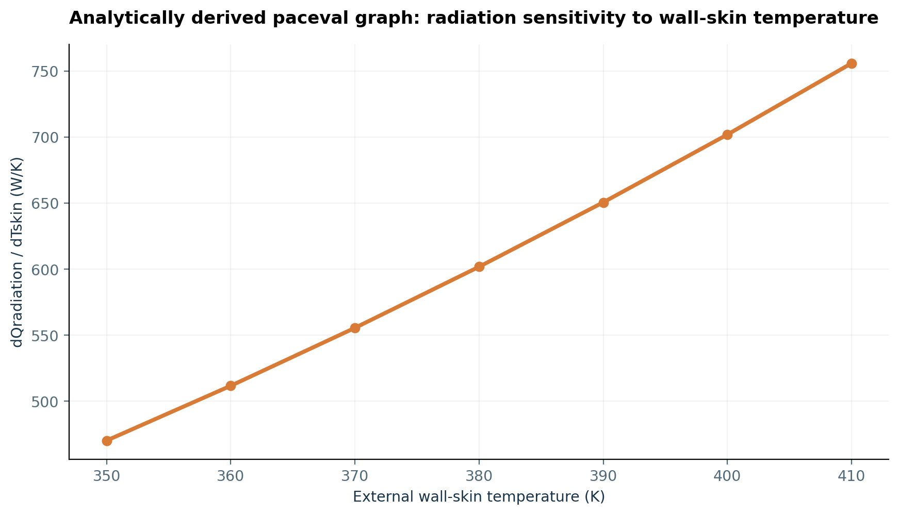
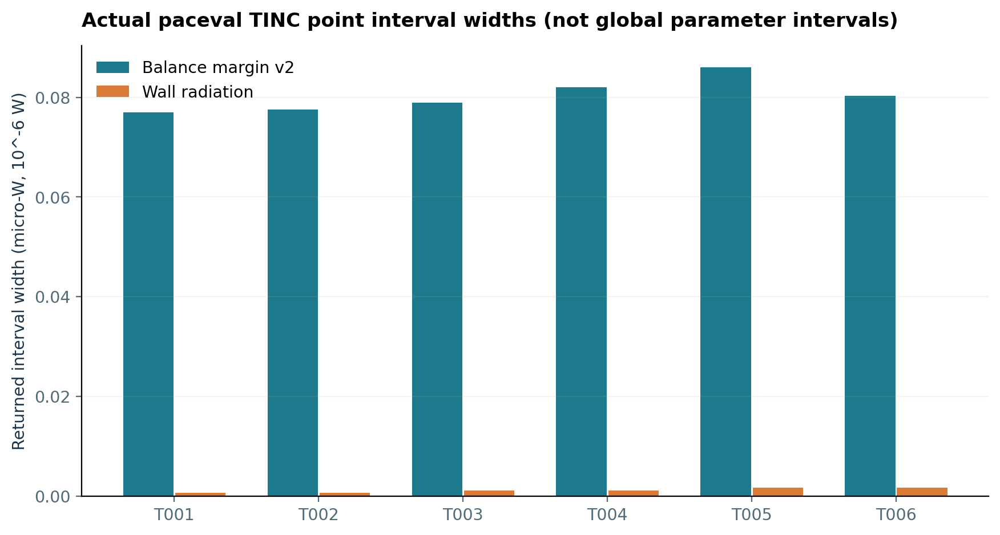

# Industrial Furnace Energy Balance and Emission Constraint Maps with paceval

**WP 30 | Mathematical Engineering Research Demonstrator | 15 November 2026**



An industrial furnace converts chemical energy into useful heat while losing energy through the exhaust, wall convection and surface radiation. For a steel reheating or heat-treatment line, engineers must repeatedly test combinations of fuel flow, load, external wall temperature, waste-heat recovery and emissions-related limits. This repository demonstrates **programmable, persistent paceval computation graphs** for a reproducible mathematical screening workflow; it is not a furnace safety controller, an emissions-compliance service or a combustion-CFD model.

The project was expanded from the four mathematical kernels in the [original WP 30 proposal](docs/Original_WP30_Proposal_2026-11-13.pdf). Its complementary research method follows the US Department of Energy's [MEASUR](https://www.energy.gov/cmei/ito/measur) / [Process Heating Systems](https://www.energy.gov/cmei/ito/process-heating-systems) methodology, while retaining substantially smaller, fully disclosed equations. ISO 13577-2:2023 concerns safety of furnace combustion systems; **this software does not demonstrate conformity**.

## What the demonstrator computes

A synthetic example represents a furnace heating a stream of material. The operator supplies fuel and material flow, temperatures, wall area and emissivity, exhaust-flow properties, an optional recovery fraction, and carbon/NOx screening inputs. The same input vector is evaluated by two independent model versions using reusable paceval graph handles.

* **Version 1:** constant effective product heat capacity with unrecovered stack heat.
* **Version 2:** linearly temperature-dependent product heat capacity and a hypothetical exhaust heat-recovery fraction.
* **Both versions:** consistent fuel input, external wall convection, thermal radiation, source-heat margin, carbon-factor mass rate, NOx rate based on supplied concentration and dry-normal volume flow, guard decisions and sensitivities.

### Thermal model (SI units)

The first model follows the proposal:

$$
Q_{fuel}=\dot m_f LHV\,\eta_b,\qquad Q_{load,1}=\dot m_p c_{p0}(T_{out}-T_{in})
$$

$$
Q_{conv}=h_c A(T_w-T_a),\qquad Q_{rad}=\varepsilon\sigma A(T_w^4-T_a^4)
$$

Temperatures **must be in kelvin** in the radiation calculation; $h_c$ describes external wall convection only and is not a combined overall heat-transfer coefficient. $\eta_b$ is defined here as the fraction of fuel chemical power released into the chosen furnace control volume **before** the explicitly modeled wall/stack losses; otherwise double counting would result.

The revised model adds an exhaust recovery fraction and a linearized heat-capacity assumption:

$$
Q_{ex,net}=(1-\rho_r)\dot m_{ex} c_{p,ex}(T_{ex}-T_a)
$$

$$
Q_{load,2}=\dot m_p c_{p0}\left[\Delta T+\frac{\beta}{2}(\Delta T)^2\right]
$$

The net balances are $M_1=Q_{fuel}-Q_{load,1}-Q_{conv}-Q_{rad}-Q_{ex,gross}$ and $M_2=Q_{fuel}-Q_{load,2}-Q_{conv}-Q_{rad}-Q_{ex,net}$. Positive $M$ denotes model-calculated heat surplus; it **does not establish energy-balance closure** unless further sinks, storage, or operating adjustments are accounted for.

### Emission-related screening

Carbon mass rate is $\dot m_{CO_2}=\dot m_f e_{CO_2}$, with a supplied fuel-specific factor. NOx mass rate is calculated only from the **provided** concentration and a **consistent** normalized exhaust volumetric rate:

$$
\dot m_{NO_x}=C_{NO_x,mg/Nm^3}\,\dot V_{dry,Nm^3/s}\,10^{-6}
$$

NOx concentrations require independently determined correction/reference-oxygen, wet/dry and reference-temperature conventions before real compliance use. The illustrative caps are **synthetic user-defined constraints, not legal thresholds**. No temperature-based NOx forecast is asserted.

### Compound decisions and sensitivities

The two guard graphs test five independent inequalities: nonnegative thermal margin, CO2 and NOx mass-rate margins, fuel-flow capacity and upper process temperature. All are evaluated by the actual paceval engine, **not** replaced by native C++ decisions. The dimensionless score is the minimum of the five appropriately normalized margins. Separate persistent graphs calculate sensitivities such as $\partial M_2/\partial\rho_r=Q_{ex,gross}$ and $\partial Q_{rad}/\partial T_w=4\varepsilon\sigma AT_w^3$.

## Actual paceval results

The connected **paceval MCP 4.26 service** actually created and evaluated **32 different model graphs over 49 grid scenarios plus 12 recovery cases**: 1,952 main graph-point evaluations, with zero reported errors. Six further cases were evaluated using two interval-enabled graphs (12 TINC results) and seven operator graphs were tested for three scenarios each (21 operator evaluations). These are **remote MCP evaluations**, not a benchmark of the local SDK executable.

| Comparison on 49 synthetic grid points | v1 | v2 |
|---|---:|---:|
| Algebraically eligible under all defined illustrative constraints | **14** | **21** |
| Algebraically ineligible | 35 | 28 |

Seven point decisions changed because the two model formulations give different thermal margins. At the test case **F025**, $\dot m_f=0.04\,kg/s$, $T_w=380\,K$ and recovery $\rho_r=0.35$: the observed v1 margin was **92,759.13 W** and the v2 margin **254,870.97 W**. The numerical evidence is in [`results`](results/README_DATA.md), including the fact that the grid CSV is a transcription of actual numerical output rather than a raw MCP payload.










## How paceval owns the computation

The original `paceval_main.h` and `paceval_main.cpp` are provided **unchanged** in `src/`. The full formulas are defined in [`src/formula_manifest.json`](src/formula_manifest.json) and the corresponding actual C++ graph registry [`src/generated_formulas.h`](src/generated_formulas.h). The application creates a persistent paceval computation object per graph, reuses it for all rows, and calls `paceval_dGetMultipleComputationsResultsExt` for batch evaluation where supported.

The C++ host owns CSV syntax and dimensional validation, safe use of `paceval_dConvertStringToFloat` and `paceval_dConvertFloatToString`, graph cleanup, result mapping, execution diagnostics, and independent native checks. It does **not** replace the 32 domain expressions with native equations in its published output. A true CSV output is generated only if the compatible local SDK program successfully runs.

### Local C++ reproduction (not executed in this release)

```bash
cmake -S src -B build -DPACEVAL_SHARED_LIB=/absolute/path/to/compatible/libpaceval.so
cmake --build build --config Release
ctest --test-dir build --output-on-failure
./build/industrial_furnace_paceval examples/synthetic_operating_points.csv build/local_results.csv
```

The original SDK header and bridge were syntax-checked with C++17. **No compatible Linux shared library was available here**, so linking and local CTest were not executed. No local latency, throughput, speedup or energy benchmark is claimed. The external shared library is deliberately **not bundled**.

### Independent numerical reproduction

```bash
python -m pip install mpmath matplotlib markdown-it-py PyMuPDF
python validation/high_precision_reference.py
python validation/check_project.py
```

The independent 90-decimal-digit mpmath reference tested **329** archived numeric/boolean cells and **12** interval point inclusions successfully. The interval results bound **point evaluations**, not uncertainties over entire input intervals. The operator selftests distinguish `%` from `mod` for negative operands.

The archive-wide GitHub Markdown preflight checks both inline and stand-alone display mathematics, forbids raw TeX math delimiters and unsupported macro names, checks relative image/file links and runs negative regression examples. Actual rendering in the GitHub.com web UI was not inspected; it is not claimed as proven.

## Limits and go / no-go decision

This study uses only **synthetic operating values and assumed physical coefficients**. It has no measured furnace gas balance, time-dependent thermal storage, temperature-profile validation, burner chemistry, radiation view-factor model, real NOx measurement or energy-use benchmark. It therefore demonstrates only the actual programmable algebra and logical screening. A pilot is a technical *go* only after independently measured accuracy criteria and either at least 15% measured end-to-end performance/energy benefit or at least 25% measured reduction in formula-update/integration effort (without a quality regression); those are predeclared **future acceptance thresholds**, not achieved benefits.

See [research validation](RESEARCH_VALIDATION.md) and the [English whitepaper](paceval_Industrial_Furnace_Energy_Whitepaper_EN.pdf).

## Sources and scope

* US Department of Energy: [Process Heating Systems](https://www.energy.gov/cmei/ito/process-heating-systems), [MEASUR tool](https://www.energy.gov/cmei/ito/measur), [Waste Heat Recovery Basics](https://www.energy.gov/cmei/ito/waste-heat-recovery-basics).
* ORNL: [MEASUR Process Heating Assessment documentation](https://industrialresources.ornl.gov/measur/suite/docs/group__process__heating__assessments).
* US EPA: [emissions estimates and source test hierarchy](https://www.epa.gov/general-conformity/general-conformity-training-modules-appendix-sample-emissions-calculations).
* ISO: [ISO 13577-2:2023 combustion-system safety scope](https://www.iso.org/standard/80533.html); it is *not* a performance-validation standard for these equations.

**No measured performance, efficiency saving, emission-reduction claim, control-system certification, or deployment evidence is asserted.**
