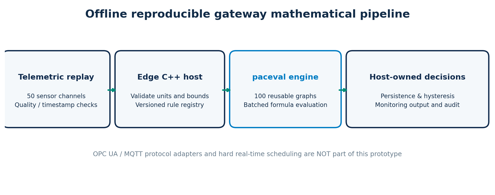

# paceval | Industrial Gateway Mathematical Rules


**A reproducible C++ research demonstrator for programmable, versioned mathematical rules at the industrial edge.** It combines 50 synthetic telemetry channels, 100 individually prepared paceval computation graphs, a deterministic 240-tick replay, explicit input-quality screening, host-owned monitoring decisions, and independent numerical audits.

The system is a **tested offline mathematical gateway kernel**, not a deployed OPC UA/MQTT connector, safety controller, trained predictive-maintenance system, or hard-real-time certification. It reports no speedup or hardware acceleration measurement.

[**Read the English scientific whitepaper (PDF)**](paceval_Industrial_Gateway_Whitepaper_EN.pdf)

## Implemented demonstration

| Capability | Actual implementation |
| --- | --- |
| Telemetry | 50 channels × 240 ticks; timestamps and `GOOD`, `BAD`, `STALE`, `MISSING` quality states |
| Mathematical rules | 100 separately created and reused paceval handles, with published formula coefficients and version identifiers |
| Rule families | Weighted condition score, bounded `tanh` score, quadratic severity and cross-feature score |
| Batch processing | `paceval_dGetComputationResultExt` evaluates validated input batches in the original paceval Linux runtime |
| Rule updates | Rule 17 is replaced by a new version; the remaining 99 graphs/results are unaffected |
| Monitoring | Three consecutive valid threshold exceedances to activate an alert, with hysteresis to clear; **all state logic remains in C++** |
| Data validity | Invalid/stale/missing inputs are excluded from mathematical evaluation and marked `NO_DATA` |
| Numerical checks | 23,442 evaluated results compared to native C++; 600 independent 90-decimal-digit samples; 24 TINC sample checks |
| Reproducibility | GCC, Clang, sanitizer tests, batch-invariance comparison, CTest and independent Python audit |



### What is actually computed with paceval?

Let `T` be temperature in °C, `V` vibration severity in mm/s and `I` current in A. Normalized dimensionless input features are

```text
t = (T - 70)/40
v = V/2
i = max(0, I - current_limit)/8
```

The 100 approved versions span four mathematical forms with individually defined coefficients:

```text
Family 0: score = w1*t + w2*v + w3*i
Family 1: score = tanh(w1*t + w2*v + w3*i)
Family 2: score = w1*t*t + w2*v*v + w3*i*i
Family 3: score = w1*t + w2*v + w3*i + w4*t*v
```

For compatibility with the **tested** Linux runtime, the positive-part term is passed to paceval as its exact real-number identity `max(0,z) = (z + abs(z))/2`. This is *not* a limit on paceval expression length or variable count. Coefficients, domains, units and thresholds are listed in [the published rules manifest](examples/rules.csv). The models are synthetic monitoring scores, **not** calibrated probabilities or validated equipment-failure predictions.

### Original paceval SDK integration

The C++ program includes [`paceval_main.h`](src/paceval_main.h); CMake compiles [`paceval_main.cpp`](src/paceval_main.cpp) directly with [`gateway_rules.cpp`](src/gateway_rules.cpp), and links to a **separately provided** original `libpaceval_linux_sharedLIB.so`. The proprietary runtime is deliberately *not* distributed.

The real API calls are `paceval_InitializeLibrary`, `paceval_CreateComputation`, `paceval_dGetComputationResultExt`, `paceval_dGetComputationResult` (TINC diagnostic), `paceval_DeleteComputation` and `paceval_FreeLibrary`. A rule is compiled once and reused across readings; updating rule 17 creates a replacement graph before releasing the previous graph. The SDK's existing copyright and AGPL notices are preserved in the original two files.

## Build and reproduce on Linux

Prerequisites: GCC or Clang, CMake ≥ 3.16, C++17, and your own compatible original paceval Linux `.so`. The reference run used Debian Linux, GCC 14.2 / Clang 17, double precision and the original Linux runtime. This is a reproducibility environment description, **not** a hard real-time performance claim.

```bash
# From the repository root:
export PACEVAL_LIB="/absolute/path/libpaceval_linux_sharedLIB.so"
cmake -S src -B build -DCMAKE_BUILD_TYPE=Release
cmake --build build -j
ctest --test-dir build --output-on-failure

# Regenerate the exact synthetic input and execute the full replay.
./build/gateway_rules --generate-data /tmp/gateway_telemetry.csv
./build/gateway_rules --replay /tmp/gateway_telemetry.csv \
  --out /tmp/gateway_results.csv --rules /tmp/gateway_rules.csv \
  --tinc /tmp/gateway_tinc.csv --batch 256

# Update only approved rule 17, preparing its replacement computation graph.
./build/gateway_rules --replay examples/telemetry.csv \
  --out /tmp/gateway_updated.csv --rules /tmp/gateway_rules_updated.csv \
  --update-rule 17 --batch 37
```

For the independent numerical audit and figure generation, install the optional Python requirements (`python3 -m pip install -r src/requirements.txt`), then run:

```bash
python3 src/validate_outputs.py \
  --examples examples --output examples/replay_results.csv \
  --tinc examples/tinc_samples.csv \
  --updated /tmp/gateway_updated.csv
```

The same replay was tested with batch sizes **1, 37, and 256**, yielding byte-identical CSV output. To regenerate the charts from the provided measurements, run:

```bash
python3 src/make_figures.py --examples examples --figures figures
```

## Verified numerical and functional results

| Tested property | Observed result |
| --- | --- |
| Source measurements | 12,000 telemetry rows; 50 channels × 240 ticks |
| Rule evaluations | 24,000 possible; **23,442 accepted**, **558 excluded** by the input-quality policy |
| Quality exclusions | 336 STALE, 214 BAD, 8 MISSING rule evaluations |
| Normal / alert result rows | 22,586 NORMAL and 856 ALERT (illustrative monitoring only) |
| Independent native C++ checks | 23,442 within the declared tolerance |
| Independent 90-digit checks | **600/600** selected samples within tolerance; max absolute discrepancy ≈ **7.08 × 10⁻¹⁷** |
| TINC sample containment | **24/24** tested samples contained their independent high-precision value |
| Controlled update | Changing rule 17 modified precisely its 240 output records; other 99 rule outputs unchanged |
| Compiler / instrumented builds | GCC, Clang, AddressSanitizer and UndefinedBehaviorSanitizer: automated tests passed |

The TINC claim is limited to the **24 tested numerical intervals**; it does not assert a universal outward-rounding proof for all expressions or hardware configurations. The 90-digit check uses the decimal values published in the input manifests.

## Scientific figures

- [Execution and ownership boundary](figures/01_gateway_architecture.png)
- [Versioned rule update](figures/02_versioned_rule_update.png)
- [Input-quality screening](figures/03_input_quality.png)
- [Four rule families](figures/04_rule_family_scores.png)
- [Host-owned alarm persistence](figures/05_monitoring_state.png)
- [TINC reference audit](figures/06_tinc_reference_audit.png)
- [Illustrative mathematical response surface](figures/07_diagnostic_response_surface.png)

All seven technical figures are also provided as editable vector [SVG files](figures/01_gateway_architecture.svg) (corresponding filenames in `figures/`).

## Scope and industrial integration

The current adapter boundary is **CSV replay**; it exercises expected semantics of channel identity, timestamps, engineering units and quality states. A real gateway integration would need a separate adapter for OPC UA data quality / PubSub or MQTT/Sparkplug metrics, lifecycle and connection state; authentication; resource limits; reconnect and replay semantics; fault testing; and an OT security review. Neither transport protocol is implemented here.

The controller state machine is a mathematical *monitoring example*, not a safety function or an automatic actuator command. A production deployment requires installation-specific validation and independent safety controls. In particular, no end-to-end latency, p99 determinism, power, CPU-budget or FPGA/ASIC gain is claimed in this feasibility release.

**Technical background:** [OPC UA PubSub](https://profiles.opcfoundation.org/document/15), [Eclipse Sparkplug](https://github.com/eclipse-sparkplug/sparkplug), [Eclipse Kura](https://eclipse-kura.github.io/kura/docs-develop/), [NIST SP 800-82 Rev. 3](https://csrc.nist.gov/pubs/sp/800/82/r3/final), [paceval C/C++ API](https://paceval.com/api/).

## Repository contents

```text
README.md
paceval_Industrial_Gateway_Whitepaper_EN.pdf
.gitignore
src/
  CMakeLists.txt
  gateway_rules.cpp
  paceval_main.h
  paceval_main.cpp
  validate_outputs.py
  make_figures.py
  requirements.txt
examples/
  telemetry.csv
  rules.csv
  replay_results.csv
  tinc_samples.csv
  rule_update_comparison.csv
  invalid_timestamp.csv
  validation.json
figures/
  00_gateway_hero.png
  01_gateway_architecture.png/.svg ... 07_diagnostic_response_surface.png/.svg
```

All sample data are **synthetic**. The README and whitepaper publish feasibility and correctness evidence rather than marketing claims about computational speed.
