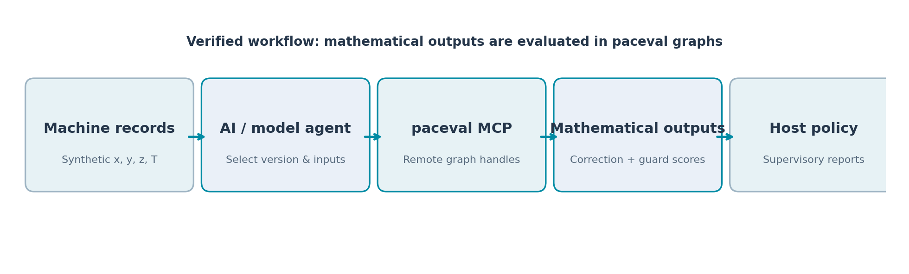

# Industrial Mathematical Models via the paceval MCP Server


*Concept illustration; not a computed research result.*

**An executed mathematical-model service demonstrator for precision manufacturing, AI agent orchestration, versioned industrial digital twins and reusable analytical expressions.** This research project documents actual executions through the connected **paceval MCP service 4.26**, alongside an independently reproducible C++ demonstrator using the **original paceval SDK 4.25**. The goal is to establish mathematical functionality and integration feasibility, not a performance ranking.

**Read the [English research whitepaper](paceval_Industrial_MCP_Mathematical_Models_Whitepaper_EN.pdf)** · [C++ source](src/industrial_mcp_paceval.cpp) · [Reproducibility instructions](docs/REPRODUCIBILITY.md) · [Actual remote MCP records](results/live_mcp_main_batch.json)

## 1. Industrial use case and current state of the art

Precision manufacturing requires repeated correction of measurements and machine positions as operating temperatures, sensor readings and machine configurations change. A machine-tool or coordinate-measuring-machine engineer may maintain a volumetric correction model that maps normalized position and temperature to an estimated offset. Such models are used in offline compensation studies, measurement replay, engineering quality summaries and what-if investigations; valid calibration still requires real reference measurements and uncertainty analysis.

Research in 2024 demonstrated combined volumetric geometric and thermal error models for machine tools. Work in 2025 studied model-aware sensor placement and adaptive thermal compensation, while research published in 2026 examined dynamic digital-twin updating for machine feed systems. Established practice therefore involves measurement campaigns, physically informed or fitted models, parameter identification, independent validation and controlled use within engineering software. Sources appear in **Scientific references** below.

The proposed role of **paceval** is the reusable mathematical layer: a client or AI agent submits an approved formula once through **Model Context Protocol (MCP)**, receives an opaque computation handle, then evaluates that graph across new input vectors. The agent does not become a numerical solver or an independent metrology authority. The industrial host manages calibration data, approval, routing, exception policy and reporting.

A practical example is a manufacturing engineering service comparing two approved versions of a temperature-sensitive correction model across a set of position measurements. It calculates both correction fields, a version-change margin, analytical sensitivities and a composite quality score. All numerical coefficients and test readings in this publication are **synthetic**, and all quality classifications are illustrative rather than production release decisions.

## 2. Research question and executed scope

Can an external AI agent invoke the paceval Mathematical Engine through MCP, reuse versioned mathematical expressions, evaluate them in batches, and compose the returned mathematical values into further graph-based quality functions with independently checked output?

**New, actually executed MCP experiments in this package:** Two different 256-component Gaussian radial-basis correction expressions were each registered through `paceval_create_computation` and evaluated together on 16 inputs through `paceval_evaluate_multiple_many`. The second version was independently registered as eight 32-component graphs and recombined at four inputs; 32 modular graph outputs were produced. Eight downstream score and margin graphs were also created and evaluated on 16 inputs, producing 128 further MCP graph results. The returned service version was **4.26**. All these operations are represented by [archived live MCP evidence](results/live_mcp_scoring_batch.json) with exact expressions and an independent check.

**Local original SDK demonstration:** The bundled C++ program compiles against the original `paceval_main.cpp`/`.h`, loads the externally provided Linux shared library at runtime, creates 22 persistent graphs and executes 11,440 graph outputs across 520 deterministic synthetic cases. It maintains two distinct versioned fields, modular representation, first-order analytical sensitivities and eight downstream functions. It is a *second verification/deployment path*, not a claim that local SDK calls are remote MCP calls.

The predecessor report [included for research provenance](docs/original_research.pdf) reported an earlier successful 16,384-component, 2,359,315-character MCP graph and eight component graphs. That **historical test was not repeated** in the present extension. In particular, the new 256-term examples must not be described as fresh tests of the earlier 16,384-term expression.

## 3. Defined mathematical model

The model is a synthetic Gaussian radial-basis correction field in four inputs: normalized $x,y,z\in[0,1]$ and temperature $T\in[0,50]\,^\circ\mathrm C$.

```math
\delta_v(x,y,z,T)=b_{0,v}+b_{T,v}(T-20)+b_{x,v}x+b_{y,v}y+b_{z,v}z
+\sum_{k=0}^{255}a_{k,v}\exp\!\left(-\frac{(x-\mu_{x,k})^2+(y-\mu_{y,k})^2+(z-\mu_{z,k})^2}{s_k}\right)
\left(1+c_k\frac{T-20}{20}\right).
```

The precise coefficient-generation rule, fixed decimal serialization, and approved expression files are in [model_generator.py](src/model_generator.py), [generated/manifest.json](generated/manifest.json), and [generated/formulas](generated/field_v1.txt). The version-2 coefficients differ from version 1 and both graph handles remain separately usable. **Correction units are synthetic**, not micrometres, because the models have not been fitted to a physical machine.

Analytical sensitivity functions for $\partial\delta/\partial T$ and $\partial\delta/\partial x$ are separate paceval graphs and independently checked. The quality model consumes previous paceval outputs as explicit variables. Its version-change and quality-score expressions are available in [generated/quality_score.txt](generated/quality_score.txt) and [generated/quality_margin.txt](generated/quality_margin.txt).

## 4. Mathematical execution architecture



| Mathematical function / industrial purpose | Actual execution | Evidence |
|---|---|---|
| Volumetric temperature-dependent correction, two versions | paceval MCP and local SDK graphs | `field_v1`, `field_v2` |
| Eight additive subgraphs of updated model | paceval MCP and local SDK multi-graph batches | `modular_block_01` to `08` |
| Temperature and X-position sensitivities | Original paceval SDK graphs | `temp_sensitivity_v1/v2`, `x_sensitivity_v1/v2` |
| Revision delta, residual, quality score and quality margin | paceval MCP and local SDK graphs | Four distinct downstream expressions |
| Version and temperature guards, governance score, corrected measurement | paceval MCP and local SDK graphs | Four more downstream expressions |
| Input validation, workflow routing and ACCEPT/REVIEW/REJECT policy | C++ host | `industrial_mcp_paceval.cpp` |
| Independent full-path mathematical verification | Separate Python with 80-digit checks | `independent_reference.py` |

The host transports the results of the first graph family to the second family. It does not replace these composite mathematical functions with native calculations in its production path. The host remains responsible for invalid data, decision interpretation, model approval and security.

## 5. Verified outputs and research results

The executed local workload comprises 520 normalized synthetic records, 22 persistent graph definitions and 11,440 graph outputs. The analysis generated **332 ACCEPT, 109 REVIEW and 79 REJECT** illustrative classifications under a declared synthetic scoring policy. Detailed results and provenance are recorded in [local_sdk_results.csv](results/local_sdk_results.csv), [local_sdk_summary.json](results/local_sdk_summary.json), [math_execution_inventory.csv](results/math_execution_inventory.csv), and [high_precision_audit.json](results/high_precision_audit.json).

The independent reference tested 3,120 core mathematical quantities, 4,680 composite quantities and decision outcomes, and 144 additional 80-decimal-place results. The archived live MCP observations were also checked separately. Scientific diagrams below use the actual recorded **local paceval** values unless explicitly marked **remote MCP**. No experimental machine accuracy, real-world performance gain or TINC certification is asserted.

## 6. Figures from executed calculations

| Figure | What it demonstrates |
|---|---|
| [02. Three-dimensional correction field](figures/02_correction_surface_3d.png) | Versioned model at 25 °C |
| [03. Position-dependent correction](figures/03_corrected_field.png) | Spatial synthetic correction |
| [04. Model revision surface](figures/04_model_revision.png) | Mathematical consequences of controlled formula change |
| [05. Temperature sensitivity](figures/05_temperature_sensitivity.png) | Explicit derivative graph |
| [06. Position sensitivity](figures/06_position_sensitivity.png) | Explicit derivative graph |
| [07. Quality decision regions](figures/07_quality_decision_regions.png) | Host decisions from paceval margins |
| [08. Temperature and decisions](figures/08_temperature_decisions.png) | Classification dependence on operating conditions |
| [09. Governance score](figures/09_governance_cross_section.png) | paceval composite scoring |
| [10. Genuine remote MCP batch outputs](figures/10_actual_remote_mcp_results.png) | Two MCP-executed model versions |
| [11. Versioned temperature profiles](figures/11_temperature_version_profiles.png) | Graph-based model comparison |

All plot-generation source is included in [make_figures.py](src/make_figures.py). The wide cover illustration is conceptual, not a measured graph.

## 7. Build and run with the original paceval SDK

The compatible **external Linux shared library must be supplied separately**. It is deliberately excluded from the GitHub archive. C++17, CMake, a Linux x86-64 compiler, and the original paceval headers/sources in `src/` are required.

```bash
cmake -S src -B build -DCMAKE_BUILD_TYPE=Release \
  -DPACEVAL_RUNTIME=/absolute/path/to/libpaceval_linux_sharedLIB.so
cmake --build build -j
./build/industrial_mcp_paceval .
ctest --test-dir build --output-on-failure
```

Recreate the synthetic equations and inputs with `python3 src/model_generator.py`. The Python verification and figures additionally use `mpmath`, `numpy`, and `matplotlib`. Rebuilding the PDF also requires `reportlab`, `Pillow`, and the DejaVu Sans fonts. Regenerate the plots using `python3 src/make_figures.py .` and the report using `python3 src/make_whitepaper.py .`.

## 8. MCP reproduction and agent integration

The actual remote experiment used the connected paceval MCP tool integration, which exposes reusable computation creation and batch calls. The public endpoint is `https://mcp.paceval-service.com/mcp`, using **Streamable HTTP**, with access depending on the client and its permissions. Follow [docs/REPRODUCIBILITY.md](docs/REPRODUCIBILITY.md) for a self-contained agent handoff and exact test procedure. Recreating the files offline does **not** contact MCP or establish a live network test; a fresh connector/tool session is required.

Opaque handles in the archived evidence are historical references, not permanent cross-session identifiers. Newly connected sessions should create their own graphs and preserve the returned handles exactly. The package never includes credentials or the external shared library.

## 9. Scientific interpretation and limitations

This is a **verified mathematical feasibility study**, not a metrologically validated error-compensation system, physical digital twin, industrial fault detector, security certification, or hard-real-time controller. Inputs, coefficients and quality thresholds are synthetic. Model approval, access control, provenance, measurement uncertainty and validation against real instruments require independent work. Production safety interlocks must remain separate from any remote mathematical service. The current publication intentionally provides **no performance comparisons**.

## 10. Scientific references and technical sources

1. Iñigo et al., *Digital Twin for Volumetric Thermal Error Compensation of Large Machine Tools*, Sensors (2024), DOI [10.3390/s24196196](https://doi.org/10.3390/s24196196).
2. Lang et al., *Sensor placement utilizing a digital twin for thermal error compensation of machine tools*, Journal of Manufacturing Systems 80 (2025), DOI [10.1016/j.jmsy.2025.03.003](https://doi.org/10.1016/j.jmsy.2025.03.003).
3. *A review of robust thermal error reduction of machine tools*, International Journal of Machine Tools and Manufacture 209 (2025), DOI [10.1016/j.ijmachtools.2025.104298](https://doi.org/10.1016/j.ijmachtools.2025.104298).
4. Yang et al., *Digital Twin-Enabled thermal error prediction and compensation system for CNC Machine tool feed systems*, Mechanical Systems and Signal Processing 250 (2026), DOI [10.1016/j.ymssp.2026.114192](https://doi.org/10.1016/j.ymssp.2026.114192).
5. [paceval news: MCP server for AI agents and LLMs](https://paceval.com/news/) (August 2026).
6. [paceval public GitHub repository and Streamable HTTP MCP guidance](https://github.com/paceval/paceval).
7. [Model Context Protocol tool specification](https://modelcontextprotocol.io/specification/2025-11-25/server/tools).
8. [OpenAI Help: Connecting custom MCP servers in ChatGPT](https://help.openai.com/en/articles/12584461-connecting-custom-mcp-servers-in-chatgpt).

**Research status: actual remote MCP and local original-SDK computations; independently verified synthetic mathematical outputs.**
