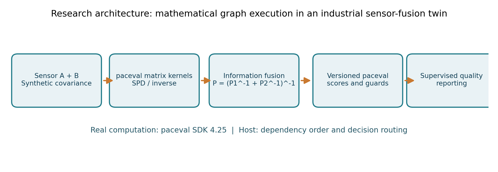
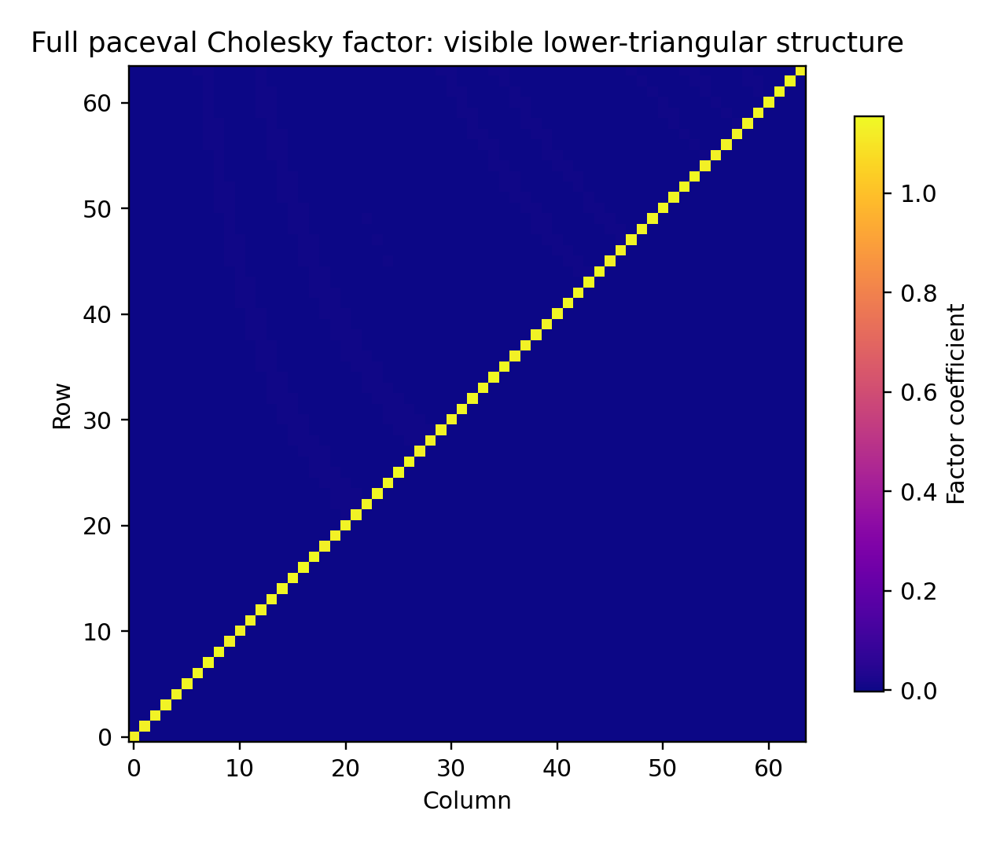
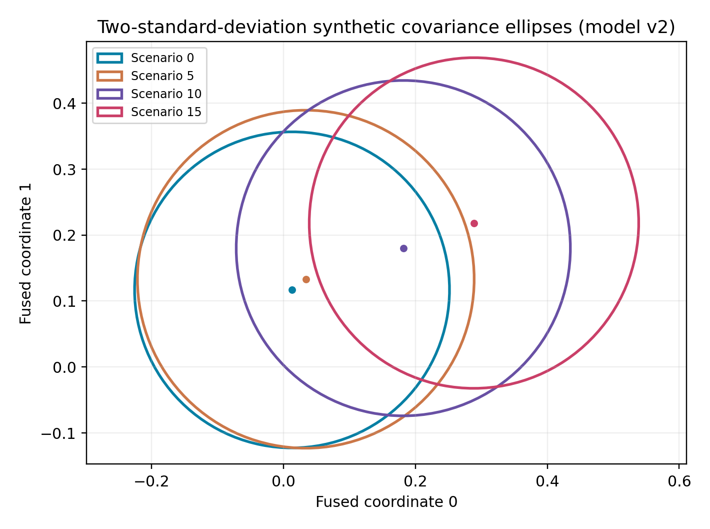
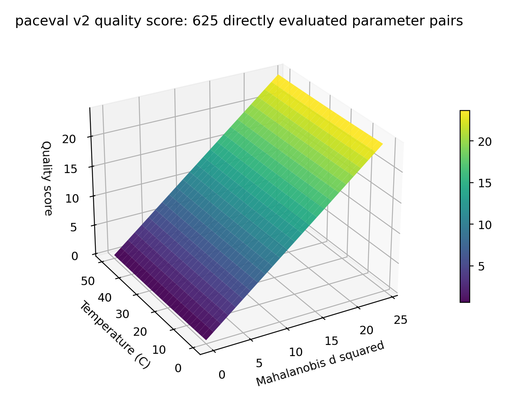

# Programmable Matrix Mathematics for Industrial Sensor Fusion with paceval


*Concept illustration; not a computed research result. Original artwork sized 2400 × 1200 pixels.*

This research demonstrates **complete dense positive-definite matrix factorization and inversion**, **matrix-based sensor fusion**, **reusable mathematical execution graphs**, and **versioned industrial quality mathematics** using the **original paceval C++ SDK**. A scientific report, executable C++ source, reproducible double-precision matrices, independently checked synthetic sensor scenarios, and the original public SDK sources are provided.

**[Read the English scientific whitepaper](paceval_Industrial_Matrix_Sensor_Fusion_Whitepaper_EN.pdf)** · **[C++ implementation](src/matrix_sensor_fusion.cpp)** · **[Recorded results](results/)** · **[Scientific figures](figures/)**

## 1. Industrial use case and current state of the art

A precision inspection cell may combine coordinate-metrology data, laser sensor readings, thermal-state information and multiple geometric estimates of one manufactured component. Every measurement arrives with an uncertainty model. Covariance matrices describe how individual dimensions vary together. A supervisory digital twin must perform matrix-based estimation, detect conflicting sensors and consistently apply approved, versioned quality criteria.

In the research workflow, two independent six-dimensional synthetic sensors estimate a common normalized state. The engine first builds a complete **symmetric positive-definite (SPD) covariance** representation. Cholesky factorizations and inverse matrices support an information-form fusion step. The resulting fused state and covariance feed mathematical scores and signed quality margins for independent model versions. The C++ host owns the sequence of dependent operations and the final status decision. The numerical kernels, matrix accumulation, sensitivity expressions and quality functions are evaluated by real paceval graphs.

Matrix decomposition and solution are established techniques. [LAPACK DPOTRF](https://www.netlib.org/lapack/explore-html/d2/d09/group__potrf_ga84e90859b02139934b166e579dd211d4.html) and [DPOTRS](https://www.netlib.org/lapack/explore-html/d3/dc8/group__potrs_ga70a04d13ff2123745a26b1e236212cf7.html) provide industrial-strength numerical reference implementations. Research on [square-root filtering for visual-inertial estimation (2025)](https://arxiv.org/abs/2510.10346) explains why positive-definite covariance handling matters. Recent manufacturing research includes a [2025 CNC multisensor digital-twin review](https://www.mdpi.com/2075-1702/13/10/921), a [2026 review of hybrid digital twins](https://www.sciencedirect.com/science/article/pii/S0278612525003267), and [NIST's 2026 digital-twin workshops](https://www.nist.gov/publications/digital-twins-workshops-summary-report), which emphasize model credibility, interoperability and uncertainty governance.

**The goal is a functionality and numerical feasibility demonstration**, not a performance comparison or an assertion of industrial measurement certification. All data are synthetic and dimensionless except the illustrative temperature input in degrees Celsius.

## 2. Verified research scope

- A **new complete 512 × 512** symmetric positive-definite matrix, its full Cholesky factor and its complete inverse were computed using persistent paceval graphs. Every inverse element is archived in IEEE-754 binary64 format.
- A second **128 × 128** complete matrix was independently calculated. The two complete inverses contain **262,144 + 16,384** stored numerical entries.
- **17 distinct paceval graphs** implement the meaningful matrix arithmetic kernels, versioned quality scores, acceptance margins, uncertainty calculations, and analytical temperature derivatives.
- The new 512-dimensional execution recorded **67,538,758 genuine graph outputs**, including the 32 sensor-fusion cases and a 625-point mathematical quality surface.
- Two distinct mathematical score versions remain available. The 32 full synthetic fusion runs include ACCEPT, REVIEW and REJECT outputs for both versions.
- Independent NumPy-based **full-matrix checks** and **56 80-decimal-digit high-precision values** passed. These checks are retained in technical audit files but are not turned into published accuracy comparisons.

The supplied source whitepaper separately reports historical 512- and 1024-dimensional experiments. **The historical 1024 × 1024 experiment was not re-executed for this new package**. The new 128- and 512-dimensional outcomes above are from this project's own recorded SDK execution.

## 3. Mathematical models

The program computes complete SPD factorization and inversion using reusable graph expressions for square roots, division, Schur complement updates, forward-substitution updates and matrix accumulations. C++ provides only algorithmic dependency ordering, memory management, data validation and file output.

```math
A = LL^{T},\qquad A^{-1} = L^{-T}L^{-1}.
```

The industrial sensor-fusion example uses two SPD covariance matrices, independent sensor observations and their information matrices:

```math
P_f=(P_1^{-1}+P_2^{-1})^{-1},\qquad
\hat{x}=P_f(P_1^{-1}m_1+P_2^{-1}m_2).
```

The innovation statistic is based on the covariance of the **difference between independent sensor observations**, not on the fused covariance:

```math
d^2=(m_1-m_2)^T(P_1+P_2)^{-1}(m_1-m_2).
```

Two separate versioned paceval score graphs use a dimensionless uncertainty radius, the norm of sensor disagreement and illustrative temperature terms. They also calculate signed margins against a hypothetical threshold of 12.592. The temperature sensitivity graphs encode the analytical partial derivative of the respective score with respect to temperature.

## 4. Actual graph execution responsibilities

| Mathematical function and industrial purpose | Actual owner | Implementation |
|---|---|---|
| Cholesky pivots and divisions | **paceval** | `sqrt(a)`, `a/b` |
| Dense Schur complement and triangular-inverse updates | **paceval** | `a-b*c` |
| Complete inverse Gram accumulation and vector products | **paceval** | `a+b*c` |
| Log-determinant scalar terms and accumulation | **paceval** | `ln(a)`, `a+2*b` |
| Covariance and information-matrix sums | **paceval** | `a+b` |
| Innovation and magnitude building blocks | **paceval** | `a-b`, `a*a`, `sqrt(a)`, `abs(a)` |
| Two score versions, continuous gates and explicit sensitivities | **paceval** | Six persistent formula-version graphs |
| Dependency order, matrix storage, case selection and file output | C++ host | Orchestration, not a substitute for mathematical kernels |
| Full-matrix and high-precision independent controls | Python/NumPy/mpmath | Independent validation only |

The [machine-readable graph registry](results/graph_registry.csv) documents actual calls and outputs for each graph. The [mathematical execution inventory](results/math_execution_inventory.csv) distinguishes engine, host and reference functions.

## 5. Executed industrial results

The synthetic experiment includes 16 measurement scenarios and two model versions. Increasing sensor disagreement creates multiple decision categories without altering either model version in place. Results are stored in [sensor_fusion.csv](results/sensor_fusion.csv), including fused coordinates, covariance diagonals, innovation statistics, continuous scores, temperature derivatives and decisions. The actual [625-point quality-score surface](results/quality_score_surface.csv) provides a two-dimensional analytical view of the same executed functions.

All reported matrix products and inverses are **full-size mathematical results**, not selected small blocks or a diagonal-plus-low-rank identity. The visualizations use the actual stored matrices and paceval output files. The architecture figure is a labelled explanatory schematic.

## 6. Scientific diagrams









For all twelve reproducible scientific figures, inspect [the figures directory](figures/) and run [make_figures.py](src/make_figures.py). PNG and vector PDF outputs are included.

## 7. Build on Linux x86-64

Use a compatible original paceval Linux shared library. The binary library is provided **externally** and is deliberately **not included** in this public GitHub research package.

```bash
cmake -S src -B build -DCMAKE_BUILD_TYPE=Release \
  -DPACEVAL_RUNTIME=/absolute/path/to/libpaceval_linux_sharedLIB.so
cmake --build build -j
./build/matrix_sensor_fusion . --n 128
./build/matrix_sensor_fusion . --n 512
ctest --test-dir build --output-on-failure
```

For source-level verification without overwriting archived output use `--verify-only`. A larger 1024 case may be attempted using `--n 1024`, but it is **not** counted as newly executed here.

## 8. Reproduction and independent audit

```bash
OPENBLAS_NUM_THREADS=1 python3 src/verify_results.py .
python3 src/verify_inventory.py .
python3 src/check_readme_math.py .
python3 src/make_figures.py .
```

The independent reference reads all original, factor and inverse matrices from the binary64 result files. It verifies every inverse entry, the factorization identity, the inverse identity, full six-dimensional sensor-fusion results and the score-surface values. High precision results are computed independently using mpmath.

See [the technical validation record](docs/RESEARCH_VALIDATION.md), the [independent audit](results/independent_audit.json) and the [reproducibility manifest](SHA256SUMS.txt).

## 9. Scientific interpretation and limitations

The work demonstrates mathematical graph reuse, complete SPD matrix operations and reusable domain-specific score expressions using the **actual original paceval library**. Its scientific value is the functional integration of mathematical model layers, versioned decisions and auditable outputs. It does **not** demonstrate accuracy of real sensors, a certified metrology pipeline, stability for arbitrary ill-conditioned or indefinite matrices, a real-time controller or a hardware acceleration advantage. No performance comparisons are provided. TINC was not used.

Quality thresholds and calibration constants are synthetic. Production applications need independent equipment-level validation, an uncertainty budget, secure configuration management and human review of any safety-relevant decisions.

## 10. Selected scientific references

See the reference section of the [English whitepaper](paceval_Industrial_Matrix_Sensor_Fusion_Whitepaper_EN.pdf) for dated sources including NIST, LAPACK and 2025–2026 digital-twin sensor-fusion research.
