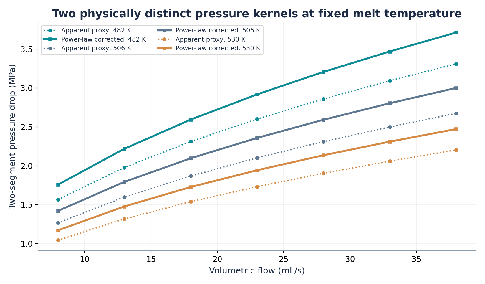
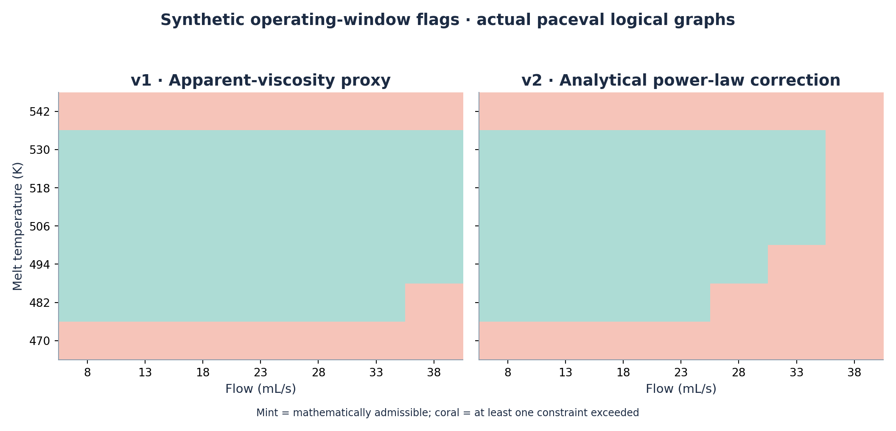
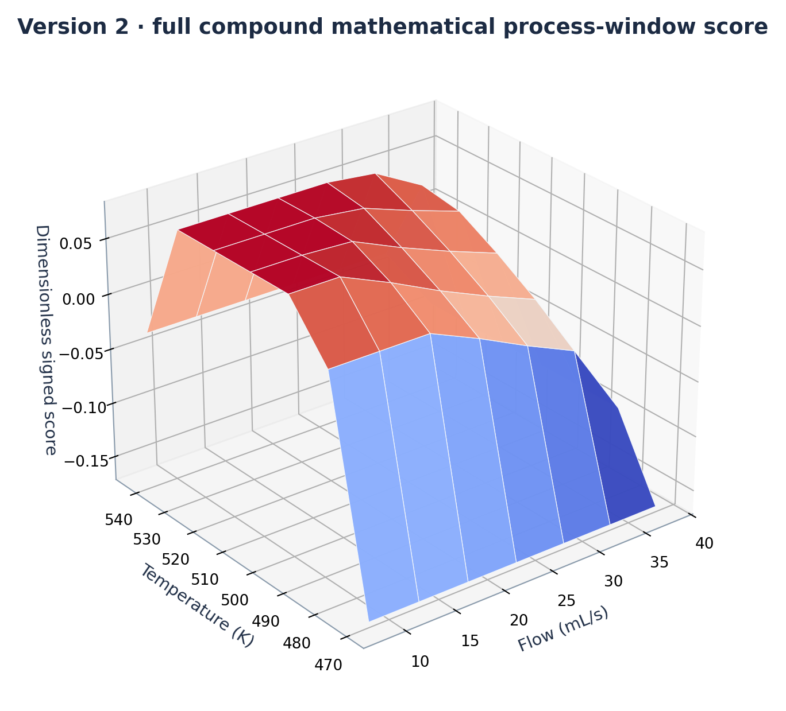

# Programmable Injection-Molding Rheology and Pressure-Window Kernels with paceval


*Industrial mathematical research demonstrator · 14 November 2026 · English · synthetic material/geometry scenarios*

This research demonstrates reproducible mathematical **rheology, runner pressure and process-window screening** with versioned, reusable paceval computation graphs. The original paceval Mathematical Engine was actually used via the remote **paceval MCP 4.26** interface, with **31 distinct mathematical graphs across 49 main grid points and 12 additional edge/model cases**. The complete C++17 reproduction source uses the original paceval SDK files but **has not been linked to or executed with a compatible local Linux shared library**. Synthetic computations are not calibrated injection-molding predictions, machine-control recommendations or material specifications.

[Scientific whitepaper (PDF)](paceval_Injection_Molding_Rheology_Whitepaper_EN.pdf) | [C++ main](src/injection_molding_paceval.cpp) | [Actual MCP observations](results/mcp_grid_observed.csv) | [Execution inventory](results/math_execution_inventory.csv) | [Original research proposal](docs/Original_WP20_Proposal_2026-11-13.pdf)

## 1. Industrial use case and current state of the art

Injection molding forces heated polymer melt through a barrel, nozzle, runners and a gate into a cooled mold cavity. Production settings involve material rheology, flow rate, melt temperature, cavity pressure, pack/hold conditions and cycle energy. Because polymer melts are usually shear-thinning, a single Newtonian viscosity cannot describe all flow conditions. Engineers first characterize a material using a rheometer and then apply validated material models, cavity geometry and boundary conditions in specialized filling simulations. A screening model is useful only as a traceable, lower-fidelity component of that wider engineering workflow.

Commercial simulation environments such as **Autodesk Moldflow**, **Moldex3D**, **SIGMASOFT** and **Cadmould** support more complete filling analyses; the 2023 review in *Polymers* summarizes their numerical approaches. The Autodesk Cross-WLF model accounts for shear-rate and temperature dependence, with pressure-sensitive material coefficients when measured. Work published in 2025 investigates cavity pressure sensing for iterative learning control; a 2026 study integrates capacitance, pressure and temperature to estimate in-process shrinkage. The current **ISO 11443:2021** and **ASTM D3835-24** provide relevant capillary rheometry methods. These references motivate characterization and validation rather than replacing them. References appear below.

A hypothetical mold engineer may want to identify which **synthetic** combinations of melt temperature and nominal flow remain within declared pressure, shear and cycle-energy constraints. This demonstrator evaluates that question for two idealized circular runner segments, using the same validated input rows and two simultaneously available mathematical pressure-model versions. It does **not** solve the spatial or transient mold-filling equations, infer a real cavity-pressure waveform, calculate fiber orientation, or automatically control a production machine.

## 2. Mathematical model and versioned pressure paths

The original WP20 proposal specified an Arrhenius-shifted shear-thinning power law and a Newtonian circular-pipe pressure relation evaluated at apparent viscosity. The research extension preserves that as **v1**, adds the analytically corrected fully developed *power-law* pipe solution as **v2**, and evaluates a bounded Cross-Arrhenius viscosity formula separately as a *diagnostic* rheology alternative. The latter is not a measured or fitted Cross-WLF material card.

For each segment of radius $r$, length $L$, positive volumetric flow $Q$ and absolute temperature $T$, the nominal shear rate, Arrhenius multiplier and apparent power-law viscosity are:

$$
\dot\gamma_{app}=\frac{4Q}{\pi r^3},\qquad
f_n=\frac{3n+1}{4n},\qquad
F_T=\exp\left[\frac{E}{R_g}\left(\frac{1}{T}-\frac{1}{T_{ref}}\right)\right],
$$

$$
\eta_{PL}=K\dot\gamma_{app}^{n-1}F_T,\qquad
\Delta p_{v1}=\frac{8\eta_{PL}LQ}{\pi r^4},\qquad
\Delta p_{v2}=\frac{2KLF_T}{r}(f_n\dot\gamma_{app})^n.
$$

The pressure expressions are evaluated for both segments and added by separate *composite paceval graphs*. The v2 expression follows from the stationary, laminar, isothermal cylindrical *ideal power-law fluid* under no-slip, fully developed flow. At $n=1$, both expressions reduce to the Newtonian Hagen-Poiseuille result. At $0<n<1$ their difference is an explicit model assumption, not an accuracy victory established against measured cavity pressure. `K` has the units Pa·s^n; it is **not** a fixed viscosity across alternative values of $n$.

The diagnostic bounded Cross-type expression uses a hypothetical zero-shear value $\eta_0(T)$:

$$
\eta_0(T)=\eta_{0,ref} F_T,\qquad
\eta_{Cross}=\frac{\eta_0(T)}{1+(\eta_0(T)\dot\gamma_{app}/\tau_*)^{1-n}}.
$$

Its coefficients are synthetic. In real practice, pressure-dependent Cross-WLF parameters and entrance effects must come from experimental material testing.

## 3. Mathematical process-window decision

The host validates input domains before each engine call. paceval calculates signed constraints for an *illustrative* machine pressure limit, a **specified** lumped cavity-pressure requirement, an upper shear rate, a temperature interval and an externally supplied cycle-energy budget. The pressure margin and a version-specific numerical window indicator are:

$$
m_p=P_{machine,max}-P_{cavity,required}-\sum_i\Delta p_i,
$$

$$
g_{v}=\left(m_p\geq0\right)\land\left(m_{\gamma,v}\geq0\right)
\land\left(m_T\geq0\right)\land\left(E_{max}-E_{cycle}\geq0\right),
$$

with $E_{cycle}=P_{heater}t_{heat}+P_{inject}t_{inject}$. Both versions have their own pressure, shear, guard and continuous dimensionless score graphs. A numerical zero-margin point is mathematically included because `>=` is explicit. No status here is an industrial safety approval or evidence of actual part quality.

## 4. Actual paceval execution and independent checks

The **main MCP batch** evaluated **31 distinct graphs at 61 independent input scenarios**, yielding **1,891 graph-point evaluations** with zero returned errors. Seven additional fixed-temperature rheology cases reused eight graphs (56 further graph-point evaluations). Pointwise TINC tested two additional graph variants on five cases each (10 interval outputs). Seven separate operator selftest graphs ran across three cases (21 evaluations); neither these tests nor their graphs are added to the main graph count. All counts and exact interface classification are in [`results/execution_evidence.json`](results/execution_evidence.json).

At the declared grid settings, **34 of 49 v1 cases** and **27 of 49 v2 cases** meet the mathematical constraints. **Seven scenarios change status** between versions. In one synthetic scenario (flow 28 mL/s, temperature 482 K), v1 gives a runner pressure of about **2.859 MPa**, while v2 gives **3.207 MPa**. With a 3.1 MPa runner-pressure allowance and the other stated limits, the v1 case is within the mathematical window and the v2 case is outside. This illustrates sensitivity to the chosen constitutive approximation, not an experimentally validated pressure difference. A separate $n=1$ case confirms the analytic Newtonian limit.

| Mathematical function / industrial purpose | Actual implementation | Graph or version |
|---|---|---|
| Nominal and corrected wall shear rates | Executed paceval graphs | `gammaA`, `gammaB`, `gammaWallA_v2`, `gammaWallB_v2` |
| Power-law viscosity and segment pressure | Executed paceval graphs | v1 and v2 segment expressions |
| Composed runner pressure and pressure margin | Executed paceval graphs | `pressureTotal_v1/v2`, `pressureMargin_v1/v2` |
| Temperature, shear and energy margins | Executed paceval graphs | `temperatureMargin`, `shearMargin_v1/v2`, `energyMargin` |
| Combined admissibility, signed score | Executed paceval graphs | `guard_v1/v2`, `score_v1/v2` |
| Explicit pressure sensitivities and version delta | Executed paceval graphs | `sensitivityPressureQ_v2`, `sensitivityPressureT_v2`, `pressureDelta_v2_v1` |
| Cross-type rheology diagnostic | Executed paceval graphs | `crossEtaA/B_diagnostic`, `pressureCrossProxy_diagnostic` |
| Input domain, file processing and result statuses | C++ host | Literal-only CSV validation and I/O |
| Independent numerical checks | Separate C++/mpmath | Verification only, not primary results |







All seven numbered charts under `figures/` are derived from **observed MCP output decimals**. The title image is concept artwork. The CSV files contain selections transcribed from returned result text, not complete lossless snapshots of the binary internal values. The **421 independent 90-digit numerical and logical checks** passed against the archived results; 10 printed TINC-point intervals enclosed their corresponding high-precision point references. Pointwise TINC is **not** uncertainty propagation or a proof for a continuum of inputs. Numerical audit details remain under `results/` rather than being presented as competing-engine accuracy claims.

## 5. Original local SDK reproduction

The unchanged original `paceval_main.h` and `paceval_main.cpp` are included under `src/` with original notices. The external binary **`libpaceval_linux_sharedLIB.so` is deliberately not included**. A matching local runtime is required to link and execute CTest.

```bash
cmake -S src -B build -DCMAKE_BUILD_TYPE=Release \
  -DPACEVAL_RUNTIME=/absolute/path/to/libpaceval_linux_sharedLIB.so
cmake --build build -j
ctest --test-dir build --output-on-failure
./build/injection_molding_paceval .
python validation/high_precision_reference.py .
python validation/check_project.py .
```

The application uses the original `paceval_dConvertStringToFloat` and `paceval_dConvertFloatToString` in the real numerical CSV ingestion/output code path, after strict numeric-literal and domain checks. Persistent computation handles, scalar controls, single-graph batch and multi-graph batch paths are included. **The C++17 syntax check succeeded; the linked local SDK application and CTest have not been run.** The original SDK’s numeric text output is not assumed to preserve arbitrary IEEE-754 bit patterns exactly. The archive includes independent byte-preserving source inputs and recorded decimal outputs.

## 6. Scientific limits and next pilot

This simplified model omits actual 3D cavity filling, transient and compressible flow, gate-entry pressure loss, geometry-dependent shear heating, viscoelasticity, cooling and solidification, weld lines, fiber orientation, back-pressure dynamics, measured cavity-pressure curves and product quality. Different polymer grades require different measured constitutive coefficients. An industrial pilot should fit rheometry measured under ISO 11443:2021 / ASTM D3835-24, validate predicted runner pressure against permitted mold/nozzle sensors, and compare filled-parts criteria against a specialist simulator on holdout processing conditions. Only then can screening scores be related to meaningful physical quality.

## 7. External references

- Autodesk Moldflow, *Simulation models* and *Cross-WLF viscosity model*: https://help.autodesk.com/cloudhelp/2023/ENU/MoldflowInsight-CLC-Ref-Materials/files/GUID-EC0F471C-A2C5-4461-9C83-B62B85936166.html and https://help.autodesk.com/cloudhelp/2019/ENU/MoldflowComm-Reference/files/GUID-7BC3A8F0-8B41-4FCB-BDF1-F1159E4DD175.htm
- Review, *Approaches for Numerical Modeling and Simulation of the Filling Phase in Injection Molding*, *Polymers* 15 (2023), 4220: https://www.mdpi.com/2073-4360/15/21/4220
- *Enhancing Injection Molding Process by Implementing Cavity Pressure Sensors and an Iterative Learning Control*, *Processes* 13 (2025), 3010: https://www.mdpi.com/2227-9717/13/9/3010
- *Integrated capacitance–pressure–temperature sensor for injection molding*, *Measurement* (2026): https://www.sciencedirect.com/science/article/pii/S0263224125030234
- *The Impact of Pressure-Dependent Viscosity Data on Injection Molding Simulations of Highly Filled Thermoplastics* (2025): https://pmc.ncbi.nlm.nih.gov/articles/PMC12736440/
- ISO 11443:2021, *Capillary and slit-die rheometers*: https://www.iso.org/standard/80003.html
- ASTM D3835-24, *Properties of Polymeric Materials by Capillary Rheometer*: https://store.astm.org/d3835-24.html
- paceval, official SDK/API reference: https://paceval.com/api/

*The original WP20 (13 November 2026) was a proposed experiment, not an earlier measured result. This is a remote-MCP executed mathematical research demonstrator with a separately unexecuted local SDK reproduction path.*
