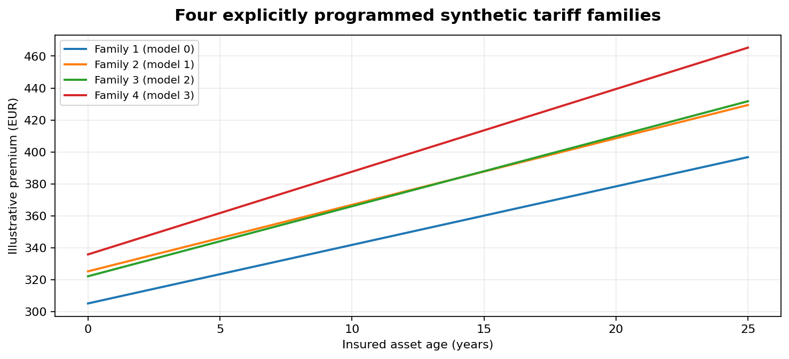

# paceval — High-Volume Insurance Tariff Evaluation


**Research-grade synthetic C++ demonstrator | 12 November 2026 | Linux x86-64 validated.**

This repository turns the starting proposal **WP-013: High-Volume Insurance Tariff Evaluation** into a directly executable study. It uses the official `paceval_main.h` and `paceval_main.cpp` C/C++ SDK facade and an **externally supplied Linux runtime**, to create and reuse 100 independently versioned mathematical premium-computation graphs across 1,024 synthetic insurance-policy records. Independent native C++ and 100-digit arithmetic validate the mathematical results. No real insurance contracts, personal attributes, customer data, production underwriting, or legally approved tariffs are represented.

[Read the English research whitepaper](paceval_Insurance_Tariffs_Whitepaper_EN.pdf) · [Main C++ demonstrator](src/insurance_tariffs.cpp) · [CMake build](src/CMakeLists.txt) · [Numerical verification](src/high_precision_reference.py)

## Research outcome

| Tested element | Observed result |
|---|---|
| Reusable paceval expression graphs | 100 individual models (four synthetic mathematical families) |
| Paired policy records | 1,024 records (512 deliberately identical risk-factor pairs) |
| Mathematical premium evaluations | 102,400; all match native C++ reference within the specified tolerance |
| Independent high-precision reference | 102,400 / 102,400 within tolerance at 100 decimal digits |
| Maximum deviation from high-precision reference | 4.20 × 10⁻¹³ EUR (absolute) |
| Non-rating tag pair invariance | 0 EUR observed difference for each equal-risk pair and all 100 models |
| Model version update | Recompile only model 17 from version 1 to 2, retain other graphs |
| TINC diagnostic | 24 / 24 raw sample intervals contain the exact reference for a separate smooth polynomial |
| GCC / Clang | Official paceval facade compiled successfully; automated CTest suite included |

**Scientific boundary.** This is a numerical *feasibility demonstration*, not actuarial product development, a fairness certification, a price quotation, a benchmarked performance claim, or regulatory clearance. The model is intentionally synthetic; a valid engine calculation does not validate the underlying pricing assumptions. The tag-invariance test checks one narrow counterfactual property, not compliance with all non-discrimination obligations.

## Mathematical core

Inputs (and explicit units):

- `age`: age of the **insured asset** in years (0–25); **never policyholder age**.
- `claims`: previous claim count, integer 0–4.
- `km`: annual distance travelled, in **1,000 km** (1–50).
- `cover`: synthetic coverage code 1, 2 or 3.
- `excess`: deductible in **1,000 EUR** (0–2).

The project starts with the WP-013 expression `premium = b*(1 + a*age)*(1 + c*claim_count)`, interpreting `age` strictly as **asset age**. The enhanced study uses four explicit, bounded families: multiplicative asset/claims factors; additional mileage/coverage factors; an exponential mileage effect with deductible adjustment; and a smooth additive/cross-factor expression with deductible adjustment. Every formula is readable in the [exported model registry](examples/models.csv) and is compiled *once* into a persistent paceval graph.

The `nonrating_tag` field is never exposed to paceval or used in any formula. The C++ host generates the two tags for otherwise identical synthetic inputs to test invariance.



## Build and run

Requirements: CMake 3.16+, C++17 compiler (GCC or Clang), a **compatible** Linux `libpaceval_linux_sharedLIB.so` supplied separately. Optional validation/plots/document generation: Python 3 with [research dependencies](src/requirements.txt). The runtime is **not** included in this public-source package.

```bash
cmake -S src -B build -DCMAKE_BUILD_TYPE=Release \
  -DPACEVAL_RUNTIME=/absolute/path/to/libpaceval_linux_sharedLIB.so
cmake --build build -j
ctest --test-dir build --output-on-failure

# Full reproducible study (102,400 calculations):
./build/insurance_tariffs --pairs 512 --models 100 --batch 128 \
  --seed 20261112 --out run
python3 src/high_precision_reference.py run

# Replay the published synthetic input CSV:
./build/insurance_tariffs --input examples/policies.csv \
  --models 100 --batch 37 --out replay

# Rebuild PNG/SVG figures from published CSV files:
python3 src/make_figures.py

# Optional: regenerate the publication PDF:
python3 src/make_whitepaper.py
```

`--models` accepts 1–100; `--pairs` accepts 1–20,000; `--batch` accepts 1–8,192. All asset inputs are checked against their declared domain before mathematical evaluation. The deliberately invalid [CSV case](examples/invalid_policy.csv) is expected to be rejected by the CTest suite.

**SDK integration:** `insurance_tariffs.cpp` calls `paceval_InitializeLibrary`, `paceval_CreateComputation`, `paceval_dGetComputationResultExt`, `paceval_dGetComputationResult`, `paceval_GetIsError`, `paceval_DeleteComputation`, and `paceval_FreeLibrary`. `paceval_main.cpp` is **compiled** alongside the application, and CMake **links** the externally provided runtime. Note that the SDK's batch API returns `true` to indicate an **error**, not success.

## Files for independent reproduction

| File | What it contains |
|---|---|
| [src/insurance_tariffs.cpp](src/insurance_tariffs.cpp) | C++ host, synthetic data generation, paceval graph management, native audit, CSV import |
| [src/paceval_main.h](src/paceval_main.h) / [src/paceval_main.cpp](src/paceval_main.cpp) | Official paceval SDK API facade; existing license notices preserved |
| [src/CMakeLists.txt](src/CMakeLists.txt) | Direct SDK build, external runtime linking, input-validation/CSV tests |
| [src/high_precision_reference.py](src/high_precision_reference.py) | Independent 100-digit audit including raw TINC interval inclusion |
| [src/make_figures.py](src/make_figures.py) / [src/make_whitepaper.py](src/make_whitepaper.py) | Eight regenerated scientific plots and the PDF research report |
| [src/requirements.txt](src/requirements.txt) | Optional scientific Python dependencies |
| [examples/policies.csv](examples/policies.csv) | Deterministically generated synthetic paired rating inputs |
| [examples/models.csv](examples/models.csv) | All 100 formula strings and numeric coefficients |
| [examples/premiums.csv](examples/premiums.csv) | 102,400 paceval premiums and native C++ references |
| [examples/model_summary.csv](examples/model_summary.csv) | Model averages, extremes, reference and pairwise diagnostics |
| [examples/model_update.csv](examples/model_update.csv) | Controlled model 17 replacement and unchanged unrelated model |
| [examples/tinc_samples.csv](examples/tinc_samples.csv) | Unmodified interval endpoints for a separate diagnostic polynomial |
| [examples/run_summary.json](examples/run_summary.json) / [examples/high_precision_audit.json](examples/high_precision_audit.json) | Machine-readable checks and reproducibility manifest |
| [examples/invalid_policy.csv](examples/invalid_policy.csv) | Intentionally invalid input for rejection regression |

## Scientific figures

1. [Research architecture](figures/01_research_workflow.png)
2. [Four mathematical families](figures/02_mathematical_families.png)
3. [Actual premium distribution for one synthetic model](figures/03_premium_distribution.png)
4. [Native C++ comparison results](figures/04_native_validation.png)
5. [Controlled tariff version change](figures/05_version_change.png)
6. [Paired non-rating tag invariance](figures/06_paired_tag_invariance.png)
7. [Model-level mean premium distribution](figures/07_model_family_comparison.png)
8. [TINC sample audit](figures/08_tinc_sample_audit.png)

All eight diagrams are also provided as [SVG files](figures/01_research_workflow.svg) for scalable GitHub and publication use.

## Domain boundaries and research context

The **Casualty Actuarial Society** explains principles of cost-based property/casualty ratemaking; those underwriting and cost models are **outside** this numerical engine experiment. **EIOPA** explicitly warns against unfair non-risk-based differential pricing and promotes record-keeping, fairness, transparency, and governance. EU **Test-Achats** unisex guidance applies to individual insurance premiums. Our demonstration deliberately excludes any protected personal attribute and does not claim legal compliance or an audited absence of proxy discrimination. Any real-world deployment requires actuarial validation, privacy, governance and relevant legal review.

Relevant external research references:

- [paceval C/C++ API (official)](https://paceval.com/api/)
- [CAS — Statement of Principles Regarding Property and Casualty Insurance Ratemaking](https://www.casact.org/statement-principles-regarding-property-and-casualty-insurance-ratemaking)
- [EIOPA — differential pricing supervisory statement](https://www.eiopa.europa.eu/publications/supervisory-statement-differential-pricing-practices-non-life-insurance-lines-business_en)
- [EIOPA — AI governance and risk management (2025)](https://www.eiopa.europa.eu/eiopa-publishes-opinion-ai-governance-and-risk-management-2025-08-06_en)
- [EUR-Lex — unisex insurance pricing guidance following Test-Achats](https://eur-lex.europa.eu/legal-content/EN/TXT/?uri=CELEX:52012XC0113(01))

This repository is research software, not a regulated pricing product. No `LICENSE_NOTICE.md` is generated. The upstream SDK files retain their original legal notices; the external paceval runtime must be obtained and used under appropriate terms.
