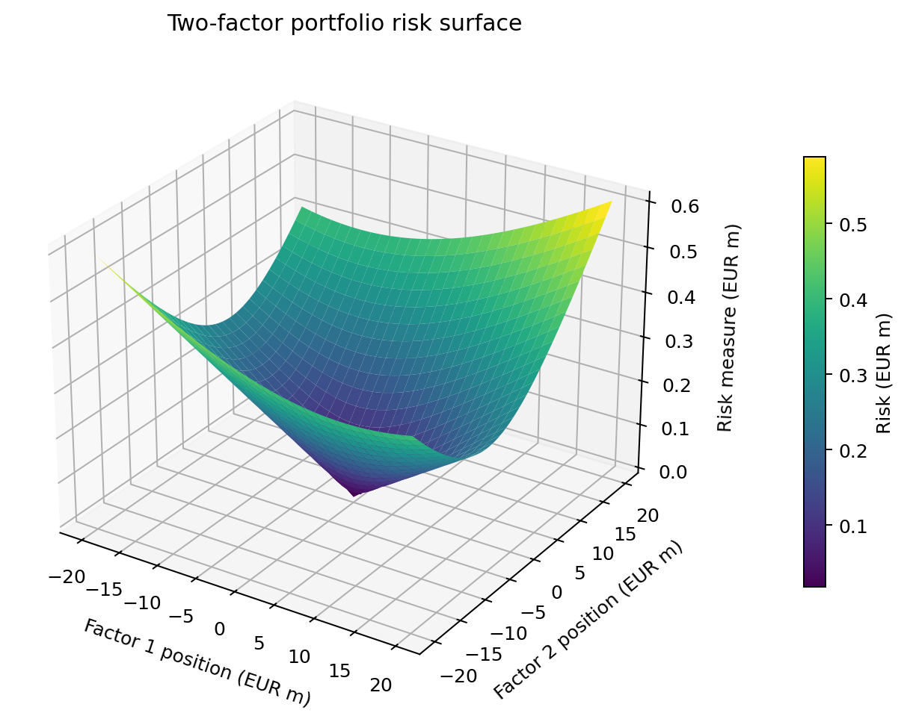
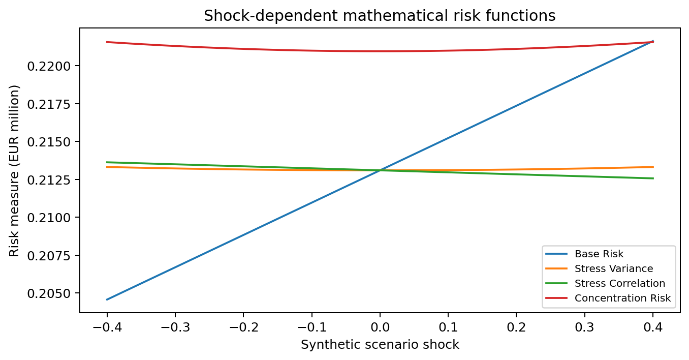

# paceval. | Intraday Risk Metric Recalculation


**A reproducible C++ research demonstrator of fifty reusable, versioned mathematical risk functions, evaluated with the original paceval C/C++ engine.** This project models a controlled intraday market-risk monitoring workflow with synthetic portfolio positions and a frozen two-factor covariance matrix.

[English research whitepaper](paceval_Intraday_Risk_Whitepaper_EN.pdf) · [C++ demonstrator](src/intraday_risk.cpp) · [CMake](src/CMakeLists.txt) · [Original SDK header](src/paceval_main.h) · [Original SDK facade](src/paceval_main.cpp)

## 1. Industrial use case and current state of the art

Bank risk-control teams monitor risk-limit utilization as positions and market conditions change. A typical workflow collects valued positions and factor sensitivities, obtains an approved covariance or scenario model, computes a portfolio risk measure, compares the result against a controlled limit and records exceptions for a human or downstream risk process. Intraday measurements are important, but they do not remove model governance, data quality and independent validation requirements.

The classical delta-normal approach approximates the standard deviation of a linear portfolio using a variance-covariance matrix. The RiskMetrics technical document describes its foundations; [BIS market-risk internal-model provisions](https://www.bis.org/committees/bcbs/basel-framework/standard/mar/30/inforce/2023-01-01/published/2024-07-05) distinguish regulatory expected shortfall and independent validation, while the [Basel Core Principles](https://www.bis.org/committees/bcbs/basel-framework/standard/bcp/40/inforce/2024-04-25/published/2024-04-25) require appropriate limits, oversight and frequently refreshed valuation information. See also the [RiskMetrics technical document](https://www.msci.com/documents/10199/5915b101-4206-4ba0-aee2-3449d5c7) and the [paceval C/C++ API](https://paceval.com/api/).

In this research model, two signed portfolio factor exposures are provided in **EUR millions**, while factor covariance values describe dimensionless daily return changes. The C++ host freezes the covariance model, validates each input, selects one of fifty mathematical rule handles and assesses whether the calculated research risk measure exceeds an illustrative limit. **paceval evaluates the nonlinear mathematical expressions; it does not estimate covariance, price securities, calculate regulatory expected shortfall or authorize trading.** The workload is synthetic and has no operational real-time latency claim.

## 2. Defined mathematical functions and paceval execution

A positive-semidefinite fixed covariance matrix is used for all updates, with daily factor variances 0.0002 and 0.00045 and covariance 0.00012:

```math
\Sigma=\begin{bmatrix}0.0002&0.00012\\0.00012&0.00045\end{bmatrix}.
```

For signed factor positions $w_1,w_2$, the baseline risk metric is the standard deviation of a linearized portfolio P&L:

```math
R_0(w_1,w_2)=\sqrt{0.0002w_1^2+0.00024w_1w_2+0.00045w_2^2}.
```

Five mathematically distinct families each have ten coefficient configurations. Let $q=w^T\Sigma w$ and $s$ be a dimensionless synthetic shock:

```math
\begin{aligned}
R_1&=\sqrt{q}(1+as),\\
R_2&=\sqrt{q+0.00002a(w_1^2+w_2^2)s^2},\\
R_3&=\sqrt{0.0002w_1^2+0.00045w_2^2+2(0.00012+0.00002as)w_1w_2},\\
R_4&=\sqrt{q}+0.004a\sqrt{w_1^2+w_2^2}\sqrt{1+s^2},\\
R_5&=\sqrt{q}+0.00015a|w_1w_2|s^2+0.002b\sqrt{1+s^2}.
\end{aligned}
```

These five families are experimental sensitivities; none is presented as a production market-risk standard. The frozen covariance must remain positive semidefinite under the correlation-shift family. The code uses bounded shock and coefficients to preserve this condition. A risk-limit event is determined by the host using the mathematical rule output and the specified illustrative limit, not by a statutory limit framework.

The SDK creates fifty handles via `paceval_CreateComputation`, then repeatedly evaluates them using `paceval_dGetComputationResult`; packed-batch verification calls `paceval_dGetComputationResultExt`. A controlled coefficient change is registered as a **51st distinct graph**. All graph handles are freed with `paceval_DeleteComputation`.

## 3. Executed research results

| Research item | Completed outcome |
|---|---:|
| Original mathematical risk expressions | 50 |
| Persistent paceval graphs including immutable revision | 51 |
| Fully executed synthetic market updates | 20,000 |
| Scalar paceval evaluations, including surfaces and scenarios | 24,167 |
| Independently checked batch values | 1,600 |
| Two-factor risk-surface values | 3,721 |
| Independent 80-digit calculations of exported samples | 500, passed |
| Invalid input cases rejected by C++ host | 3 |
| CMake and CTest SDK integration | 1/1 passed |

Detailed internal numerical verification, including precision diagnostics, is available in [results](results/) and the independent [high-precision audit](src/high_precision_reference.py). No performance or accuracy advantage over native C++ is claimed. The numerical metric is not a calibrated forecast or regulatory capital measure.

## 4. Industrial interpretation of actual calculated graphics

All eight numbered scientific figures are regenerated from [released paceval CSV data](examples/); the cover is an independently generated conceptual illustration.

| Figure | Interpretation | Images |
|---|---|---|
| 1 | Sampled risk series and illustrative limit exceedances | [PNG](figures/01_intraday_replay.png) · [PDF](figures/01_intraday_replay.pdf) |
| 2 | Distribution of computed intraday metric values | [PNG](figures/02_risk_distribution.png) · [PDF](figures/02_risk_distribution.pdf) |
| 3 | Risk levels across fifty versioned expressions | [PNG](figures/03_rule_family_risk.png) · [PDF](figures/03_rule_family_risk.pdf) |
| 4 | True 3D two-factor risk surface from 3,721 paceval values | [PNG](figures/04_risk_surface_3d.png) · [PDF](figures/04_risk_surface_3d.pdf) |
| 5 | Contour curves for the same frozen-covariance risk function | [PNG](figures/05_risk_contours.png) · [PDF](figures/05_risk_contours.pdf) |
| 6 | Four functions evaluated across a defined shock interval | [PNG](figures/06_stress_scenarios.png) · [PDF](figures/06_stress_scenarios.pdf) |
| 7 | Explicit immutable formula-revision comparison | [PNG](figures/07_formula_versioning.png) · [PDF](figures/07_formula_versioning.pdf) |
| 8 | Illustrative risk-limit exceedances by rule | [PNG](figures/08_risk_limit_alerts.png) · [PDF](figures/08_risk_limit_alerts.pdf) |





Machine-readable outputs: [risk replay](examples/risk_replay.csv), [rule registry](examples/rule_registry.csv), [rule summary](examples/family_summary.csv), [surface](examples/risk_surface.csv), [stress curves](examples/stress_scenarios.csv), [formula revision](examples/formula_revision.csv), and [SDK execution log](examples/sdk_execution.txt).

## 5. Build and reproduce

The matching compatible paceval Linux shared runtime must be obtained separately; it is not redistributed. The provided `paceval_main.h` and `paceval_main.cpp` come from the original SDK and retain their original notices.

```bash
cmake -S src -B build -DCMAKE_BUILD_TYPE=Release \
  -DPACEVAL_RUNTIME=/absolute/path/to/libpaceval_linux_sharedLIB.so
cmake --build build -j
ctest --test-dir build --output-on-failure
./build/intraday_risk --updates 20000 --out reproduced
python3 src/verify_results.py
python3 src/high_precision_reference.py
python3 src/make_figures.py
python3 src/make_whitepaper.py
python3 src/check_readme_math.py
```

The Python scripts use the released data in `examples/`; a fresh executable run can be compared with this release. The plotting scripts require `numpy`, `pandas`, and `matplotlib`; report creation uses `reportlab` and `Pillow`, and high-precision validation uses `mpmath`. The C++ executable uses C++17 and CMake.

## 6. Interpretation and research boundary

This demonstrates **formula execution, not market-risk model approval**. Fixed covariance and simplified expression families intentionally exclude non-Gaussian tails, volatility estimation, backtesting, historical shocks, changing cross-asset dependencies, liquidity horizons, risk-factor eligibility, trading-book capital, and a production intraday service. The source proposal's p99.9/throughput questions are therefore not answered by this publication; no runtime or speed comparison is given. No investment or trading advice is provided.

Independent numerical audits are released for transparent replication but C++-versus-paceval accuracy statistics are not included in the public research narrative. The synthetic risk-limit events must not be interpreted as actual bank exceptions or empirical forecasts.
