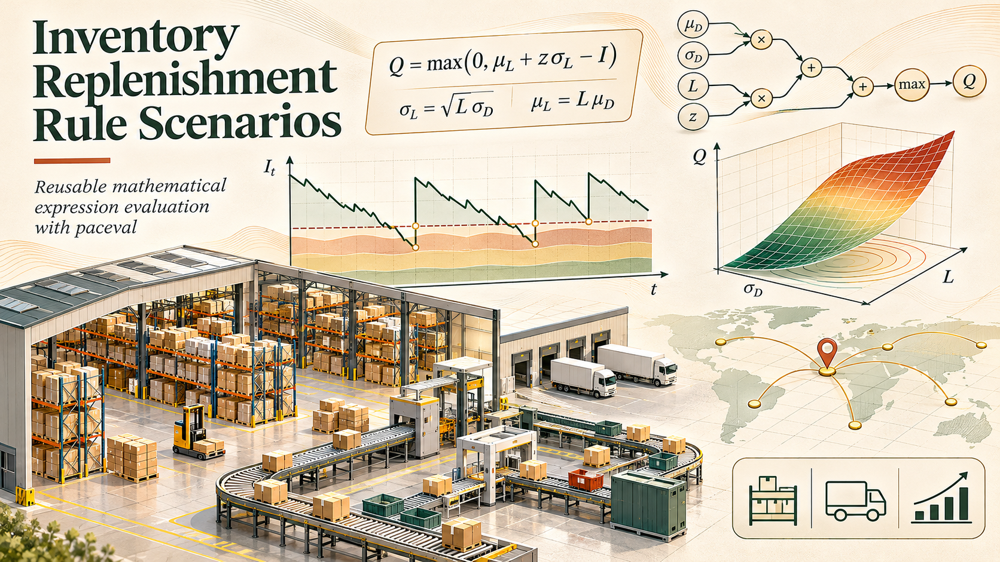
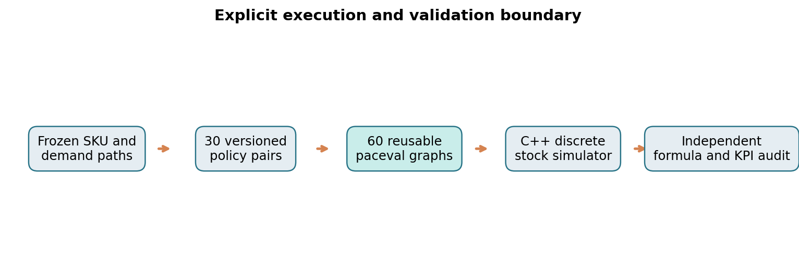
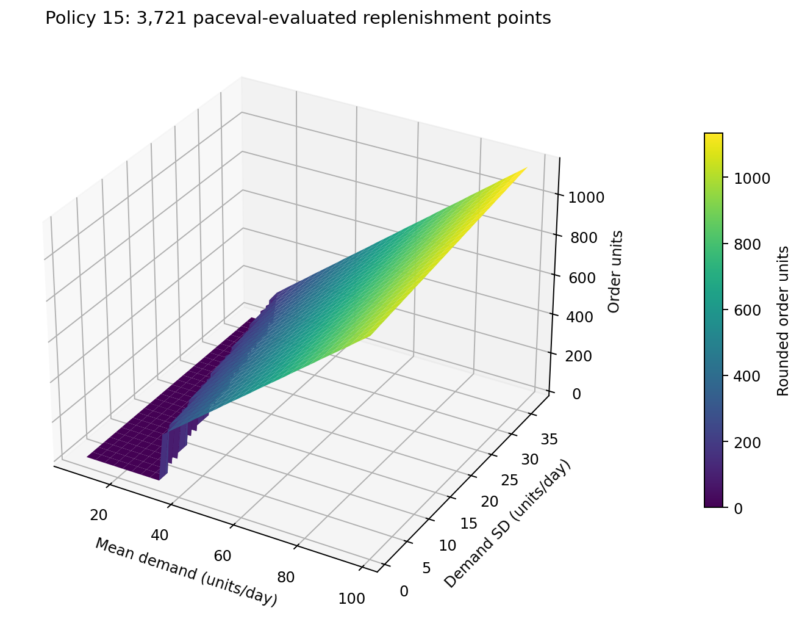
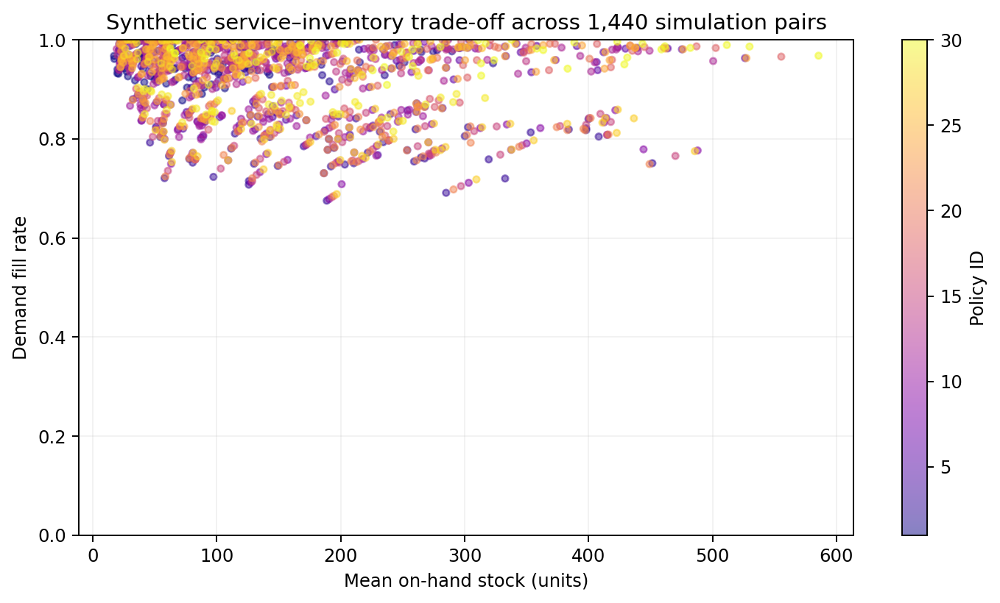

# paceval. | Inventory Replenishment Rule Scenarios



**An executed C++ research demonstrator for interchangeable, reusable inventory-replenishment rule mathematics with the original paceval mathematical engine.** The project combines 30 versioned policy configurations, 60 persistent mathematical expression graphs, deterministic synthetic product demand, discrete stock and delivery simulation, scalar and packed-batch SDK checks, and an independent high-precision audit. The cover is **concept artwork**; numbered graphs are calculated from paceval-exported data.

[English research whitepaper (PDF)](paceval_Inventory_Replenishment_Whitepaper_EN.pdf) · [C++ source](src/inventory_replenishment.cpp) · [CMake build](src/CMakeLists.txt) · [SDK header](src/paceval_main.h) · [SDK source](src/paceval_main.cpp) · [Numerical audit](src/high_precision_reference.py)

## 1. Industrial use case and system boundary

Distribution warehouses, spare-parts providers, industrial manufacturers and retail supply-chain teams often maintain thousands of stock-keeping units (SKUs) with varying demand levels, lead times and review cycles. To examine revised replenishment rules, the same mathematical contracts can be evaluated repeatedly using different SKU parameters. This pilot examines that **formula-execution boundary**, not the superiority of any stock policy in the real world.

**paceval owns** versioned mathematical expressions for target inventory gaps and optional reorder thresholds, the persistent computation handles, double-precision scalar evaluations and packed batch evaluations.

**The C++ host owns** SKU and demand generation, units, inventory-position accounting, arrivals, lost-sales fulfillment, positive-part gating, integer order rounding, daily timeline progression, input/output files, separate native formulas and service-outcome metrics. No external ERP, live inventory system, optimizer or dynamic forecasting engine is connected.



## 2. Mathematical model and units

The six-variable SDK ABI uses `mu sigma lead review ip trend`. Let $m$ be mean demand in units per one-day observation, $s$ the standard deviation of demand per one-day observation (units), $L$ the lead-time count in one-day periods, $R$ the review-period count, $I$ the inventory position (units), and $h$ a daily demand trend adjustment expressed in units per one-day period. All time parameters in the formula are **counts of the fixed one-day sampling period**, so the square-root terms have units of stock units.

For each registered policy $j$, the reusable **order-up-to gap** is:

```math
G_j = m(L+R_j) + z_j s\sqrt{L+R_j} + b_j m + k_j h L - I.
```

The integer order quantity is computed by the C++ host, not by the paceval graph:

```math
Q_j = \left\lceil\max\left(0,G_j\right)\right\rceil.
```

For a conditional policy, a second independently reusable graph evaluates the threshold:

```math
H_j = mL + z_js\sqrt{L}+b_jm-I.
```

The host places $Q_j$ only when $H_j>0$ for conditional rules. All other policies place the positive order quantity on their defined periodic-review dates. The buffer $b_j$ is numerically a number of one-day mean-demand periods; $z_j$ and $k_j$ are dimensionless scenario coefficients. These coefficients are **synthetic rule variations**, not fitted parameters or warranted service-level factors.

In the daily lost-sales model, scheduled stock arrivals precede demand. If $O_t$ denotes on-hand stock, $A_t$ arriving units and $D_t$ requested units, the host computes:

```math
F_t=\min(O_t+A_t,D_t),\qquad O_{t+1}=\max(0,O_t+A_t-D_t).
```

An order is scheduled for day $t+L$. Inventory position includes on-hand stock and outstanding receipts. There are no backorders or reservations. The deterministic demand stream is identical between policies for each SKU, eliminating one avoidable source of comparison inconsistency.

The **immediate-demand fill rate** is:

```math
\beta=\frac{\sum_t F_t}{\sum_t D_t}.
```

This is different from the **cycle service level**, which measures no-stockout cycles. The simulation does not infer one metric from the other.

## 3. Real executed results with the original paceval C/C++ SDK

| Check | Observed result |
|---|---:|
| Registered replenishment policies | **30** |
| Persistent mathematical expression graphs | **60** |
| Deterministic SKU × policy formula scenarios | **105,000** |
| Scalar paceval evaluations audited against independent C++ formulas | **213,721** |
| Packed double-precision batch results audited | **1,920** |
| One-hundred-twenty-day paired policy–SKU inventory simulations | **1,440** |
| Separate 80-digit decimal oracle comparisons from released CSV rows | **3,600 / 3,600 within tolerance** |
| Maximum absolute distance of the CSV-decimal oracle | **3.51 × 10⁻¹³ units** |
| Difference in reported paired simulation fill rates | **0 within checked tolerances** |
| Original SDK-linked CMake/CTest integration | **1 / 1 passed** |

[SDK execution output](results/sdk_execution.txt) · [CTest record](results/ctest_sdk.txt) · [80-digit audit JSON](results/decimal_audit.json) · [Exported scenario samples](examples/scenario_samples.csv) · [Simulation metrics](examples/policy_metrics.csv) · [Policy registry](examples/policy_registry.csv)

The independent `Decimal` reference interprets the **exported decimal CSV inputs**; it is not a bit-exact oracle for the original in-memory IEEE-754 values. Formula checks use absolute error at most `1e-10 × (1 + |reference|)`. The native C++ and paceval routes share the same inventory simulation logic; they independently evaluate the numerical reorder formulas. The agreement demonstrates computational feasibility for the tested domain, not global accuracy, physical service guarantees or policy optimality. No CPU speed, energy or monetary advantages are claimed.

## 4. Calculated scientific figures

Each numbered figure is regenerated from CSV exports using [make_figures.py](src/make_figures.py). The included PNG/PDF plots use actual paceval-computed formula inputs and/or the resulting C++ inventory simulation state.

| Figure | Content | Source |
|---|---|---|
| 1 | SDK/host execution architecture | [PNG](figures/01_execution_architecture.png), [vector PDF](figures/01_execution_architecture.pdf) |
| 2 | Synthetic immediate-demand fill rate across 30 policies | [PNG](figures/02_fill_rate_by_policy.png), [vector PDF](figures/02_fill_rate_by_policy.pdf) |
| 3 | Original paceval order-gap formulas under initial stock variation | [PNG](figures/03_order_gap_by_inventory.png), [vector PDF](figures/03_order_gap_by_inventory.pdf) |
| 4 | **3D** replenishment-order surface, 61 × 61 grid | [PNG](figures/04_replenishment_3d_surface.png), [vector PDF](figures/04_replenishment_3d_surface.pdf) |
| 5 | Contours of the same calculated replenishment surface | [PNG](figures/05_replenishment_contours.png), [vector PDF](figures/05_replenishment_contours.pdf) |
| 6 | Service–inventory tradeoff in 1,440 stateful simulations | [PNG](figures/06_inventory_service_tradeoff.png), [vector PDF](figures/06_inventory_service_tradeoff.pdf) |
| 7 | Versioned policy configuration and review intervals | [PNG](figures/07_policy_registry.png), [vector PDF](figures/07_policy_registry.pdf) |





[3D source data](examples/replenishment_surface.csv) · [Policy version registry](examples/policy_registry.csv)

## 5. Compile and reproduce

The project compiles **both** the supplied original paceval C/C++ SDK facade (`paceval_main.h` / `paceval_main.cpp`, upstream copyright headers retained) and the fully commented executable. The original SDK source differs only in the local header include path to fit `src/`. The compatible architecture-specific shared runtime is supplied **externally** and is **not redistributed** in the GitHub ZIP.

```bash
cmake -S src -B build -DCMAKE_BUILD_TYPE=Release \
  -DPACEVAL_RUNTIME=/absolute/path/to/libpaceval_linux_sharedLIB.so
cmake --build build -j
ctest --test-dir build --output-on-failure
./build/inventory_replenishment --skus 3500 --out reproduced
python3 src/high_precision_reference.py
python3 src/make_figures.py
python3 src/make_whitepaper.py
python3 src/check_readme_math.py
```

**Input convention:** The Python scripts audit/plot the *released* `examples/` files and do not silently use the new `reproduced/` path. To regenerate the published examples from a fresh run, explicitly copy the produced CSVs to `examples/` in a separate working copy. Optional figure generation needs NumPy and Matplotlib; whitepaper production needs ReportLab. Core C++ computation requires neither of those Python libraries.

## 6. Research limitations and external references

This is a **synthetic feasibility study**. Demand distributions, lead times, forecasts, reorder factors, SKU data, review calendars and physical supply-chain constraints were not inferred from industrial records. The policies are examples, not recommendations. The 120-day simulation uses fixed lead times and lost sales and excludes minimum order quantities, backorders, supplier failures, forecast updates, multi-echelon flows, perishable products and customer order prioritization. TINC interval guarantees were not evaluated in this release. No speed comparison is asserted.

Scientific context: [paceval C/C++ API](https://paceval.com/api/), [Inventory Systems, continuous and periodic review](https://rossetti.github.io/RossettiInventoryBook/08-Chapter8.html), [TUM discussion of review systems](https://mediatum.ub.tum.de/doc/1743194/1743194.pdf), and [inventory fill-rate versus service-level definitions](https://logistics.nida.ac.th/wp-content/uploads/2016/08/6001-11-multiperiod-performance-v2.pdf). The linked sources inform model boundaries; they are not endorsements of this research code.

**Conclusion.** Sixty mathematical graphs were successfully executed through the actual paceval SDK for 30 configurable inventory policies. The controlled experiments demonstrate numerical rule evaluation, handle reuse, scalar and batch operation, and reproducible integration with a discrete inventory simulator. Industrial suitability would require a separate validation against permitted real-world operational data.
