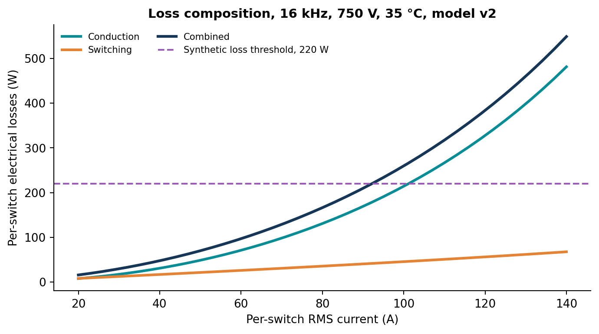
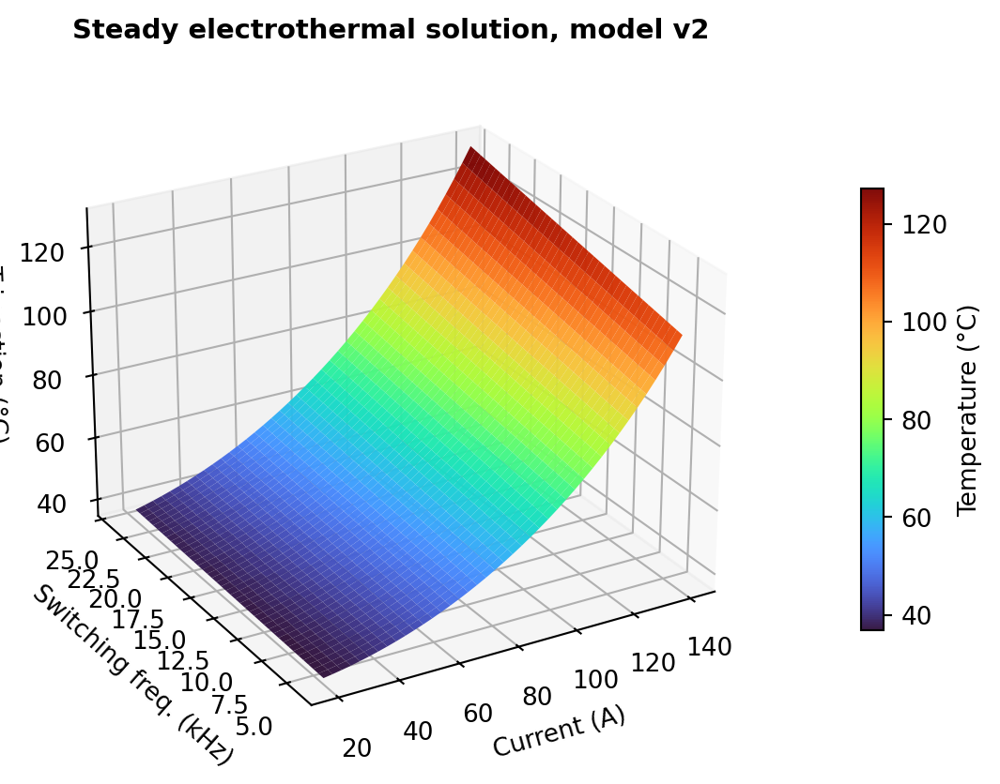
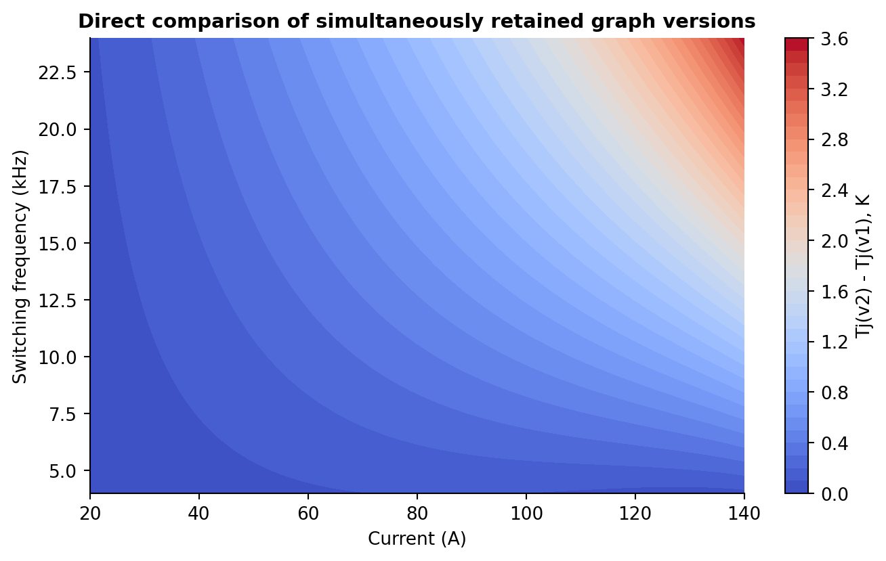
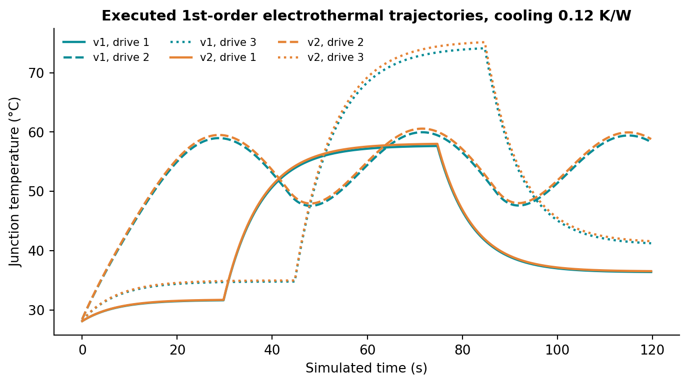

# Industrial SiC Inverter Loss and Thermal Optimization with paceval


*Concept illustration; not a computed research result.*

**A fully executed, independently verified C++ mathematical research demonstrator.** The project investigates reusable paceval execution graphs for the power-loss and junction-temperature calculations surrounding the engineering of a hypothetical SiC inverter power switch. It provides two simultaneously retained model versions, a domain-limited coupled thermal solution, transient operation and reproducible numerical evidence. The complete study is available in [the English scientific whitepaper](paceval_Inverter_Electrothermal_Optimization_Whitepaper_EN.pdf).

**Research result, 14 November 2026:** 100,000 synthetic operating points; 35 distinct created and executed paceval graphs; 15,700 actual multi-graph batch calls; 12,480,049 graph-point evaluations across the sweep, controlled surfaces and transient studies. Both model versions passed an independent analytical and high-precision reference test. These are execution counts, **not performance benchmarks**. [Execution manifest](results/execution_evidence.json) · [Independent numerical audit](results/independent_reference_audit.json).

## 1. Industrial use case and current state of the art

Three-phase inverters control electric motors, photovoltaic power conversion and other energy-intensive installations. Their semiconductor switches lose electrical energy during conduction and switching, and these losses heat their junctions. Thermal feedback matters because conduction resistance and switching energy can change with temperature. Engineers therefore need to examine current, DC-link voltage, switching frequency and cooling conditions together, not as unrelated scalar calculations.

Today's engineering workflows rely on power-device data sheets, characterized switching-energy curves, circuit-level simulation, electrothermal networks and experimental validation. The 2025 study by Bianchini *et al.* reports a datasheet-based switching-loss model for estimating SiC MOSFET junction temperature. Infineon documents how switching energies depend on application voltage and current, while more recent 2026 work examines SiC inverter junction-temperature measurement under surge conditions and application-representative power cycling. This demonstrator uses the mathematical structure of these established approaches, but **does not borrow or claim calibration against any manufacturer's device data**.

The use case is **non-actuating engineering exploration**: a design engineer selects synthetic current, bus voltage, switching frequency and cooling resistance; paceval evaluates the conduction and switching loss expressions; a small C++ root solver orchestrates the thermal balance using *paceval-computed residuals and derivatives*; downstream paceval graphs evaluate margins, sensitivities, qualitative feasibility and model changes. The generated categories are hypothetical engineering checks, not hardware safety approval.

## 2. Mathematical scope and versioning

The modeled quantity is **one equivalent switch**, not a full inverter-system efficiency model. `i` is the equivalent per-switch RMS conduction current in A; `v` is DC bus voltage in V; `fs` is switching frequency in Hz; `tamb` and `tj` are ambient and junction temperatures in degrees Celsius; `rth` is an effective lumped switch-to-ambient thermal resistance in K/W. The synthetic `ripple` field represents peak-to-peak triangular current ripple, whose additional v2 RMS-squared contribution is `ripple²/12`. Limits `pmax` and `tmax` are explicitly hypothetical.

The baseline model **v1** retains the four equations of the supplied WP 03 proposal:

$$
P_{\mathrm{cond},1}=I^2R_0[1+\alpha_1(T_j-25)],
$$

$$
P_{\mathrm{sw},1}=f_{\mathrm{sw}}(E_{on,0}+E_{off,0})\frac{V}{800}\frac{I}{100},
$$

$$
F_1(T_j)=T_j-T_a-R_{\mathrm{th}}(P_{\mathrm{cond},1}+P_{\mathrm{sw},1}).
$$

The extended model **v2** adds a quadratic temperature term to conduction resistance, an explicit ripple contribution, temperature-dependent and nonlinear current-voltage scaling of the primary switching energy, and a synthetic supplemental switching-energy term:

$$
P_{\mathrm{cond},2}=(I^2+I_{\mathrm{ripple}}^2/12)R_0
[1+\alpha_2\Delta T+\beta_R\Delta T^2],\quad \Delta T=T_j-25,
$$

$$
P_{\mathrm{sw},2}=f_{\mathrm{sw}}\left[E_0(V/800)^{1.04}(I/100)^{1.06}(1+\beta_T\Delta T)
+E_x(V/800)(I/100)(1+\beta_x\Delta T)\right].
$$

All coefficients are deterministic **synthetic research assumptions**. For this study `R0=0.018 ohm`, `E0=0.0026 J`, `Ex=0.00030 J`, `alpha1=0.0038 1/K`, `alpha2=0.0036 1/K`, `betaR=0.0000012 1/K²`, `betaT=0.0009 1/K`, and `betax=0.0013 1/K`. These numbers must not be construed as measured properties of a commercial module.

The coupled root is `F(Tj)=0`. The C++ host supplies root brackets and Newton updates. paceval evaluates **both F and its analytic derivative** at every update. A point without a steady root inside the stated temperature-model interval `[Tamb, 250 °C]` is labeled `NO_ROOT_IN_250C_MODEL_DOMAIN`; this does not establish global physical thermal runaway. Also, the chosen operating limit of `Tj <= 170 °C` is an illustrative research threshold, not a universal semiconductor rating.

The transient extension evaluates a single-node RC state transition in a **paceval graph**:

$$
T_{j,k+1}=T_{j,k}+\frac{\Delta t}{C_{\mathrm{th}}}
\left[P_{\mathrm{loss}}(T_{j,k})-\frac{T_{j,k}-T_a}{R_{\mathrm{th}}}\right].
$$

This first-order thermal surrogate does not reproduce a multi-node module or heatsink thermal impedance and is not a certified lifetime or power-cycling model.

## 3. What actually runs in paceval

| Industrial mathematical function | Actual execution owner | Persistent graph or rationale |
|---|---|---|
| Conduction, switching and total device losses | **paceval** | v1 and v2 distinct graphs |
| Thermal equilibrium residual and analytic derivative | **paceval** | `thermal_residual`, `residual_derivative` |
| Junction-temperature margin, loss margin, feedback margin | **paceval** | Three guards per model |
| Analytic loss and implicit temperature sensitivities | **paceval** | `loss_sensitivity_current`, `temperature_sensitivity_current`, `temperature_sensitivity_frequency` |
| Switching-loss share, weighted stress score, combined logical guard | **paceval** | Three compositional graphs per model |
| Thermal step and loss-energy step | **paceval** | v1/v2 state and energy graphs |
| Junction and loss differences between model versions | **paceval** | Three additional comparison graphs |
| Root bracketing, Newton update, model-domain classification | C++ host | Solver and flow control; consumes paceval `F` and `dF/dT` |
| CSV schema and dimensional validation | C++ host | Validation precedes any mathematical evaluation |
| Numerical CSV conversion | **paceval conversion API** | `paceval_dConvertStringToFloat`, `paceval_dConvertFloatToString` |
| Independent analytical, transient and high-precision verification | Python reference | Not a replacement for the production paceval path |

Both formula families remain registered at the same time, with the same variable declarations. The actual code uses `paceval_dGetMultipleComputationsResultsExt` for large model and solver batches, and separately tests `paceval_dGetComputationResult` for scalar calls. The graph-major layout is checked with known inputs. The master [formula execution inventory](results/math_execution_inventory.csv) lists all 35 executed expressions. The [two end-to-end traces](results/end_to_end_trace.csv) follow unchanged input fields through paceval-computed loss, residual, margins and combined guard into the C++ label.

The operator test exercises the documented infix `min`/`max`, mathematical `mod`, C++-style `%`, relational and Boolean operators in genuine computations. Numerical CSV tokens pass a **strict decimal-literal schema** before conversion, because paceval's general string conversion can also evaluate mathematical expressions. Pseudo-literals, non-finite values, comma decimals and formula injections are rejected by the CSV interface. The normal output representation follows the SDK formatter and is **not claimed bitwise round-trip lossless**.

## 4. Executed workload and illustrative findings

The deterministic synthetic study contains 100,000 input scenarios covering current, voltage, switching frequency, ambient conditions, ripple and six cooling-resistance settings. Both formula versions are applied to each input. Additional independent operating surfaces contain 1,681 graph-evaluated points **per version**; transient profiles cover 12 model/profile/cooling cases of 480 samples each.

| Measured research count | Executed result |
|---|---:|
| Different persistent graphs created and exercised | **35** |
| Synthetic stationary input scenarios | **100,000** |
| Model-specific scenario evaluations attempted | **200,000** |
| Actual multi-graph batch calls | **15,700** |
| Successful graph-point evaluations, including solver stages | **12,480,049** |
| v1 roots within the defined model domain | **92,175** |
| v2 roots within the defined model domain | **91,499** |
| Both model versions with valid joint roots | **91,499** |
| Independently checked full-model scalar values | **2,204,088** |
| Independent transient/state checks | **17,280** |
| Separate 80-digit reference checks | **1,024** |

At the explicitly generated reference operating point of **80 A, 750 V, 16 kHz, 35 °C and 0.16 K/W**, the paceval study returns the following illustrative **per-switch** values:

| Mathematical result | v1 | v2 |
|---|---:|---:|
| Steady junction temperature | 60.94 °C | 61.60 °C |
| Conduction loss | 130.93 W | 130.73 W |
| Switching loss | 31.20 W | 35.49 W |
| Total loss | 162.13 W | 166.22 W |
| Remaining loss allowance, relative to synthetic 220 W limit | 57.87 W | 53.78 W |

These numbers are computed **under declared synthetic assumptions**. The categorization `ACCEPT`, `REVIEW` or `REJECT` is a derived research status. A non-bracketed point is not silently forced to an apparently valid root. Do not infer inverter efficiency, converter-level heat balance, manufacturer junction limits or device reliability from this example.

## 5. Scientific illustrations

The figures show actual recorded paceval results, except for the explicitly labeled concept diagram and cover illustration.









Additional files in `figures/` include synthetic operating coverage, quality margins, analytic sensitivities, model status distributions, accumulated loss energy and a two-dimensional operating-region map. All nonconceptual PNG and vector PDF plots can be regenerated from `results/*.csv` using `src/make_figures.py`.

## 6. Build and run

Requires Linux x86-64, a C++17 compiler, CMake and a **separately supplied, compatible original paceval shared library**. The original `paceval_main.h` and `paceval_main.cpp` from the research environment are included unmodified except for their local header include path in `.cpp`. They retain their original upstream license notices; no binary library is distributed in this ZIP.

```bash
cmake -S src -B build -DCMAKE_BUILD_TYPE=Release \
  -DPACEVAL_RUNTIME=/absolute/path/to/libpaceval_linux_sharedLIB.so
cmake --build build -j
ctest --test-dir build --output-on-failure
```

To reproduce the complete numerical research study without altering the archived reference results:

```bash
./build/inverter_thermal --run --count 100000 --out build/full_reproduction
python3 src/verify_reference.py --results build/full_reproduction
python3 src/make_figures.py --results build/full_reproduction --figures build/reproduced_figures
```

Python validation and plotting require `numpy`, `pandas`, `mpmath` and `matplotlib` (see `src/requirements.txt`). CTest also runs a small executable scenario study with the original shared library. The core C++ executable itself needs no Python packages to perform its mathematics.

Important machine-readable artifacts are `results/execution_evidence.json`, `results/math_execution_inventory.csv`, `results/end_to_end_trace.csv`, `results/inverter_results.csv`, `results/version_comparison.csv`, `results/operating_surface.csv`, `results/transient_profiles.csv`, `results/solver_rejections.csv` and `results/independent_reference_audit.json`. All calculations are deterministic for this test dataset. CSV numbers are formatted with the actual paceval numerical output routine; binary audit values and their independent comparisons must not be inferred from rounded text alone.

## 7. Limits, governance and industrial next step

The research establishes the functionality of the original paceval Mathematical Engine as an execution layer for a programmable electrothermal inverter surrogate. It does **not** establish external calibration of the thermal resistance, switching energies, inverter switching sequence or gate resistance; it does not validate real junction-temperature sensors, nonuniform temperatures, semiconductor ageing, hard real-time control or grid qualification. The standalone `P_loss=f_sw E_sw` form is an averaged synthetic switching model, not a circuit waveform solver. Thermal stability and safe physical operating area require independently characterized data and appropriate hardware tests.

An appropriate next pilot would adopt manufacturer-approved on/off energy tables across temperature/current/voltage, characterized device resistance, a multi-node transient thermal network and measurements at documented load profiles. paceval graphs could then retain approved, versioned mathematical corrections, losses, constraints and sensitivities while the host manages a verified physical and safety workflow.

TINC was **not** used in this experiment; there is no certified interval or global numerical inclusion claim. The external runtime is not part of the archive. The GitHub README was structurally and link checked, but no live GitHub renderer or industrial equipment was accessed in this study.

## 8. Sources and contextual references

1. Bianchini, C. et al. (2025), *Switching Loss Model for SiC MOSFETs Based on Datasheet Parameters Enabling Virtual Junction Temperature Estimation*, Sensors 25(12), 3605. https://doi.org/10.3390/s25123605
2. Infineon Developer Community (2024), *Estimating SiC MOSFET switching losses in applications*. https://community.infineon.com/t5/Knowledge-Base-Articles/Estimating-SiC-MOSFET-switching-losses-in-applications/ta-p/709113
3. Infineon (2025), *CoolSiC MOSFET 1200 V G2* application note, temperature-dependent switching energy plots. https://www.infineon.com/assets/row/public/documents/24/42/infineon-coolsic-1200v-g2-mosfet-in-a-to263-7-package-applicationnotes-en.pdf
4. *An Online Junction Temperature Estimation Method for SiC Inverter Considering Surge Avoidance* (2026). https://doi.org/10.1049/pel2.70278
5. Drummond, R. et al. (2026), *Application-representative high-frequency power cycling of SiC power modules used in inverters and rectifiers*. https://doi.org/10.1016/j.microrel.2026.115997
6. Original paceval mathematical API and operators: https://paceval.com/api/ and https://paceval.com/product-brief/

The linked industrial literature motivates the research model but **does not verify the synthetic paceval experimental results**. All reported execution counts and reported outputs originate from the archived calculations. The original two-page WP 03 proposal is preserved under `docs/original_WP03_proposal.pdf` for provenance.
