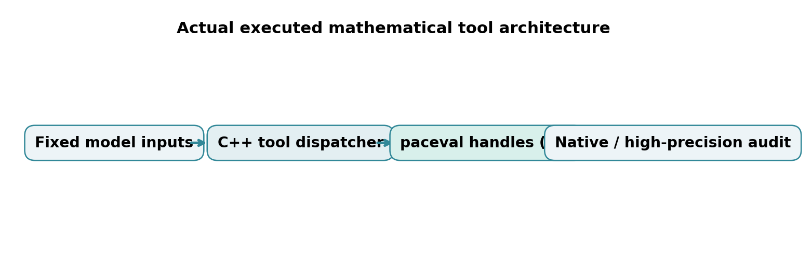
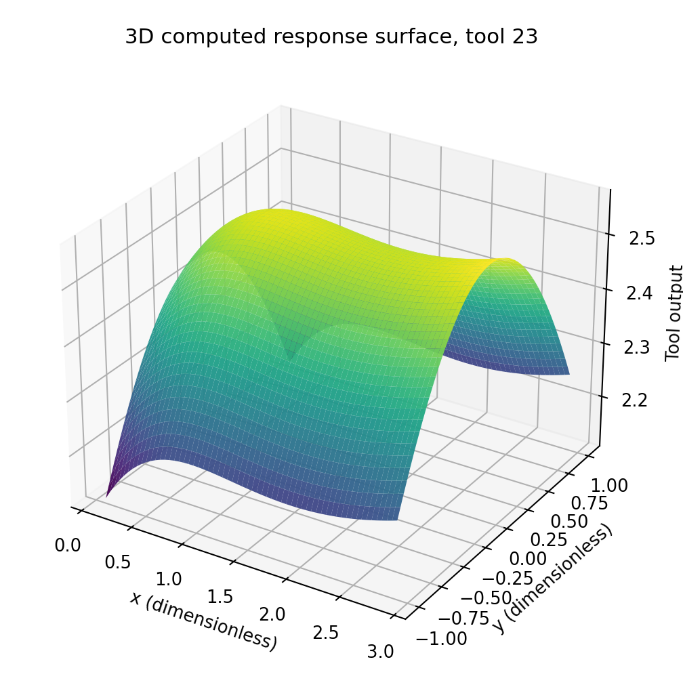
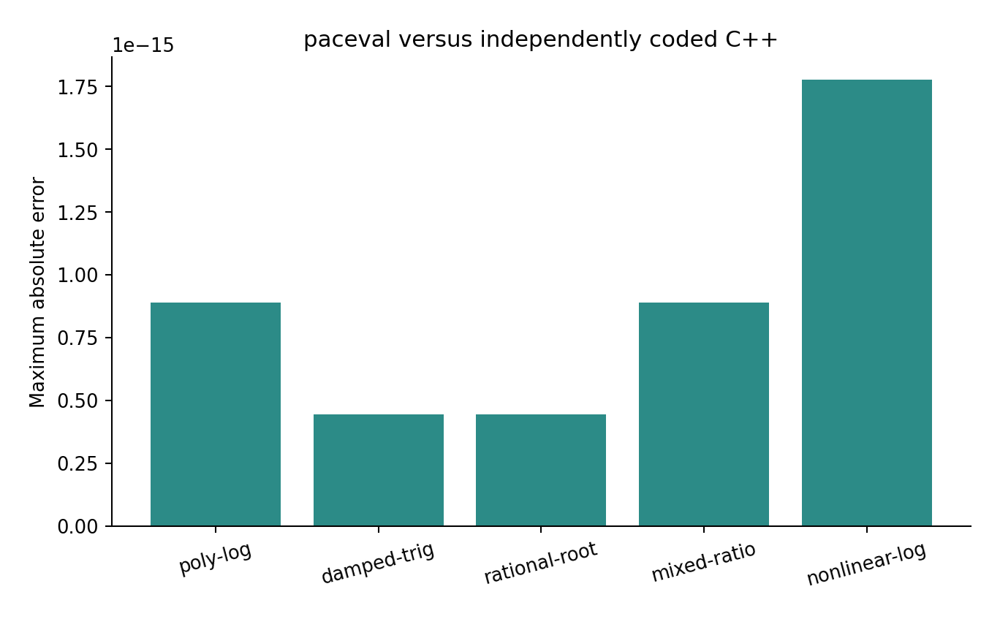

# paceval. | Reusable Large Quantitative Model Tools


*Cover image: conceptual AI-generated illustration, not a numerical output.*

**An executed C++ research demonstrator for deterministic, reusable mathematical tools that can be invoked and composed by a higher-level quantitative assistant.** Fifty immutable mathematical tool definitions are created as independent paceval computation graphs, evaluated across 10,000 scripted requests, reused in 2,000 two-stage compositions, and audited against separately implemented native C++ formulas. A further graph demonstrates a controlled change of formula version without destroying its predecessor.

[English whitepaper (PDF)](paceval_Large_Quantitative_Model_Tools_Whitepaper_EN.pdf) · [C++ demonstrator](src/quantitative_tools.cpp) · [CMake](src/CMakeLists.txt) · [paceval facade source](src/paceval_main.cpp) · [SDK header](src/paceval_main.h)

## 1. Industrial use case and current state of the art

Engineering organizations, financial-analysis teams, scientific software providers and data-analytics platforms increasingly expose repeatable mathematical functions as callable tools. A large-model assistant can select an operation, populate its arguments and consume the result; exact arithmetic is delegated to a deterministic execution component. For example, an engineering agent might first evaluate a nonlinear stress-related surrogate and then pass its bounded output to a second maintenance-score function. The separate formulas should remain versioned, auditable and reusable across many requests.

The **Model Context Protocol (MCP)** provides a standard description of callable tools, input schemas and results. The specification dated **28 July 2026** introduces additional stateless request/response and authorization features. This repository does *not* implement an MCP network service, authentication or wire protocol. It demonstrates the **local mathematical execution layer** that could sit behind one or many correctly specified tools. A production integration must implement protocol validation, user consent, access control, rate limiting and error reporting independently. See the [official MCP 2026 tool specification](https://github.com/modelcontextprotocol/modelcontextprotocol/blob/main/docs/specification/2026-07-28/server/tools.mdx) and [release announcement](https://blog.modelcontextprotocol.io/posts/2026-07-28/).

The [paceval public API](https://paceval.com/api/) exposes reusable computation objects: after creating a mathematical expression graph once, the caller can supply new numerical arguments without resending its expression. This makes it a suitable candidate for studying deterministic mathematical tool libraries. The claim assessed here is **correctly reusable numerical execution**, not a speed advantage, an AI model's independent reasoning accuracy or production MCP readiness.

## 2. Defined models and mathematical contracts

All five input variables `x y a b c` are dimensionless in this synthetic benchmark, with `0.1 <= x <= 2.9`, `-1 <= y <= 1` and `0.2 <= a,b,c <= 1.4`. Five families each contain ten independently versioned mathematical expressions with a frozen coefficient `$k_j$`. Total: **50 distinct formula contracts**.

**Family A: polynomial–logarithmic**

```math
f_{A,j}(x,y)=a x^2+b\ln(1+x)+k_j c y
```

**Family B: damped oscillation**

```math
f_{B,j}(x,y)=a e^{-k_j x}+b\sin(x+y)+cxy
```

**Family C: rational–root**

```math
f_{C,j}(x,y)=\frac{a}{1+k_j x^2}+b\sqrt{1+x}+c\cos(y)
```

**Family D: mixed rational–trigonometric**

```math
f_{D,j}(x,y)=\frac{ax+by+c}{1+k_j x^2}+\sin(xy)
```

**Family E: nonlinear logarithmic–exponential**

```math
f_{E,j}(x,y)=a\ln(1+x^2)+b e^{-xy^2}+k_j c x^2
```

For all families, the ten `$k_j$` values are `0.11, 0.18, ..., 0.74` and are embedded in immutable formula strings. The paceval syntax uses **`ln`**, not the unsupported `log` spelling observed in the first SDK trial; the C++ oracle independently uses `std::log`. The allowed domain avoids the log, square-root and denominator singularities.

## 3. paceval execution architecture and tool composition



The host registers **50 computation objects**, with immutable computation handles reused for every request. It also creates a separate version-2 handle for the first tool, leaving version 1 alive. All numerical computations are performed using the original `paceval_main.h` / `paceval_main.cpp` facade linked against the externally supplied paceval Linux library.

An example of composition is:

```math
u=f_i(x,y,a,b,c),\qquad v=f_j(x,\tanh(u),a,b,c).
```

Both `$u$` and `$v$` are evaluated with paceval, while the host explicitly applies the bounded coupling `tanh` and selects the second tool. This is deterministic **local tool composition**, not an independently validated autonomous agent or network endpoint.

The host owns synthetic request generation, domain constraints, tool dispatch, input packing, composition order, CSV output and independent native reference computations. paceval owns the mathematical formula graphs and their scalar/batch execution. The original SDK copyright notices are retained.

## 4. Executed verification results

| Audit | Recorded result |
|---|---:|
| Tool definitions / model families | 50 / 5 |
| Persistent computation graph handles, including one formula update | **51** |
| Deterministic scripted tool requests | **10,000** |
| Two-stage tool compositions | **2,000** |
| Scalar SDK evaluations (including surface and version checks) | **15,723** |
| Independently checked packed batch outputs | **1,600** |
| Surface points computed directly by paceval | **3,721** |
| 80-digit independent mpmath checks | **250 / 250 passed** |
| Maximum observed absolute discrepancy (native C++ audit) | **1.78e-15** |
| CTest integration | **1/1 passed** |

These numbers document a finite synthetic proof of feasibility. They do not imply correct evaluation for arbitrary expressions, certified interval bounds, safety of arbitrary untrusted tool strings or successful MCP protocol operation. The 80-digit audit checks every 40th request from the exported CSV, and is independently implemented.

[Raw SDK audit](results/sdk_execution.txt) · [CTest](results/ctest_sdk.txt) · [High-precision audit](results/high_precision_audit.json) · [Independent CSV integrity audit](results/reproducibility_audit.json) · [Scripted request data](examples/requests.csv) · [Frozen registry](examples/tool_registry.csv) · [Version comparison](examples/version_audit.csv)

## 5. Scientific figures generated from actual paceval CSV output

Every numbered plot derives from the included paceval CSV exports, not from the illustrative title image.

| Figure | Contents | Formats |
|---|---|---|
| 1 | Actual C++ host / graph ownership | [PNG](figures/01_execution_architecture.png), [PDF](figures/01_execution_architecture.pdf) |
| 2 | Five different mathematical tool families | [PNG](figures/02_tool_family_outputs.png), [PDF](figures/02_tool_family_outputs.pdf) |
| 3 | Numerical agreement across model families | [PNG](figures/03_numerical_audit.png), [PDF](figures/03_numerical_audit.pdf) |
| 4 | Version-1 registry of 50 graphs | [PNG](figures/04_tool_registry.png), [PDF](figures/04_tool_registry.pdf) |
| 5 | **3D** surface from 3,721 paceval outputs | [PNG](figures/05_response_surface_3d.png), [PDF](figures/05_response_surface_3d.pdf) |
| 6 | Response contour of the same function | [PNG](figures/06_response_contours.png), [PDF](figures/06_response_contours.pdf) |
| 7 | Immutable v1 versus v2 evaluation | [PNG](figures/07_model_versioning.png), [PDF](figures/07_model_versioning.pdf) |
| 8 | Scripted-request result distribution | [PNG](figures/08_request_distribution.png), [PDF](figures/08_request_distribution.pdf) |





[Full response-surface CSV](examples/response_surface.csv)

## 6. Compile and reproduce

The original `paceval_main.h` and `paceval_main.cpp` are checked into `src/` with their upstream copyright/AGPL notices. The runtime `.so` must be supplied externally and is not redistributed in this archive.

```bash
cmake -S src -B build -DCMAKE_BUILD_TYPE=Release \\
  -DPACEVAL_RUNTIME=/absolute/path/to/libpaceval_linux_sharedLIB.so
cmake --build build -j
ctest --test-dir build --output-on-failure
./build/quant_tools --out reproduced
```

To generate exactly the tracked CSV figures and high-precision audit (with Python packages `matplotlib`, `numpy`, `mpmath`, `reportlab`):

```bash
python3 src/high_precision_reference.py
python3 src/verify_results.py
python3 src/make_figures.py
python3 src/make_whitepaper.py
python3 src/check_readme_math.py
```

The scripts above read the released `examples/` CSVs; a new run in `reproduced/` must be audited independently or compared to the existing examples. `--test` runs a smaller execution solely for CTest. The numerical CSVs use platform double precision; exact textual agreement across arbitrary math-library/CPU combinations is not promised. No Python dependency is needed for the C++ application itself.

## 7. Scientific limitations, future industrial integration

The suite is deliberately synthetically defined; the functions are examples of complex reusable quantitative mathematics, **not calibrated industrial or financial models**. Five analytic families and one composition convention test graph reuse, input validation assumptions and changes to mathematical definitions. No external observations, customer data, forecasts, production business logic, authorization service or authenticated MCP client are used. TINC is not enabled, and no interval-certification claim is made.

A future industrial integration could expose a catalogue through an MCP-compliant server with strict input/output JSON Schema, access controls, rate limits, robust cancellation and explicit failure semantics, then test end-to-end tool selection separately. The 2026-07-28 MCP specification offers a current protocol reference, but no part of its network implementation is claimed as tested here.

**Conclusion:** The selected tool-library mathematics was successfully executed by 51 reusable paceval computation graphs and independently checked for the stated deterministic workload. This establishes a documented mathematical execution component suitable for further tool-platform research, not a validated standalone AI or network product.

## 8. Sources

1. [Model Context Protocol tools specification, 2026-07-28](https://github.com/modelcontextprotocol/modelcontextprotocol/blob/main/docs/specification/2026-07-28/server/tools.mdx)
2. [MCP specification release, 28 July 2026](https://blog.modelcontextprotocol.io/posts/2026-07-28/)
3. [MCP protocol security and trust considerations](https://github.com/modelcontextprotocol/modelcontextprotocol/blob/main/docs/specification/2026-07-28/index.mdx)
4. [paceval public C/C++ API](https://paceval.com/api/)
5. [NIST AI Risk Management Framework](https://www.nist.gov/itl/ai-risk-management-framework)
