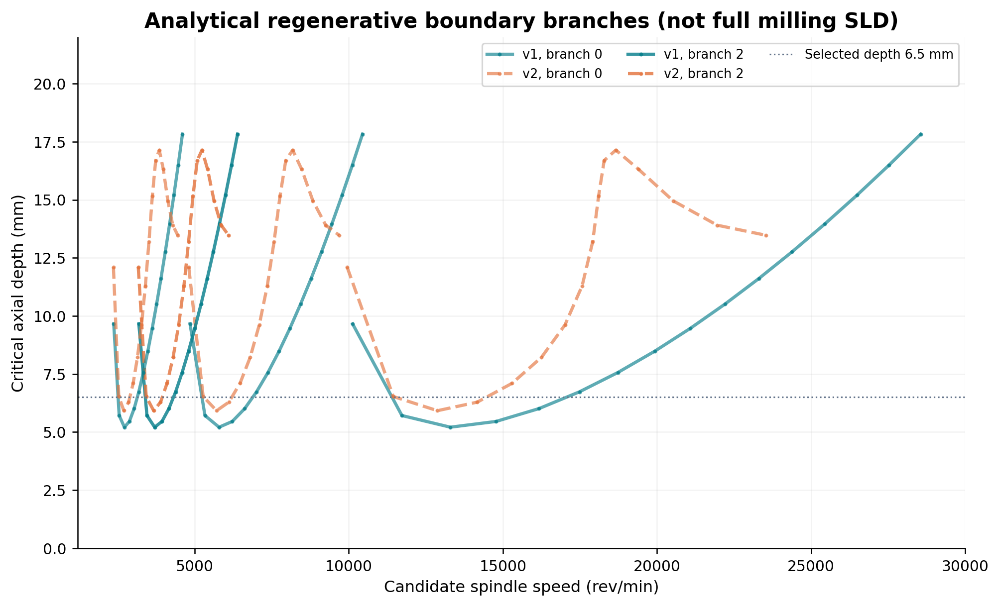
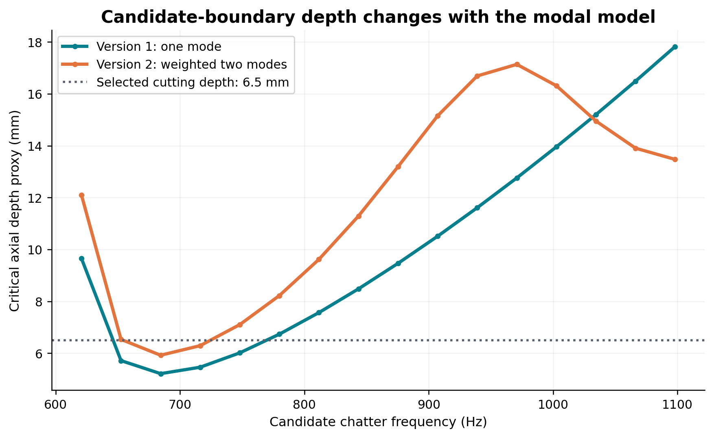
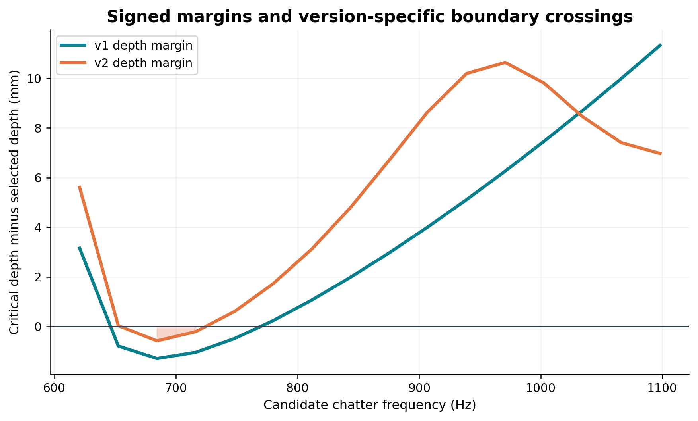

# Programmable Regenerative Chatter Candidate Maps with paceval


*Industrial mathematical research demonstrator | 15 November 2026 | English publication | Synthetic machine-tool dynamics*

This project demonstrates reusable, independently checked **paceval Mathematical Engine** graph execution for frequency-response functions, candidate critical cutting depths, regenerative phase matching, stability-lobe branch coordinates, signed depth margins, versioned modal models, and analytical sensitivity. It does **not** prove chatter-free operation of a machine tool. Twenty-three mathematical graph expressions were executed on 64 synthetic frequency/lobe cases through the actual **remote paceval MCP 4.26** service. The included local C++ application has been syntax-checked against the original SDK bridge, but has **not** been linked to or executed with the unavailable compatible Linux shared library.

[Scientific whitepaper (PDF)](paceval_Machine_Tool_Chatter_Whitepaper_EN.pdf) | [C++ main program](src/chatter_stability_paceval.cpp) | [Graph inventory](results/math_execution_inventory.csv) | [Recorded MCP outputs](results/mcp_boundary_observed.csv) | [Original research proposal](docs/Original_WP22_Proposal_2026-11-13.pdf)

## 1. Industrial use case and current state of the art

During milling, a rotating cutter removes material in successive tooth passages. Structural deflection can leave surface waves that modify the uncut chip thickness on subsequent tooth contacts. This feedback, called **regenerative chatter**, can amplify vibration, degrade surface finish and damage tools. A machining engineer may measure or identify a tool-tip frequency response function (FRF), estimate cutting-force coefficients and compare potential spindle speeds and axial cutting depths in a *stability lobe diagram* (SLD). The challenge is that response characteristics change with tool overhang, machine configuration, workpiece geometry, cutting conditions and wear.

NIST published tool-length-dependent stability surfaces combining experimental holder/spindle information with tool-tip receptance modeling in 2004. ORNL's 2020 review describes modern regenerative and intermittent-cutting models. Research in 2024 investigated higher-order predictor-corrector schemes for Floquet stability calculations; 2025 work evaluated uncertainty-aware milling stability and online construction of lobes from cutting signals. In 2026, research explored robustness-augmented stability diagrams and physics-driven digital-twin adaptation. This study deliberately uses a much narrower **single-direction, constant-coefficient, scalar regenerative candidate-boundary model**, rather than those fuller physical solutions. Sources appear in Section 8 and in the PDF.

The applied question is: *How does the inclusion of a second synthetic vibration mode shift the algebraic critical-depth candidates, the corresponding phase-consistent spindle speeds and their margins relative to a chosen depth of cut?* This mathematical screening layer is where paceval executes formulas; C++ handles file contracts, domain checking and downstream candidate presentation. Neither model is calibrated against actual modal measurements or cutting experiments.

## 2. Mathematical model and simultaneous versions

The first model is the complex compliance of one damped mass-spring mode,

$$
G_1(j\omega)=\frac{1}{k_1-m_1\omega^2+j c_1\omega}.
$$

The second model is a weighted combination of two such dynamic modes,

$$
G_2(j\omega)=G_1(j\omega)+\frac{\alpha}{k_2-m_2\omega^2+j c_2\omega}.
$$

The real and imaginary parts, compliance magnitude, candidate critical depth and phase are evaluated as separate **persistent paceval graphs**. The two model versions are simultaneously accessible, with independent handles. For either selected $G$ and only within the declared domain $\mathrm{Re}(G)<0$ and $\mathrm{Im}(G)<0$,

$$
b_{\mathrm{crit}}=-\frac{1}{2 K_s\,\mathrm{Re}(G)},\qquad
\theta=\pi+2\arctan\!\left(\frac{\mathrm{Im}(G)}{\mathrm{Re}(G)}\right).
$$

Under the declared scalar regenerative characteristic equation and the phase branch used in this study, the candidate spindle speed for $Z$ teeth and lobe index $\ell=0,1,2,\ldots$ is

$$
N_{\ell}=\frac{60\omega}{Z(\theta+2\pi\ell)}\quad\text{rev/min}.
$$

The signed margin $m_b=b_{\mathrm{crit}}-b_{\mathrm{cut}}$ and Boolean condition $b_{\mathrm{cut}}\le b_{\mathrm{crit}}$ are also actual paceval graph results. The latter **only classifies a depth relative to a sampled algebraic candidate boundary at that frequency**; it does not classify all possible cuts at the same RPM, and it is not a proven physical chatter stability decision. The separate paceval model-change graph computes $\Delta b=b_{\mathrm{crit},2}-b_{\mathrm{crit},1}$ and an explicit analytical coefficient sensitivity $\partial b_{\mathrm{crit},2}/\partial K_s=-b_{\mathrm{crit},2}/K_s$.

As a mathematical consistency check, paceval evaluates both real and imaginary components of the chosen scalar regenerative characteristic residual,

$$
D=1+K_s b_{\mathrm{crit}}G(j\omega)\left(1-e^{-j\omega\tau}\right),\qquad
\tau=\frac{60}{ZN_\ell}.
$$

The candidate boundary is constructed so that $D$ is near zero, which checks the algebraic phase relation. It does not establish stability against all delay modes or time-periodic cutting forces. Here $K_s$ is an effective orientation-adjusted cutting-force coefficient rather than an empirically identified material constant; this simplified scalar model must not be applied directly to arbitrary tooth geometry.

## 3. Actual paceval ownership and mathematical function inventory

| Mathematical function / industrial purpose | Actual implementation | Graph/version or rationale |
|---|---|---|
| Single-mode real/imaginary receptance and amplitude | paceval MCP, executed | `frf_real_v1`, `frf_imag_v1`, `amplitude_v1` |
| Weighted two-mode receptance and amplitude | paceval MCP, executed | `frf_real_v2`, `frf_imag_v2`, `amplitude_v2` |
| Critical cutting-depth candidates | paceval MCP, executed | `critical_depth_v1`, `critical_depth_v2` |
| Regenerative phase and boundary RPM | paceval MCP, executed | `phase_v1`, `phase_v2`, `boundary_rpm_v1`, `boundary_rpm_v2` |
| Cut-depth margin and relational/Boolean proxy | paceval MCP, executed | `depth_margin_v1/v2`, `screen_guard_v1/v2` |
| Modal update difference, sensitivity, normalized margin | paceval MCP, executed | `critical_depth_delta`, `critical_depth_sensitivity_Ks_v2`, `relative_margin_v2` |
| Real/imaginary characteristic-equation residual | paceval MCP, executed | `regenerative_residual_real_v2`, `regenerative_residual_imag_v2` |
| Natural frequency and damping ratio for first mode | paceval MCP, executed | `natural_frequency_rad_s`, `damping_ratio_v1` |
| CSV literal parsing, domain rejection, lobe enumeration and file I/O | C++ host source | Separate from mathematical graph execution |
| Independent complex-reference calculations and exact binary-input checking | C++/Python verification only | Not substituted for paceval output |

The full exact expressions and verified remote handles are in [`src/formula_manifest.json`](src/formula_manifest.json) and [`results/math_execution_inventory.csv`](results/math_execution_inventory.csv). The C++ source builds the same expression inventory against the original local SDK, reuses every computation handle and contains scalar, single-graph batch and multiple-graph batch paths. The local SDK runtime tests remain unexecuted.

## 4. Actually executed synthetic experiment

A deterministic set of **16 angular frequencies (3900–6900 rad/s) and four lobe indices (0–3)** generates 64 cases. The selected input depth is 6.5 mm, the cutter has four teeth and the synthetic modal data are recorded in [`examples/DATA_SCHEMA.md`](examples/DATA_SCHEMA.md). The remote main batch evaluated **23 graphs × 64 inputs = 1472 graph-point combinations** without an error response. It is not a measured tool-tip FRF, spindle-speed study or physically validated machining plan.

The selected MCP decimal output transcription in [`results/mcp_boundary_observed.csv`](results/mcp_boundary_observed.csv) includes the two receptance versions, critical depths, phase, eight actual boundary RPM columns, margins, logical flags and the lobe-zero complex residual. This file is **not** a complete binary-exact dump of the original MCP response. The original remote service version, graph counts and audit scope are given in [`results/execution_evidence.json`](results/execution_evidence.json).

Under these declared synthetic assumptions, 12 of the 16 distinct frequency points satisfy the v1 local depth guard and 14 satisfy v2. Two frequencies (4100 and 4700 rad/s) change the local guard outcome. For instance, at 4100 rad/s the v1 critical depth is approximately **5.712 mm**, while v2 gives **6.530 mm** against the selected 6.5 mm candidate depth. This mathematical comparison is not a claim that the physical cut is stable at every associated RPM.







Further plots include [receptance](figures/01_modal_receptance_actual_mcp.png), [version differences](figures/05_model_version_depth_difference_actual_mcp.png), the [3D branch plot](figures/06_boundary_branches_3d_actual_mcp.png) and [TINC output widths](figures/07_tinc_point_bounds_actual_mcp.png). Every numbered research plot uses only the archived actual MCP result transcription; the cover is a labeled concept artwork.

## 5. Independent verification and precision limitations

The archived selected result columns passed an independent **90-decimal-digit** complex-reference audit with **400 individual checks**. The six remote interval-mode input points yielded 12 non-error TINC interval outputs, and the independently evaluated exact binary-input mathematical point references lie within their printed decimal bounds. A separate remote operator selftest verified 21 graph-point results for `%` versus `mod`, infix `min`/`max`, relational expressions and Boolean logic. Detailed tolerances, printed intervals and failure diagnostics are retained under `results/`; public-facing plots do not compare the engine's numerical error to native C++.

These TINC evaluations check **point inputs**, not entire parameter intervals and not uncertainty in measured stiffness, damping or cutting coefficients. No global numerical certification is claimed. The structural model uses synthetic coefficients, not actual experimentally measured dynamic properties.

## 6. Original SDK C++ reproduction

The original `paceval_main.h` and `paceval_main.cpp` are included unchanged under `src/` with their existing notices. Supply a compatible original Linux x86-64 shared library separately; the external binary is not distributed.

```bash
cmake -S src -B build -DCMAKE_BUILD_TYPE=Release \
  -DPACEVAL_RUNTIME=/absolute/path/to/libpaceval_linux_sharedLIB.so
cmake --build build -j
ctest --test-dir build --output-on-failure
./build/chatter_stability_paceval .
python validation/high_precision_reference.py .
python validation/check_operator_results.py .
python validation/check_project.py .
python src/make_figures.py
```

The actual local production CSV flow, when run with a compatible library, is: schema/finite-domain check → literal-only numeric CSV parsing with `paceval_dConvertStringToFloat` → persistent graph creation → scalar and multi-graph batch execution → independent native C++ verification of critical results → CSV output using `paceval_dConvertFloatToString`. Original binary64 values should be stored separately wherever a byte-exact audit is required; decimal text formatting is not automatically lossless. The C++ code and SDK bridge passed `g++ -std=c++17 -fsyntax-only`; local linking and CTest remain **not executed**.

## 7. Scientific limits and next experimental study

The sample curves are parameterized branches of a scalar constant-direction feedback model. The experiment does **not** solve the milling's actual periodic-delay system, distinguish all intersections of competing instability branches, compute Floquet multipliers, include directional immersion coefficients or multi-axis coupling, account for process damping, variable pitch, tool-position dependence, nonlinear engagement or thermal cutting effects. For practical process planning, the minimum reliable stable depth across all physically relevant roots and experimentally observed chatter conditions must be established with a validated specialist stability solver and measured cutting results.

A suitable next pilot is to use permitted real tool-tip impact-test FRFs, estimate frequency-dependent cutting force and engagement coefficients, calibrate both models, compare branch predictions with a validated semi-discretization/Floquet model, and test observed cutting against held-out spindle-speed/depth cases. Real deployment would also require uncertainty propagation and tool-safety controls. The 2025 interval-uncertainty research and 2026 robustness-aware work provide relevant directions, but neither is reproduced or claimed here.

## 8. Selected references

- Schmitz et al., NIST, *Tool Length-Dependent Stability Surfaces* (2004): https://www.nist.gov/publications/tool-length-dependent-stability-surfaces
- Schmitz, ORNL, *Chatter Stability of Machining Operations* (2020): https://www.ornl.gov/publication/chatter-stability-machining-operations
- *Newton–Simpson-based predictor–corrector methods for milling chatter stability prediction*, Scientific Reports (2024): https://www.nature.com/articles/s41598-024-84329-9
- *A non-intrusive interval analysis method for chatter stability of uncertain milling systems* (2025): https://doi.org/10.1016/j.jmapro.2025.04.047
- *Online building of milling stability lobe diagrams based on multi-feature signals* (2025): https://doi.org/10.1016/j.jmapro.2025.08.024
- Kadovitz and Brand, *Robustness-augmented stability lobe diagrams for improved process planning in turning and milling* (2026): https://link.springer.com/article/10.1007/s00170-026-18349-2
- Huang, Yi and Guo, *Physics-driven real-time, intelligent digital twin for adaptive milling chatter control* (2026): https://doi.org/10.1016/j.cirp.2026.04.032
- paceval Mathematical Engine public references: https://paceval.com/api/ and https://paceval.com/product-brief/

*Research date: 15 November 2026. An independently audited mathematical demonstration, not a complete milling stability or industrial safety qualification.*
