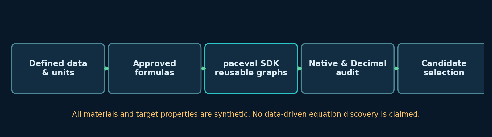
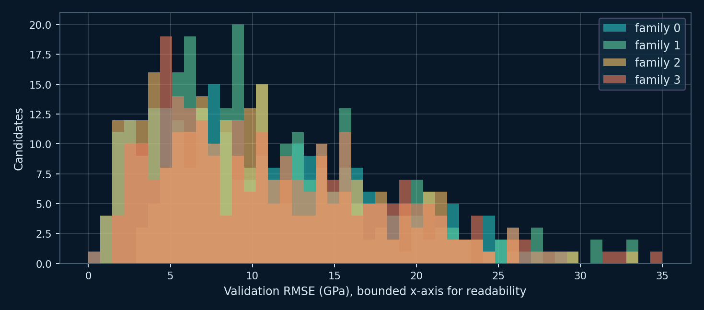

# paceval. | Material Property Symbolic-Regression Candidate Evaluation


**A reproducible C++ materials-formula feasibility demonstrator using the original paceval C/C++ SDK.** This project evaluates and reuses 1,000 predefined, dimensionally balanced, synthetic material-property candidate expressions on a deterministic 60-sample workload. The scalar and batch SDK outputs are checked against independent native C++ evaluations, and the selected formula is independently audited using high-precision Python Decimal arithmetic. This is not an experiment on real material data or an equation-discovery algorithm.

[English research whitepaper (PDF)](paceval_Material_Symbolic_Regression_Whitepaper_EN.pdf) · [C++ implementation](src/material_candidate.cpp) · [CMake configuration](src/CMakeLists.txt) · [Verified SDK execution log](results/sdk_execution.txt)

## 1. Verified research scope

The originating research proposal WP-019 asked whether candidate mathematical expressions for material-property symbolic regression can be evaluated repeatedly with paceval while maintaining numerical and domain-level controls. The released application implements the **candidate-evaluation kernel**, not the entire symbolic-regression search/optimization loop.

| Family | Fixed-form candidate contract | Units |
|---|---|---|
| 0 | `E = a + b*x + c*exp(-d/T)` | `E,a,b,c` in GPa; `d,T` in K; `x` dimensionless |
| 1 | `E = a + b*x + c/(1+T/d)` | Same units |
| 2 | `E = a + b*x + c*exp(-d/T) + e*x*x` | `e` in GPa |
| 3 | `E = a + b*x + c*exp(-d/T) + e*x*(T/300)` | `e` in GPa; literal `300` represents **300 K** |

These predefined expressions are dimensionally consistent by their parameter and constant contracts, and **all represent a synthetic GPa-valued scalar**, not a proven elastic-modulus law. The C++ host enforces the approved family registry and positive `d`. It does not contain a general dimensional-analysis parser. The 1,000 candidates have fixed coefficients from a deterministic generator; none is trained or optimized. Candidate 0 is intentionally the known noiseless generative model.



## 2. Reproduced results with original paceval SDK 4.25

| Verified operation | Observed output |
|---|---:|
| Approved, reusable candidate graph handles | 1,000 |
| Scalar paceval evaluations checked against native C++ | 60,000 / 60,000 passed |
| Batch paceval evaluations checked against native C++ | 32,000 / 32,000 passed |
| Independent 80-digit Decimal check for the **selected** candidate | 60 / 60 passed |
| CMake/CTest SDK integration | 1 / 1 passed |
| Selected candidate (validation RMSE selection) | ID 0, family 0 |
| Selected synthetic validation RMSE | 0.08605 GPa |
| Selected synthetic held-out test RMSE | 0.08941 GPa |

The full run was compiled and executed against the supplied compatible Linux x86-64 runtime. The C++ tolerance for paceval/native arithmetic is an **absolute 2e-9 GPa**, while the separately coded Decimal/export tolerance is **2e-10 GPa**. The selected Decimal audit observed a maximum absolute difference of approximately **2.08e-14 GPa** against the exported native C++ prediction. This is not an 80-digit test of the internal paceval engine. No execution-speed comparisons, speedup or hardware advantages are claimed.

[Complete paceval SDK execution transcript](results/sdk_execution.txt) · [CTest output](results/ctest_sdk.txt) · [80-digit audit](results/decimal_audit.json)

## 3. Compile with the supplied paceval C++ interface

The source tree contains `src/paceval_main.h` and `src/paceval_main.cpp`, the upstream C/C++ 4.25 public facade supplied for this experiment. The `#include` path in the CPP facade has been normalized to `"paceval_main.h"` for the local `src/` layout. The original copyrights and licensing declarations remain. The compiled engine `.so` is **not distributed** in this GitHub package; provide your own compatible external Linux runtime.

```bash
cmake -S src -B build -DCMAKE_BUILD_TYPE=Release \
  -DPACEVAL_RUNTIME=/absolute/path/to/libpaceval_linux_sharedLIB.so
cmake --build build -j
ctest --test-dir build --output-on-failure
mkdir -p reproduced
./build/material_candidates --candidates 1000 --out-prefix reproduced/wp019
python3 src/high_precision_reference.py reproduced/wp019_selected.csv reproduced/audit.json
```

The generated `.csv` files and audit JSON can be compared to the included deterministic examples. Running `--test` uses 40 candidates for the SDK integration test. The executable uses the official `paceval_InitializeLibrary`, `paceval_CreateComputation`, `paceval_dGetComputationResult`, `paceval_dGetComputationResultExt`, `paceval_GetIsError`, `paceval_DeleteComputation`, and `paceval_FreeLibrary` calls. The host checks every per-item batch error code as well as SDK and finite-number status.

## 4. Synthetic workload and transparent selection

The dataset comprises **60 deterministic synthetic samples**: 36 training, 12 validation and 12 held-out test samples. `x` is dimensionless, `T` is in kelvin, and `E` is in GPa. A known source formula plus bounded, deterministic sinusoidal discrepancy produces the synthetic target. No real material dataset, measured modulus or proprietary material record is bundled.

For each candidate the program checks all 60 scalar calculations and additionally 32 batched calculations, then computes partition-specific RMSE. Candidate selection depends **only on the validation RMSE** (ID resolves ties). The ranking file exports only training and validation scores; only the selected candidate's test score is reported. The program computes test predictions for numerical SDK verification of every formula, so its partitioning should not be represented as blinded experimental validation.

[Synthetic samples](examples/wp019_samples.csv) · [Candidate ranking](examples/wp019_ranking.csv) · [Selected prediction trace](examples/wp019_selected.csv)



## 5. Independent validation, diagrams and figures

The native C++ reference evaluates each of the four branches without using a paceval computation graph, while the SDK parses expression strings and maintains reusable computation handles. The Python [high-precision checker](src/high_precision_reference.py) separately reconstructs the selected expression using `Decimal` with 80 significant digits, and checks all 60 exported predictions. These finite sample checks demonstrate the specified computation, not certified numerical behavior over all real numbers.

The project publishes its scientific figures both as raster PNG and vector PDF. They can be reconstructed from the committed examples with [make_figures.py](src/make_figures.py) (NumPy and Matplotlib); the PDF can be rebuilt with [make_whitepaper.py](src/make_whitepaper.py) (ReportLab and Pillow). The figure names are numbered `01` through `08` and the cover graphic is `00`.

- [Four approved formula families](figures/02_dimensioned_formula_families.png)
- [Deterministic samples and splits](figures/03_synthetic_material_samples.png)
- [Selected formula predictions](figures/05_selected_predictions.png)
- [Residuals by split](figures/06_residuals_by_split.png)
- [Independent numeric verification](figures/07_independent_verification.png)
- [Temperature sensitivity](figures/08_temperature_sensitivity.png)

## 6. Scientific interpretation and external research

**Demonstrated:** direct integration of paceval graph creation, scalar evaluation, repeated graph reuse and batch evaluation for a defined synthetic candidate grammar. All checks were executed using the supplied external engine. **Not demonstrated:** new equation discovery, physics-constrained automated search, coefficient fitting, prediction of real materials, thermodynamic stability, general-purpose unit analysis or independent verification using measured material properties.

For an applied follow-up, the [Matbench suite](https://docs.materialsproject.org/services/ml-and-ai-applications/matbench) offers standardized material-property tasks with published data and evaluation procedures, such as log10 of the Voigt-Reuss-Hill bulk modulus. That logarithmic target is **not** equivalent to this pilot's raw synthetic GPa-valued property; it requires new, explicit contracts, descriptors and splits. The [NIST JARVIS-DFT repository](https://www.nist.gov/programs-projects/jarvis-dft) also contains computed elastic, electronic and other materials properties. Its data structure and terms must be checked before integrating data. The broader [Matbench paper](https://www.nature.com/articles/s41524-020-00406-3) describes the rationale for careful benchmarking and external evaluation.

The official [paceval API reference](https://paceval.com/api/) and [public source repository](https://github.com/paceval/paceval) document the SDK used here. The GitHub package intentionally does **not** contain an external shared engine or a separate `LICENSE_NOTICE.md`. Original upstream notices are preserved in `src/paceval_main.cpp` and `src/paceval_main.h`; review their AGPL terms before redistribution.
