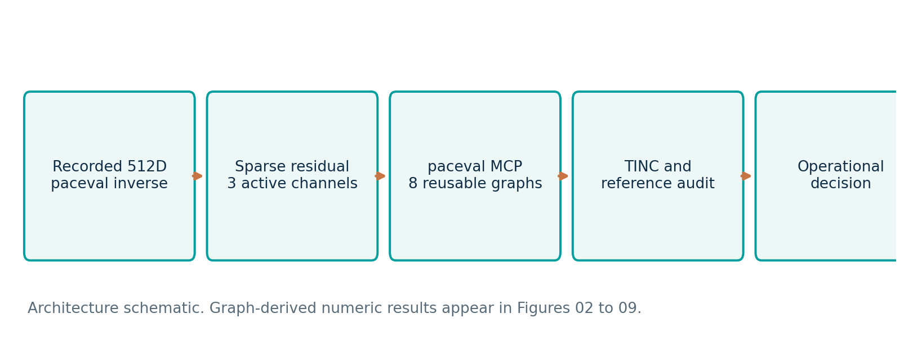
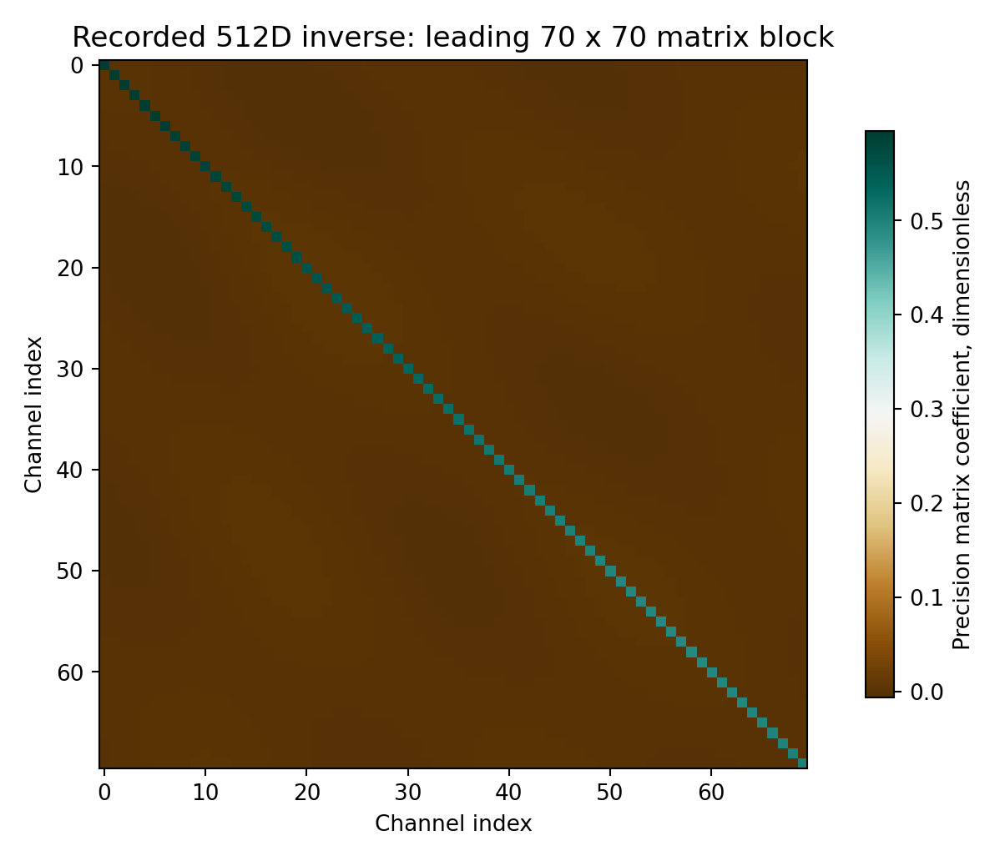
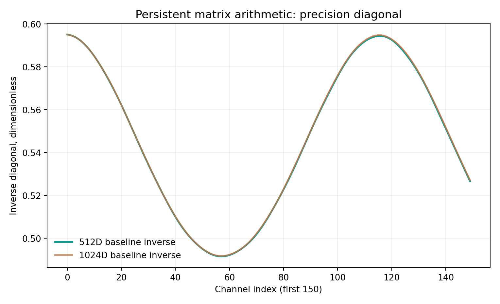
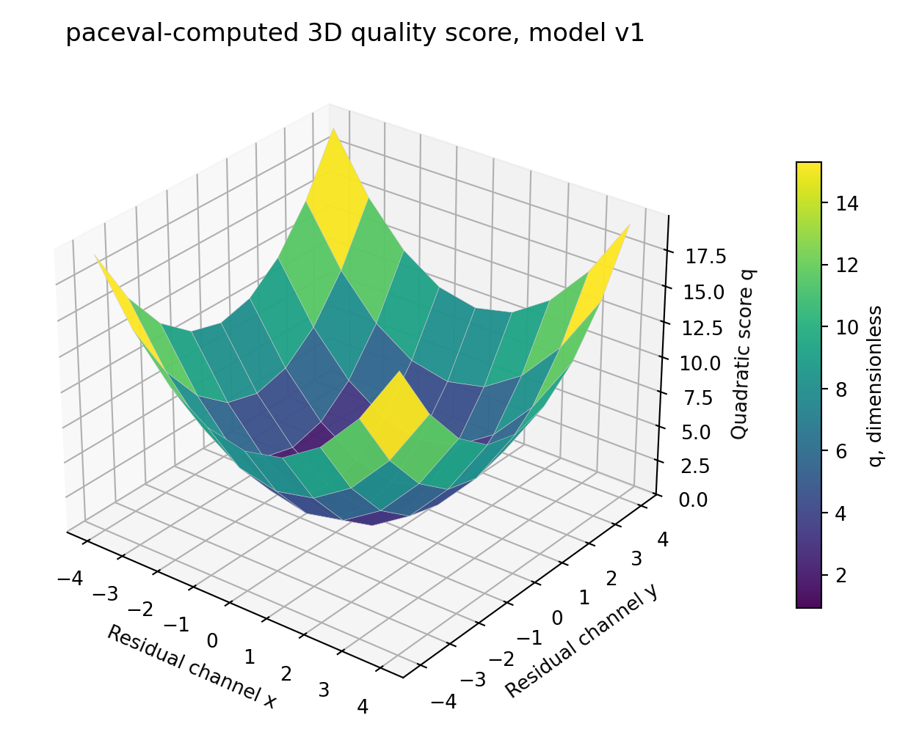
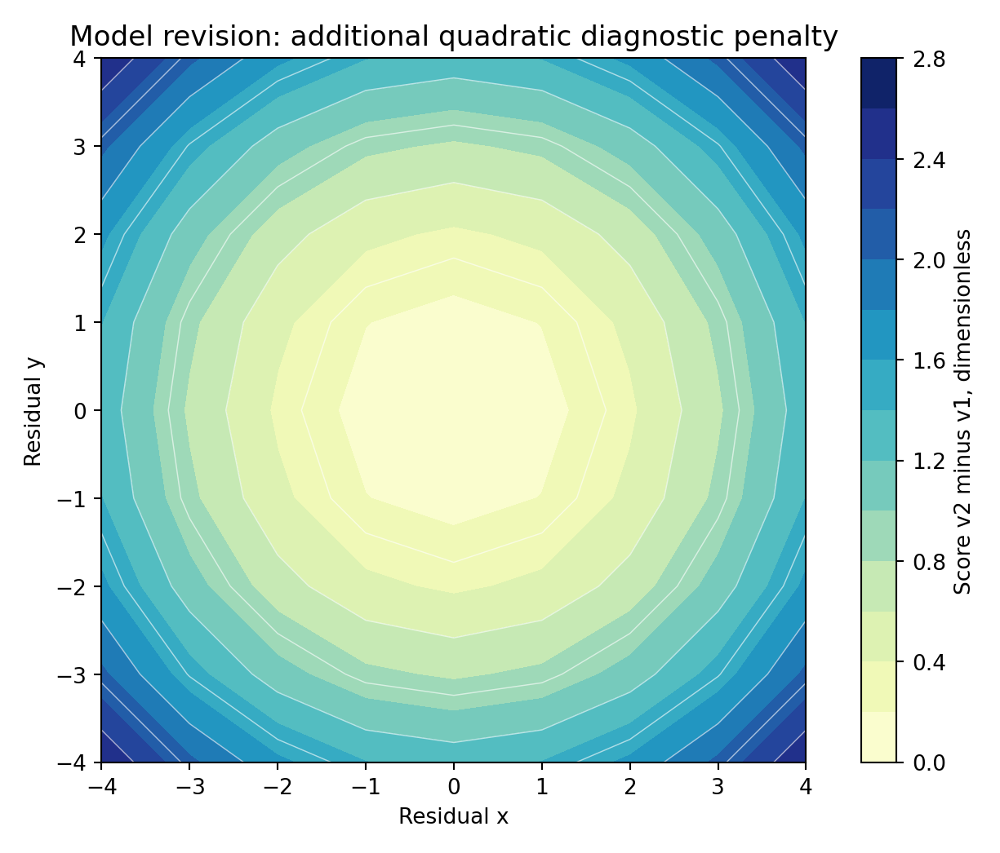
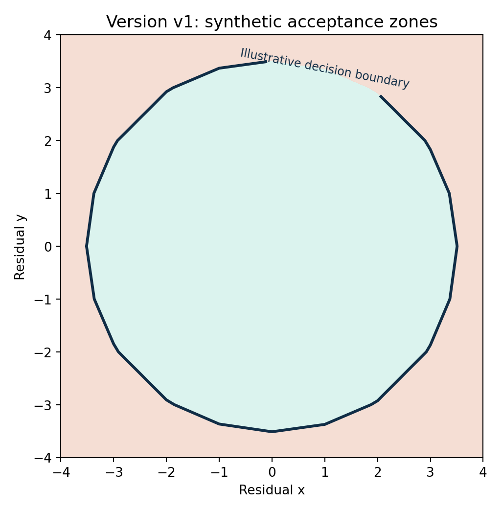
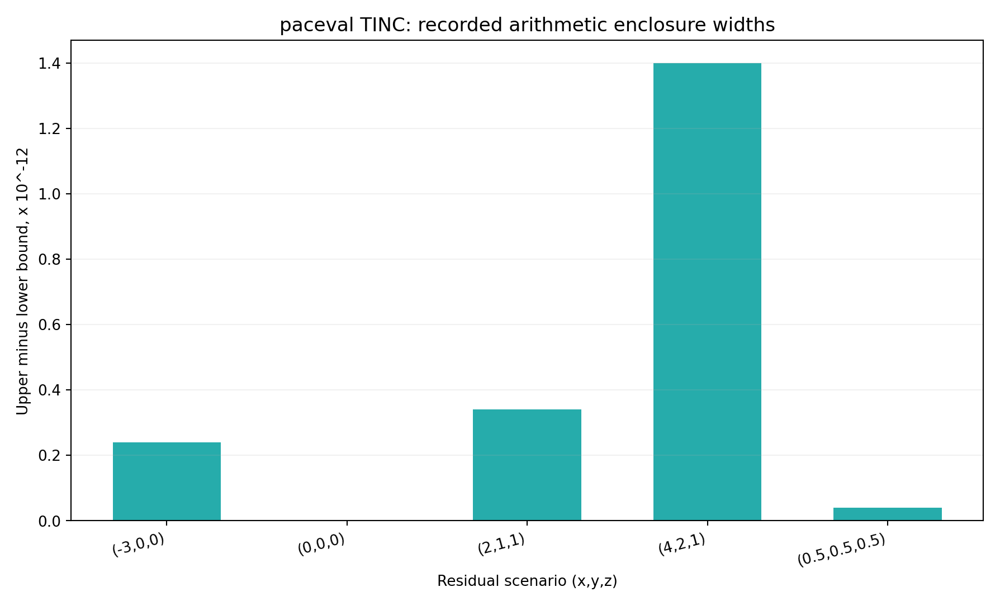
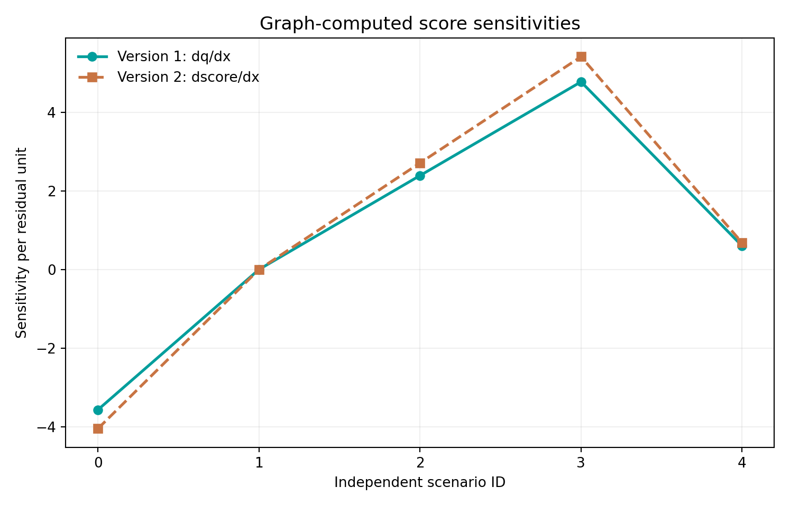
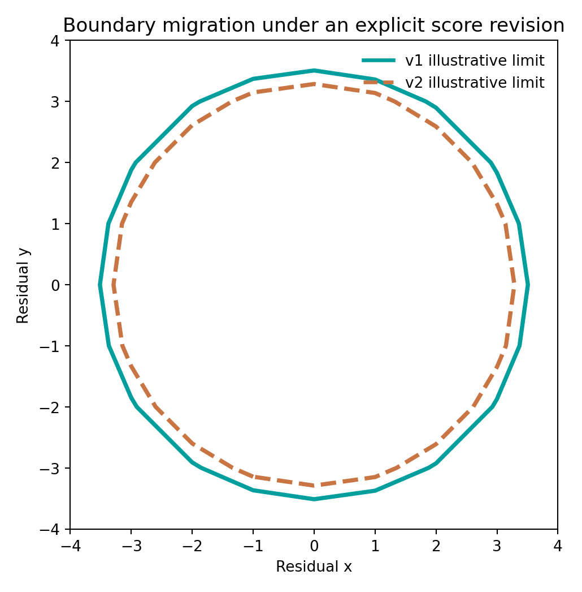

# Programmable Matrix Mathematics for Industrial Quality Monitoring with paceval


*Concept illustration; not a computed research result. Original 2400 × 1200 pixels.*

**Scientific functionality demonstrator | 13 November 2026 | English research package**

A full-size matrix calculation can be only the beginning of an industrial decision. This study extends previously recorded paceval Cholesky and complete dense SPD inverse computations with a version-controlled multichannel quality-monitoring application. The application calculates covariance-weighted residual scores, explicit model revisions, sensitivities, decision margins and rounding enclosures using the **real paceval Mathematical Engine**.

[English research whitepaper](paceval_Matrix_Precision_Quality_Whitepaper_EN.pdf) · [C++ main application](src/matrix_precision_paceval.cpp) · [recorded numerical outcomes](results/execution_evidence.json) · [scientific validation](RESEARCH_VALIDATION.md)

## 1. Industrial use case and current state of the art

A modern precision machine or manufacturing test cell may combine measurements from position, vibration, temperature, geometry and equipment condition sensors. These signals are not independent. Changes in temperature can affect several axes simultaneously, and different sensors may register related deviations. A system which simply tests every sensor against a separate scalar threshold can miss important correlated effects.

Covariance matrices provide a mathematical representation of how measured channels vary together. Engineers use them in sensor fusion, calibration, estimation and multivariate statistical process monitoring. The established mathematical workflow is to estimate or specify a covariance model, ensure an appropriate positive-definite factorization, calculate a residual-based statistic and interpret it against a decision policy. In practice, numerical linear algebra packages such as LAPACK provide highly developed Cholesky factorizations and triangular solves. Multivariate process control frequently uses covariance-normalized, Hotelling-style or Mahalanobis statistics. The International Bureau of Weights and Measures (BIPM) separately addresses multivariate measurement uncertainty and conformity decisions in JCGM 102 and JCGM 106.

This demonstrator investigates where **reusable mathematical expression graphs** are useful within such a workflow. It is not presented as a universal replacement for LAPACK, a calibrated multivariate control chart or a certified inspection instrument. A concrete hypothetical application is a 512-channel machine health or measurement model. Its dense covariance inverse has been recorded by the original local paceval matrix study. The new experiment examines residuals with three active channels and 509 zero entries, then applies an explicitly versioned quality formula to the resulting 512-dimensional quadratic form. All data are **synthetic and dimensionless**.

The 2025 literature continues to study robust covariance estimation and multivariate process monitoring with correlated observations. These approaches motivate the application, while this project specifically tests the mathematical execution and traceability of paceval expressions. See the [external research references](#10-external-scientific-references).

## 2. Research question and evidence levels

Can previously recorded dense matrix results be connected to a reproducible, versioned and independently auditable quality-monitoring calculation through persistent paceval graphs? Can the same engine also evaluate sensitivity expressions and numerical interval enclosures, without confusing arithmetic rounding error with physical measurement uncertainty?

The study contains **two evidence categories**. First, complete 512 × 512 and 1024 × 1024 matrices, their recorded full inverses and original C++ study source are retained from a prior genuine local SDK experiment. Their full-matrix residuals have been independently recomputed in this package. Second, **new results were executed through the genuine paceval MCP 4.26 server** on 13 November 2026. The new local C++ application is included and passes syntax compilation, but could not be linked and executed because a compatible original Linux `.so` is not present in this environment. Its test status is explicitly *not executed*.

## 3. Mathematical models and functional flow

For a symmetric positive-definite covariance matrix of dimension 512, the original program records a complete precision matrix, its inverse:

```math
\mathbf{P}=\mathbf{A}^{-1}, \qquad \mathbf{A}=\mathbf{L}\mathbf{L}^{\mathsf{T}}.
```

For the synthetic sparse residual vector and a synthetic dimensionless threshold, define:

```math
\mathbf{r}=(x,y,z,0,\ldots,0)^{\mathsf{T}}, \qquad q_1=\mathbf{r}^{\mathsf{T}}\mathbf{P}\mathbf{r}.
```

The complete 512-dimensional quadratic form reduces **exactly for this sparse input** to the leading 3 × 3 block of the previously computed full precision matrix. It is not a claim that the entire 512-dimensional matrix is equivalent to a 3 × 3 matrix. With coefficients \(a=P_{11}\), \(b=P_{12}\), \(c=P_{13}\), \(d=P_{22}\), \(e=P_{23}\), \(f=P_{33}\), all taken from recorded paceval matrix output:

```math
q_1=ax^2+2bxy+2cxz+dy^2+2eyz+fz^2.
```

A controlled diagnostic policy revision introduces a nonnegative supplementary penalty with \(h=0.08\). Version 1 and version 2 remain separately available:

```math
q_2=q_1+h(x^2+y^2+z^2), \qquad m_1=t-q_1, \qquad m_2=t-q_2.
```

The illustrative threshold \(t=7.815\) is **not** an industrially calibrated specification. In particular, version 2 does not inherit a chi-square distribution merely because its input resembles a Mahalanobis statistic. The decision label is assigned by the C++ host from the paceval-computed margin. The graph also computes explicit analytic sensitivities and the square-root radial diagnostic:

```math
\frac{\partial q_2}{\partial x}=2ax+2by+2cz+2hx,\qquad \rho_1=\sqrt{q_1}.
```

**TINC precision clarification:** The additional interval results recorded by paceval concern its mathematical evaluation and platform-dependent floating-point rounding. They do **not** propagate unknown sensor calibration uncertainty, unknown model parameters or systematic process errors. A genuine conformity decision would need a separate, justified metrological uncertainty budget and acceptance policy.

## 4. What actually ran in paceval

| Mathematical function or industrial purpose | Actual implementation | Graph or model status |
|---|---|---|
| Full 512/1024 dense SPD Cholesky and inverse | Original paceval local SDK, archived results | Previously recorded, not rerun here |
| 512D sparse quadratic quality score | Genuine paceval MCP 4.26 graph | `q`, version 1, actually evaluated |
| Revised quadratic penalty score | Genuine paceval MCP 4.26 graph | `q_v2`, version 2, actually evaluated |
| Explicit score revision difference | Genuine paceval MCP 4.26 graph | `delta_v2_v1`, actually evaluated on the 81-point grid |
| Signed decision margins for both versions | Genuine paceval MCP 4.26 graphs | `margin_v1`, `margin_v2`, evaluated |
| Sensitivities with respect to residual inputs | Genuine paceval MCP 4.26 graphs | `sensitivity_x_v1`, `sensitivity_x_v2`, `sensitivity_z_v2`, evaluated |
| Normalized score radius | Genuine paceval MCP 4.26 graph | `normalised_radius`, evaluated |
| Score and margin rounding enclosures | Genuine paceval MCP TINC graphs | `q_tinc`, `margin_tinc`, evaluated |
| Input screening, sampling, state, classifications, file I/O | C++ host or Python support | Not represented as paceval functions |
| Independent high-precision numerical checks | mpmath and NumPy | Reference only, never represented as paceval output |

The original SDK files `src/paceval_main.h` and `src/paceval_main.cpp` are included with upstream notices unchanged. The new [C++ source](src/matrix_precision_paceval.cpp) calls `paceval_CreateComputation`, `paceval_dGetComputationResultExt` and `paceval_dGetMultipleComputationsResultsExt` with consistent input ordering. The multi-graph path includes a layout cross-check against separately evaluated graphs. These calls are **implemented but have not been locally executed in this release**. The separately executed remote MCP batches are documented in [the evidence register](results/execution_evidence.json).

## 5. Reproducible numerical outcomes

The new remote execution created **11 persistent graph handles** and performed **4 recorded bulk requests**, evaluating **293 graph-and-scenario pairs** across **86 distinct residual scenarios**. This comprises a 9 × 9 score surface for two model versions and one explicit paceval revision-difference graph, eight other graph functions on five selected cases and two TINC-enabled functions on those five cases. The server reported no per-value execution errors for these recorded requests. These totals should not be confused with 293 independent quality-control observations or 293 different mathematical formulas.

The new [scenario CSV](results/remote_paceval_scenarios.csv) and [81-point grid CSV](results/remote_paceval_grid.csv) are derived from the returned paceval outputs. The archive also includes the prior 512D and 1024D full inverse files, the corresponding input SPD matrices and the original verification metadata. An independent high-precision and full-matrix audit **passed** on those recorded data. See [audit JSON](results/high_precision_audit.json). In accordance with this publication's scope, numerical differences against native reference calculations are not summarized here. The audit file preserves the details.

The TINC tests establish inclusion for the specific recorded examples at the precision represented by the endpoint serialization. Finite tests do not prove a general global interval guarantee for every formula or input, and the result remains separate from metrological uncertainty.

## 6. Scientific diagrams

Every technical result figure is reproduced from recorded original paceval inverse data or the new actual MCP outputs. Architecture is labeled as schematic. All technical plots are supplied as PNG and vector PDF.



*Figure 1. Schematic linking previously recorded dense SPD matrix results to the genuinely executed new quality graphs.*



*Figure 2. A 70 × 70 region of the full 512-dimensional inverse recorded in the earlier local paceval run.*



*Figure 3. Original recorded precision matrix diagonals at two problem dimensions.*



*Figure 4. Three-dimensional surface using the 81 values actually returned by paceval MCP.*



*Figure 5. Difference between separately registered mathematical model versions, evaluated using a dedicated paceval graph.*



*Figure 6. Illustrative threshold regions of the recorded version 1 function.*



*Figure 7. Widths of the actual five recorded rounding enclosures. They are not physical sensor error bars.*



*Figure 8. Analytical sensitivity functions genuinely evaluated by paceval on sample cases.*



*Figure 9. Versioned quality boundaries derived from genuine paceval MCP grids.*

## 7. Build instructions with original paceval SDK

An ABI-compatible original Linux x86-64 paceval shared library is mandatory and is intentionally **not** redistributed. The local executable cannot be linked using the header alone. Once the runtime is available, use:

```bash
cmake -S src -B build -DCMAKE_BUILD_TYPE=Release \
  -DPACEVAL_RUNTIME=/absolute/path/to/libpaceval_linux_sharedLIB.so
cmake --build build -j
ctest --test-dir build --output-on-failure
```

The executable writes regenerated CSV output to `results/local_sdk_regenerated_grid.csv`. That file is intentionally **absent** until the real local SDK run succeeds. The preserved remote results remain untouched. No successful local CTest run is claimed in this research package.

## 8. Reproduction and independent verification

```bash
python3 src/high_precision_reference.py .
python3 src/make_figures.py
python3 src/check_readme_math.py .
```

These scripts use the recorded result files, not a native reimplementation falsely presented as paceval evaluation. The audit checks the reconstructed 512D and 1024D matrix inverses, eight new formulas, grid values and TINC sample inclusions. The README checker includes positive and negative regression tests for GitHub math blocks and checks local document links. A true GitHub web rendering inspection cannot be claimed from this environment.

The original matrix factorization and inverse source is preserved as `src/dense_spd_paceval.cpp`. Its reproducibility requirements and original recorded results are distinct from the new MCP calculations. The new `src/matrix_precision_paceval.cpp` demonstrates the proposed fully local continuation without pretending that it has been run.

## 9. Interpretation and scientific limitations

The combined evidence supports the **mathematical feasibility** of reusing a full SPD precision model inside a configurable quality-scoring chain with independently checked paceval expressions. It establishes a clear division between matrix primitives, programmable domain mathematics and operational decisions. Current evidence is restricted to synthetic, well-conditioned archived matrices, sparse three-channel residuals, explicitly chosen quality rules and a small TINC validation sample. It is not a calibrated process-control design or certified acceptance rule. A next research step would involve actual multichannel signals, covariance estimation, model-drift analysis, physical units and a justified metrological uncertainty budget.

## 10. External scientific references

1. [Netlib LAPACK: DPOTRS, solving SPD systems using Cholesky factors](https://www.netlib.org/lapack/explore-html/d3/dc8/group__potrs_ga70a04d13ff2123745a26b1e236212cf7.html). Official algorithm reference.
2. [BIPM JCGM 102:2011, multivariate measurement uncertainty](https://www.bipm.org/en/doi/10.59161/jcgm102-2011). Official guide.
3. [BIPM JCGM 106:2012, uncertainty and conformity assessment](https://www.bipm.org/en/doi/10.59161/JCGM106-2012). Official guide.
4. [Auxiliary covariate-assisted condition monitoring for machinery (2025)](https://www.sciencedirect.com/science/article/pii/S0951832025011573). Recent multivariate process-monitoring context.
5. [Robust covariance matrix-based Hotelling T-squared control chart (2025)](https://onlinelibrary.wiley.com/doi/full/10.1002/qre.70025). Scientific context for robust covariance.
6. [paceval developers and TINC](https://paceval.com/developers/) and [paceval API reference](https://paceval.com/api/). Engine documentation.
7. [Original research document](docs/Original_Industrial_Matrix_Research_EN.pdf). Previous full-size SPD matrix computational study and recorded provenance.

*All claims of successful execution refer either to preserved previous matrix experiments or to the new MCP results. Hardware acceleration, product certification, industrial deployment and the unavailable local binary test are not claimed.*
