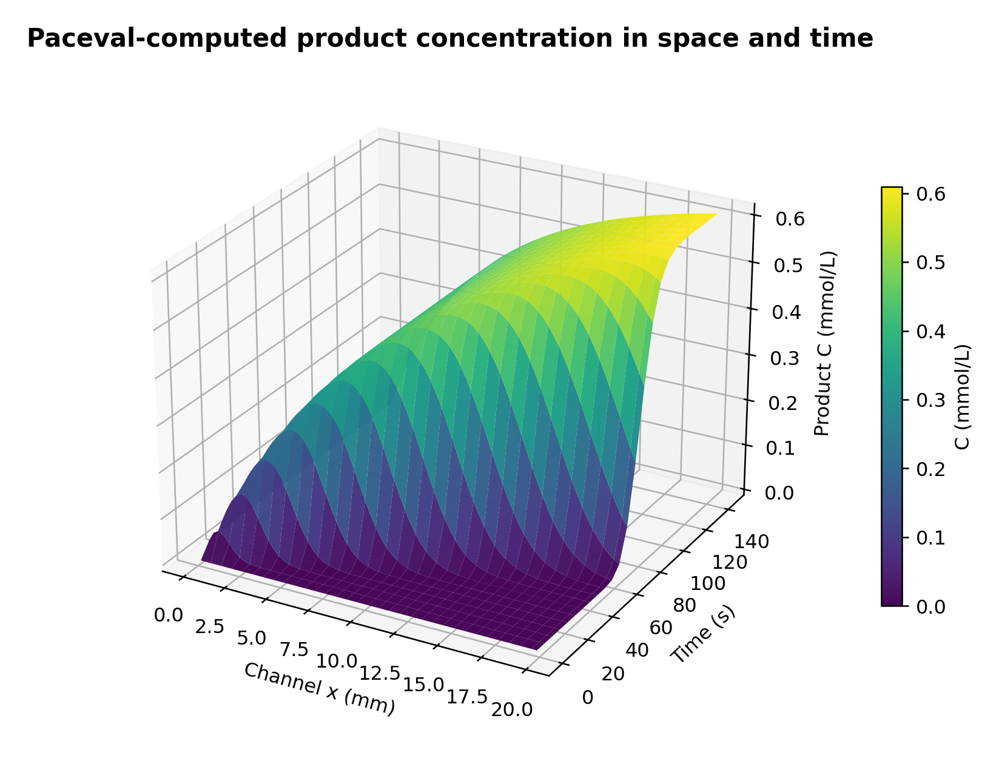

# paceval | Microfluidic Reaction–Transport Research


*Concept illustration; not a computed research result. Original 2400 × 1200 px illustration; scientific figures below are generated from actual paceval result files.*

**A reproducible, scientifically delimited C++ research demonstrator for reversible reaction-rate expressions and conservative species transport in a synthetic continuous-flow microreactor.** The original paceval Mathematical Engine executes reusable coupled finite-volume update expressions, rate functions, explicit analytical sensitivities, balance-boundary functions and controllable assessment scores. The C++ application manages simulation state, spatial arrangement, scheduling and independent verification, but does not replace the genuine SDK mathematics with a native stand-in.

**[English scientific whitepaper (PDF)](paceval_Microfluidic_Reaction_Rate_Expressions_Whitepaper_EN.pdf)** · **[C++ application](src/microfluidic_reactor.cpp)** · **[Mathematical execution inventory](results/math_execution_inventory.csv)** · **[Reproducibility protocol](results/reproducibility.txt)**

## 1. Industrial use case and current state of the art

Microfluidic reactors guide small volumes of liquids through microchannels so that reactants can mix, move, react and be analyzed under controlled conditions. Applications include flow chemistry, reaction screening, process analytics and analytical or biochemical microdevices. The relevant industrial question is not merely whether a local chemical formula can be evaluated: it is how the kinetic law interacts with residence time, advection, axial dispersion, incoming feed composition and reactor response. An industrial engineer needs to inspect concentration profiles, product generation, mass conservation and changes of a kinetic model across a reproducible set of operating conditions.

In established engineering practice, dilute-species transport and reaction are coupled with laminar flow models, commonly using finite-element or finite-volume simulations. COMSOL's Microfluidics and Chemical Reaction Engineering capabilities explicitly describe coupled flow, convection, diffusion and chemical reactions. OpenFOAM documents finite-volume scalar advection–diffusion equations. This project deliberately isolates **one 1-D, cross-section-averaged reaction–transport kernel** and keeps velocity and effective axial dispersion prescribed. It neither solves a three-dimensional fluid-flow problem nor claims to reproduce the true mixing dynamics of a particular microchip.

Contemporary research confirms the importance of this use case: Westphal et al. (2024) combine microreactor monitoring with online LC/MS; a 2025 miniaturized reactor study uses in-situ Raman spectroscopy for kinetic characterization; Knoll et al. (2025) introduce the modular FlowMat reactor modeling toolbox; and Silber et al. (2026) investigate the kinetic modeling of multi-step transformations from dynamic continuous-flow experiments. These works motivate transparent, reusable rate-law kernels, but do not establish industrial superiority of paceval or validate the parameters of this synthetic study.

Here the practical data chain is **inlet concentrations + channel geometry + transport and kinetic parameters → reusable paceval reactions and finite-volume updates → concentration fields and outlet measures → independent mass-balance and reference checks → illustrative engineering comparisons**.

**Sources:** [COMSOL 6.4: chemical transport and reactions](https://doc.comsol.com/6.4/doc/com.comsol.help.mfl/mfl_ug_modeling.05.13.html), [OpenFOAM scalar transport](https://doc.openfoam.com/2306/tools/processing/solvers/rtm/basic/scalarTransportFoam/), [Westphal et al., 2024, DOI 10.1039/D4RE00004H](https://doi.org/10.1039/D4RE00004H), [Knoll et al., 2025, DOI 10.1039/D5RA06173C](https://doi.org/10.1039/D5RA06173C), [Silber et al., 2026, DOI 10.1039/D5RE00306G](https://doi.org/10.1039/D5RE00306G).

## 2. Verified research scope

The research uses a hypothetical aqueous, dilute, single-channel flow reactor with **A + B ⇌ C**, one-dimensional cross-section-averaged concentration fields and constant effective axial dispersion. Species are expressed in mmol/L, channel distance in mm and simulation time in seconds. A positive, prescribed mean velocity drives an inlet step of A and B into an initially empty channel. No external proprietary experimental dataset is used.

The research run contains **12 deterministic scenarios**, **64 finite-volume cells**, **1440 steps**, a **0.1 s time interval** and a **144 s observation horizon**. Two different kinetic models and two values of the forward rate coefficient are evaluated at three flow velocities. The original Linux paceval library executed **82 distinct persistent graphs**, **2,890 multi-graph batches**, **6,809,202 graph results**, and **258 additional scalar API evaluations**; it also completed **2,160 native C++ mathematical checks**. The independent Python audit passed **35,424 comparisons with 80-decimal-place reference calculations** and **216 whole-trajectory field checks**. The full run and all three CTest tests passed with the supplied original library. The audit includes independent balance checks on both stoichiometric conserved combinations. An additional genuine-paceval mesh-refinement experiment at **32, 64 and 128 cells** shows decreasing consecutive outlet-concentration differences in **all 12 cases** (successive-difference ratio 0.488–0.510); this is numerical convergence evidence for this workload, not a general convergence proof. [Mesh-refinement evidence](results/mesh_refinement.csv).

[Execution record](results/sdk_execution.txt) · [Verification audit](results/high_precision_audit.json) · [CTest log](results/ctest_sdk.txt) · [Scenario results](results/scenario_summary.csv)

## 3. Mathematical model and versioned kinetics

The local equations for each species are an idealized, isothermal conservation law with a prescribed common mean velocity $u$ and effective axial dispersion $D$:

```math
\frac{\partial c_i}{\partial t} + u\frac{\partial c_i}{\partial x}
= D\frac{\partial^2 c_i}{\partial x^2} + \nu_i r,\qquad
(\nu_A,\nu_B,\nu_C)=(-1,-1,+1).
```

The **original law (v1)** is reversible mass action; the **experimental alternative (v2)** includes a bounded forward-rate term with a hypothetical saturation factor. This is **not** an experimentally established mechanism for a named compound.

```math
r_1=k_f A B-k_r C,\qquad
r_2=\frac{k_f A B}{1+K A}-k_r C.
```

Units: $k_f$ in L/(mmol·s), $k_r$ in 1/s and $K$ in L/mmol. Here $A$, $B$, $C$ are concentrations in mmol/L; $r$ is mmol/(L·s). For the case-study design: $L=20$ mm, $D=0.006$ mm²/s, $u\in\{0.25,0.40,0.55\}$ mm/s, $k_f\in\{0.018,0.032\}$ L/(mmol·s), $k_r=0.003$ 1/s, $K=0.65$ L/mmol, $A_{\mathrm{in}}=1.0$ mmol/L and $B_{\mathrm{in}}=0.9$ mmol/L. Initially every cell has A=B=C=0. An inlet Dirichlet concentration and zero-diffusive-flux outlet are imposed via the boundary face fluxes.

For positive flow, the host supplies neighboring old-state concentrations and boundary factors. **paceval itself evaluates the face-flux difference and the complete species update**:

```math
J_{i-1/2}=u c_{i-1}-D\alpha_L\frac{c_i-c_{i-1}}{\Delta x},
\qquad
J_{i+1/2}=u c_i-D\alpha_R\frac{c_{i+1}-c_i}{\Delta x},
```

```math
c_i^{n+1}=c_i^n+\Delta t\left(
\frac{J_{i-1/2}-J_{i+1/2}}{\Delta x}+\nu_i r
\right).
```

For interior cells $\alpha_L=\alpha_R=1$; for the inlet face $\alpha_L=2$ due to the half-cell Dirichlet distance; for the outlet face $\alpha_R=0$ (zero diffusive outflow). The host updates state arrays only **after** receiving three paceval graph outputs for the selected kinetic version. The explicit step is checked for nonfinite/negative values; the test does not imply unconditional stability.

Define two chemical invariants: $A+C$ and $B+C$. Their spatial integrals are compared with the cumulative **paceval-computed net inlet-minus-outlet boundary flux**. Other paceval graphs compute the channel Péclet number $Pe=uL/D$, the nominal pseudo-first-order Damköhler number $Da=k_f B_{\mathrm{in}}L/u$, reaction and score gradients and signed outlet target margins.

During an inlet startup transient, **$1-A_{out}/A_{in}$ is not a chemically valid conversion measure**, because reactant may not yet have reached the outlet. Therefore, our explicit research measure is the local stoichiometric reacted fraction $C_{out}/(A_{out}+C_{out}+\varepsilon)$, with $\varepsilon=10^{-12}$ mmol/L to define the low-signal limit; results near zero signal are not used for process decisions. The separate ratio $C_{out}/A_{in}$ is labeled only as an outlet product-to-feed concentration ratio, not as an absolute chemical yield.

## 4. Verified allocation of mathematical work

| Mathematical function / research purpose | Actual execution | Graph / version or host rationale |
|---|---|---|
| Reversible reaction, forward/reverse kinetics | **paceval** | `reaction_rate`, `forward_rate`, `reverse_rate` v1/v2 |
| Transport of A, B, C | **paceval** | `transport_A/B/C` v1/v2 |
| Complete one-step reaction–transport state update | **paceval** | `A_next`, `B_next`, `C_next` v1/v2 |
| Analytic sensitivities to A, B, C, kf and K | **paceval** | `d_rate_dA/B/C/kf/K` v1/v2 |
| Inlet/outlet boundary fluxes of conserved species pairs | **paceval** | `influx_A_C/B_C`, `outflux_A_C/B_C` v1/v2 |
| Concentration invariants and outlet reaction fraction | **paceval** | `mole_sum`, `outlet_reacted_fraction` v1/v2 |
| Outlet product flux, target/decision margins | **paceval** | `outlet_molar_flux_C`, `target_product_margin`, `reacted_fraction_margin` |
| Twelve versioned, weighted assessment formulas each | **paceval** | `score_v1_01…12`, `score_v2_01…12` |
| Residence time, Péclet and nominal Damköhler numbers | **paceval** | `flow_residence_time`, `peclet_channel`, `damkohler_nominal` |
| Controlled v1/v2 formula difference | **paceval** | `reaction_rate_v2_minus_v1` |
| Time-stepping, state persistence, mesh, I/O | **C++ host** | Stateful orchestration; not represented as paceval functionality |
| Spatial reductions and cumulative boundary integrals | **C++ host** | Stateful sums of paceval concentrations and paceval boundary fluxes |
| High-precision and reference model | **Python / native C++** | Independent verification only; never substituted for live paceval output |

All real graph definitions, original expressions and confirmed execution owners appear in [formula_registry.csv](results/formula_registry.csv) and [math_execution_inventory.csv](results/math_execution_inventory.csv). The graph inventory records only actual executed SDK expressions as `paceval`; it does not inflate the graph count with C++ routines.

## 5. Actual scientific results

The 144 s endpoint study shows a coherent response to variations in velocity, reaction rate and formulation. The slower flow has longer nominal residence time; the higher forward-rate configuration generates more product under the chosen hypothetical assumptions; the saturation-dependent v2 model changes the local kinetics and outlet result while the original v1 remains available without alteration. The results are **illustrative reactor-system outcomes**, not predictions for a specific chemical manufacturing process.

**Selected results (all actual paceval calculations):**

| Case | Model | u (mm/s) | kf (L/[mmol·s]) | C outlet (mmol/L) | Stoichiometric reacted fraction |
|---|---|---|---|---|---|
| 1 | v1 | 0.25 | 0.018 | 0.49474 | 0.49474 |
| 2 | v2 | 0.25 | 0.018 | 0.41080 | 0.41080 |
| 3 | v1 | 0.25 | 0.032 | 0.61088 | 0.61088 |
| 4 | v2 | 0.25 | 0.032 | 0.54628 | 0.54628 |

The full tables include all 12 scenarios, physical outlet concentrations, model version, dimensionless groups, weighted scores, and audited inventories. The numerical differences between native and paceval implementations are **not** promoted as research findings; the independent comparisons and their detailed audit remain in the technical verification files. The report does not contain CPU or speedup comparisons.

## 6. Scientific diagrams

The following visualizations are reproducible from the actual paceval data files using [make_figures.py](src/make_figures.py). Figure 1 is an architecture schematic; figures 2–10 use computed paceval data.

| Figure | Application-oriented interpretation |
|---|---|
| [01 – Workflow](figures/01_workflow.png) | Input → mathematical graphs → reactor outputs → independent audit |
| [02 – Species profiles](figures/02_spatial_species_profiles.png) | A, B, C evolution along the channel at three times |
| [03 – 3-D concentration surface](figures/03_product_spacetime_3d.png) | Calculated product concentration over channel length and time |
| [04 – Reaction extent and velocity](figures/04_reacted_fraction_flow.png) | Reaction fraction as throughput conditions change |
| [05 – Parameter map](figures/05_outlet_product_parameter_map.png) | Outlet product across flow and kinetic options |
| [06 – Model revision](figures/06_versioned_reaction_outcome.png) | Product difference between retained kinetic laws |
| [07 – Conserved species pairs](figures/07_stoichiometric_inventory.png) | Boundary transport versus domain inventory |
| [08 – Analytical sensitivity](figures/08_local_kinetic_sensitivities.png) | Real paceval sensitivity values over local state samples |
| [09 – Dimensionless regimes](figures/09_peclet_damkohler_map.png) | Péclet–Damköhler operating design space |
| [10 – Composite scores](figures/10_programmable_composite_scores.png) | Reusable weighted engineering score versions |



## 7. Build and reproduce on Linux x86-64

You must provide **your own compatible original Linux paceval shared library**. It is intentionally **not included** in this repository. The authentic `paceval_main.h` and `paceval_main.cpp` sources, with preserved upstream copyright and license notices, are under `src/`. The only change made to the original .cpp is its local include path to the neighboring header. Examine the actual upstream AGPL terms before publishing or redistributing these components.

```bash
cmake -S src -B build -DCMAKE_BUILD_TYPE=Release \
  -DPACEVAL_RUNTIME=/absolute/path/to/libpaceval_linux_sharedLIB.so
cmake --build build -j
ctest --test-dir build --output-on-failure

# Reproduce the original full executed dataset (12 scenarios, 64 cells, 1440 steps)
./build/microfluidic_reactor --out . --cells 64 --steps 1440
python3 src/verify_results.py --root .
python3 src/mesh_refinement.py --root . --executable build/microfluidic_reactor
python3 src/make_figures.py --root .
python3 src/make_whitepaper.py --root .
python3 src/check_readme_math.py
```

Python dependencies for graph plotting/report generation: `numpy`, `matplotlib`, `reportlab`, `Pillow`; the high-precision audit additionally uses `mpmath`. The C++ solver uses the standard C++17 library and the **original** paceval runtime only.

**[Compact reproducibility instructions](results/reproducibility.txt)** · **[Preserved research proposal](reference/WP_047_Microfluidic_Reaction_Rate_Expressions.pdf)**

## 8. Reproducibility and verification

The released computation uses deterministic initial conditions and exact parameter grid, with no random-number draws. Input rows are stored in `examples/synthetic_operating_scenarios.csv`; outcome trajectories in `results/concentration_profiles.csv`; mass audit in `results/mass_balance.csv`; grid refinement in `results/mesh_refinement.csv`; operating-point summaries in `results/scenario_summary.csv`; all registered graph expressions and their actual execution status in `results/formula_registry.csv` and `results/math_execution_inventory.csv`; and tested graph input/output pairs in `results/graph_probe.csv`.

A separate independent reference program reconstructs all simulated trajectories using independently written native numerical equations and checks every graph family using 80-digit `mpmath` calculations from the recorded binary64 input values. The tests cover model differences, conservative updates, boundaries, rate derivatives, dimensionless groups and output score functions. For physical validity we additionally check nonnegative concentrations and both stoichiometric integral balances. Re-running these checks is a necessary verification step, but a finite test set is not a proof of general or global numerical correctness. TINC interval certification was not attempted in this numerical study; the reported residual checks and sample calculations must not be interpreted as interval bounds.

README LaTeX syntax and local file links are checked by [check_readme_math.py](src/check_readme_math.py), including deliberate failing regression cases. A live GitHub MathJax rendering check was not performed in this runtime; do not treat the structural check as visual proof.

## 9. Scientific interpretation and limitations

The positive research result is that a complete, meaningful reaction–transport numerical path can be executed by persistent original paceval graphs with real original-SDK batch functions, while independent methods check full application outputs. The two kinetic laws are different but simultaneously callable and controlled; analytical reaction-rate derivatives are explicit formulas, **not** a claim that the SDK performs automatic differentiation.

Important limits: the channel is 1-D and cross-section-averaged; the fluid velocity field is prescribed rather than computed; axial dispersion is an effective parameter, not molecular diffusion alone; uniform isothermal concentrations within each cell cannot reproduce transverse gradients and finite mixing time; the kinetics are synthetic; there are no real experimental measurements, viscosity/pressure/heat/catalyst data, three-dimensional CFD comparisons, process qualification, verified manufacturing economics, or hardware performance gains. In particular, Pe, Da, output targets and scores are *research descriptors*, not safety or regulatory certification.

The original proposal specified a broad benchmark hypothesis. This work is a verified implementation of a **defined synthetic mathematical research kernel**, not experimental validation of all microfluidic applications. A useful next step would be public measured concentration profiles with an independently established flow field, uncertainty propagation and independently identified reaction parameters.

## 10. External research sources

1. COMSOL, *Chemical Transport and Reactions*, v6.4, [official user documentation](https://doc.comsol.com/6.4/doc/com.comsol.help.mfl/mfl_ug_modeling.05.13.html).
2. OpenFOAM, *scalarTransportFoam*, [official documentation](https://doc.openfoam.com/2306/tools/processing/solvers/rtm/basic/scalarTransportFoam/).
3. Westphal, H. et al. (2024), *Development of an automated platform for monitoring microfluidic reactors through multi-reactor integration and online (chip-)LC/MS-detection*, Reaction Chemistry & Engineering. [DOI: 10.1039/D4RE00004H](https://doi.org/10.1039/D4RE00004H).
4. Knoll, S. et al. (2025), *FlowMat: a toolbox for modeling flow reactors using physics-based and machine learning approaches*, RSC Advances. [DOI: 10.1039/D5RA06173C](https://doi.org/10.1039/D5RA06173C).
5. Silber, K. et al. (2026), *Kinetic modeling of multi-step transformations using sequential dynamic flow experiments*, Reaction Chemistry & Engineering. [DOI: 10.1039/D5RE00306G](https://doi.org/10.1039/D5RE00306G).
6. Research article (2024), *Extraction of the intrinsic rate constant for a photocyclization reaction in capillary microreactors using a simplified reactor model*, Reaction Chemistry & Engineering. [DOI: 10.1039/D4RE00087K](https://doi.org/10.1039/D4RE00087K).
7. [paceval Mathematical Engine](https://github.com/paceval/paceval) and [official API](https://paceval.com/api/).

*Research artifact produced November 2026. No performance or industrial deployment claim is made.*
