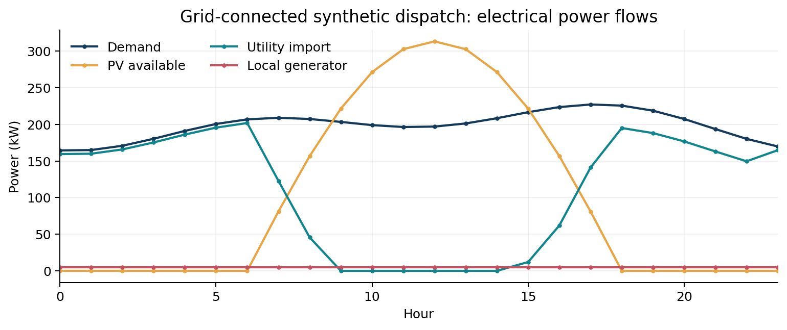
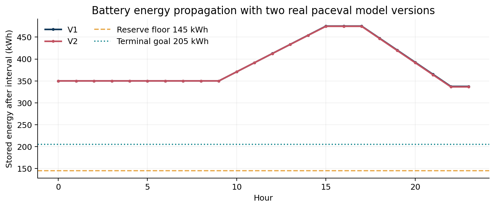
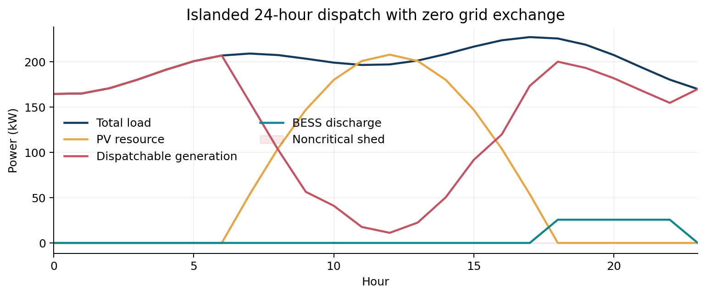

# Microgrid Storage Dispatch and Feasibility Evaluation with paceval


A reproducible mathematical functionality study of **multi-period microgrid energy balance, storage state propagation, reserve constraints and operating-cost screening**, implemented with the original paceval Mathematical Engine (SDK 4.25) and C++ on Linux.

**Research status (14 November 2026):** The original C++ integration was built and executed with the supplied binary-compatible Linux paceval runtime. All 69 registered domain graphs were actually evaluated with synthetic schedules. Results were checked against independent native C++ and 85-digit Python reference calculations. No industrial operational or regulatory approval is claimed.

## 1. Industrial use case and current state of the art

A microgrid combines local generation, photovoltaic electricity, storage and electrical loads behind a controllable interface to a distribution grid. A dispatcher must choose hour-by-hour charging, discharging, local generation and utility exchange without violating physical limits. During a grid outage, the same resources may need to preserve essential loads without external electricity. A prospective 24-hour schedule therefore needs more than a sum of favorable hourly prices. Every battery transition changes the energy available in later hours, while power balance, reserve, charge/discharge exclusivity, generator ramp limits and export restrictions must remain satisfied.

Established technologies already optimize such systems. **REopt**, maintained by the US National Laboratory of the Rockies (formerly NREL), develops optimized generation/storage sizing and dispatch and resilience analysis. **oemof.solph** provides open energy-system optimization. **Pyomo** is a mathematical optimization modeling framework. These are complements rather than replacements for the present demonstration. Recent research increasingly includes battery aging, SOC-dependent limits and uncertainty-aware reserve planning. This project investigates a narrower but relevant calculation layer: repeatedly evaluating the mathematical feasibility and costs of externally proposed dispatch schedules through reusable formula graphs.

The studied hypothetical site has PV generation, a 650 kWh battery, a controllable generator, critical and noncritical demand, and a utility connection that may be unavailable. The host proposes deterministic candidate sequences; **paceval evaluates the actual mathematical state equations, guard expressions and costs**. No MILP optimum is claimed, and the site specifications are illustrative rather than manufacturer measurements.

The actual evidence path is: validated CSV candidate → original paceval graph evaluation → next battery state transported by C++ to the next hour → original paceval feasibility and cost graphs → C++ multi-hour aggregation and decision → exported results → independent validation.

## 2. What was extended beyond the original proposal

The input WP 12 defined power balance, storage update, reserve margin and operating cost. This implementation extends that core to the following scientifically useful conditions: curtailment of available PV, noncritical load shedding with a protected critical-load fraction, active grid import and export limits, island-mode zero-grid-exchange constraints, generator ramp limits, no simultaneous charging/discharging, upper and lower energy bounds, a separate reserve floor and terminal energy goal, derivative formulas, composite feasibility guards and two persistent model versions.

**V1** uses constant one-way charge/discharge efficiency with no battery throughput cost. **V2** uses an illustrative SOC-dependent efficiency correction and a throughput cost. Both versions use the same validated input schedules and retain independent graph handles. The V2 model is not a calibrated electrochemical or electrothermal battery model; its coefficients are deliberately identified as illustrative assumptions.

## 3. Mathematical model and units

For one hourly interval, with all powers in kW and elapsed time in h:

- **Electricity balance:** `Ppv - Pcurt + Pgen + Pdis + Pimport - Pch - Pexport - Pload + Pshed = 0`.
- **Storage state:** `E_next = E + dt*(eta_ch(E)*Pch - Pdis/eta_dis(E))` in kWh.
- **V1 efficiencies:** `eta_ch(E)=0.95`, `eta_dis(E)=0.93`.
- **V2 efficiencies:** `eta_ch(E)=0.95*(1-0.26*(E/650-0.5)^2)` and `eta_dis(E)=0.93*(1-0.13*(E/650-0.5)^2)`.
- **Reserve:** `E_next - E_reserve >= 0`; the illustrative reserve floor is 145 kWh.
- **Stage cost:** `dt*(c_fuel*Pgen+c_buy*Pimport-c_sell*Pexport+c_curt*Pcurt+c_shed*Pshed+c_age*(Pch+Pdis)+c_ramp*abs(Pgen-Pgen_previous))`.
- **Feasibility:** a conjunction of nonnegative signed physical margins, `abs(balance) <= tolerance`, zero utility flow in island operation and mutually exclusive charging/discharging. The host also requires a terminal state of at least 205 kWh.

The battery energy range is 60–650 kWh, with a 350 kWh initial state. The assumed upper bounds for charge/discharge and local generation are 125 kW and 230 kW respectively. The numerical input conventions and all parameters are recorded in [`input/SCHEMA.md`](input/SCHEMA.md) and [`input/parameters.csv`](input/parameters.csv). All currency values are **illustrative USD**, not customer savings or market quotations. The reported feasibility is limited to **single-bus active-power and storage-energy equations**; frequency, voltage, reactive power, network thermal constraints, protection and equipment transients are not modeled.

## 4. Verified graph execution and ownership

| Mathematical function / industrial purpose | Actual implementation | Graph / rationale |
|---|---|---|
| PV curtailment and delivered load | paceval | `V1_PV_USED`, `V2_SERVED_LOAD` and counterparts |
| Active-power balance | paceval | `V1_POWER_BALANCE`, `V2_POWER_BALANCE` |
| Battery efficiencies and energy transition | paceval | `V1/V2_ETA_CH`, `ETA_DIS`, `E_NEXT`, `SOC_NEXT` |
| Upper/lower storage energy and reserve | paceval | `V1/V2_MARGIN_MIN`, `MARGIN_MAX`, `MARGIN_RESERVE` |
| Charge, discharge, generator and grid margins | paceval | `V1/V2_MARGIN_*` family |
| Critical load and generator ramp constraints | paceval | `V1/V2_MARGIN_CRITICAL_LOAD`, `MARGIN_RAMP` |
| Island-mode and non-simultaneous operations | paceval | `V1/V2_ISLAND_GRID_GUARD`, `NO_SIMULTANEOUS` |
| Cost components, compound stage cost, scoring | paceval | `V1/V2_*_COST`, `STAGE_COST`, `SCREENING_SCORE` |
| Analytically derived state sensitivities | paceval | `V1/V2_D_ENEXT_*` |
| Composite per-period feasibility | paceval | `V1/V2_STEP_FEASIBILITY` |
| Two-version difference and robust margin | paceval | `DELTA_*`, `MIN_RESERVE_ACROSS_MODELS`, `JOINT_FEASIBILITY` |
| Sequential battery-state propagation | C++ host | Previous `E_NEXT` is input to next interval |
| Candidate schedule generation and ranking | Python generator / C++ host | Discrete sequence generation and aggregation, not an optimizer |
| Independent numerical reference | C++ and Python | Separate algebra, not used to produce published paceval outcomes |

Graph IDs, expressions, version and run status are recorded in [`results/formula_manifest.csv`](results/formula_manifest.csv), [`results/math_execution_inventory.csv`](results/math_execution_inventory.csv), and [`results/execution_evidence.json`](results/execution_evidence.json).

## 5. Actually executed research dataset

The deterministic generator created **1,080 synthetic 24-hour candidate schedules**: 360 each for `grid_sunny`, `grid_cloudy` and `island_outage`. Both models were evaluated for all **51,840 model-hour records**. Some deliberately infeasible cases test mismatched power, charge/discharge conflicts and limits. No physical site measurement is included.

| Main finding | Real calculation output |
|---|---:|
| Domain graphs registered and executed | 69 / 69 |
| 24-hour schedules | 1,080 |
| Model-schedule chains | 2,160 |
| Model-hour evaluations | 51,840 |
| Fully feasible V1 schedules | 792 |
| Fully feasible V2 schedules | 816 |
| Native end-value reference assertions | 7,452 |
| Independent 85-digit reference assertions | 52,216 |

The two models classify 24 additional generated schedules as fully feasible under V2. This is a result of the **selected synthetic parameters and hard constraints**; it neither proves superior battery physics nor demonstrates industrial safety. In the current generated data, the V2 median final stored energy is lower than V1, while the additional throughput cost increases modeled expense. See [`results/schedule_summary.csv`](results/schedule_summary.csv) and [`results/model_comparison.csv`](results/model_comparison.csv).

## 6. Scientific figures from paceval results







The repository includes ten original scientific figures as PNG and vector PDF. They are generated from the real paceval CSV outputs by [`scripts/make_figures.py`](scripts/make_figures.py), including a candidate feasibility comparison, cost distributions, modeled efficiency sensitivity, a multi-schedule energy heatmap and a 3D schedule landscape. The conceptual hero illustration is **not** a measured figure.

## 7. Build and reproduce on Linux

The genuine SDK source files `src/paceval_main.h` and `src/paceval_main.cpp` are included unchanged except for the minimum include-path integration adjustment to the latter. The external binary runtime is intentionally **not included in the public ZIP**.

```bash
cmake -S src -B build -DCMAKE_BUILD_TYPE=Release \
  -DPACEVAL_RUNTIME=/absolute/path/to/libpaceval_linux_sharedLIB.so
cmake --build build -j
ctest --test-dir build --output-on-failure

# Optional direct replay of the original mathematical workload
./build/microgrid_dispatch --run input/dispatch_candidates.csv input/parameters.csv results
python3 scripts/verify_high_precision.py results input
python3 scripts/make_figures.py
```

Dependencies: a C++17 compiler and CMake for the actual program; Python 3 with `mpmath`, `numpy`, `pandas` and `matplotlib` for high-precision auditing and charts; `markdown-it-py` for the strict README checker; ReportLab and Pillow for whitepaper regeneration. The pre-generated data, plots and PDF are included so plotting libraries are not required to execute C++.

## 8. Validation and declared limits

The real C++ program was compiled against the supplied SDK 4.25 wrapper and compatible ELF shared library. Scalar, multi-graph batch layout, compound boolean operations, `%` versus `mod`, `min`/`max`, and both original double/string conversion functions were tested. Generated CSV columns reject formula expressions masquerading as numeric literals. Independently coded native C++ checks and 85-digit mpmath calculations cover full state chains, stage balance, operating cost, efficiency functions, analytical sensitivities, and feasibility guards. Audit details remain in [`results/high_precision_audit.json`](results/high_precision_audit.json) and [`results/native_audit.csv`](results/native_audit.csv), not in accuracy-comparison tables in this public README.

**Not established:** externally optimized dispatch, grid-code compliance, calibrated battery aging, AC load-flow, transient or frequency stability, inverter control, generator fuel sustainability, weather uncertainty guarantees, measurement validation, verified reserve availability under faults, or regulatory approval. IEEE 2030.7 and IEEE 2030.8 relate to controller functions and testing; IEEE 1547 concerns DER interconnection. This research **does not certify conformance** with those standards.

## 9. Scientific sources

1. [U.S. Department of Energy: Microgrid Systems](https://www.energy.gov/oe/microgrid-systems).
2. [NLR: REopt Capabilities](https://www.nlr.gov/reopt/about/capabilities).
3. [oemof.solph 0.6.4: SOC-dependent storage charging (2026)](https://oemof.org/2026/04/17/solph-v0-6-4-saturating-storage/).
4. [IEEE 2030.7-2017: Microgrid controller specifications](https://standards.ieee.org/ieee/2030.7/5941/).
5. [IEEE 2030.8-2018: Microgrid controller testing](https://standards.ieee.org/ieee/2030.8/6169/).
6. [IEEE 1547-2018: Distributed-resource interconnection](https://standards.ieee.org/ieee/1547/5915/).
7. [Nguyen et al., 2024: Microgrid MILP considering storage degradation and renewable uncertainty](https://www.sciencedirect.com/science/article/pii/S2352152X2404249X).
8. [Schade, 2024: Battery degradation impact on economic dispatch](https://doi.org/10.1002/est2.588).
9. [Original paceval API](https://paceval.com/api/) and [paceval Product Brief](https://paceval.com/product-brief/).

## 10. Scope and licensing

The original paceval SDK source identifies an AGPL license and retains its original copyright notices. Review third-party license obligations before redistribution. No executable runtime library is distributed here. For scientific methodology and independent verification, read [`RESEARCH_VALIDATION.md`](RESEARCH_VALIDATION.md). The original two-page WP 12 is preserved in [`docs/original_WP12_proposal.pdf`](docs/original_WP12_proposal.pdf).
