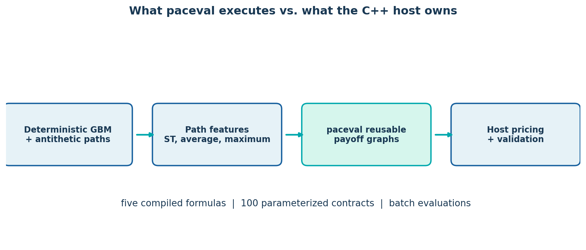
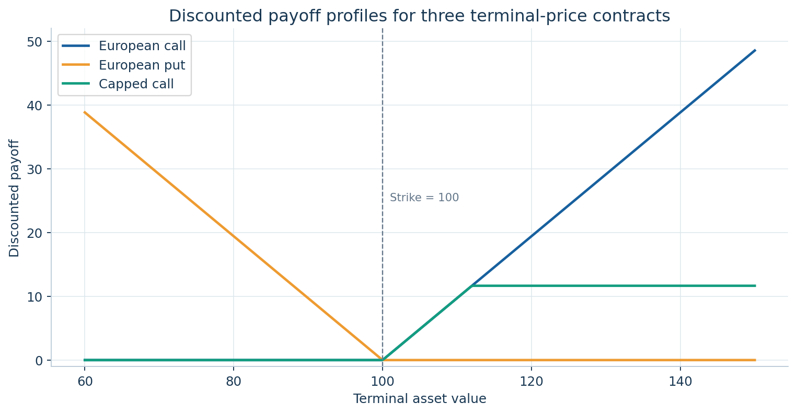
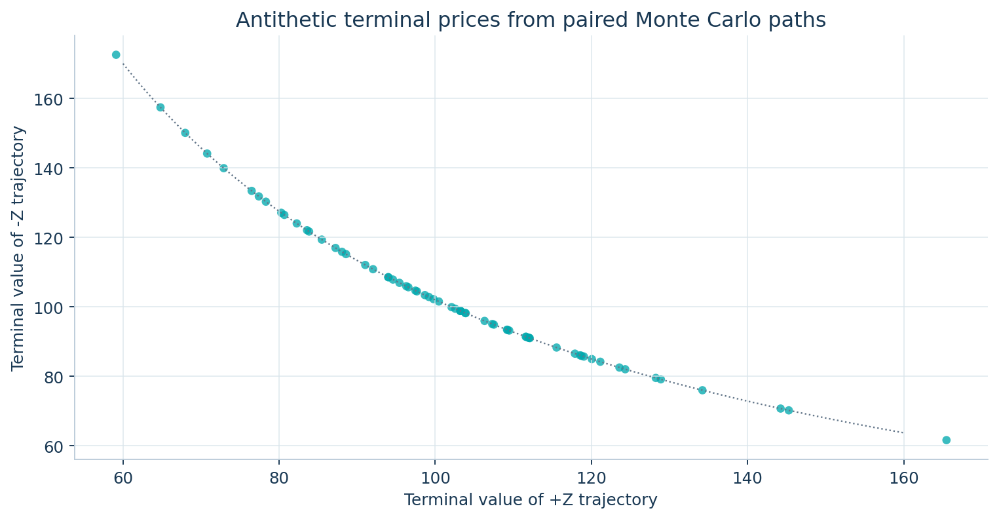
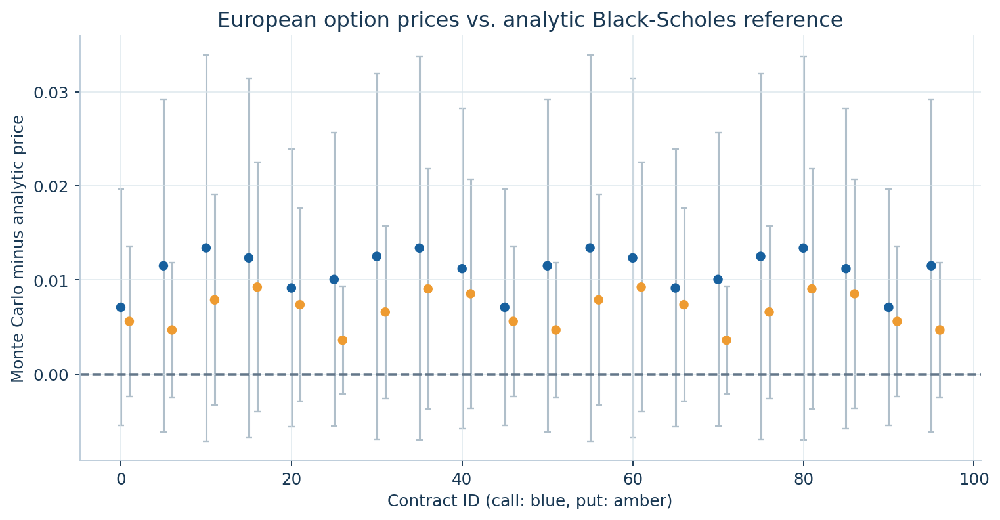
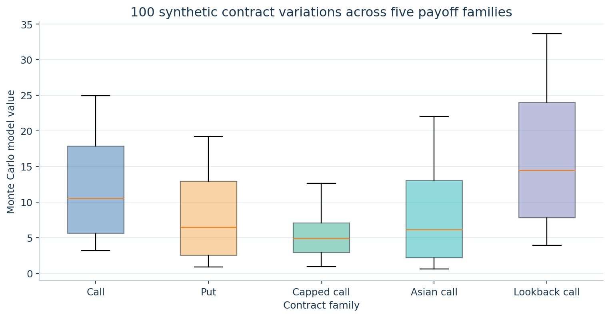
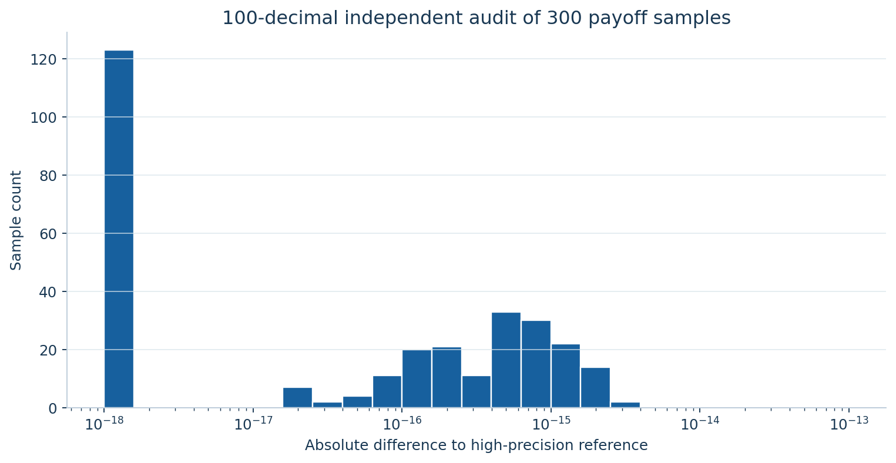
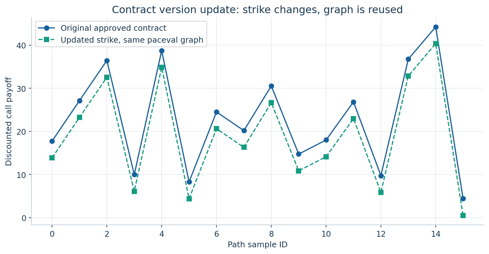
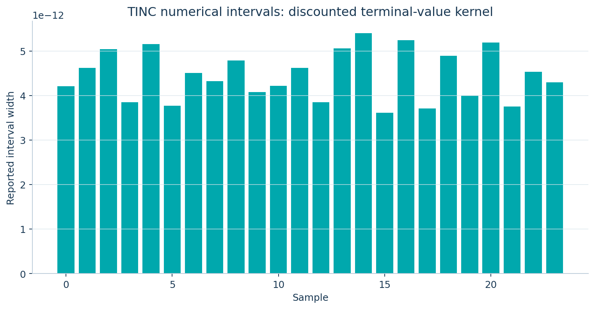

# paceval | Reusable Payoff Kernels in Monte Carlo Pricing


**A fully executed, reproducible C++ research demonstrator for deterministic, reusable mathematical payoff evaluation inside a Monte Carlo pricing workflow.** The official paceval SDK evaluates five mathematical payoff families across 100 synthetic option-contract variants and one million fixed antithetic price paths. The C++ host handles sampling, trajectory statistics, parameter governance and price aggregation. The project is a numerical feasibility study, not a trading product.

**[Scientific whitepaper (PDF)](paceval_Monte_Carlo_Pricing_Whitepaper_EN.pdf)** · [C++ source](src/monte_carlo_pricing.cpp) · [CMake configuration](src/CMakeLists.txt) · [100-decimal independent audit](src/high_precision_reference.py) · [Regenerate research diagrams](src/make_figures.py)

## Verified research outcomes

| Implemented and checked capability | Actual result |
|---|---|
| Monte Carlo scenario generator | 1,000,000 synthetic GBM paths, organized into 500,000 antithetic pairs; 16 dates per path, fixed seed `20261112` |
| Contract variants | 100 approved, parameterized variants across 5 mathematical payoff families |
| Reusable paceval computation graphs | 5 distinct regular graphs, created once and applied to all contracted path batches; 1 additional TINC graph for a smooth discounting kernel |
| Real paceval payoff evaluations | **100,000,000**, compared per path with an independent native C++ payoff implementation, no tolerance failures |
| European option analytics | 40 European call/put contracts compared against closed-form Black-Scholes prices; largest deviation **1.41 antithetic-pair standard errors** |
| Separate mpmath audit | 300 payoff samples verified to 100-digit precision (max absolute difference **3.33 × 10⁻¹⁵**) |
| Independently checked interval samples | 24/24 TINC intervals for **discounted terminal value** contain the 100-digit reference in this sample |
| Path identity | 64/64 antithetic pairs satisfy the expected terminal-value identity |
| Contract variation control | A strike update is evaluated with existing graph handles, and a separate unaffected contract is rechecked |

The calculations were executed with the original paceval Linux runtime on **Linux x86-64**. The reported values are examples from a specified synthetic risk-neutral geometric Brownian motion model, not externally validated option prices. Numerical equality is a different claim from Monte Carlo sampling accuracy: both are assessed separately. No relative speedup or energy-consumption claim is made.

## Why this application makes sense for paceval

Financial Monte Carlo systems need to evaluate many *different contractual payoffs over the same simulated paths*. Creating a mathematical expression graph once and reusing it with new path features and contract parameters isolates the frequently revised calculation from the scenario-generation and valuation machinery. With the supplied original runtime, the same five graphs evaluate 100 contract variants without recompiling each formula for each price path.

The two top-level mathematical categories are **terminal-payoff contracts**, such as European calls and puts, and **path-dependent contracts**, such as sampled-average Asian calls and discrete-monitoring lookback calls. All payoffs are computed on pre-existing path features and multiplied by `exp(-r*T)` inside the paceval graph. The payoff-family distinction is crucial: 100 contract variants are **not** 100 distinct graph formulas.

### Explicit mathematical contract models

Let `ST` be terminal asset price, `A` the arithmetic average across the 16 monitored post-start values, `M` the running maximum including initial spot, `K` strike, `C` positive cap, `r` risk-neutral interest rate and `T` maturity. Write `x+ = max(x,0)`.

| Family | Discounted payoff computed by paceval |
|---|---|
| European call | `exp(-r*T) * (ST-K)+` |
| European put | `exp(-r*T) * (K-ST)+` |
| Capped call | `exp(-r*T) * ((ST-K)+ - (ST-K-C)+)` |
| Asian call (discretely monitored) | `exp(-r*T) * (A-K)+` |
| Lookback call (discretely monitored) | `exp(-r*T) * (M-K)+` |

`max(x,0)` is implemented with `(x+abs(x))/2` inside the verified paceval formulas to match the installed parser. Neither path interpolation nor continuous-monitoring corrections are implied. The simulation is intentionally restricted to constant-volatility GBM with `S0=100`, `r=0.03`, `sigma=0.20`, `T=1`, zero dividends and fixed 16-step monitoring. No parameter calibration, historical-market backtest or hedging strategy is included.

### Independent statistical and numerical validation

For European calls and puts, the Black-Scholes equation provides a separate theoretical reference under exactly the same risk-neutral GBM assumptions. Antithetic paths share opposite normal innovations, so **each plus/minus pair**, not each individual trajectory, is one independent observation when estimating standard errors. A price deviation must be interpreted relative to that Monte Carlo standard error, not mistaken for floating-point error. Analytic checks use the declared threshold `|MC - BS| <= 6 * SE + 0.025`, a generous gross-error sanity check, not a proof of statistical calibration.

The 100-decimal Python audit independently computes selected exact payoff formulas and analytic option prices from the recorded binary64 inputs. The 24 TINC samples concern `ST*exp(-r*T)`, **a smooth discounted underlying-value expression**, not the kinked call payoff. Those observed interval enclosures are pointwise regression results, not a general guarantee for all expressions or financial models.

## Build and execute

A compatible, externally obtained Linux **binary runtime** is required. The public GitHub package deliberately includes only the SDK interface sources [`src/paceval_main.h`](src/paceval_main.h) and [`src/paceval_main.cpp`](src/paceval_main.cpp); it **does not bundle the proprietary `.so`**. The SDK interface `.cpp` is compiled directly into the application, and CMake links the supplied runtime. All build commands are relative to the repository root:

```bash
export PACEVAL_LIB=/absolute/path/to/libpaceval_linux_sharedLIB.so
cmake -S src -B build -DCMAKE_BUILD_TYPE=Release -DPACEVAL_RUNTIME="$PACEVAL_LIB"
cmake --build build -j
ctest --test-dir build --output-on-failure

# Short integration test
./build/monte_carlo_pricing --paths 4096 --contracts 25 --steps 16 --batch 128 --out smoke
python3 src/high_precision_reference.py smoke

# Reproduce the full published numerical workload (100 million payoff evaluations)
./build/monte_carlo_pricing --paths 1000000 --contracts 100 --steps 16 --batch 8192 --seed 20261112 --out reproduced
python3 src/high_precision_reference.py reproduced
```

Python reproduction requires `mpmath`, and diagram regeneration additionally requires `numpy` and `matplotlib`:

```bash
python3 -m pip install mpmath numpy matplotlib reportlab pillow
python3 src/make_figures.py --examples examples --figures figures
python3 src/make_whitepaper.py
```

The full workload is deliberately CPU-intensive. This application supports `--paths` up to 1,000,000, `--contracts` up to 100, `--steps` up to 256 and `--batch` up to 16,384 as **CLI guardrails for this research demo**, not limits imposed by paceval. Paths must be even to form independent antithetic pairs. CPU/memory limits are platform specific, and the release has no ARM, FPGA, ASIC or hard real-time validation.

## Reproducible example files

The repository publishes compact audit examples rather than all 100 million pointwise results. Files include [100-contract formula catalog](examples/contracts.csv), [100 contract valuation summaries](examples/prices.csv), [128 path samples](examples/path_samples.csv), [300 payoff sample audits](examples/payoff_audit.csv), [contract version update samples](examples/model_update.csv), [24 TINC samples](examples/tinc_samples.csv), the [high-precision audit report](examples/high_precision_audit.json) and [run configuration/validation summary](examples/validation.txt). The Python audit script regenerates `high_precision_audit.json` using the published sample and price files.

## Scientific diagrams

| Diagram | Contents |
|---|---|
|  | [Architecture, C++ host and graph execution (SVG)](figures/01_architecture.svg) |
|  | [Three terminal-payoff profiles (SVG)](figures/02_payoff_profiles.svg) |
|  | [Antithetic pair terminal-value identity (SVG)](figures/03_antithetic_paths.svg) |
|  | [Monte Carlo vs Black-Scholes with 95% error bars (SVG)](figures/04_black_scholes_agreement.svg) |
|  | [100 contract values by payoff family (SVG)](figures/05_contract_variations.svg) |
|  | [Independent high-precision differences (SVG)](figures/06_high_precision_audit.svg) |
|  | [Parameter version update (SVG)](figures/07_contract_update.svg) |
|  | [Observed TINC interval widths (SVG)](figures/08_tinc_intervals.svg) |

## Evidence, scope and limitations

The public output is a **scientific mathematical feasibility demonstrator**, not investment advice or a market pricing validation. The option-pricing assumptions are constant risk-neutral parameters, a deterministic pseudorandom sequence, finite path counts and discrete averaging/maxima. The C++ program does not use real market data, QuantLib binaries or an external random number service. The supplied C++ version includes ordinary `paceval_*` function calls and a separate original SDK forwarding layer; no `dlopen`/`dlsym` function-pointer adapter is used.

For further integration, it would be valuable to replace synthetic paths with a separately validated market-data-backed scenario system; add documented control variates and stress testing; examine stable Greeks near payoff kinks; and validate different CPUs and proposed hardware deployments independently. None of these extensions is represented as already demonstrated.

## Technical references

- [paceval public mathematical API](https://paceval.com/api/), especially `paceval_CreateComputation`, `paceval_dGetComputationResultExt`, TINC and graph deletion.
- [QuantLib European equity option example](https://github.com/lballabio/QuantLib/blob/master/Examples/EquityOption/EquityOption.cpp), including seeded Monte Carlo engines and antithetic variance reduction.
- [Black-Scholes risk-neutral derivation and standard errors context](https://wanghemath.github.io/Book-MathFinance/chapters/chapter-16-black-scholes-formula.html).
- [Intel oneMKL Black-Scholes reference](https://www.intel.com/content/www/us/en/docs/onemkl/cookbook/2021-4/black-scholes-formula-european-options-pricing.html).

Original copyright and license notices in the two paceval SDK source files are preserved. This repository does **not** distribute the proprietary runtime or contain a separate `LICENSE_NOTICE.md` file.
