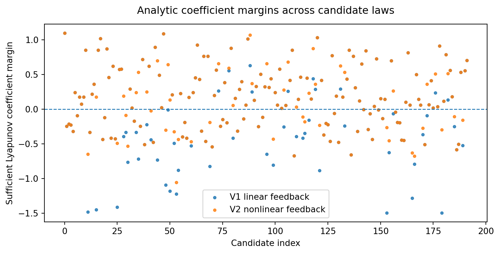
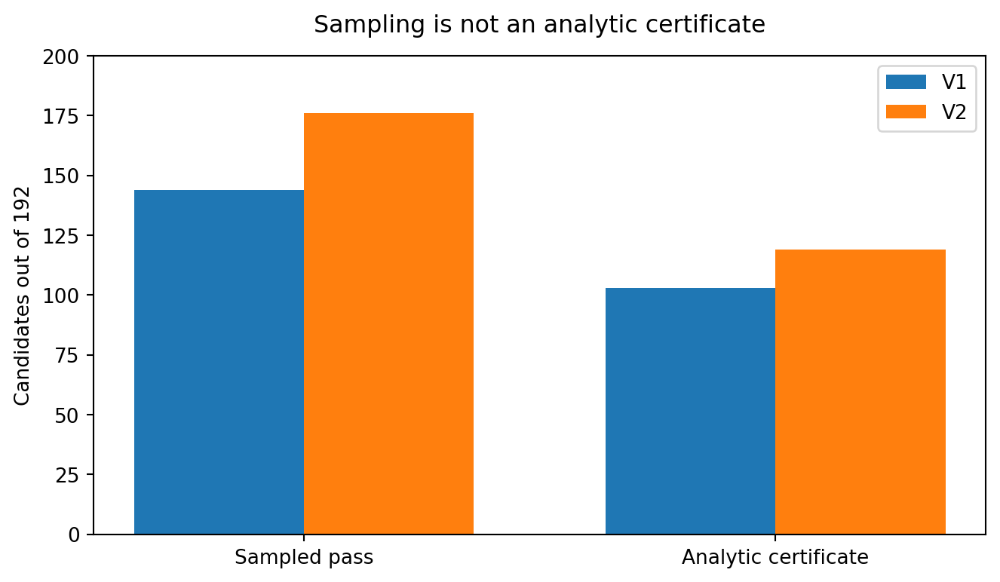
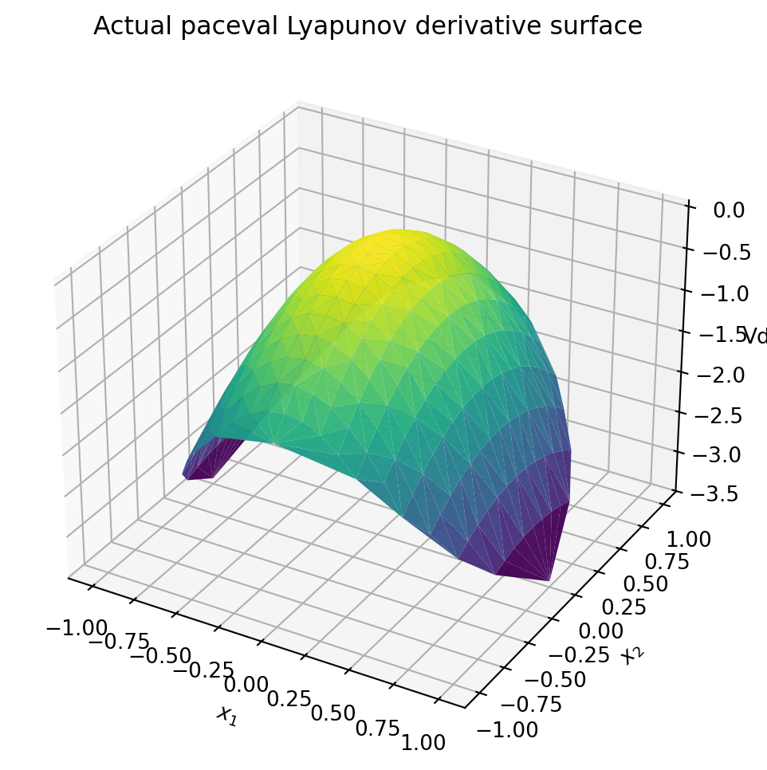

# Nonlinear Control-Law Candidate Screening and Lyapunov Residuals with paceval


**WP 28 | Industrial and control-theoretic research demonstrator | November 2026**

This repository includes a real C++ research demonstrator using the **original paceval 4.25 C/C++ SDK and compatible Linux shared library**. Persistent mathematical execution graphs calculate closed-loop dynamics, the candidate Lyapunov function, its derivative, sampled constraint margins, analytic sufficient certification coefficients, actuator bounds, sensitivities and two-version comparisons. Independent native C++ and 90-decimal-place mpmath implementations test the resulting calculations. A separate mathematical derivation establishes the stated sufficient continuous-state condition for this deliberately restricted model family.

**This is not a production, safety-certified or universal stabilizing controller.** All process parameters and feedback gains are synthetic. The provided material is a research experiment, not an industrial installation or a hardware performance comparison.

## 1. Industrial use case and current state of the art

A plant controller, robot-axis controller or automatic design algorithm may generate many candidate nonlinear feedback laws. Before using an expensive plant simulation, experiment or hardware-in-the-loop test, a screening application needs to ask which candidates meet actuator limits and produce a Lyapunov derivative that is sufficiently negative over a relevant state region. Evaluating a few state samples can find explicit counterexamples, but cannot establish stability at unseen states. In particular, a controller that passes a sampled test is **not** automatically certified.

Lyapunov design and control Lyapunov functions are established mathematical approaches. Modern research combines learning and counterexample-guided synthesis with formal verification, such as SOS or SMT. Yang et al. (ICML 2024) explore neural feedback and Lyapunov certificates; Debauche et al. (2025) formalize a counterexample-guided synthesis framework for switched systems; Devadze et al. (2025) study formally certified SOS stability proofs. Tools such as dReal provide nonlinear real-arithmetic reasoning under explicit delta-completeness semantics [1-4]. All are distinct in scope from paceval's graph-based expression evaluation. paceval does not claim to be an SMT solver or to automatically establish a theorem.

The executable answers a focused feasibility question: *Which of the selected synthetic feedback candidates pass a grid-based test, which fail with explicit sampled counterexamples, and which additionally satisfy a mathematically derived sufficient condition for an invariant state neighborhood?* The CPU host supplies state grids, the RK4 integrator and decisions. The original paceval engine supplies the substantive mathematical expressions used in each step.

## 2. Mathematical models and assumptions

Let the continuous-time states be $x$ and $y$ and let $a,b>0$, $c,d\ge 0$. We study the following synthetic nonlinear plant:

```math
\dot{x}=-a x + u + c x y^2, \qquad \dot{y}=-b y + d x^2 y.
```

Two versions are simultaneously available:

```math
u_1=-k_1 x-k_2 y, \qquad u_2=-k_1 x-k_2 y-k_3\tanh(x), \quad k_3\ge 0.
```

Both use the positive definite quadratic Lyapunov candidate $V=p_1x^2+p_2y^2$ with $p_1,p_2>0$. paceval evaluates the **full composite** Lie derivative, not a native-only approximation:

```math
\dot V=2p_1x(-a x + u + c x y^2)+2p_2y(-b y+d x^2y).
```

The pointwise residual is $m(x,y)=-\varepsilon(x^2+y^2)-\dot V$, and the pointwise actuator margin is $u_{max}-|u|$. The sampling domain is $D_R=\{x^2+y^2\le R^2\}$ with $0<R\le 1$ and $\varepsilon>0$. Sample acceptance does **not** imply the inequality holds throughout $D_R$.

### A sufficient continuous-state certificate (within this model class)

For $|x|\le R\le 1$, $x\tanh(x)\ge (1-R^2/3)x^2$. Using $2|xy|\le x^2+y^2$ and $x^2y^2\le (R^2/4)(x^2+y^2)$, define $B=\max(0,p_1c+p_2d)$, and let $k_3^*=0$ for V1 or $k_3^*=k_3$ for V2. The original paceval engine evaluates the following sufficient coefficient margins:

```math
M_x=2p_1(a+k_1)+2p_1 k_3^*(1-R^2/3)-p_1|k_2|-BR^2/2-\varepsilon
```

```math
M_y=2p_2 b-p_1|k_2|-BR^2/2-\varepsilon.
```

If $M_x\ge 0$, $M_y\ge 0$ and the other stated model assumptions hold, then $\dot V\le-\varepsilon(x^2+y^2)$ everywhere on $D_R$. The ellipsoid

```math
\Omega=\{(x,y):V(x,y)\le\min(p_1,p_2)R^2\}
```

is contained within $D_R$, is forward invariant, and the origin is locally exponentially stable for initial conditions in $\Omega$, under the stated **unclipped** continuous-time equations. An additional conservative global actuator condition $u_{max}-R(|k_1|+|k_2|+k_3^*)\ge0$ ensures the commanded control lies within the declared actuator bound throughout $D_R$; it is NOT a model of actuator saturation or anti-windup. The conjunction is exposed as a genuine paceval Boolean graph. This certificate is sufficient, not necessary. Failing it does not prove instability. A sampled negative residual is a counterexample to the proposed inequality, not necessarily a proof of divergence.

## 3. Actual execution and results

The exact scalar and multi-graph APIs, formula expressions, persistent handles, source code and recorded result data are documented in [the mathematical inventory](results/math_execution_inventory.csv), [the formula manifest](results/formula_manifest.csv), and [the execution evidence](results/execution_evidence.json). Input CSV fields are validated as numeric literals before invoking the original paceval number parser. CSV result values use the original paceval double-to-string conversion, with separately documented serialization limitations.

| Function and purpose | Actual implementation | Formula graph or reason |
|:--|:--|:--|
| Feedback, state dynamics, nonlinear actuator term | paceval | `V1/V2_CONTROL`, `FLOW_X`, `FLOW_Y` |
| Quadratic Lyapunov candidate, full Lie derivative | paceval | `LYAPUNOV`, `VDOT` |
| Pointwise margin, input, state and positivity checks | paceval | `RESIDUAL`, `ACTUATOR_MARGIN`, `STATE_MARGIN`, `POSITIVE_V` |
| Conservative entire-disk Lyapunov coefficient bounds | paceval | `M1_CERT`, `M2_CERT`, `CERT_MARGIN` |
| Disk-wide actuator bound and Boolean eligibility | paceval | `GLOBAL_ACT_MARGIN`, `CERT_GUARD` |
| Analytic feedback and Lyapunov sensitivities | paceval | `SENS_K1_VDOT`, `SENS_K2_VDOT`, `SENS_K3_VDOT`, `SENS_K3_CONTROL` |
| Composite score and between-version differences | paceval | `COMPOSITE_SCORE`, `COMPARE_*` |
| State grid, candidate acceptance, RK4 stepping | C++ host | Stateful data and integration orchestration |
| Independent mathematical reference | Native C++ + Python mpmath | Separate formulas, no graph replay |

The recorded main experiment evaluates **192 synthetic candidates**, two mathematical versions, and a 317-state disk grid per candidate. All **49 domain graphs** were created and executed. Of the 192 candidate laws, **144 (V1) and 176 (V2)** pass the tested grid; **103 (V1) and 119 (V2)** pass the stronger sufficient analytic conditions, including the conservative actuator requirement. There are **48 (V1) and 16 (V2)** sampled counterexample candidates. The counts originate from [the actual C++ evidence file](results/execution_evidence.json), not from estimates or historical runs.

### Research figures from real paceval output







The repository contains ten figures in both PNG and vector PDF. **Illustration**: the cover is a conceptual mathematical artwork, not measured stability data.

## 4. Reproducing the executable

Linux x86-64, a C++17 compiler, CMake, the bundled unmodified original `paceval_main.h/.cpp`, and the **separately provided compatible original** `libpaceval_linux_sharedLIB.so` are required. The shared library is deliberately *not* redistributed in this ZIP.

```bash
cmake -S src -B build -DCMAKE_BUILD_TYPE=Release \
  -DPACEVAL_RUNTIME=/absolute/path/to/libpaceval_linux_sharedLIB.so
cmake --build build -j
ctest --test-dir build --output-on-failure
./build/nonlinear_lyapunov --run input/candidates.csv results
python scripts/verify_high_precision.py results input/candidates.csv
python scripts/verify_certificates.py results input/candidates.csv
python scripts/check_markdown.py .
```

For research re-runs, keep the original CSV schema, input ordering and seed. The supplied inputs were generated deterministically from seed `20261115`. `input/candidates.csv` contains the exact tested numeric input values, including deliberately failing candidates. The recorded outputs reside in `results/`. A passing unit test or mathematical certificate is **not** a validation of a commercial dynamical system.

## 5. Validation and scope

The supplied independently written verification reports **56,064 high-precision formula and complete-output checks** and **3,537 analytic-condition checks**, with no failed checks, and native checks executed in the original C++ main path. Separate full-loop CTest status is recorded after packaging. Technical differences and tolerances remain only in `results/*audit*.json` or `.csv`, rather than being presented as a comparative engine-accuracy claim. The repository includes a recursive Markdown parser, local-link checker and negative-regression tests under `scripts/check_markdown.py`.

The explicit assumptions are crucial. A proof for the specified smooth two-state model with exactly stated gains and state set is **not** global stability for arbitrary nonlinear plants. Nor does it address sampling, transport delays, quantization, sensor noise, disturbances, unmodeled actuator saturation, mechanical contacts, uncertain plant identification, safety functions or regulatory compliance. The selected quadratic Lyapunov form can be conservative even for a stable controller. Follow-up research should investigate data-calibrated plant dynamics, robust uncertainty intervals, machine-assisted invariant sets, polynomial SOS or SMT certificates, and independent closed-loop hardware-in-the-loop studies.

## 6. Further reading and source provenance

1. Yang et al., *Lyapunov-stable Neural Control for State and Output Feedback: A Novel Formulation*, ICML 2024. https://proceedings.mlr.press/v235/yang24f.html
2. Debauche et al., *Formal Synthesis of Lyapunov Stability Certificates for Linear Switched Systems using ReLU Neural Networks*, 2025. https://proceedings.mlr.press/v288/debauche25a.html
3. Devadze et al., *Computer-Assisted Proofs for Lyapunov Stability via Sums of Squares Certificates and Constructive Analysis*, 2025. https://link.springer.com/article/10.1007/s10817-024-09717-2
4. dReal reference and delta-complete decision semantics. https://dreal.github.io/
5. Wei et al., *Robust Neural Lyapunov Control for Nonlinear Systems With Quadratically Bounded Disturbances*, November 2025. https://doi.org/10.1002/rnc.70279
6. Paceval API: https://paceval.com/api/ ; Product Brief: https://paceval.com/product-brief/

The document is a standalone independent research demonstrator. Source code license notices appear in [LICENSE_NOTICES.md](LICENSE_NOTICES.md), and detailed research assumptions and numerical audit status in [RESEARCH_VALIDATION.md](RESEARCH_VALIDATION.md).
