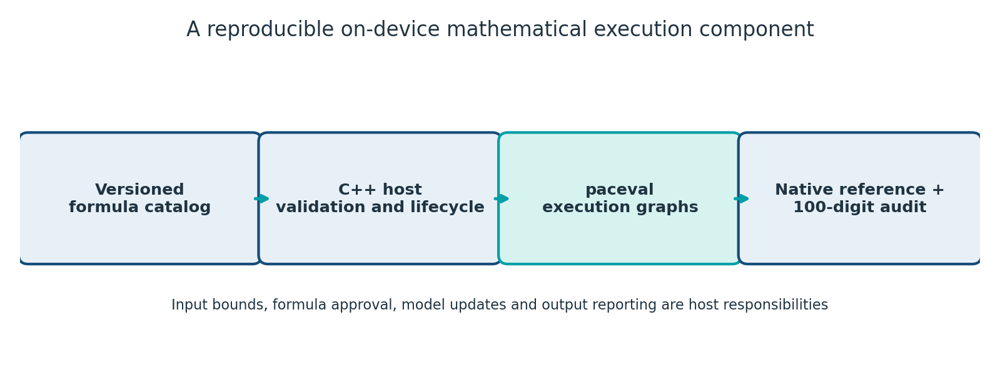
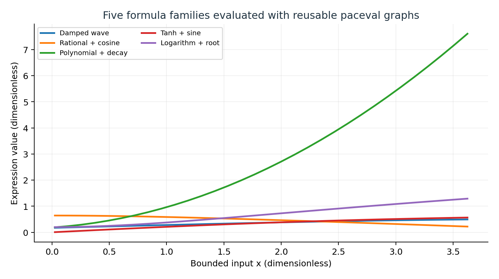
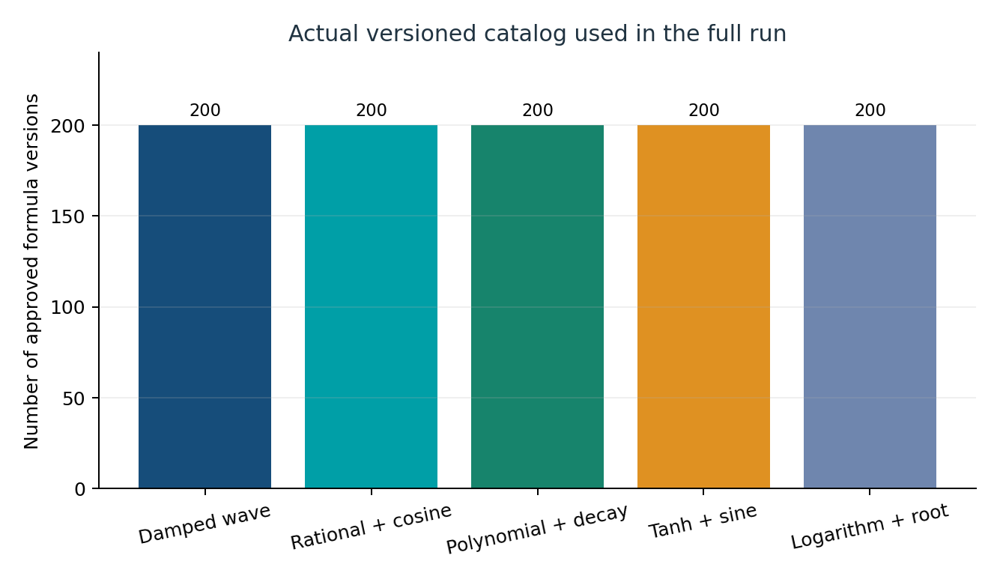
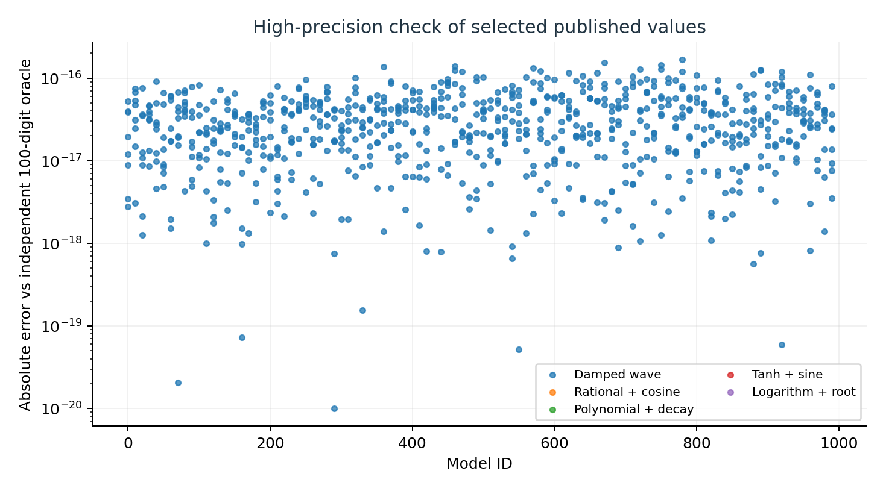
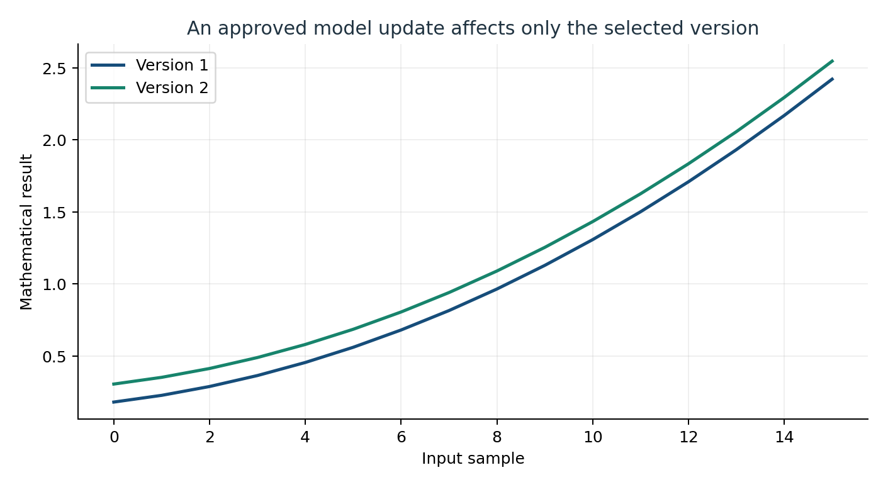
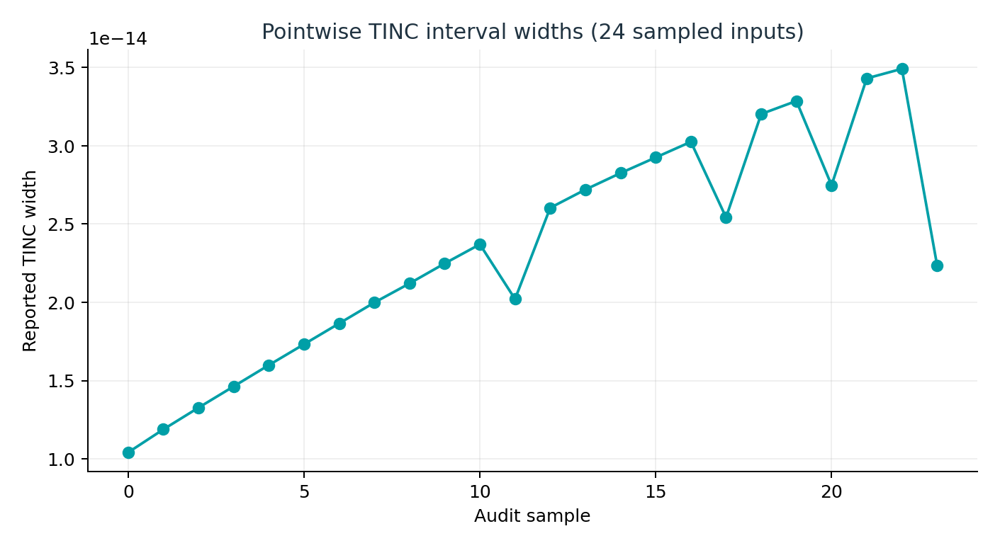
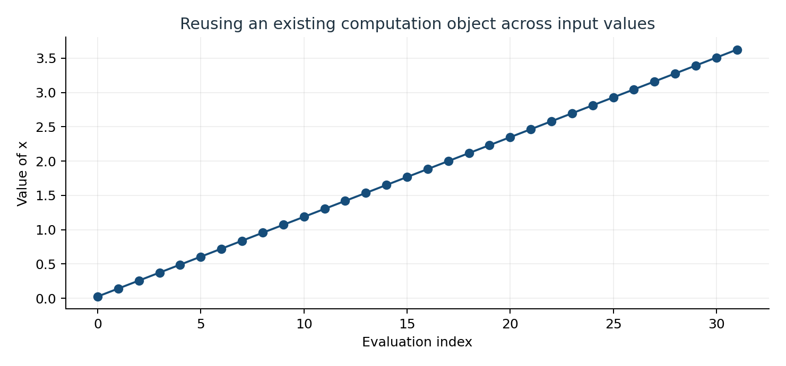

# paceval | On-Device Reusable Expression Runtime


**A reproducible C++ research demonstrator for persistent mathematical execution graphs on Linux edge-class systems.** The project prepares versioned formula expressions once, evaluates new bounded inputs with the official paceval SDK, updates one selected model without rebuilding the catalog, and checks the numerical outputs against independent native C++ and 100-digit Python references.

**[Read the scientific whitepaper](paceval_On_Device_Expression_Runtime_Whitepaper_EN.pdf)** | [Main C++ source](src/on_device_runtime.cpp) | [Source build configuration](src/CMakeLists.txt) | [Independent audit](src/high_precision_reference.py) | [Whitepaper generator](src/make_whitepaper.py)

## Verified scope

| Property | Demonstrated result |
|---|---|
| Distinct mathematical formulas | 1,000 approved expression versions across five formula families |
| Graph lifecycle | 1,000 graph handles created and reused; deletion before library shutdown |
| Batch evaluations | 32,000, compared to native C++ and an independent 100-digit Python implementation |
| Independent high-precision maximum absolute difference | Approximately 2.99 × 10^-15 across the 32,000 outputs |
| Controlled formula update | Model 17 replaced; 16 output pairs checked for the expected difference of 0.125 |
| TINC sample audit | 24/24 independently checked reference values contained in their reported intervals |
| Batch reproducibility | Identical `models.csv`, `evaluations.csv`, `model_update.csv`, and `tinc_samples.csv` for batch sizes 1, 37 and 64 |
| Compilers and diagnostics | GCC 14.2, Clang 17, AddressSanitizer/UndefinedBehaviorSanitizer; three CTests passed in each configuration |
| Hardware tested | x86-64 Linux with the supplied original paceval binary |

These are **feasibility and numerical-correctness results**, not comparative speed benchmarks. This release has **not** been run on ARM hardware, measured for energy consumption or qualified for real-time operation. Synthetic expressions and input values have no claimed physical calibration.

## Application and mathematical scope

An edge gateway or embedded Linux application often needs to calculate a portfolio of configurable mathematical transforms over repeated sensor or application values. The host application manages the approved formula catalog, input ranges and version changes; paceval evaluates the prepared mathematical functions.

The experiment implements five families: damped oscillation, cosine with rational correction, quadratic plus exponential decay, hyperbolic tangent plus sine, and logarithmic plus square-root correction. Each formula uses a declared input tuple `(x, a, b, c, d)` and a version-specific numeric offset; **1,000 formulas means 1,000 distinct configured expressions, not 1,000 independent equation structures**. The bounded synthetic domain keeps all functions mathematically defined.

Representative formula:

```text
y = a*sin(b*x) + c*exp(-(d*x)) + version_offset
```

Version changes use a two-stage replacement in this single-threaded host: a new graph must be created successfully before it replaces the previous handle. The same other 999 prepared handles remain available. The C++ host validates finite numeric inputs and owns graph lifetimes, batch buffering, audit outputs and version metadata. paceval performs the expression execution via `paceval_CreateComputation`, `paceval_dGetComputationResultExt`, `paceval_dGetComputationResult` (TINC samples) and `paceval_DeleteComputation`.

## Build and run on Linux

The official SDK interface sources [`paceval_main.h`](src/paceval_main.h) and [`paceval_main.cpp`](src/paceval_main.cpp) are included directly in [`src/`](src/). The compatible platform-specific **binary paceval runtime is required but deliberately not distributed** with this repository. Use an absolute path to the externally obtained library. Its CPU architecture must match the compiled executable.

```bash
export PACEVAL_LIB=/absolute/path/to/libpaceval_linux_sharedLIB.so
cmake -S src -B build -DCMAKE_BUILD_TYPE=Release -DPACEVAL_RUNTIME="$PACEVAL_LIB"
cmake --build build -j
ctest --test-dir build --output-on-failure
./build/on_device_runtime --models 1000 --samples 32 --batch 64 --out reproduced
python3 -m pip install mpmath matplotlib reportlab pillow
python3 src/high_precision_reference.py reproduced --expect-models 1000
```

The CLI supports `--models N`, `--samples N`, `--batch N` and `--out directory`; default values are 1000, 32 and 64. A bounded output guard limits this research CLI to 1.5 million rows per invocation; **this is an application data-management policy, not a limit of paceval**. Larger workloads need streaming output, memory audits and device-specific operational tuning. `--self-test` checks the native reference without loading the runtime.

For a smaller first execution:

```bash
./build/on_device_runtime --models 25 --samples 16 --batch 7 --out smoke
python3 src/high_precision_reference.py smoke --expect-models 25
```

To regenerate the scientific figures from the **published** examples:

```bash
python3 src/audit_samples.py
python3 src/make_figures.py
python3 src/make_whitepaper.py
```

## Target platforms and portability

This repository was **built and tested on Linux x86-64**. paceval documents Linux ARM64 distributions and services, but that documentation alone does not validate this specific executable. For ARM64, obtain the matching SDK and ARM64 shared library, compile the project on a supported ARM64 Linux device (or cross-compile with an ARM64 sysroot), and run the exact same tests and independent audit **on the device**. Do not link the x86-64 `.so` into an ARM binary.

Suggested target checks: actual CPU architecture, OS ABI, runtime checksum and license, available RAM, process lifetime, worst-case request latency, power measurement method, persistent model restart behavior and non-finite input rejection. None of these unmeasured device-specific properties is claimed as experimentally validated here.

## Scientific figures

**Architecture and graph ownership**  
  
[Editable SVG](figures/01_reusable_runtime_architecture.svg)

**Five evaluated mathematical families**  
  
[Editable SVG](figures/02_mathematical_families.svg)

**Actual catalog composition**  
  
[Editable SVG](figures/03_formula_catalog.svg)

**Independent precision audit**  
  
[Editable SVG](figures/04_high_precision_audit.svg)

**One controlled formula version update**  
  
[Editable SVG](figures/05_formula_version_update.svg)

**Observed pointwise TINC widths**  
  
[Editable SVG](figures/06_tinc_sample_widths.svg)

**Reusing a single handle with changing inputs**  
  
[Editable SVG](figures/07_repeated_input_sweep.svg)

## Reproducible files

- [Formula catalog](examples/models.csv) with actual formula text and version metadata
- [32,000 evaluation results](examples/evaluations.csv) with native C++ references
- [Model-update verification](examples/model_update.csv) for the selected version
- [TINC sample output](examples/tinc_samples.csv) with lower and upper bounds
- [High-precision validation summary](examples/validation.json) with exact count and error statistics
- [Independent high-precision plot samples](examples/high_precision_audit_samples.csv)
- [Runtime summary](examples/run_summary.txt) with scenario size and configuration

The independent high-precision script must be run on the provided results or on a re-executed run. Its TINC check compares the mathematically evaluated value directly against the reported binary64 bounds. Passing 24 finite point samples establishes only the stated sample-wise observation.

## Research context and technical references

The study follows the proposal *WP-008: On-Device Reusable Expression Runtime* (11 November 2026), extending its illustrative single formula to a versioned 1,000-formula catalog with direct paceval integration and numerical auditing. No external dataset is required.

- [paceval API](https://paceval.com/api/) — official C/C++ integration, prepared computation objects and batch results
- [paceval GitHub repository](https://github.com/paceval/paceval) — SDK platform and architecture overview
- [ONNX Runtime mobile](https://onnxruntime.ai/docs/tutorials/mobile/) — reference for on-device memory, deployment and validation requirements; not part of this code
- [Clang cross-compilation guidance](https://clang.llvm.org/docs/CrossCompilation.html) — target toolchain/sysroot dependencies
- [Raspberry Pi OS documentation](https://www.raspberrypi.com/documentation/computers/os.html) — ARM Linux deployment context

**Reproducibility note:** `src/paceval_main.cpp` and `src/paceval_main.h` retain their original licensing notices. The original binary mathematical runtime is external. No separate `LICENSE_NOTICE.md` is included.
