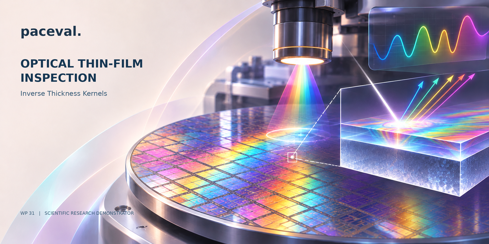
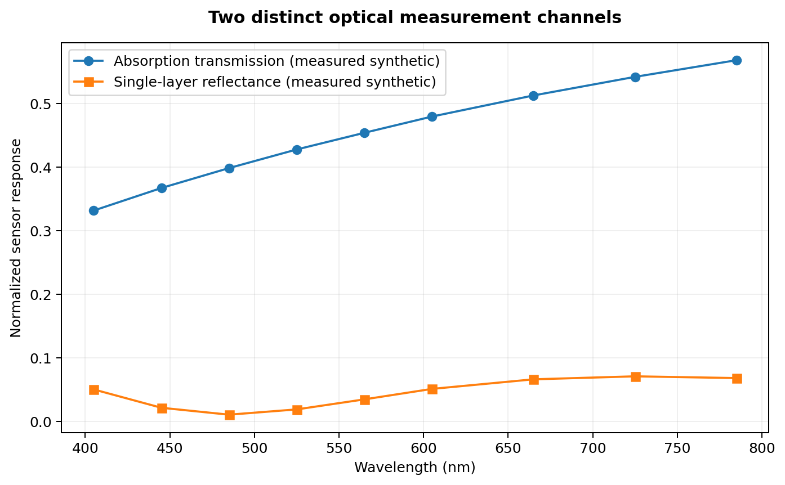
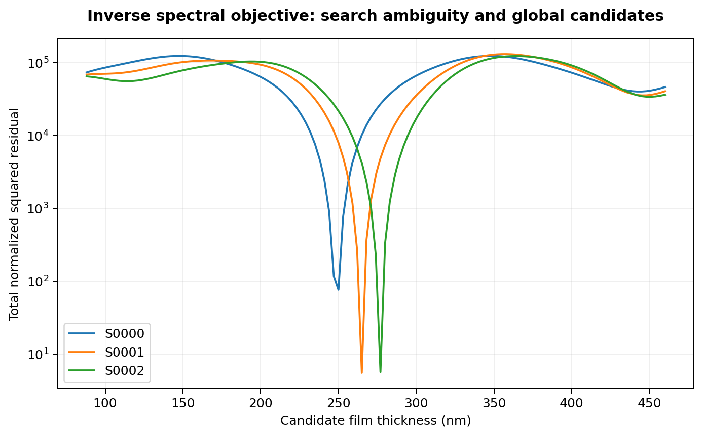
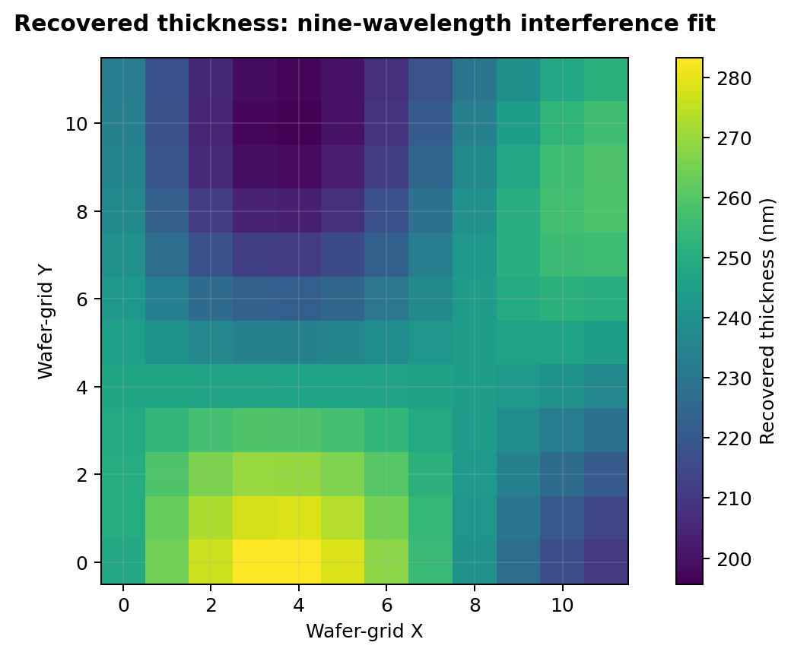

# Optical Thin-Film Inspection and Inverse Thickness Kernels with paceval



**WP 31 | Research demonstrator | November 2026 | Original paceval SDK 4.25**

This repository demonstrates the **actual execution of reusable paceval mathematical graphs** for two optical film-thickness measurement channels, including wavelength-dependent forward models, inverse reconstruction, analytical sensitivities, spectral fitting, uncertainty indicators and quality constraints. The C++ program was compiled and run against the supplied original Linux x86-64 library. Every numerical datum in the published scientific figures comes from its executed result files. The included data are **deterministic and synthetic**, not instrument readings or evidence of a calibrated process.

## 1. Industrial use case and current state of the art

A semiconductor manufacturer needs to check the thickness and lateral uniformity of deposited dielectric coatings before downstream processing. At each wafer location, a reflectometer measures the variation of reflected light with wavelength. A transparent layer causes partial reflections at the upper and lower interfaces, whose interference pattern depends on film thickness and refractive index. A separate absorption-based optical channel can provide a simpler analytical thickness estimate where the sample geometry and absorption approximation are appropriate.

Industrial systems use reflectometry and spectroscopic ellipsometry alongside material models and reference-wafer calibration. NIST documents both a [Filmetrics F40-UV reflectometer](https://www.nist.gov/laboratories/tools-instruments/nanofab-tool-filmetrics-f40-uv-reflectometer) and a [Woollam M-2000 spectroscopic ellipsometer](https://www.nist.gov/laboratories/tools-instruments/nanofab-tool-j-woollam-m-2000-di-spectroscopic-ellipsometer); the latter includes polarization and variable-angle measurements not represented by this project. Multilayer modeling is supported by established transfer-matrix implementations, including the open-source [tmm](https://github.com/sbyrnes321/tmm) package. A 2026 metrology study compares reflectometry and ellipsometry on uniform films ([Metrologia, DOI](https://doi.org/10.1088/1681-7575/ae3964)). Their existence motivates disciplined modeling and uncertainty analysis, **not** an assertion of equivalence between this demonstration and those systems.

The investigated industrial workflow is: validated spectral inputs → reusable paceval optical functions and derivatives → paceval-generated per-wavelength inverse residuals → C++ spectral aggregation and one-dimensional search → paceval fit-quality and specification margins → C++ screening classification and machine-readable output. This provides a mathematical kernel suitable for further research integration into a metrology system.

## 2. Physical scope and two formula versions

**V1, `BEER`:** A deliberately simple effective absorption/transmission channel with offset, at film thickness $d$ and wavelength $\lambda$:

```math
I(d,\lambda)=I_0\exp[-\alpha_0(550/\lambda)d]+I_{\mathrm{offset}},\qquad
d_{\mathrm{inv}}=-\frac{\ln[(I-I_{\mathrm{offset}})/I_0]}{\alpha_0(550/\lambda)}.
```

The analytical sensitivity is $\partial d/\partial I=-1/[\alpha_{\mathrm{eff}}(I-I_{\mathrm{offset}})]$. This is not generally a correct model for interference-sensitive reflective multilayer wafers. It is retained as a transparent baseline for an absorption-compatible measurement channel.

**V2, `FILM`:** Normal-incidence coherent reflectance for one transparent, homogeneous, isotropic film on a semi-infinite, lossless dielectric substrate. With real positive refractive indices $n_0,n_f,n_s$, define

```math
r_{01}=\frac{n_0-n_f}{n_0+n_f},\quad r_{12}=\frac{n_f-n_s}{n_f+n_s},\quad
\phi=\frac{4\pi n_f d}{\lambda}.
```

```math
R(d,\lambda)=\frac{r_{01}^2+r_{12}^2+2r_{01}r_{12}\cos\phi}
{1+(r_{01}r_{12})^2+2r_{01}r_{12}\cos\phi}.
```

The paceval formula for $\partial R/\partial d$ is analytically derived from this same expression. The host forms the nine-wavelength objective $J(d)=\sum_j[(R(d,\lambda_j)-y_j)/\sigma_R]^2$ from the **paceval-computed residual terms**, explores a global thickness grid, then refines the best local basin. This numerical search is a host algorithm, not a built-in paceval optimizer or automatic differentiation feature.

The two channels are **different physical forward models** with a common latent synthetic thickness. Their agreement is a synthetic cross-check, not a demonstration that Beer-Lambert transmission and Fresnel reflectance are interchangeable or satisfy a joint optical energy balance. The model does not include complex optical constants, angle/polarization effects, roughness, backside reflections, dispersive film optics, unknown-index fitting or multilayer transfer matrices.

## 3. Demonstrated mathematical functionality

| Mathematical function / industrial purpose | Actual implementation | Graph / version or reason |
|---|---|---|
| Wavelength-dependent attenuation, transmission and analytical inversion | paceval | `BEER_ALPHA_EFF`, `BEER_FORWARD`, `BEER_INVERSE` |
| Forward intensity and synthetic sensor errors | paceval | `BEER_SENSOR`, `FILM_SENSOR` |
| Transmission thickness sensitivity and uncertainty | paceval | `BEER_SENS_INTENSITY`, `BEER_UNCERTAINTY` |
| Fresnel interface amplitudes, phase, coherent reflectance | paceval | `FILM_R01`, `FILM_R12`, `FILM_PHASE`, `FILM_REFLECTANCE` |
| Spectral residuals, optical derivative, local information | paceval | `FILM_RESIDUAL`, `FILM_DR_DD`, `FILM_FISHER` |
| Fit tolerance, objective margin, final combined quality guard | paceval | `SUMMARY_THICKNESS_MARGIN`, `SUMMARY_OBJECTIVE_MARGIN`, `SUMMARY_QUALITY_GUARD` |
| Local information-to-uncertainty conversion | paceval | `SUMMARY_UNCERTAINTY` |
| Two-channel fit differences, guard and indicator ratio | paceval | `COMPARE_*` |
| Nine-wavelength aggregation, global thickness enumeration, bounded local search | C++ host | Variable-length reduction and stateful numerical search |
| Input schema validation, host-level ACCEPT/REVIEW decision, CSV output | C++ host | Non-mathematical orchestration and safety policy |
| Numerical and inverse-optics reference models | Independent Python / C++ | Verification only, not published paceval execution |

The verifiable full list is in [`results/math_execution_inventory.csv`](results/math_execution_inventory.csv) and the actual execution counters are in [`results/execution_evidence.json`](results/execution_evidence.json). The source code for every `paceval_CreateComputation`, scalar, single-graph batch and multi-graph batch call is in [`src/optical_film_main.cpp`](src/optical_film_main.cpp).

## 4. Reproducible experiment and scientific results

The deterministic input contains **144 synthetic wafer locations on a 12 × 12 grid**, each sampled at nine wavelengths from 405 nm to 785 nm, giving **1,296 spectral input rows**. The same known thickness is used in each channel. Each channel gets its own synthetic sensor error, with nominal intensity uncertainty 0.001 and nominal reflectance uncertainty 0.00035. These are assumed parameters, not measured sensor calibration.

The executed run created and used **33 unique domain-specific graphs**, with 263,709 graph-point evaluations in scalar, single-graph batch and multi-graph batch paths. The illustrative thickness specification is **235 ± 35 nm**. The fitted Beer and Fresnel channels passed the screen for **130** and **129** locations, respectively; all **144** pairs reconstructed their known synthetic truth within 3 nm under the declared model and known material coefficients. These successes are not a real-site accuracy or metrology uncertainty claim. See the machine-readable evidence JSON for counts and recorded results.







A vital limitation is the single-wavelength thickness alias. Because $\cos\phi$ is periodic, at one wavelength the thicknesses $d$ and $d+\lambda/(2n_f)$ produce exactly the same reflectance in the assumed lossless single-layer model. The actually evaluated case is in [`results/alias_case.csv`](results/alias_case.csv) and the complete paceval-generated curve is in [`results/alias_curve.csv`](results/alias_curve.csv). Broad spectral information helps distinguish them in this particular dataset, but it does not mathematically guarantee uniqueness for every stack, wavelength range or set of unknown material constants.

## 5. Build and execute

Linux x86-64, CMake 3.16+, a C++17 compiler, Python 3 and the **separately supplied original compatible paceval shared library** are required. NumPy, SciPy, mpmath, Matplotlib, markdown-it-py and ReportLab are used only by development, independent audit and documentation scripts.

```bash
cmake -S src -B build -DCMAKE_BUILD_TYPE=Release \
  -DPACEVAL_RUNTIME=/absolute/path/to/libpaceval_linux_sharedLIB.so
cmake --build build -j
ctest --test-dir build --output-on-failure
./build/optical_film --run input/spectral_samples.csv results
```

The `src/paceval_main.h` and `src/paceval_main.cpp` files are the original SDK interface files, with the minimal relative include-path adaptation required for compilation. The actual `.so` is **intentionally not distributed**. A Linux shared-library test cannot automatically establish Windows/macOS/iOS portability.

Input CSV numeric fields are constrained to finite decimal literals before the original SDK `paceval_dConvertStringToFloat` is called. Output numeric values use `paceval_dConvertFloatToString`, with independent numeric checks. Decimal text formatting is not claimed to preserve all binary IEEE-754 values exactly. The source data use UTF-8, comma-separated fields and period decimal points. Schema and checks are in [`docs/CSV_SCHEMA.md`](docs/CSV_SCHEMA.md).

## 6. Verification and project limits

The executed release passed **8 of 8 automated CTests**, **8,208 independent 90-digit checks**, and **435 independent inverse/alias checks**; twelve core result and audit files were reproduced byte-identically. The independent **90-digit mpmath** check covers forward functions, inverses, derivatives, local information and final composite objective/uncertainty. An independent **SciPy** reference repeats the global one-dimensional inversion and confirms the wavelength alias. Automated tests additionally check original SDK scalar and batch paths, operator conventions, safe CSV literals, deterministic input generation, and archive-wide GitHub-compatible Markdown math syntax (including deliberate negative regressions). All detailed discrepancies and tolerances are kept in the machine-readable audit files, not in the public evidence summary.

This project demonstrates **formula execution and inverse fitting for idealized synthetic optics**, not calibrated thickness metrology, measurement traceability, real wafer validation, multilayer ellipsometry, industrial classification acceptance, or any speedup versus established instruments or software. The next scientific steps are complex-valued transfer matrices, wavelength-dependent optical constants, correlated measurement uncertainties, multi-angle polarimetry, and comparison to traceable measured standards.

## 7. Files and references

The source-derived reference and research context are described in [`docs/literature_sources.md`](docs/literature_sources.md), with explicit implementation assumptions in [`docs/FORMULA_SCOPE.md`](docs/FORMULA_SCOPE.md). The full English [PDF research paper](paceval_Optical_Thin_Film_Whitepaper_EN.pdf), [technical research validation](RESEARCH_VALIDATION.md), reproducible inputs, numerical audits and all ten scientific figures (PNG and vector PDF) are included. Source licensing is recorded in [LICENSE_NOTICES.md](LICENSE_NOTICES.md).
