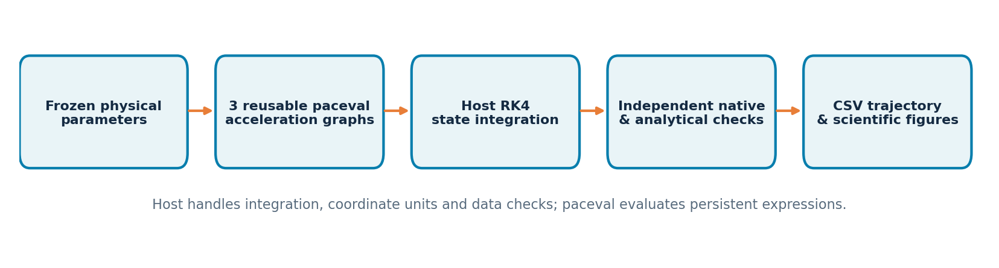
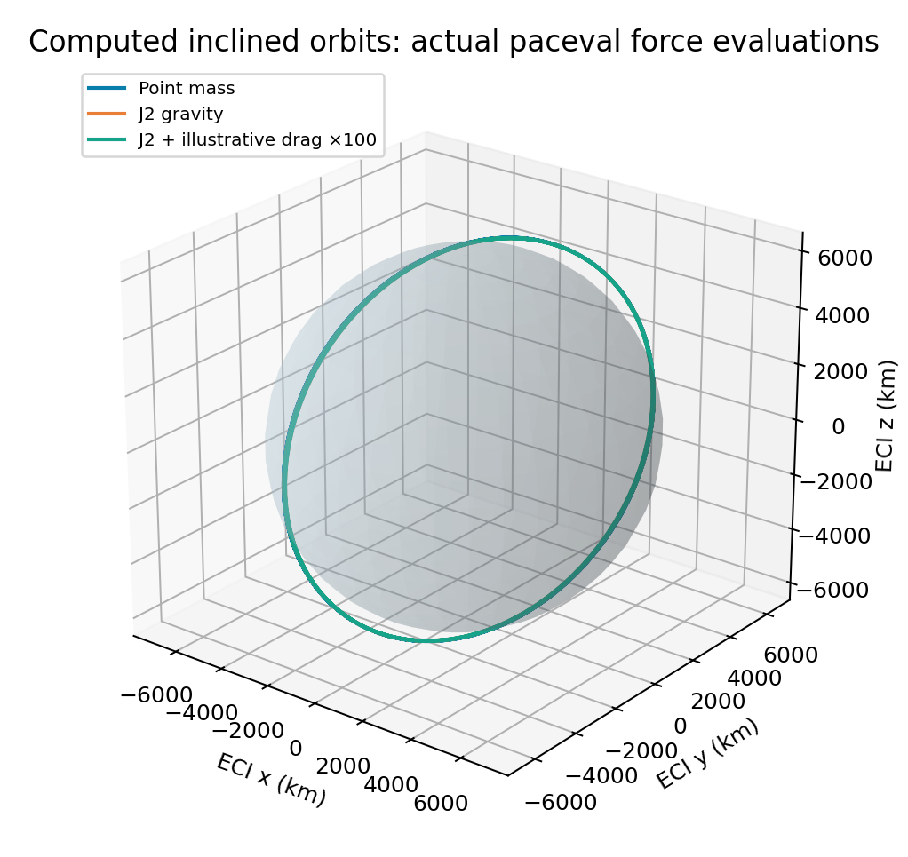
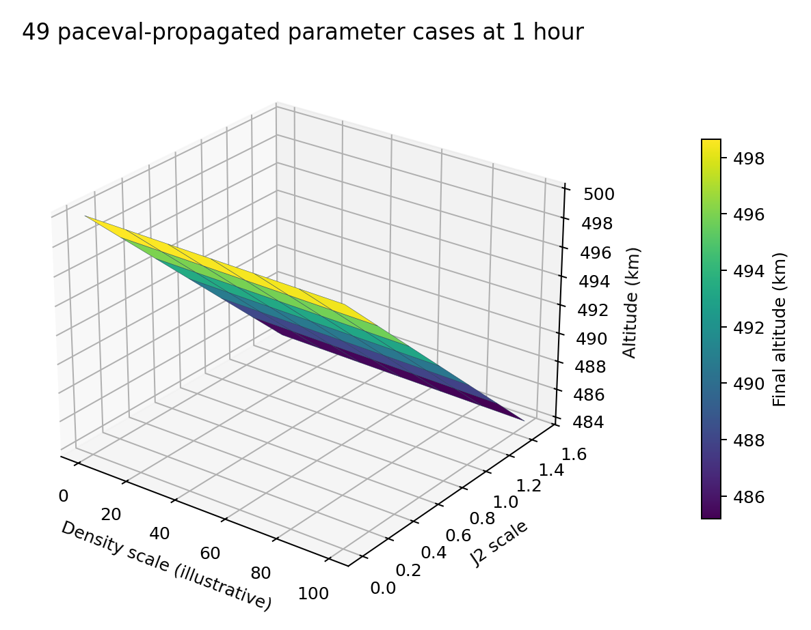

# paceval. | Analytical Kernels for Orbit Parameter Sweeps


**An executable C++ research demonstrator that integrates reusable paceval mathematical expression graphs into an Earth-orbit propagation and parameter-sweep workflow.** Three persistent paceval graphs calculate three Cartesian acceleration components from point-mass gravity, Earth's J2 oblateness correction and an explicitly simplified co-rotating atmospheric-drag model. A fixed-step Runge–Kutta host independently audits every acceleration and trajectory against separately implemented native C++ formulas.

**Scope:** The repository is a computational proof of concept with deterministic initial conditions, simplified atmosphere and no measured spacecraft observations. It is not an operational orbit propagator, flight-dynamics certificate, ephemeris provider or validated prediction of orbital decay.

[English research whitepaper (PDF)](paceval_Orbit_Parameter_Sweeps_Whitepaper_EN.pdf) · [C++ demonstrator](src/orbit_sweeps.cpp) · [CMake build](src/CMakeLists.txt) · [SDK header](src/paceval_main.h) · [SDK interface source](src/paceval_main.cpp) · [Verification script](src/verify_results.py)

## 1. Industrial use case and system boundary

Satellite operations, spacecraft mission design, constellation planning and flight-dynamics software repeatedly evaluate forces while sweeping orbit altitude, inclination, gravity coefficients, spacecraft ballistic coefficients and atmospheric assumptions. Numerically integrating a spacecraft trajectory requires a stateful solver, while each force-model evaluation consists of mathematical expressions with many reusable subexpressions. This study specifically tests the latter integration boundary.

**paceval owns:** three fully specified acceleration-expression graphs, reusable computation handles, direct double-precision numerical evaluation, and packed batch evaluation on independent state vectors. The graph handles persist through all orbit and parameter cases and are deleted at shutdown.

**The C++ host owns:** physical units, initial states, time integration, orbit-state history, parameter sweeps, numerical-domain checks, atmospheric assumptions, native reference forces, analytical two-body check, diagnostic invariants, CSV export and plots. paceval is *not* represented as an adaptive integrator, a propagation database or an external source of ephemerides.



## 2. Defined mathematical model

### 2.1 Central and J2 accelerations

Earth-centered inertial Cartesian state, using **km, km/s and seconds**:

```math
\dot{\mathbf r}=\mathbf v,\qquad
\dot{\mathbf v}=\mathbf a_0+\mathbf a_{J2}+\mathbf a_D.
```

Set $`r=\|\mathbf r\|`$, $`q=z^2/r^2`$, $`R_e=6378.137\,\mathrm{km}`$, $`\mu=398600.4418\,\mathrm{km^3/s^2}`$ and $`J_2=1.08262668\times 10^{-3}`$. The reference constants are *frozen model inputs*, not a gravity-field realization at a particular epoch.

```math
\mathbf a_0=-\mu\,\mathbf r/r^3,\quad
 g=\frac{3\mu J_2 R_e^2}{2r^5},\quad
\mathbf a_{J2}=g\begin{bmatrix}
 x(5q-1)\\ y(5q-1)\\ z(5q-3)
\end{bmatrix}.
```

The source strings explicitly encode all operations as supported paceval mathematical expressions. Different values of $`\mu`$ and $`J_2`$ are passed to **the same** handles, not implemented by rebuilding or silently switching the expression.

### 2.2 Simplified atmosphere and drag

The research-domain model assumes an exponentially declining density at geocentric altitude $`h=r-R_e`$, **not a measured atmospheric forecast**:

```math
\rho(h)=4\times10^{-12}\,\exp\!\left(-\frac{h-400\,\mathrm{km}}{60\,\mathrm{km}}\right)\,\mathrm{kg/m^3}.
```

Atmospheric co-rotation uses $`\boldsymbol\omega=(0,0,7.2921150\times10^{-5})\,\mathrm{rad/s}`$ and $`\mathbf v_{rel}=\mathbf v-\boldsymbol\omega\times\mathbf r`$. The aerodynamic force is

```math
\mathbf a_D=-\tfrac12(C_dA/m)\rho(h)\,\|\mathbf v_{rel}\|\mathbf v_{rel},\qquad C_dA/m=0.02\,\mathrm{m^2/kg}.
```

The C++/paceval expression converts m/s to km/s consistently: it multiplies the km/s velocity products by 1000 in the conversion of SI acceleration to km/s². Density multipliers 0, 1, 10 and 100 are **artificial sensitivity settings**, not physical estimates from satellite observations.

### 2.3 Propagation and numerical checks

The host integrates with classical **RK4**, fixed $`\Delta t=60\,\mathrm{s}`$. Every stage of the paceval computation is checked against an *independently coded* Cartesian native C++ right-hand side. Both paths are numerically integrated using the same fixed RK4 algorithm, and their 6D states are compared at every exported trajectory step. A point-mass case is also compared against the exact circular-orbit solution.

The no-drag potential is $`U=-\mu/r+\mu J_2R_e^2P_2(z/r)/r^3`$, with $`P_2(u)=(3u^2-1)/2`$. The code checks specific mechanical energy conservation for the conservative models. **It does not apply that conservation assertion when drag is enabled.** Angular momentum conservation is checked only in the point-mass two-body case, not for the noncentral J2 force.

## 3. Executed results with the original paceval SDK

| Recorded check | Actual result |
|---|---:|
| Persistent mathematical computation graphs | 3 |
| Scalar paceval acceleration-component audits | **81,360** |
| Packed double-precision batch comparisons | **96** (32 inputs per graph) |
| Largest absolute difference against independent native force component | **3.47 × 10⁻¹⁸ km/s²** |
| Six-hour orbit propagation cases | **10** |
| Additional one-hour J2 × density parameter combinations | **49** |
| Two-body circular analytical position oracle, 4 h | Maximum deviation **0.09543 km** |
| Independent CSV-level two-body analytical oracle, 6 h | Maximum deviation **0.18272 km** |
| Independent C++ trajectory discrepancies | All below the coded tolerances |
| CMake / CTest SDK integration | **1 / 1 passed** |

These are **feasibility and numerical agreement observations**, not CPU speed comparisons, accuracy guarantees for arbitrary orbits, or validation against a flight-data source. The circular-orbit discrepancies above include **fixed-step RK4 integration error** and should not be misinterpreted as arithmetic disagreement between paceval and native C++.

[SDK execution log](results/sdk_execution.txt) · [CTest result](results/ctest_sdk.txt) · [CSV-independent audit](results/csv_independent_audit.json) · [Original test summary](examples/audit_summary.txt)

## 4. Calculated scientific 3D graphics and comparisons

Every numbered figure is generated from the included paceval-exported CSV files. The **cover art** is an illustrative image and is never represented as measured or computed orbit data.

| Figure | Meaning | Source and figure |
|---|---|---|
| 1 | Host / paceval computation boundary | [PNG](figures/01_execution_architecture.png), [vector PDF](figures/01_execution_architecture.pdf) |
| 2 | True three-dimensional calculated trajectories for selected force variants | [PNG](figures/02_3d_orbits.png), [vector PDF](figures/02_3d_orbits.pdf) |
| 3 | J2-dependent ascending-node evolution | [PNG](figures/03_j2_node_evolution.png), [vector PDF](figures/03_j2_node_evolution.pdf) |
| 4 | Orbital altitude history under conservative and drag variants | [PNG](figures/04_altitude_history.png), [vector PDF](figures/04_altitude_history.pdf) |
| 5 | **3D** final-altitude surface across 49 J2/density combinations | [PNG](figures/05_parameter_surface.png), [vector PDF](figures/05_parameter_surface.pdf) |
| 6 | RAAN parameter-map visualization | [PNG](figures/06_parameter_raan_map.png), [vector PDF](figures/06_parameter_raan_map.pdf) |
| 7 | Difference between conservative energy and dissipative drag energy | [PNG](figures/07_energy_audit.png), [vector PDF](figures/07_energy_audit.pdf) |
| 8 | Full-trajectory difference against the independent native RK4 | [PNG](figures/08_position_difference.png), [vector PDF](figures/08_position_difference.pdf) |
| 9 | Resulting RAAN across ten force-parameter cases | [PNG](figures/09_scenario_node_comparison.png), [vector PDF](figures/09_scenario_node_comparison.pdf) |





[Ten-scenario CSV summary](examples/scenario_summary.csv) · [49-scenario CSV surface](examples/parameter_surface.csv) · [Two-body trajectory](examples/orbit_two_body.csv) · [J2 trajectory](examples/orbit_nominal_J2.csv) · [J2 and drag trajectory](examples/orbit_J2_drag_x100.csv)

All ten full trajectory CSVs are in [`examples/`](examples/) and retain every observed state, specific energy, osculating node, paceval/native trajectory error, and the declared time step. No real spacecraft telemetry or trajectory files are bundled.

## 5. Compile and reproduce with the public paceval C/C++ facade

The repository includes the original **paceval SDK header and source facade**, with the single include path in `paceval_main.cpp` adapted to the adjacent header inside `src/`. Upstream copyright and AGPL notices remain in both original SDK files. The compatible Linux shared runtime must be supplied **externally** and is not published in the ZIP.

```bash
cmake -S src -B build -DCMAKE_BUILD_TYPE=Release \
  -DPACEVAL_RUNTIME=/absolute/path/to/libpaceval_linux_sharedLIB.so
cmake --build build -j
ctest --test-dir build --output-on-failure
./build/orbit_sweeps --out reproduced
python3 src/verify_results.py
python3 src/check_readme_math.py
python3 src/make_figures.py
python3 src/make_whitepaper.py
```

**Command qualification:** `verify_results.py`, `make_figures.py` and `make_whitepaper.py` read the **released** files in `examples/` and regenerate the audit/figures/PDF there. To audit a separately produced `reproduced/` directory, first compare it to `examples/` or copy the generated files to `examples/` in a separate working copy. The generator does not silently substitute the `reproduced/` outputs as its input.

**GitHub equation formatting:** This README uses GitHub-supported `math` fenced blocks and backtick-protected dollar-delimited inline expressions. Run `python3 src/check_readme_math.py` after editing formulas; it flags unsupported delimiters and missing relative links. It checks Markdown structure, not whether a formula is physically correct. See [GitHub mathematical-expression documentation](https://docs.github.com/en/get-started/writing-on-github/working-with-advanced-formatting/writing-mathematical-expressions).

Python dependencies for optional reproduction are `numpy`, `matplotlib` and `reportlab`. The C++ executable itself requires **C++17, CMake and the externally supplied ABI-compatible paceval runtime**, not Python.

## 6. Domain limitations and scientific interpretation

- The model treats Earth as a spherical reference plus first J2 zonal gravity; no J3/J4, Earth rotation of the gravity field, precession/nutation, Earth-orientation data, lunisolar gravity, solar radiation pressure, tides or thrust.
- Exponential drag density and fixed H are intentionally illustrative. Real thermospheric density depends on solar/geomagnetic activity and local conditions. No atmospheric data or empirical calibration was used.
- Scenarios are synthetic. They share one fixed inclination and height and vary gravity and drag coefficients. No collision events, maneuvers, drag attitude variation, re-entry or operational mission prediction was evaluated.
- Mathematical agreement between two C++ calculation paths does not prove the chosen physical model is representative of a real satellite. A high-fidelity independent propagator and orbit observations are necessary for that claim.
- A finite sample of numerical agreement and energy checks is not a proof of universal floating-point accuracy, physical conservation for all parameter values or interval certification. TINC was not enabled for this release.
- No performance, energy-saving, business-value or operational-accuracy advantage is asserted by the study.

## 7. External research context

The architecture and selected constants are informed by [NASA's Earth Fact Sheet](https://nssdc.gsfc.nasa.gov/planetary/factsheet/earthfact.html), the [ESA Earth Observation Mission Conventions document](https://eop-cfi.esa.int/Repo/PUBLIC/DOCUMENTATION/SYSTEM_SUPPORT_DOCS/Mission%20Convention%20Documents/MCD_conventions_v4_27.pdf), ESA's published discussion of [orbit propagation and atmospheric drag](https://conference.sdo.esoc.esa.int/proceedings/sdc7/paper/399/SDC7-paper399.pdf), [JPL NAIF SPICE](https://naif.jpl.nasa.gov/naif/toolkit.html), and the [paceval public C/C++ API](https://paceval.com/api/).

**Conclusion.** A demanding, nested three-dimensional orbital-acceleration mathematical kernel has been successfully executed repeatedly through the official paceval interface in a reproducible synthetic satellite-orbit scenario. The demonstrated result is a modular numerical computation capability, not a substitute for a validated flight-dynamics solver.
