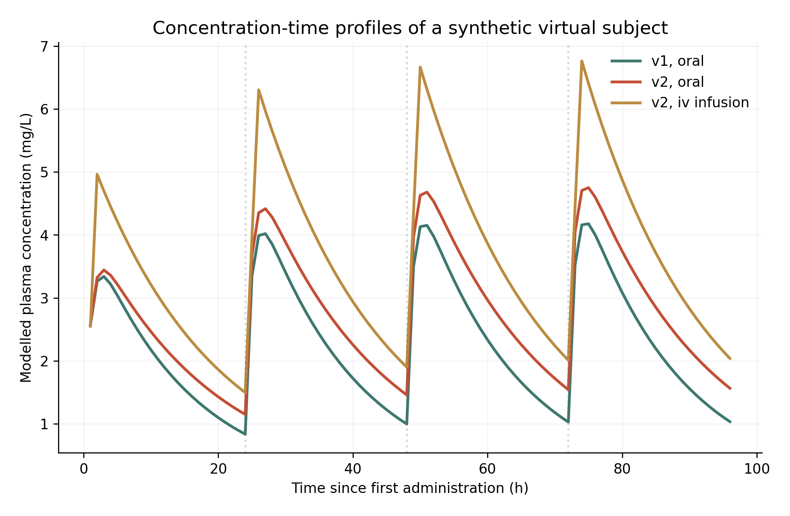
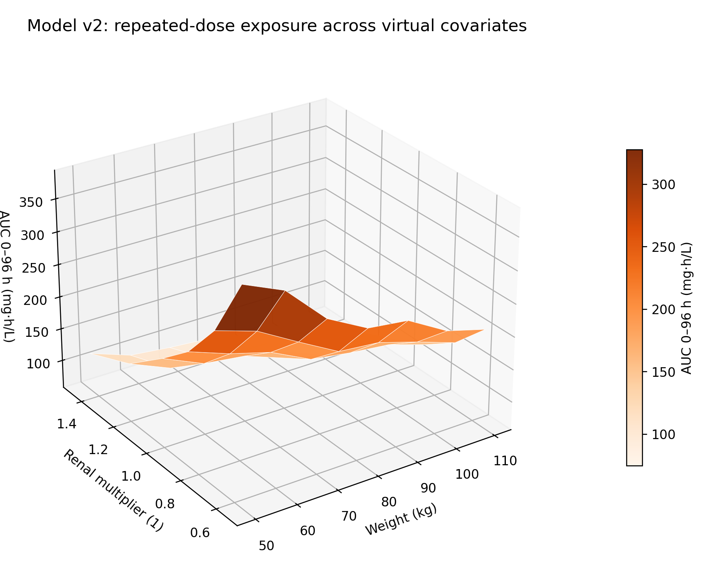

# paceval | Patient-Specific Pharmacokinetic Rate Kernels


*Concept illustration; not a computed research result. The virtual subject and compound are entirely fictional.*

**A reproducible, original-SDK-tested C++ research demonstrator** for patient-covariate-dependent pharmacokinetic (PK) rate expressions, analytically exact state transitions, exposure and concentration readouts, versioned clearance formulas, quantitative margins and sensitivity functions. It studies a synthetic one-compartment model, not medical prescribing software.

**[English scientific whitepaper (PDF)](paceval_Patient_Specific_Pharmacokinetic_Rate_Kernels_Whitepaper_EN.pdf)** · **[Main C++ implementation](src/pharmacokinetic_kernels.cpp)** · **[Complete mathematical function inventory](results/math_execution_inventory.csv)** · **[Original SDK execution record](results/sdk_execution.txt)**

## 1. Industrial use case and current state of the art

Pharmacokinetics describes how a compound is absorbed, distributed and eliminated over time. During drug-development research, scientists combine information about an experimental compound, the administration schedule and subject-level covariates to predict concentration–time profiles. In a virtual population the same mathematical expressions may be evaluated many times while weight, clearance, absorption and model assumptions change. The output can include a concentration trajectory, the area under the concentration curve (AUC), a sampled peak concentration (Cmax) and a residual or objective for comparing models. These are *model outputs*, not automatically safe or effective doses.

A contemporary pharmacometric workflow typically involves a scientifically selected structural model, data qualification, statistical parameter estimation, an ODE or analytical solver, uncertainty analysis and external model evaluation. Existing technology includes NONMEM, Monolix, Pumas, nlmixr2/rxode2 and, for richer physiologically based models, the Open Systems Pharmacology PK-Sim/MoBi suite. Those systems provide broader scientific workflows than a mathematical expression engine. The 2024 literature on model ensembling and subsequent model-selection guidance reinforce the need for external validation rather than treating covariate-based predictions as inherently reliable [4–6]. In 2026, the ICH M15 guideline established a harmonized framework for evaluating model-informed drug-development evidence [1, 2]; FDA guidance on population PK remains relevant [3].

The research opportunity investigated here is narrower and testable: **can a coherent set of meaningful PK formulas be built as persistent paceval graphs, evaluated for repeated synthetic scenarios through the real SDK, and checked independently?** paceval computes model parameters, elimination and absorption rates, *exact* stepwise states, AUC increments, composite synthetic scores, numerical guard margins and analytical sensitivities. The C++ controller manages chronological administration events, state retention, accumulation, sampled extrema, input validation and files. This project does not implement Bayesian inference, mixed-effects model fitting, automatic differentiation, physiologically based PK, clinical decision support or regulatory qualification.

## 2. Verified research scope

The demonstrated mathematical model is a deliberately limited **one-compartment PK system with an oral absorption depot, first-order elimination and optional constant-rate intravenous infusion**. Two clearance-covariate formulas are kept in memory simultaneously as separate graph versions. The host applies four illustrative administrations at 24-hour intervals. All parameter values describe a *fictional compound* and 42 algorithmically generated virtual profiles. The normalized renal factor is a dimensionless synthetic input, **not** measured eGFR or creatinine clearance.

The canonical original-Linux-SDK run performed:

| Actual recorded item | Result |
|---|---:|
| Successfully created **and executed** distinct paceval graphs | **94** |
| Virtual profiles / scenario combinations | **42 / 168** |
| Time steps / step duration / time horizon | **384 / 0.25 h / 96 h** |
| Actual multi-graph batch calls | **417** |
| Actual output values from paceval multi-graph batches | **1,537,542** |
| Executed single-value paceval cross-checks | **1,014** |
| Independently implemented native C++ checks | **2,286** |
| Independent 80-digit graph and whole-trajectory reference checks | **9,932** |
| Full independently checked scenario trajectories | **12** |

The source of these figures is [results/sdk_execution.txt](results/sdk_execution.txt) and [results/high_precision_audit.json](results/high_precision_audit.json). The execution, CTest and independent mathematical audit passed. Their numeric verification details live in `results/`, not in this report. The checks establish computational consistency with the *defined synthetic model*, not clinical validity.

## 3. Defined mathematical model

For a synthetic subject with body weight $WT$ in kilograms, reference clearance $CL_0$ in L/h, and reference distribution volume $V_0$ in L, define the two deliberately hypothetical renal-covariate models:

```math
\begin{aligned}
CL_1 &= CL_0 (WT/70)^{0.75} RF\,e^{\eta_{CL}},\\
CL_2 &= CL_0 (WT/70)^{0.75}(0.55RF+0.45RF^2)e^{\eta_{CL}},\\
V &= V_0(WT/70)e^{\eta_V},\qquad k=CL/V.
\end{aligned}
```

Here $RF$ is a synthetic dimensionless multiplier; $\eta_{CL},\eta_V$ are deterministic profile perturbations. The exponent and v2 polynomial are experimental modeling assumptions, not coefficients estimated from a clinical population. Both clearance graph versions remain available for exactly the same input row.

With depot amount $A_g$ (mg), central amount $A_c$ (mg), absorption constant $k_a$ (h⁻¹), bioavailable fraction $F$, and constant infusion rate $R$ (mg/h) during one time interval, the ODE system is:

```math
\begin{aligned}
\frac{dA_g}{dt}&=-k_a A_g,\\
\frac{dA_c}{dt}&=Fk_a A_g+R-kA_c,\\
C&=A_c/V.
\end{aligned}
```

For constant parameters and input within a step of length $h$, the exact state transition is:

```math
\begin{aligned}
A_g'&=A_g e^{-k_a h},\\
A_c'&=A_c e^{-kh}
+\frac{Fk_aA_g}{k_a-k}(e^{-kh}-e^{-k_a h})
+\frac{R}{k}(1-e^{-kh}),\\
\Delta AUC&=\frac{F(A_g-A_g')+Rh-(A_c'-A_c)}{CL}.
\end{aligned}
```

The final expression is the exact integrated central exposure for this **linear** model over the step, derived from input-output mass conservation. It is not an adaptive ODE method. To avoid an unstable removable singularity, the tested input domain explicitly excludes $k_a$ close to $k$; a production model should implement a stable limit branch. The host accumulates already-calculated paceval AUC increments and selects the maximum of paceval concentrations on the declared 0.25-hour observation grid. Thus **sampled Cmax** is not asserted to equal the continuous-time global maximum.

We use fictional parameters $CL_0=5$ L/h, $V_0=40$ L, $WT=50$–$110$ kg and an oral depot of 240 mg once per 24 h; the alternative IV scenario delivers 120 mg/h for the first 2 h of each day. With oral delivery, bioavailability is profile-dependent and less than unity; the alternative routes therefore do **not** represent matched systemic input or a clinically interchangeable regimen. The illustrative concentration ceiling of 6 mg/L, target of 3 mg/L and AUC reference of 40 mg·h/L are arbitrary testing constants, **not therapeutic or toxicological limits**.

## 4. Actual mathematical execution responsibilities

The [function inventory](results/math_execution_inventory.csv) registers individual graph IDs, formulas, units, versions, SDK paths and independent verification roles. Graph creation, the actual scalar and multi-graph batch calls and error checks are in [src/pharmacokinetic_kernels.cpp](src/pharmacokinetic_kernels.cpp).

| Mathematical function / purpose | Actual execution | Graph / version or host rationale |
|---|---|---|
| Weight and synthetic renal-covariate adjustment of clearance; distribution volume | **paceval** | `clearance_v1`, `clearance_v2`, `volume_v1/v2` |
| Elimination constant, half-life, depot / central RHS, absorption and elimination fluxes | **paceval** | `elimination_constant`, `half_life`, `gut_rate`, `central_rate`, etc., both versions |
| Full analytical state propagation and resulting concentration | **paceval** | `depot_next`, `central_next`, `concentration_next`, both versions |
| Exact stepwise AUC, alternative trapezoid, eliminated systemic mass | **paceval** | `auc_exact_step`, `auc_trapezoid_step`, `eliminated_mass`, both versions |
| Single-dose analytical concentration, peak time and peak magnitude; theoretical AUC to infinity | **paceval** | `single_dose_oral_*`, `auc_infinity_*`, both versions |
| Covariate/weight sensitivities, score derivative, explicit version differences | **paceval** | `*_sensitivity_*`, `clearance_delta_v2_v1`, `predicted_concentration_delta_v2_v1` |
| Squared residual and 14 alternative weighted, multi-criterion synthetic objectives *per version* | **paceval** | `score_v1_01`–`15`, `score_v2_01`–`15` |
| Illustrative concentration / clearance / exposure margins | **paceval** | `upper_margin`, `lower_margin`, `relative_clearance_margin`, etc. |
| Administration timing, state retention, cumulative reduction and peak selection | **C++ host** | Chronological control, not pure single-row arithmetic |
| Numerical oracle and full trajectories used only for validation | **Native C++ / Python mpmath** | Independent reference, never substituted for the primary paceval data |

On an appropriate set of inputs, the SDK receives **one graph registration per mathematical definition** and thereafter reuses its handles in `paceval_dGetMultipleComputationsResultsExt`. The code checks a small mixed-graph/mixed-row layout against scalar paceval calls before running the complete multi-graph workload. All 94 registered graphs are actually evaluated with real SDK inputs, including those not needed in the sequential state update.

## 5. Research dataset and versioned scenarios

The [virtual profile CSV](examples/synthetic_virtual_profiles.csv) contains 7 weights × 6 renal multipliers, small deterministic heterogeneity terms, absorption coefficients and oral bioavailability. The four combinations of model version and administration route produce 168 simulated traces for a fixed **96-hour** window. The reproducible synthetic event schedule and dose amounts are frozen in C++ source. Two formula versions change the renal multiplier's functional relationship to clearance while keeping the remaining model assumptions identical; they are a controlled formula-revision experiment, *not* two validated clinical hypotheses.

The primary research data are [scenario_summary.csv](results/scenario_summary.csv), [concentration_trajectories.csv](results/concentration_trajectories.csv), [score_variants.csv](results/score_variants.csv), [formula_registry.csv](results/formula_registry.csv) and [graph_probe.csv](results/graph_probe.csv). The graph probes preserve the actual input vector and the corresponding paceval result for independent auditing.

As one concrete example, synthetic profile 19 under repeated oral input produces **AUC(0–96 h) = 220.8537 mg·h/L (v1)** and **267.2031 mg·h/L (v2)**. The corresponding **sampled Cmax values are 4.2085 and 4.7686 mg/L**. These are verified calculations for arbitrary research parameters, not suggested clinical exposure targets.

## 6. Scientific figures

Each numbered analytical chart is produced by [src/make_figures.py](src/make_figures.py) from the actual original-SDK output CSVs. PNG and vector PDF versions are included; captions, formulas and source files are indexed in [results/figure_manifest.csv](results/figure_manifest.csv).

| Scientific view | Interpretation |
|---|---|
| [01. End-to-end PK workflow](figures/01_application_workflow.png) | Conceptual processing architecture (not a computed chart) |
| [02. Concentration–time curves](figures/02_virtual_profile_concentration.png) | Model and administration scenarios for one virtual profile |
| [03. Exposure vs renal factor](figures/03_exposure_by_renal_covariate.png) | Versioned AUC changes over the synthetic multiplier |
| [04. Three-dimensional AUC surface](figures/04_exposure_surface_3d.png) | Joint weight and covariate effects on repeated-dose exposure |
| [05. Model-revision AUC difference](figures/05_model_revision_exposure_map.png) | Differences between v2 and v1 for the same virtual profile |
| [06. Peak concentration vs weight](figures/06_peak_concentration_by_weight.png) | Sampled Cmax across virtual body weights |
| [07. Virtual subject variability](figures/07_virtual_subject_variability.png) | Multiple concentration traces under one synthetic regimen |
| [08. Joint AUC and peak concentration](figures/08_auc_peak_joint_distribution.png) | Two non-equivalent exposure descriptors |
| [09. Clearance formula versions](figures/09_versioned_clearance_covariate.png) | Two simultaneously retained covariate formula models |
| [10. Illustrative concentration margin](figures/10_illustrative_concentration_margin.png) | Algebraic distances from a nonclinical numerical reference |




## 7. Build, execution and independent verification

The project builds on **Linux x86-64** with CMake and a compatible **externally supplied original paceval shared library**. The original `paceval_main.h` and `paceval_main.cpp` are included under `src/` with their upstream copyright and AGPL notices preserved. The shared library is **not distributed** in this repository or ZIP. Obtain a permitted compatible binary and supply its absolute path.

```bash
cmake -S src -B build -DCMAKE_BUILD_TYPE=Release \
  -DPACEVAL_RUNTIME=/absolute/path/to/libpaceval_linux_sharedLIB.so
cmake --build build -j
ctest --test-dir build --output-on-failure

# Canonical four-day synthetic cohort with both model versions and input routes:
./build/pharmacokinetic_kernels --out . --steps 384 --patients 42

python3 src/verify_results.py --root .
python3 src/make_figures.py --root . --figures figures
python3 src/check_readme_math.py
python3 src/make_whitepaper.py --root .
```

Python dependencies for the independent audit and publication scripts are `mpmath`, `numpy`, `matplotlib`, `Pillow` and `reportlab`. CTest calls the original SDK executable on a smaller deterministic cohort and then checks the resulting data with independent 80-digit arithmetic. The 96-hour canonical release run is separately recorded in [results/sdk_execution.txt](results/sdk_execution.txt). Results are regenerated, not hard-coded into the computational scripts.

The numerical verification includes independently implemented native C++ transitions, scalar-versus-batch layout checks, 80-digit mpmath comparisons for all 94 important graph families and full repeated-dose trajectories, including AUC, sampled peak, mass conservation, concentration and model-dependent covariates. Audit failures terminate the validation program with an error. README formulas and relative links are checked by [src/check_readme_math.py](src/check_readme_math.py), with intentional pass/fail regression cases. A source-level structural check is **not** a visual verification of GitHub's Math renderer.

## 8. Interpretation and limitations

This research establishes feasibility of **real reusable mathematical graph execution** in a deliberately constrained pharmacokinetic use case. It does not demonstrate superior drug-model performance, clinical utility, safety, regulation-compliant dosing or differences in computational efficiency. The dataset is synthetic; covariate functions, reference parameters, virtual observations, objective weights and illustrative thresholds are arbitrary. Profile perturbations are deterministic rather than fitted random effects. There is no assay noise, external drug data, parameter identifiability assessment, Bayesian posterior update, prediction-corrected visual predictive check, multi-compartment disposition, nonlinear elimination, interoccasion variation or PBPK structure. The analytically solved single-compartment model requires its parameter-domain restrictions; no adaptive solver study was undertaken. Finite mathematical test samples cannot prove a global numerical guarantee; TINC was not evaluated.

A scientifically stronger follow-on could integrate a permitted, anonymized real dataset with a validated structural model, prospectively specified covariates, alternative model structures, identifiability checks and external validation. Such work would require pharmacometric and clinical specialists. The research code should never be used to decide actual treatment or medication doses.

## 9. Scientific references and software context

1. International Council for Harmonisation, **ICH M15, General Principles for Model-Informed Drug Development**, adopted internationally in 2026; [EMA implementation (July 2026)](https://www.ema.europa.eu/en/ich-m15-guideline-general-principles-model-informed-drug-development-step-2b-scientific-guideline) and [FDA final guidance (June 2026)](https://www.fda.gov/regulatory-information/search-fda-guidance-documents/m15-general-principles-model-informed-drug-development).
2. US FDA, **Population Pharmacokinetics: Guidance for Industry**, February 2022. [Official guidance](https://www.fda.gov/regulatory-information/search-fda-guidance-documents/population-pharmacokinetics).
3. **Recommended approaches for integration of population pharmacokinetic modelling with precision dosing in clinical practice**, British Journal of Clinical Pharmacology (2024/25). [Paper](https://doi.org/10.1111/bcp.16335).
4. **Selecting the Best Pharmacokinetic Models for a Priori Model-Informed Precision Dosing with Model Ensembling**, 2024. [Open article](https://pmc.ncbi.nlm.nih.gov/articles/PMC11522197/).
5. **Tutorial on model selection and validation of model input into precision dosing software**, 2023/24. [Open article](https://pmc.ncbi.nlm.nih.gov/articles/PMC10725261/).
6. **Guidance for External Evaluation and Selection of Population Pharmacokinetic Models for Precision Dosing**, published 2025/26. [PubMed](https://pubmed.ncbi.nlm.nih.gov/41343019/).
7. Open Systems Pharmacology, [PK-Sim](https://github.com/Open-Systems-Pharmacology/PK-Sim) and [Suite releases](https://github.com/Open-Systems-Pharmacology/Suite/releases).
8. Lixoft/Simulations Plus, [one-compartment analytical PK model library](https://monolixsuite.slp-software.com/__attachments/51740750/PKPDlibrary.pdf?inst-v=f5f13ef2-fa0b-4c78-89d6-b19562be09fa).
9. Original paceval repository and C/C++ API: [paceval/paceval](https://github.com/paceval/paceval), [paceval API](https://paceval.com/api/).

**Publication status:** independent numerical research demonstrator with the original SDK, scientific validation of its stated synthetic equations, and no clinical validation. © 2026 paceval. Preserve the original SDK license notices and verify applicable redistribution requirements before publication.
