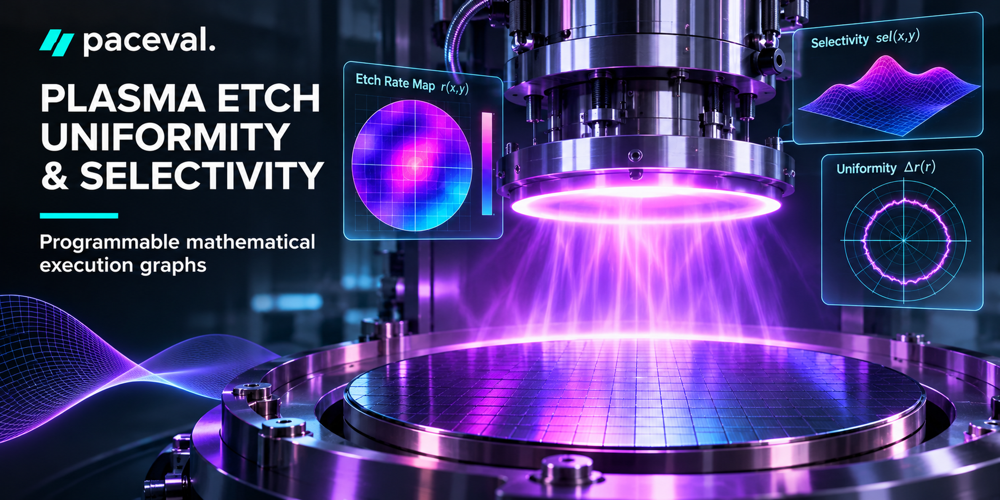
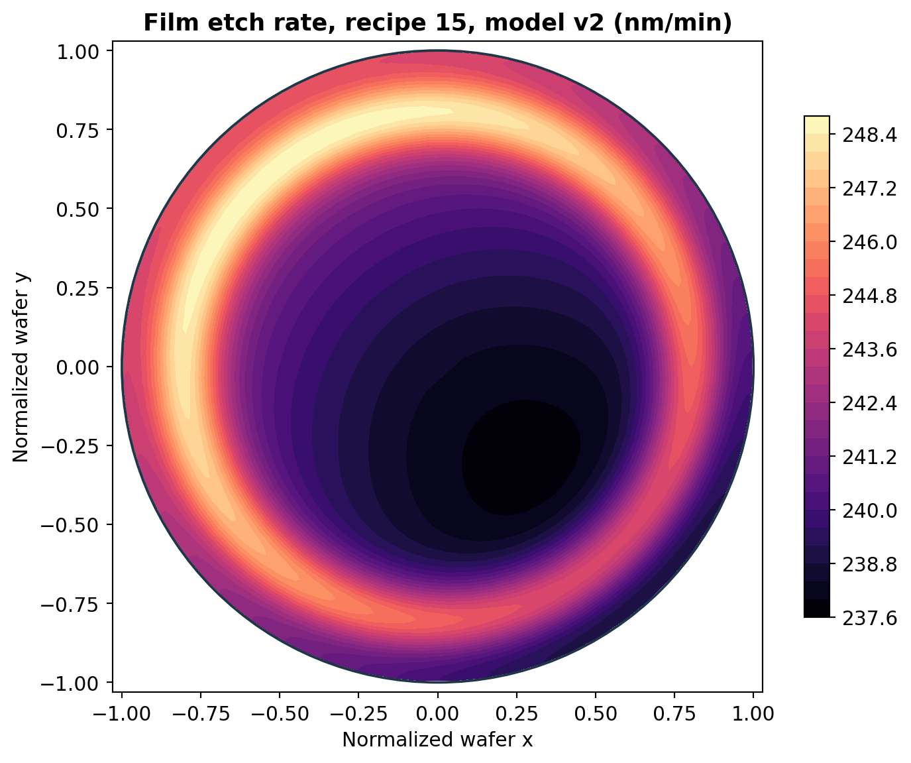
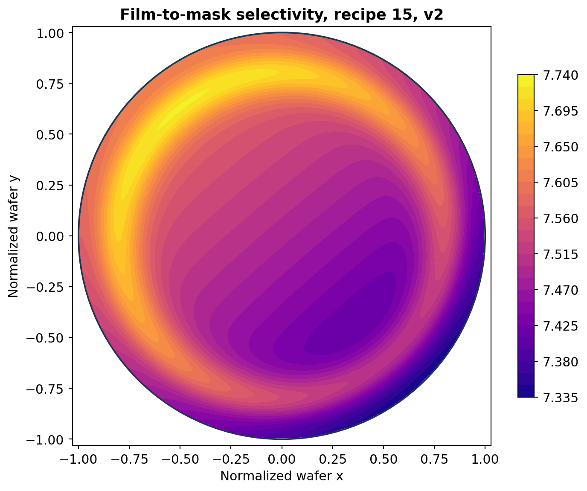
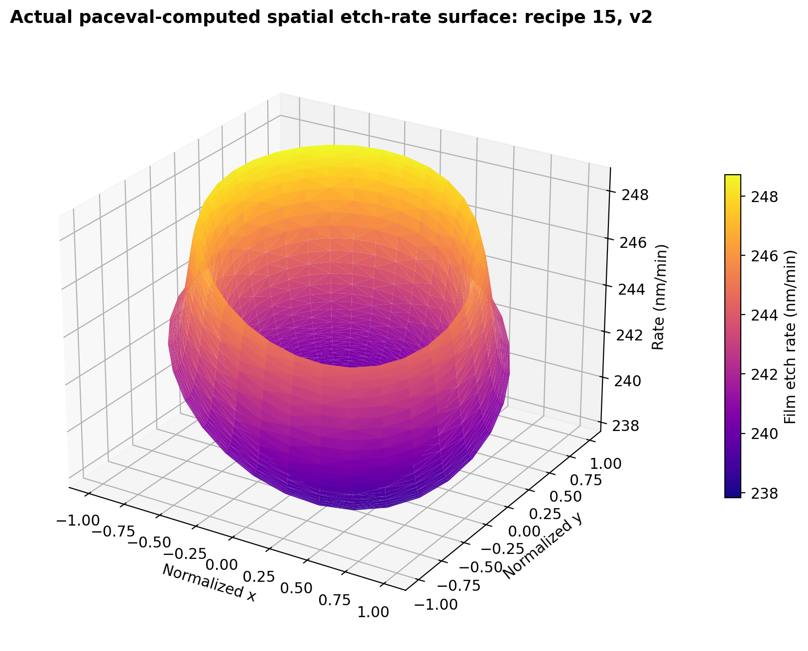
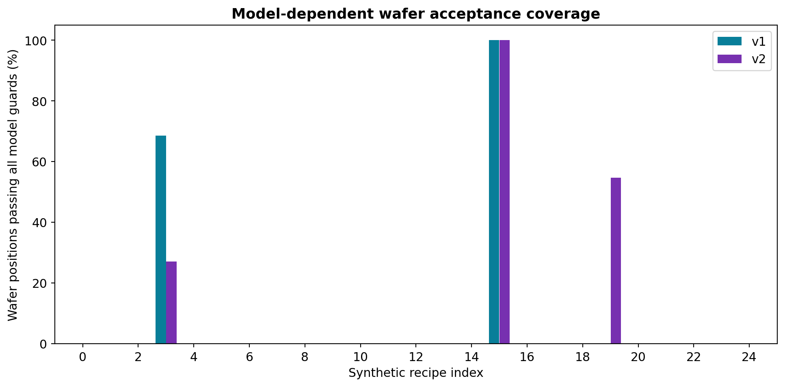

# Semiconductor Plasma Etch Uniformity and Selectivity Mapping with paceval



*Concept illustration; not a computed research result or photograph of a deployed etcher.*

A reproducible **C++ industrial research demonstrator** executing two versions of an analytical wafer-scale plasma-etch surrogate with the **original paceval Mathematical Engine SDK 4.25**. The full synthetic demonstration evaluates etch rate, mask erosion, film depth, material selectivity, local nonuniformity, spatial and process sensitivities, numerical process scores and conditional quality decisions as persistent mathematical execution graphs. It is a mathematical function and integration study, **not** a plasma-chemistry simulation or fab qualification.

**[Scientific whitepaper (PDF)](paceval_Plasma_Etch_Uniformity_Selectivity_Whitepaper_EN.pdf)** · [C++ source](src/plasma_etch.cpp) · [Independent validation](src/verify_reference.py) · [Recorded execution evidence](results/execution_evidence.json) · [Original research specification](docs/WP06_original_research_specification.pdf)

## 1. Industrial use case and current state of the art

Plasma etching removes targeted materials from a semiconductor wafer using reactive species and ion bombardment in a controlled chamber. Engineers select gas chemistry, electrode temperature, pressure, bias and etch duration so that the desired film is removed at the intended rate while a protective mask survives, etched profiles remain acceptable and different wafer locations receive comparable material removal. **Selectivity** means the ratio of target-film to mask etch rates. **Within-wafer nonuniformity** describes spatial differences, which may be created by gas distribution, plasma/sheath conditions, wafer-edge effects and pattern-dependent chemistry.

A typical research cycle starts with an etch recipe, develops a predictive or empirical model, computes maps over measurement positions, checks film depth and mask consumption, changes the recipe, and compares measurements with model predictions. Instrument descriptions from [NIST's ICP etcher](https://www.nist.gov/laboratories/tools-instruments/nanofab-tool-oxford-plasmapro-100-inductively-coupled-plasma-icp-iii) confirm the practical roles of pressure, chemistry and temperature-controlled electrodes. The [NIST Dektak XT profilometer](https://www.nist.gov/laboratories/tools-instruments/nanofab-tool-bruker-dektak-xt-profilometer) is a relevant metrology example for etch depth and film thickness. A [2025 review of plasma etching](https://doi.org/10.1016/j.mne.2025.100330) summarizes chemistry-dependent rates, selectivity, anisotropy and process windows; [2026 wafer-edge research](https://doi.org/10.3390/jmmp10090338) focuses on focus-ring effects, while a [2024 IEEE study](https://doi.org/10.1109/ACCESS.2024.3444454) examines 3D etch simulation and multi-objective modeling. These are background sources and do **not** validate the synthetic model used here.

**The specific question:** Can paceval execute and reuse a connected family of mathematical wafer-rate expressions, model revisions, film/mask selectivity functions and fully composed quality rules, while a host system manages wafer coordinates, datasets and model provenance?

## 2. Demonstrated research scope

The experiment has **25 deterministic synthetic process recipes**, each evaluated at **4,096 equal-area wafer positions** for **two simultaneously retained formula versions**. There are **204,800 model-point rows**. This is an explicitly defined surrogate workload with no fabricated metrology measurements. The two models share an Arrhenius/pressure/chemistry-inspired rate structure; version 2 adds a localized radial-ring term and different coefficients. This difference illustrates controlled formula revision, not a result about an actual chamber.

| Real execution metric | Recorded outcome |
|---|---:|
| Distinct registered and actually executed paceval graphs | 59 |
| Successful multi-graph batch calls | 1,750 |
| Graph-point outputs | 5,734,550 |
| Model-point result rows | 204,800 |
| Independently verified pointwise scalar results | 4,505,600 |
| Independently verified recipe-summary metrics | 500 |
| 80-digit high-precision reference values | 2,048 |

Every figure that reports a mathematical result is generated directly from the saved [paceval results](results/wafer_points.csv). All detailed numeric validation differences are in [the private research audit](results/independent_reference_audit.json), not in marketing charts or the whitepaper.

## 3. Defined mathematical models

For normalised wafer coordinates `(x,y)` in the unit disk, electrode temperature `T` in kelvin, pressure `p` in mTorr, dimensionless bias `b` and synthetic chemistry index `c`, the film and mask rates have the illustrative structure

$$
r_f(x,y)=A_f\exp\!\left(-\frac{E_f}{R_g T}\right)
\left(\frac{p}{p_0}\right)^{\alpha_f}
G_f(b,c)\,S_f(x,y),
$$

$$
r_m(x,y)=A_m\exp\!\left(-\frac{E_m}{R_g T}\right)
\left(\frac{p}{p_0}\right)^{\alpha_m}
G_m(b,c)\,S_m(x,y).
$$

Here `S_f` and `S_m` are distinct versioned polynomial or polynomial-plus-ring spatial maps; the exact coefficients and full registered expressions are in [graph_registry.csv](results/graph_registry.csv). Rates are in nm/min. The following quantities are executed as paceval graphs:

$$
\mathrm{sel}=\frac{r_f}{\max(r_m,\epsilon)},\qquad
d_f=r_f t_e,\qquad
\delta=\frac{r_f-r_{f,\mathrm{center}}}{r_{f,\mathrm{center}}}.
$$

The host aggregates wafer-level maxima and minima, then a **separate paceval summary graph** evaluates the explicitly defined max/min nonuniformity:

$$
\mathrm{NU}_{\%}=100\,\frac{r_{\max}-r_{\min}}{2\bar r}.
$$

This definition is **one specified within-wafer statistic** and is not equivalent to all definitions of process uniformity. The research also reports coefficient of variation. Hard quality rules are **synthetic and unit-defined**: depth target tolerance, minimum mask remainder, minimum film/mask selectivity, maximum local center deviation and a multi-component score bound. They are not actual fab specifications.

## 4. paceval mathematical execution versus C++ host

| Mathematical function / industrial purpose | Actual execution | Graph version or rationale |
|---|---|---|
| Film and mask etch rates, wafer-center rate | paceval | `film_rate`, `mask_rate`, `center_rate` (v1/v2) |
| Spatial gradients and temperature, pressure, chemistry sensitivities | paceval | Five independent derivative graphs (v1/v2) |
| Film depth, mask erosion and remaining film/mask thickness | paceval | Stage-B composite expressions (v1/v2) |
| Selectivity, local rate deviation, depth and selectivity margins | paceval | Stage-B composed expressions (v1/v2) |
| Quality score, score margin and combined Boolean quality guard | paceval | Includes explicit `AND`, `>=`, `<=`, `min` and `max` operators |
| Max/min nonuniformity, coefficient of variation and mean-rate normalization | paceval | Three final aggregate-normalization graphs |
| Wafer coordinate generation; summation of rates and extrema over positions | C++ host | Stateful point enumeration and across-row aggregation |
| ACCEPT/REVIEW/REJECT classification from already-computed margins | C++ host | Status logic, not a process actuation claim |
| CSV input validation, recording, and model/graph lifetime | C++ host using paceval converters | `paceval_dConvertStringToFloat`, `paceval_dConvertFloatToString` |
| Independent analytic and 80-digit verification | Python reference only | Never passed off as paceval execution |

**Executed sequence:** validated recipe and wafer coordinates → persistently created paceval primary graphs → numerical value transport through C++ → paceval downstream scores and constraints → host aggregation → three paceval summary graphs → documented CSV and status interpretation. The same v1 and v2 graphs remain simultaneously available. The library is called through `paceval_main.cpp` with the genuine `paceval_dGetMultipleComputationsResultsExt` API.

## 5. Selected observed synthetic outcomes

For synthetic recipe **15**, model v1 produces an area-mean film rate of **234.345 nm/min** and average selectivity **7.631**; v2 gives **242.152 nm/min** and **7.532**, respectively. The corresponding modeled depth changes from about **515.56 nm** to **532.73 nm**, and both versions pass the defined combined process rule at all 4,096 wafer positions. In another recipe, model versions produce different accepted wafer fractions. All numerical statements describe **this model only**.

The selected 25 recipes result in widely varying depths and selectivities, which is useful for demonstrating both accepted and rejected candidate operating points. The numerical threshold is hypothetical. A pass result here is *not* a production release.

## 6. Scientific diagrams

The following plotted data are taken from genuine paceval evaluations, with [reproduction scripts](src/make_figures.py). PNG and vector PDFs are both included.









Additional figures include local uniformity, mask protection, sensitivity maps, 3D maps, radial profiles, recipe response surfaces, model revision and quality score distributions. The architecture drawing is a conceptual diagram, not computational data.

## 7. Build and reproduce

Requires Linux x86-64, C++17, CMake and a compatible original externally supplied paceval shared library. The public repository contains the original `paceval_main.h` and `paceval_main.cpp` adapter sources, but **does not redistribute the external shared library**. Python validation and chart generation require packages listed in [`src/requirements.txt`](src/requirements.txt).

```bash
cmake -S src -B build -DCMAKE_BUILD_TYPE=Release \
  -DPACEVAL_RUNTIME=/absolute/path/to/compatible/libpaceval_linux_sharedLIB.so
cmake --build build -j
ctest --test-dir build --output-on-failure
./build/plasma_etch --run --recipes 25 --radial 64 --angular 64 --out results/reproduced
python3 src/verify_reference.py results/reproduced
python3 src/make_figures.py
python3 src/make_whitepaper.py
```

The explicit command to regenerate graphs and the full dataset creates **new live paceval calculations**; it does not use stored reference arrays to simulate the mathematical engine. The example full-run values were executed with SDK **4.25**, not via the remote MCP service. The sample CSV files are standard decimal dot, comma-delimited UTF-8, and numerical serialization uses paceval's own converter. A strict lexical guard excludes arbitrary expressions from CSV number fields, since the paceval string converter can parse expressions. For bit-exact values one must store a separate binary representation; text roundtrip is not asserted to be lossless.

For publication and repeatability, compare [`results/execution_evidence.json`](results/execution_evidence.json), [`results/math_execution_inventory.csv`](results/math_execution_inventory.csv), [`results/independent_reference_audit.json`](results/independent_reference_audit.json) and [`results/sha256_manifest.txt`](results/sha256_manifest.txt). The manifest excludes itself and intentionally excludes file-system modification times and machine-local runtime-library paths.

## 8. Interpretation, limitations and next scientific step

The research validates **the explicit mathematical functionality and execution architecture** on deterministic synthetic wafer maps. It does not reproduce plasma discharge equations, sheath physics, semiconductor surface reactions, pattern-density effects, material-specific selectivity calibration, etch profile evolution, industrial metrology uncertainty or fab-specific yield. The rate law is intentionally a low-dimensional functional surrogate. Physical assertions require measured process maps, target materials, gas chemistries, equipment-specific conditions and independent holdout wafer measurements. Safety-related process interlocks and actual recipe deployment remain outside this demonstration.

Current source context: [NIST III-V ICP etcher](https://www.nist.gov/laboratories/tools-instruments/nanofab-tool-oxford-plasmapro-100-inductively-coupled-plasma-icp-iii) · [NIST Dektak XT](https://www.nist.gov/laboratories/tools-instruments/nanofab-tool-bruker-dektak-xt-profilometer) · [2025 plasma etch review](https://doi.org/10.1016/j.mne.2025.100330) · [2026 wafer edge study](https://doi.org/10.3390/jmmp10090338) · [2024 plasma etch optimization](https://doi.org/10.1109/ACCESS.2024.3444454) · [paceval API](https://paceval.com/api/) · [paceval Product Brief](https://paceval.com/product-brief/).

*The demonstration deliberately publishes no comparative C++/paceval/CPU/GPU/FPGA performance results. Independent numerical references are used strictly for scientific verification, and their detailed differences remain in technical audit files.*
