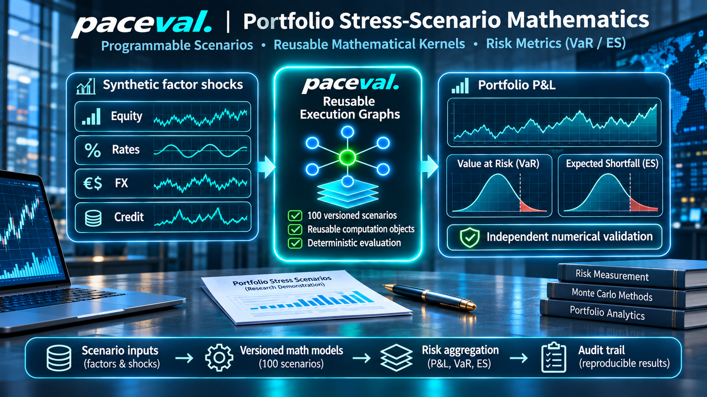

# paceval Portfolio Stress-Scenario Mathematics



**A reproducible C++ research demonstrator for evaluating versioned mathematical portfolio P&L functions with paceval execution graphs.** It combines a transparent synthetic four-factor scenario model, independent numerical audits, separate named stresses, and illustrative Value at Risk (VaR) and Expected Shortfall (ES) reductions. The aim is to establish the **technical feasibility and reproducibility** of the mathematical execution layer. No speed or investment-performance claims are made.

[Read the English research whitepaper](paceval_Portfolio_Stress_Whitepaper_EN.pdf) · [C++ source](src/portfolio_stress.cpp) · [Independent validation](src/validate_outputs.py) · [Reproduce all scientific figures](src/make_figures.py)

## Scientific scope and actual paceval contribution

The program prepares **100 different, versioned mathematical expressions** using the official `paceval_main.h` and `paceval_main.cpp` SDK interface. Each expression is compiled into a **reusable paceval computation handle** and then evaluated over a fixed set of synthetic factor shocks using the documented `paceval_dGetComputationResultExt` batch API. One rule is revised and re-evaluated without rebuilding the unrelated rules.

**What paceval computes:** per-scenario monetary P&L from explicit formulas; repeated use of formula handles; an optional smooth TINC diagnostic computation.

**What the C++ host computes:** deterministic scenario generation; input policy; correlation-like shock construction; rule/handle inventory; aggregation of scenario losses into VaR/ES; named stress reporting; model version control; results export. The Python validator independently recomputes risk statistics and selected formula values with 100-digit `mpmath` arithmetic. None of these host functions are attributed to paceval.

### Illustrative mathematical model

Four shocks are used: `eq` (relative equity return), `ir` (absolute interest-rate change), `fx` (relative FX move), and `cr` (absolute credit-spread change). All variables are dimensionless decimals; coefficient units are synthetic monetary units per corresponding shock (and per shock squared for gamma terms).

The full permitted function family is a portfolio delta-gamma-cross approximation with an optional equity drawdown term:

```text
PnL = D_eq*eq + D_ir*ir + D_fx*fx + D_cr*cr
    + 0.5*G_eq*eq^2 + 0.5*G_ir*ir^2
    + 0.5*G_cr*cr^2 + X_eq_fx*eq*fx
    - H*max(0,-eq)
```

Four deliberately distinct expression families progressively include linear deltas, gamma terms, cross-factor interaction, and a non-smooth equity drawdown term. These are **synthetic mathematical approximations** and not calibrated financial instruments, validated portfolio valuations or a regulator-approved market-risk methodology. The `max` operation is represented algebraically using `abs()` for portability with the tested runtime.

### Reproducible evaluation scope

| Element | Actually executed or independently checked |
|:--|:--|
| Versions and prepared graphs | 100, covering four formula families |
| Seeded distribution scenarios | 4,096 |
| Separate hypothetical stresses | 6 (excluded from empirical VaR/ES) |
| Total paceval P&L evaluations | 410,200 (including named stresses) |
| Native C++ comparison | 410,200 results within the predeclared tolerance |
| Independent high-precision audit | 1,000 P&L samples plus all 600 named-stress results; 100 decimal digits |
| VaR / ES reduction audit | Independently recomputed for all 100 rule versions |
| Formula update | Rule 17 changed; other prepared rule graphs reused unchanged |
| Exploratory TINC diagnostics | 24 samples with explicitly reported raw and host-widened endpoints |

**Estimator definition:** `loss = -PnL`; empirical VaR at 95% or 97.5% uses the nearest-rank sorted loss; illustrative ES at 97.5% is the arithmetic mean of the highest `ceil(0.025*N)` losses for `N` distribution scenarios. This deliberately simple ES estimator is **not** the regulatory liquidity-horizon-adjusted FRTB ES capital calculation. Named stresses are never inserted into the empirical risk distribution.

The TINC output is deliberately separate from P&L, VaR and ES. On this runtime the raw interval endpoints were point intervals in the 24-sample audit, so the C++ host additionally records a one-binary64-ULP outward adjustment on each side. Those adjusted intervals contained all 24 independently evaluated values; this is an **observed finite-sample check, not a universal interval guarantee**.

## Build and execute on Linux

A C++17 compiler and CMake 3.16+ are needed, together with a compatible external Linux paceval runtime. The proprietary `.so` is **not bundled**. The included SDK facade source files are compiled directly into this executable, exactly as explained in the [official paceval API instructions](https://paceval.com/api/).

```bash
export PACEVAL_LIB=/absolute/path/to/libpaceval_linux_sharedLIB.so
cmake -S src -B build -DCMAKE_BUILD_TYPE=Release -DPACEVAL_RUNTIME="$PACEVAL_LIB"
cmake --build build -j
ctest --test-dir build --output-on-failure

# Reproduce the published 100-model experiment:
./build/portfolio_stress --scenarios 4096 --models 100 --batch 512 --seed 20261112 --out results

# Independently audit exported values and risk statistics:
python3 -m pip install mpmath matplotlib numpy
python3 src/validate_outputs.py --folder results --json results/independent_audit.json

# Reproduce scientific figures from the bundled CSV examples:
python3 src/make_figures.py
```

On this release's verification machine, the external library file had SHA-256 `acf63a87df0ee822b467edbca887393d31ec0ea03562e1abf802d2512a5bfb12`. This checksum identifies the tested binary; it does not imply that all compatible binaries must have the same checksum. The actual end-to-end validation used x86-64 Debian Linux with GCC 14.2 and Clang 17.

### CSV replay and input validation

The same input data may be supplied using a CSV file rather than recreated by the random generator:

```bash
./build/portfolio_stress --input examples/factor_shocks.csv --models 100 --batch 37 --out imported_results
```

The importer expects the columns `scenario_id,type,eq,ir,fx,cr` with consecutive 0-based IDs and at least 64 distribution scenarios; any `named_stress` records must follow them. It rejects nonfinite, out-of-range, wrongly typed, and malformed records. The released file [factor_shocks.csv](examples/factor_shocks.csv) was used in the round-trip test, producing byte-identical `evaluations.csv` and `risk_metrics.csv` under different batch sizes.

## Evidence and source files

### C++ and verification source

- [C++ demonstrator](src/portfolio_stress.cpp) · [CMake configuration](src/CMakeLists.txt)
- [Official SDK C/C++ interface header](src/paceval_main.h) · [Official SDK implementation](src/paceval_main.cpp)
- [Independent 100-digit reference and risk-metric validation](src/validate_outputs.py)
- [Scientific plot generation](src/make_figures.py)

### Reproducible example inputs and outputs

- [Versioned model registry (all 100 explicit formulas)](examples/rules.csv)
- [Seeded synthetic shock inputs](examples/factor_shocks.csv)
- [Scenario narratives](examples/scenario_descriptions.csv)
- [All empirical P&L comparisons](examples/evaluations.csv)
- [Per-version VaR and ES](examples/risk_metrics.csv)
- [Separate named stress results](examples/stress_results.csv)
- [Controlled rule-version update](examples/rule_update.csv)
- [TINC raw and one-ULP-expanded diagnostic samples](examples/tinc_samples.csv)
- [Run metadata](examples/validation.json) · [Independent audit JSON](examples/independent_audit.json)

### Scientific figures

| Figure | Plot |
|:--|:--|
| 1 | [Mathematical execution architecture](figures/01_execution_architecture.png) ([SVG](figures/01_execution_architecture.svg)) |
| 2 | [Four synthetic factor distributions](figures/02_factor_shock_distributions.png) ([SVG](figures/02_factor_shock_distributions.svg)) |
| 3 | [P&L loss distribution and risk markers](figures/03_pnl_distribution.png) ([SVG](figures/03_pnl_distribution.svg)) |
| 4 | [Empirical risk metrics for all rule versions](figures/04_var_es_across_models.png) ([SVG](figures/04_var_es_across_models.svg)) |
| 5 | [Six independent named stresses](figures/05_named_stress_scenarios.png) ([SVG](figures/05_named_stress_scenarios.svg)) |
| 6 | [Version-controlled formula update](figures/06_version_update_isolation.png) ([SVG](figures/06_version_update_isolation.svg)) |
| 7 | [Native C++ residual distribution](figures/07_numerical_crosscheck.png) ([SVG](figures/07_numerical_crosscheck.svg)) |
| 8 | [Comparison of formula families](figures/08_formula_family_comparison.png) ([SVG](figures/08_formula_family_comparison.svg)) |

## Scientific sources and interpretation

This project was developed from the supplied *WP-010: Programmable Portfolio Stress-Scenario Mathematics* proposal. The extension toward delta-gamma approximations, named stresses, deterministic importable shock datasets, and independent tail-metric audits is part of **this demonstrator**, not a claim contained in the initial proposal.

The [Basel Committee's stress testing principles](https://www.bis.org/committees/bcbs/basel-consolidated-guidelines/module/rma/30) emphasize scenario governance, plausibility, data and validation. The [EBA stress-testing guidelines](https://www.eba.europa.eu/documents/10180/2282644/2b604bc8-fd08-4b17-ac4a-cdd5e662b802/Guidelines%20on%20institutions%20stress%20testing%20%28EBA-GL-2018-04%29.pdf) describe internally consistent risk-factor shocks. The [EU CRR II market-risk framework](https://eur-lex.europa.eu/legal-content/EN/TXT/?uri=celex%3A32019R0876) distinguishes regulatory ES calculations from the simplified empirical tail statistic presented here.

**Scientific boundary:** this is a numerical feasibility demonstration with deterministic synthetic data, not historical VaR backtesting, a predictive market model, a production risk system, or investment advice. Numerical agreement does not validate the economic factor model. No performance, regulatory certification, live trading, or risk-reduction claims are made.

The included SDK files retain their original licensing notices; consult their licensing terms before publishing or redistributing them. No separate `LICENSE_NOTICE.md` is created.
