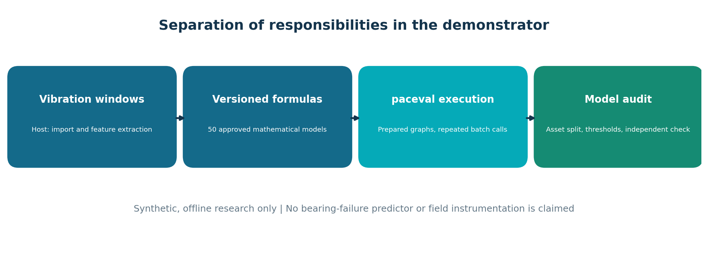

# paceval. Predictive Maintenance Mathematics


**Vibration features · Versioned mathematical scoring · Independent validation**

A reproducible **C++17 / Linux scientific feasibility demonstrator** showing how a mathematical execution engine can be used as a reusable component in an industrial condition-monitoring workflow. Fifty versioned mathematical score expressions are prepared through the official `paceval_main.h` / `paceval_main.cpp` interface and evaluated across many vibration windows with the original paceval Linux runtime. The host handles vibration features, dataset splits, threshold decisions and research metrics. **The application does not claim trained machine-failure probabilities, remaining-useful-life forecasting or field certification.**

**[Read the complete English research whitepaper](paceval_Predictive_Maintenance_Whitepaper_EN.pdf)**

## Reproducible research result

| Implementation or check | Verified result |
| --- | --- |
| Asset-disjoint synthetic cohort | 48 assets, 12 windows each (576 windows) |
| Raw acceleration data | 512 samples/window, 294,912 samples total |
| Model family | 50 distinct, versioned paceval scoring expressions |
| Prepared graph reuse | All 50 graph handles created once and reused in batches |
| Mathematical evaluations | 28,800/28,800 agreed with the independent native C++ calculation |
| Independent 90-digit mpmath audit | 28,800/28,800 within predeclared tolerance; maximum absolute difference about 2.36 × 10⁻¹⁶ |
| TINC sample-level reference inclusion | 24/24 sampled results contained their high-precision reference |
| Frozen model selected from training/validation | Version `v1.5` (model 5), threshold 0.55 |
| Previously unseen synthetic test assets | TP=71, TN=72, FP=0, FN=1; F1=0.9930 |
| Linux integration | Direct SDK source integration and externally supplied original `.so` |

The model-selection and fault-separation statistics above are **specific to generated, labelled vibration signals**. They are not estimates of real-world diagnostic performance. The TINC checks concern only the listed sample points.

## Research architecture



The host reads raw acceleration windows, validates sensor and label metadata, computes RMS and Pearson kurtosis, and partitions assets rather than individual windows. The mathematical kernel creates 50 distinct immutable scoring graphs, each called repeatedly with updated numerical inputs. The host selects a model using **training then validation assets only**, applies a fixed score threshold of 0.55 and reports results on independent test assets.

The base formula from WP-006 is the logistic condition index:

```text
S = 1 / (1 + exp(-(a*R + b*K + c*T + d + correction)))
R = RMS / 0.3
K = (PearsonKurtosis - 3) / 3
T = (temperatureC - 60) / 20
```

Four approved correction families are used across the 50 versions: none, `0.035*R*K`, `0.03*R*R` and `0.045*tanh(K)`. Model coefficients are defined in [the C++ source](src/predictive_maintenance.cpp). They are **synthetic, not fitted engineering constants**. The mathematical score is not a calibrated failure probability.

The feature equations and exact conventions are documented in the [whitepaper](paceval_Predictive_Maintenance_Whitepaper_EN.pdf). Pearson kurtosis is the fourth central population moment divided by the squared second central population moment, *without* subtracting 3.

## Scientific figures

| Figure | Description |
| --- | --- |
| [Architecture](figures/01_execution_architecture.png) | Division between feature extraction, paceval and independent assessment |
| [Vibration examples](figures/02_vibration_windows.png) | Synthetic healthy and fault-like raw acceleration windows |
| [Kurtosis distributions](figures/03_kurtosis_distribution.png) | A feature's variation across the synthetic cohort |
| [Held-out scoring](figures/04_holdout_scores.png) | Score distributions for the frozen selected model |
| [Confusion matrix](figures/05_heldout_confusion.png) | The exact held-out synthetic decisions |
| [Model version study](figures/06_model_versions.png) | Separate validation and retrospective test F1 by formula version |
| [TINC sample check](figures/07_tinc_sample_audit.png) | Width of evaluated numerical intervals and sample reference offsets |
| [Response surface](figures/08_mathematical_score_surface.png) | Two-dimensional score surface for the selected formula |

Each scientific figure is included as PNG **and SVG** in [`figures/`](figures/).

## Build and run on Linux

Use GCC 14 or a recent Clang with CMake 3.16+. Supply your own compatible *original* Linux paceval runtime. The package intentionally does **not** include `libpaceval_linux_sharedLIB.so`.

```bash
export PACEVAL_LIB="/absolute/path/to/libpaceval_linux_sharedLIB.so"
cmake -S src -B build -DCMAKE_BUILD_TYPE=Release
cmake --build build -j
ctest --test-dir build --output-on-failure

./build/predictive_maintenance \
  --raw examples/raw_vibration.csv \
  --out evaluation.csv \
  --features features.csv \
  --metrics model_metrics.csv \
  --tinc tinc_samples.csv --batch 37
```

The official [paceval API documentation](https://paceval.com/api/) describes compiling `paceval_main.cpp` with a C++ application and linking the platform-specific runtime. The build manifest is [`src/CMakeLists.txt`](src/CMakeLists.txt); the official wrapper sources are [`src/paceval_main.h`](src/paceval_main.h) and [`src/paceval_main.cpp`](src/paceval_main.cpp). Their existing copyright and licensing comments are preserved.

To regenerate the exact synthetic raw cohort:

```bash
python3 src/generate_data.py --output /tmp/raw_repro.csv
cmp examples/raw_vibration.csv /tmp/raw_repro.csv
```

For the independent 90-decimal-digit numerical audit (`pip install -r src/requirements.txt`):

```bash
python3 src/high_precision_reference.py \
  --scores examples/evaluation.csv \
  --tinc examples/tinc_samples.csv \
  --output /tmp/predictive_maintenance_audit.json
```

For figures: `python3 src/make_figures.py`. The [published reference audit](examples/high_precision_validation.json) was generated independently of the paceval runtime.

## Data and reproducibility

- [Raw synthetic vibration](examples/raw_vibration.csv): 48 asset groups, 12 windows per group, each with 512 acceleration values; labels and temperatures are synthetic.
- [Extracted features](examples/features.csv): the host's RMS, kurtosis and temperature per window.
- [Full scoring results](examples/evaluation.csv): version, asset, split, score, native reference and fixed-threshold decision.
- [Per-model metrics](examples/model_metrics.csv): 50 versioned formulas and separate train/validation/test results. The train and validation columns are used for selection; test outcomes are retrospective reporting only.
- [TINC samples](examples/tinc_samples.csv): 24 separately evaluated numerical intervals.
- [Invalid input example](examples/invalid_raw.csv): deliberately rejected before graph evaluation.
- [Model and figure generator](src/generate_data.py) and [plot generator](src/make_figures.py).

**Real data pathway.** The C++ raw CSV boundary accepts `asset_id,window_id,split,label,temp_C,sample_index,accel_g`. Assets may not occur in multiple partitions. A real dataset must supply independently justified fault labels, acceleration in a consistent unit and a contemporaneous temperature measurement; missing temperature must not be fabricated. Real bearing recordings are **not** bundled or claimed to have been analysed here.

Relevant independently published sources for future model evaluation:

- [Paderborn University bearing data](https://mb.uni-paderborn.de/en/kat/research/bearing-datacenter/data-sets-and-download): synchronized vibration and current with operating conditions and temperature; the official dataset carries **CC BY-NC 4.0** conditions, requiring consideration before commercial use.
- [Case Western Reserve University Bearing Data Center](https://engineering.case.edu/bearingdatacenter/download-data-file): documented healthy/faulted bearing vibration recordings; the measurements do not by themselves supply this demonstrator's temperature channel.
- [NASA IMS Bearings](https://data.nasa.gov/dataset/ims-bearings): bearing degradation recordings for an independent future pilot.

## Interpretation and boundaries

This demonstrator has **directly executed paceval scoring** and independent numerical checks; it does not prove that the fixed formula predicts actual failures, that labels are causally meaningful, or that a threshold transfers to a different factory. A credible field study must pre-register operating conditions, avoid asset/test leakage, handle distribution shift, calibrate an operational threshold and examine false alarms and missed faults against independently collected ground truth.

The feasibility report intentionally makes **no CPU performance or energy advantage claim**. Full performance testing and relevant real-world industrial evaluation are separate research phases. The repository does not ship a proprietary paceval `.so`, a production monitoring server, a trained prognostics model or a `LICENSE_NOTICE.md`.
