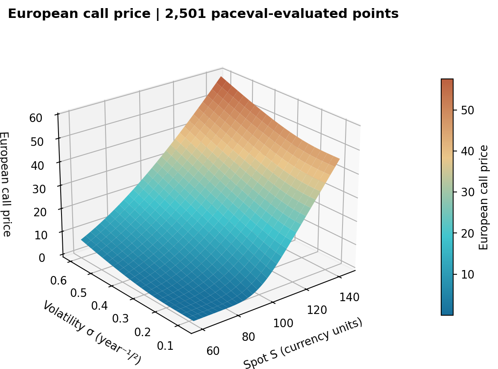
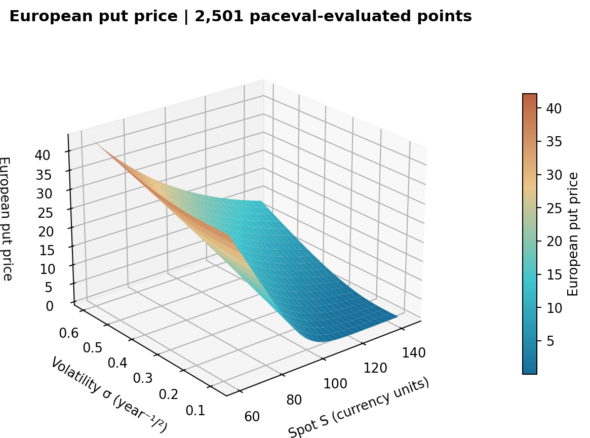
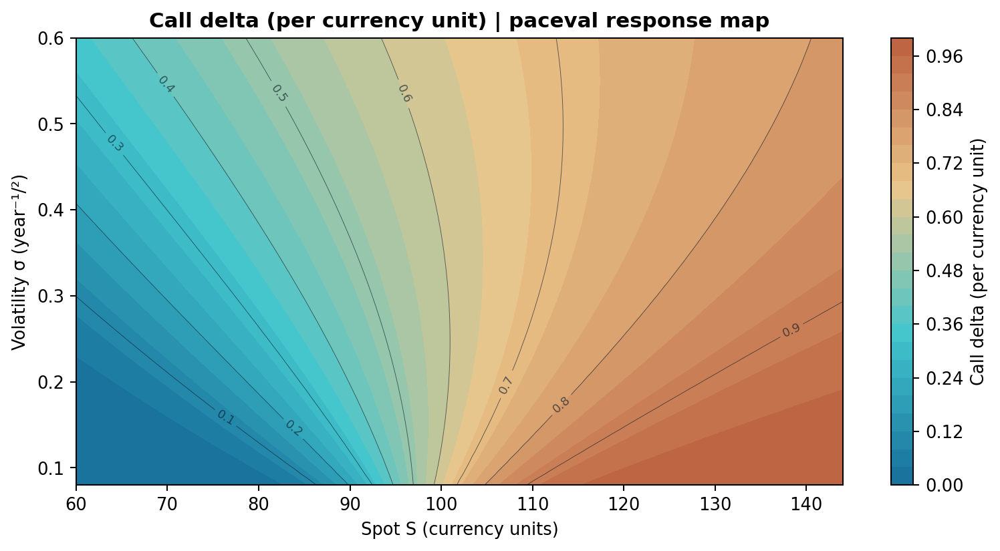
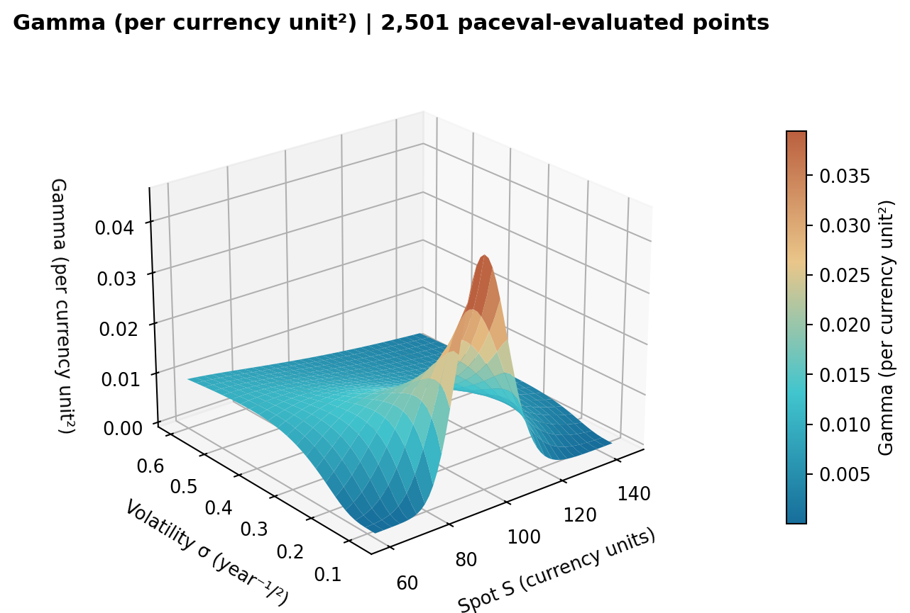
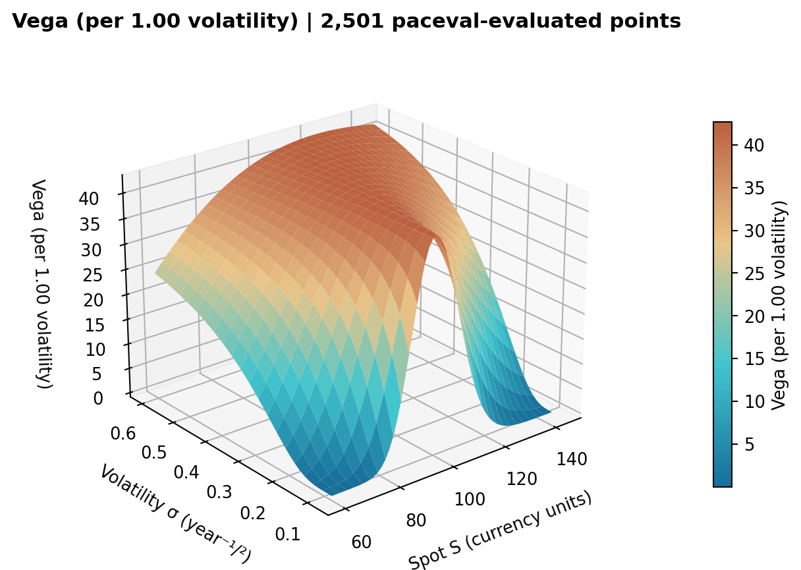
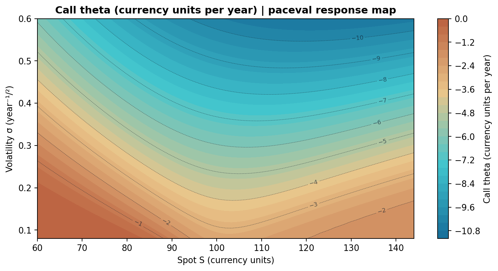
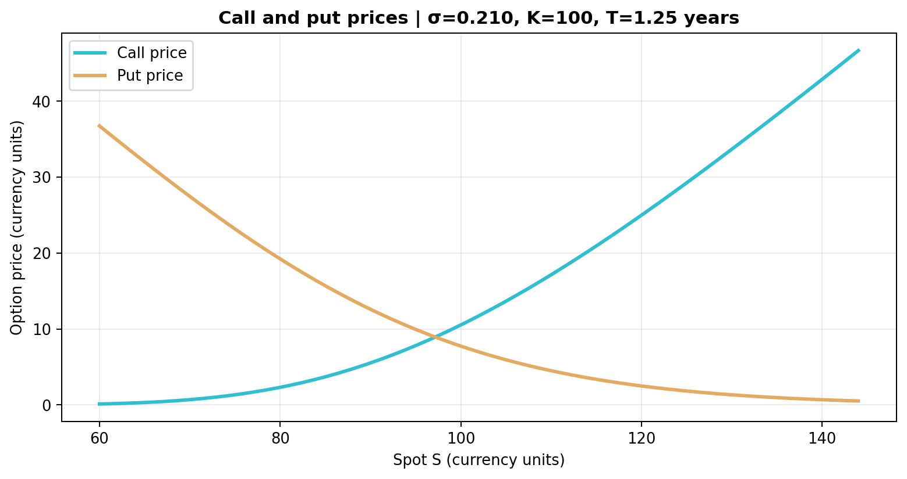

# paceval. | Pricing Formula Sensitivities at Scale


**A reproducible C++ feasibility demonstrator for reusable mathematical option-pricing and sensitivity formulas with the original paceval engine.** Ten versioned mathematical expressions evaluate theoretical Black–Scholes–Merton European call/put prices and analytical Greeks across a fixed synthetic spot–volatility grid. All outputs are checked against independent numerical references. This is an executed computational research demonstration, **not** an investment recommendation, market-calibrated pricing engine, exchange integration, or portfolio risk-management system.

[English scientific whitepaper (PDF)](paceval_Pricing_Formula_Sensitivities_Whitepaper_EN.pdf) · [Main C++ source](src/pricing_sensitivities.cpp) · [CMake project](src/CMakeLists.txt) · [Raw verified results](examples/pricing_grid.csv)

## 1. Verified research scope

The supplied WP-020 proposal asks whether reusable formula execution can support repeated pricing and sensitivity evaluation. The executable study implements the original vanilla European-option price formula and extends it to both option types and a curated set of analytical Greeks. The synthetic contracts include a **continuous dividend yield q** and a continuously compounded interest rate r. All formulas are deterministic closed forms. There is no smile or stochastic volatility.

| Reusable paceval graph | Definition | Reported units |
|---|---|---|
| `call_price` / `put_price` | Discounted European vanilla option prices | Currency units per option/underlying unit |
| `call_delta` / `put_delta` | ∂V/∂S | Currency per currency unit (dimensionless for a single underlying unit) |
| `gamma` | ∂²V/∂S² | Inverse currency units |
| `vega` | ∂V/∂σ | Currency units per **1.00** volatility increment |
| `call_theta` / `put_theta` | Calendar-time derivative `-∂V/∂T`, all else fixed | Currency units per year |
| `call_rho` / `put_rho` | ∂V/∂r | Currency units per **1.00** rate increment |

`S` spot and `K` strike are positive in the same monetary unit; `T` is years to expiry, `sigma` annualized decimal volatility; `r` and `q` are continuously compounded decimal rates per year. The study includes no FX conversions.

**Exact SDK boundary:** the C++ host computes `d1`, `d2`, the four standard-normal CDF values and `phi(d1)` using `std::erfc` and `std::exp`. The fixed 11-value ABI is `S K T r q sig n1 n2 nm1 nm2 pdf`. **paceval evaluates all ten registered price/Greek expressions** via `paceval_CreateComputation`, `paceval_dGetComputationResult` and `paceval_dGetComputationResultExt`. It does **not** perform the standard-normal CDF itself in this implementation. This separation ensures no unsupported paceval `N(x)` function is assumed. The host also owns validation, scenario generation and auditing.

## 2. Executed, independently verified results (Linux x86-64)

| Verified test | Observed result |
|---|---:|
| Persistent paceval computation handles | 10 |
| Deterministic research scenarios | 2,501 |
| paceval scalar results matching separate native C++ implementation | 25,010 / 25,010 |
| paceval batch results matching separate native C++ implementation | 25,010 / 25,010 |
| Independently computed 80-digit mpmath audit | 1,050 / 1,050 comparisons |
| Maximum observed absolute difference to separate native C++ | ~4.12e-13 |
| Maximum put-call parity residual on grid | ~2.84e-14 |
| CTest integration checks | 1 / 1 passed |

Numerical tolerance for each price/Greek value: `abs(paceval-native) <= 2e-9 * (1 + abs(native))`. The standalone high-precision script uses `1e-9 * (1 + abs(reference))`. The observed numbers are specific to the supplied SDK runtime and dataset. They **do not** indicate processor-independent throughput, improved pricing accuracy in financial markets, or general certified numerical bounds. No runtime measurements or speed comparisons are reported.

[SDK execution audit](results/sdk_execution.txt) · [CTest results](results/ctest_sdk.txt) · [80-digit audit](results/decimal_audit.json)

## 3. Compile directly with the original paceval C/C++ SDK

The project compiles [`paceval_main.cpp`](src/paceval_main.cpp) and [`pricing_sensitivities.cpp`](src/pricing_sensitivities.cpp) together and includes [`paceval_main.h`](src/paceval_main.h). The upstream `paceval_main.cpp` retains its source and license header; its *relative include* was adjusted for the flat `src/` layout. The external compatible architecture-specific Linux `.so` is **not included**.

```bash
cmake -S src -B build -DCMAKE_BUILD_TYPE=Release \
  -DPACEVAL_RUNTIME=/absolute/path/to/libpaceval_linux_sharedLIB.so
cmake --build build -j
ctest --test-dir build --output-on-failure
./build/pricing_sensitivities --out reproduced
```

To recreate the independent decimal check for that run, use the project layout or copy the `reproduced/pricing_grid.csv` file to `examples/pricing_grid.csv`, then:

```bash
python3 src/high_precision_reference.py
python3 src/make_figures.py
python3 src/make_whitepaper.py
```

`make_figures.py` requires NumPy and Matplotlib; `high_precision_reference.py` requires mpmath; `make_whitepaper.py` requires ReportLab and Pillow. The C++ executable itself uses the standard library plus the paceval SDK/runtime. The original paceval source code retains its upstream AGPL notices, and reuse/distribution obligations should be checked with the upstream project. No additional `LICENSE_NOTICE.md` is created.

## 4. Scientific figures from actual paceval outputs

The following seven plots are generated from **real paceval numeric outputs**, not generated artwork. Each is available as a PNG for README/web use and as a vector PDF.



**Figure 1.** [Call price (PNG)](figures/01_call_price_surface.png) · [vector (PDF)](figures/01_call_price_surface.pdf). Fixed strike, maturity, rates and dividend yield.



**Figure 2.** [Put price (PNG)](figures/02_put_price_surface.png) · [vector (PDF)](figures/02_put_price_surface.pdf).



**Figure 3.** [Delta (PNG)](figures/03_call_delta_map.png) · [vector (PDF)](figures/03_call_delta_map.pdf).



**Figure 4.** [Gamma (PNG)](figures/04_gamma_surface.png) · [vector (PDF)](figures/04_gamma_surface.pdf).



**Figure 5.** [Vega (PNG)](figures/05_vega_surface.png) · [vector (PDF)](figures/05_vega_surface.pdf).



**Figure 6.** [Call theta (PNG)](figures/06_theta_map.png) · [vector (PDF)](figures/06_theta_map.pdf).



**Figure 7.** [Call/put comparison (PNG)](figures/07_call_put_slice.png) · [vector (PDF)](figures/07_call_put_slice.pdf).

The cover image is an **illustrative CGI concept**, not an output of the C++ model. It is intentionally distinguished from the numerically constructed scientific figures.

## 5. Independent verification, assumptions and limitations

The C++ application evaluates each of 2,501 deterministically generated spot–volatility grid points for all ten graphs, verifies all results against separately written native C++ equations, and explicitly calls the SDK batch API in bounded blocks of at most 32 cases. The exported CSV is version-specific and has 16 columns including six input values and all ten formula outputs.

The independent [`high_precision_reference.py`](src/high_precision_reference.py) uses 80-decimal-digit mpmath arithmetic with its own CDF definition through `erf`, recalculating 105 strategically selected scenarios, 1,050 outputs. Neither script reads the SDK expressions to create its formulas. The sample audit uses decimals exported from binary64 C++; it does not assert binary-exact interval inclusions or global correctness across untested inputs.

Sample ranges: `S = 60..144`, `sigma = 0.08..0.60`, `K=100`, `T=1.25 years`, `r=0.035`, `q=0.012`. The implementation rejects inputs outside its documented research domain. This is not a production model and does not include American exercise, discrete cash dividends, price-feed data, calibrated implied volatility, transaction costs, jumps, smile/skew, or stochastic rates and volatilities.

## 6. Research basis and references

- [paceval public C/C++ API](https://paceval.com/api/) for persistent computation objects and the explicit batch evaluation API.
- [Ohio State Black–Scholes notes](https://math.osu.edu/~ban.1/5632/black_scholes.pdf) for the continuous-dividend version of vanilla European option pricing.
- [Options Industry Council: Volatility and the Greeks](https://www.optionseducation.org/advancedconcepts/volatility-the-greeks) for the interpretation and per-unit conventions of option sensitivities.
- [Federal Reserve: Black–Scholes prices and deltas](https://fraser.stlouisfed.org/files/docs/publications/frbatlreview/rev_frbatl_2000_v85no1.pdf) for underlying financial mathematical context.

**Conclusion:** This project demonstrates the computational feasibility of reusable paceval expression graphs for synthetic Black–Scholes-Merton option pricing and analytical Greeks with independently verified numerical results. It does not demonstrate a financial-market edge or processor-specific acceleration.
