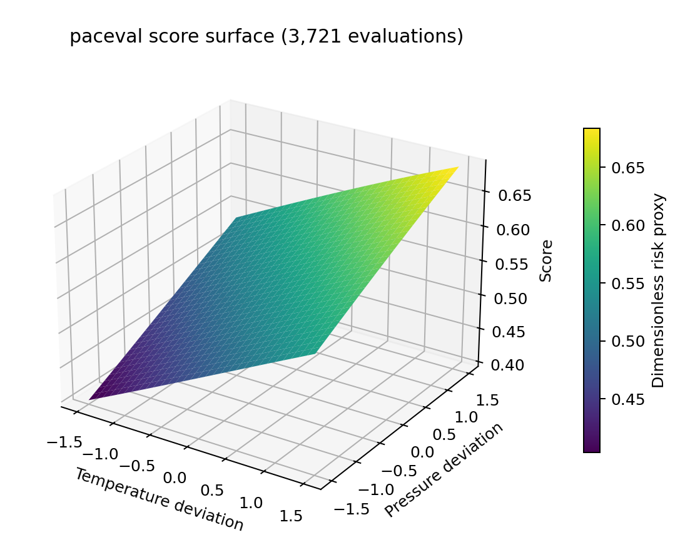
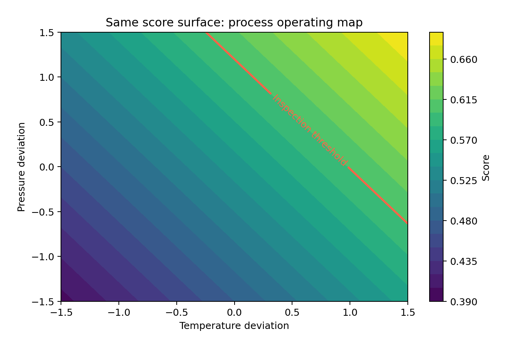

# paceval. | Mathematical Quality and Scrap Scores


**A reproducible industrial research demonstrator for reusable mathematical quality-risk expressions, versioned manufacturing scores, and inspection-routing scenarios using the original paceval C/C++ engine.**

**Verified scope:** 50 distinct score formulas, 51 persistent computation graphs including an immutable version update, 10,000 synthetic process observations, 13,843 scalar paceval evaluations, 1,600 batch checks, and 3,721 paceval-generated three-dimensional surface values. The independent numerical reference is recorded in technical audit files. This study does not claim a validated industrial scrap predictor.

[English research whitepaper](paceval_Quality_Scrap_Scores_Whitepaper_EN.pdf) · [C++ demonstrator](src/quality_scores.cpp) · [CMake](src/CMakeLists.txt) · [Original SDK interface](src/paceval_main.h) · [SDK facade](src/paceval_main.cpp) · [Result verifier](src/verify_results.py)

## 1. Industrial use case and current state of the art

Manufacturers must detect drift in temperature, pressure, speed, vibration, wear, and other process signals before costly nonconforming products proceed to downstream manufacturing or shipment. Quality teams use process control charts, statistical modelling, process capability studies, sensor-based classification, inspection sampling, and machine-learning systems. A score can help prioritize inspection or engineering review, but the underlying decision must reflect the product specification, measurement uncertainty, and failure costs.

This project represents a **hypothetical automated machining line** that generates normalized five-sensor process observations. A catalogue of 50 mathematical quality-scoring rules converts each observation to a dimensionless score. The C++ host applies a declared demonstration threshold of 0.60 and produces an inspection flag. The flag is *not* a machine shutdown, a release decision, or proof that a manufactured item is defective. Independently generated synthetic defect labels permit exploratory diagnostics while deliberately avoiding any claim of a calibrated real-world scrap probability.

For the industrial context, the UCI [SECOM dataset](https://archive.ics.uci.edu/dataset/179/secom) is a relevant example of semiconductor manufacturing pass/fail data and missing sensor readings. The UCI [AI4I 2020 dataset](https://archive.ics.uci.edu/dataset/601/ai4i+2020+predictive+maintenance+dataset) supplies clearly labelled synthetic operating signals and machine-failure outcomes, **not manufacturing scrap labels**. NIST provides authoritative context for [manufacturing measurements](https://www.nist.gov/el) and statistical engineering. These datasets and sources are discussed as future study opportunities; the published numerical outcomes below come solely from the accompanying deterministic synthetic paceval workload.

In the implemented workflow, standardized process measurements feed an allowlisted versioned formula, paceval executes its persistent mathematical expression, and a separate C++ policy layer creates an inspection routing flag. A real deployment would additionally need calibrated models, measurement-system analysis, production validation, and approved quality-control decisions.

## 2. Mathematical score models and paceval execution

Five normalized process features are used: `t` (temperature deviation), `p` (pressure deviation), `s` (speed deviation), `v` (vibration deviation), and `w` (tool-wear deviation). All are dimensionless. The logistic mapping is:

```math
S_j=\frac{1}{1+\exp(-z_j)}
```

Five expression families are instantiated with ten coefficient variants each. The following formulas represent the family structures; coefficients are declared in `examples/score_registry.csv`.

```math
\begin{aligned}
z_1 &= a t+b p+c s+0.35v+0.25w,\\
z_2 &= a t^2+b p^2+c s^2+0.30v-0.70,\\
z_3 &= a tp+b sv+cw+0.12t^2-0.15,\\
z_4 &= a\sin(t)+b\cos(p)+csw+0.30v,\\
z_5 &= a\ln(1+t^2)+b\sqrt{1+p^2}+cvw+0.15s-0.45.
\end{aligned}
```

The host sets a demonstrative inspection-routing rule:

```math
\mathrm{inspect}(S)=
\begin{cases}
1, & S\geq 0.60,\\
0, & S<0.60.
\end{cases}
```

This threshold is an **illustrative policy setting**, not an optimized economic decision or a statistically calibrated cut-off. Individual score values are bounded between zero and one, but that does not make them calibrated probabilities.

The original SDK functions `paceval_InitializeLibrary`, `paceval_CreateComputation`, `paceval_dGetComputationResult`, `paceval_dGetComputationResultExt`, `paceval_DeleteComputation`, and `paceval_FreeLibrary` are used. A 51st graph demonstrates a new formula version without modifying the original. Validation, synthetic-label generation, decision routing, CSV export, and independent reference calculations remain outside paceval.

## 3. Executed numerical research

| Measurement | Verified result |
|---|---:|
| Distinct mathematical score models | 50 |
| Persistent paceval graph handles, including version 2 | 51 |
| Synthetic manufacturing observations | 10,000 |
| Scalar paceval evaluations | 13,843 |
| Batch-evaluated results | 1,600 |
| 3D surface grid evaluations | 3,721 |
| Independent high-precision sample checks | 500, passed |
| Synthetic inspection flags at threshold 0.60 | 2,046 |
| Synthetic positive defect labels | 3,710 |
| CMake / CTest SDK integration | 1 / 1 passed |

The 2,046 inspection flags and 3,710 synthetic labels do not refer to real products. Their disagreement is expected because the scoring rules were not fitted to the independent synthetic label generator. No claims about industrial accuracy, sensitivity, specificity, calibrated scrap probability, or actual manufacturing cost savings follow from these values.

## 4. Scientific and industrial figures

All plotted numerical quantities originate in the released `examples/` CSV outputs generated by the paceval C++ program. Figure 1 visualizes the resulting workload counts; the cover is separately identified as a conceptual illustration.

| Figure | Interpretation | Source files |
|---|---|---|
| 1 | Executed graph, record, batch, and surface scope | [PNG](figures/01_executed_scope.png) · [PDF](figures/01_executed_scope.pdf) |
| 2 | Score distribution and hypothetical inspection threshold | [PNG](figures/02_score_distribution.png) · [PDF](figures/02_score_distribution.pdf) |
| 3 | Inspection-routing response across 50 score models | [PNG](figures/03_inspection_by_model.png) · [PDF](figures/03_inspection_by_model.pdf) |
| 4 | Five score families against separately generated labels | [PNG](figures/04_family_profile.png) · [PDF](figures/04_family_profile.pdf) |
| 5 | 3D mathematical quality-score surface (3,721 values) | [PNG](figures/05_quality_surface_3d.png) · [PDF](figures/05_quality_surface_3d.pdf) |
| 6 | Two-dimensional process-operating contour map | [PNG](figures/06_quality_contours.png) · [PDF](figures/06_quality_contours.pdf) |
| 7 | Controlled formula version and original immutable graph | [PNG](figures/07_versioned_scores.png) · [PDF](figures/07_versioned_scores.pdf) |
| 8 | Exploratory score-bin diagnostic, not calibration validation | [PNG](figures/08_label_diagnostics.png) · [PDF](figures/08_label_diagnostics.pdf) |





## 5. Build and reproduce

The repository includes the original `paceval_main.h` and `paceval_main.cpp` source facade with the adjacent include path adapted to this layout. A compatible Linux `.so` library is required **externally** and is not redistributed.

```bash
cmake -S src -B build -DCMAKE_BUILD_TYPE=Release \
  -DPACEVAL_RUNTIME=/absolute/path/to/libpaceval_linux_sharedLIB.so
cmake --build build -j
ctest --test-dir build --output-on-failure
./build/quality_scores --out reproduced
python3 src/verify_results.py
python3 src/high_precision_reference.py
python3 src/make_figures.py
python3 src/make_whitepaper.py
python3 src/check_readme_math.py
```

The verification and plotting scripts read the shipped `examples/` results by default; a freshly generated `reproduced/` directory is a separate output and does not silently replace publication data. Python numerical/plotting dependencies: `mpmath`, `numpy`, `pandas`, `matplotlib`. PDF authoring uses `reportlab` and `Pillow`.

Reproducible data files: [score registry](examples/score_registry.csv), [10,000 records](examples/quality_records.csv), [score summaries](examples/score_summary.csv), [3D surface](examples/quality_surface.csv), [formula versions](examples/formula_versions.csv), [SDK execution log](results/sdk_execution.txt), [independent decimal audit](results/decimal_audit.json), [structural result audit](results/result_audit.json), and [CTest record](results/ctest_sdk.txt).

## 6. Scientific interpretation and limitations

This project demonstrates expression registration, scalar and packed-batch execution, 50 maintained mathematical policies, and a controlled immutable graph update. It does **not** demonstrate fitted scrap prediction, statistically valid production inspection, industrial model calibration, process intervention, failure-cost optimization, deployment on production equipment, or an actual reduction in waste. Data shifts, missing readings, class imbalance, sensor calibration, and temporal leakage remain important concerns for subsequent studies.

The work intentionally makes **no** processor acceleration, relative calculation-accuracy, production yield, economic value, or market-superiority claim. Numerical verification details are retained as reproducible technical audits rather than used as a comparative marketing exhibit.

## 7. External references

1. UCI Machine Learning Repository. *SECOM manufacturing process dataset.* https://archive.ics.uci.edu/dataset/179/secom
2. UCI Machine Learning Repository. *AI4I 2020 Predictive Maintenance Dataset.* https://doi.org/10.24432/C5HS5C (synthetic machine-failure data; CC BY 4.0).
3. NIST Engineering Laboratory. https://www.nist.gov/el
4. paceval Mathematical Engine, official C/C++ API. https://paceval.com/api/

The research implementation and its claims are limited to the explicitly released synthetic mathematical workload.
