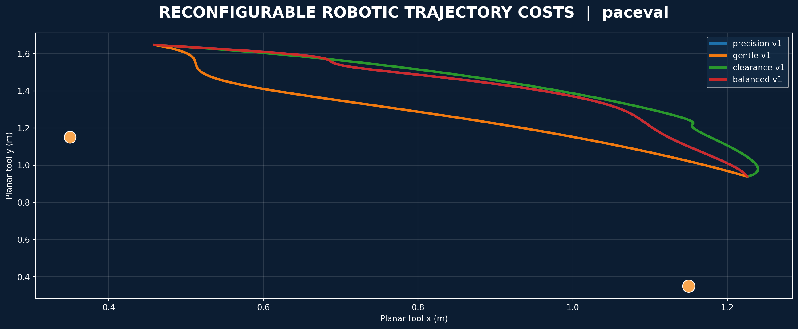
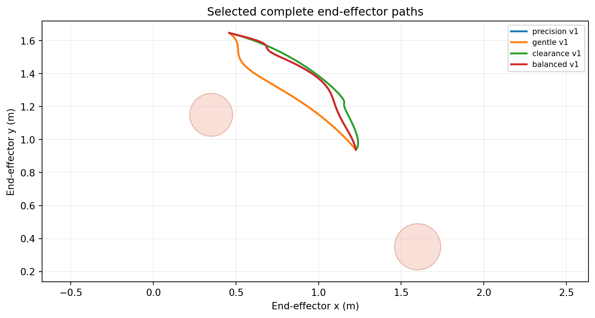
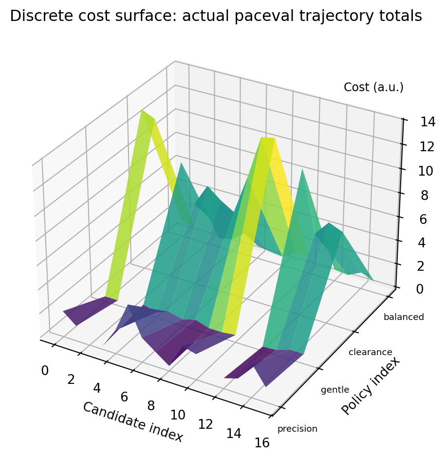

# WP_031 — Reconfigurable Robotic Trajectory Cost Functions with paceval



**Research status:** Implemented and executed using the original paceval C/C++ SDK and compatible Linux runtime, November 2026. This GitHub project extends the earlier *Programmable Mathematics for Robotic Trajectories* feasibility experiment by comparing **complete trajectories under multiple immutable, versioned mathematical cost models**. The illustration above depicts the actually exported synthetic joint-space candidates, not measured industrial robot operation.

**[English research Whitepaper (PDF)](paceval_Reconfigurable_Robotic_Trajectory_Costs_Whitepaper_EN.pdf)** · **[C++ implementation](src/trajectory_costs.cpp)** · **[Original paceval SDK header](src/paceval_main.h)**

## 1. Industrial use case and current state of the art

An industrial robot may need to prioritize tight positioning during assembly, low jerk for careful handling, or larger margins from obstacles in a constrained workcell. The preferred evaluation rule can change between processes, even when the candidate robot paths and scene stay unchanged. A useful robot planning stack therefore separates path generation and physical feasibility from the mathematical expressions used to rank the alternatives.

Modern planning frameworks already support multiple optimization approaches. The [MoveIt 2 STOMP composable task interface](https://github.com/moveit/moveit2/blob/main/moveit_planners/stomp/include/stomp_moveit/stomp_moveit_task.hpp) explicitly accepts trajectory cost and validity callbacks. [MoveIt CHOMP](https://github.com/moveit/moveit2_tutorials/blob/main/doc/how_to_guides/chomp_planner/chomp_planner_tutorial.rst) optimizes trajectories using smoothness and obstacle costs. Jerk-aware industrial trajectory design is also an active research subject, for example [time–jerk optimal trajectory planning (2024)](https://doi.org/10.1002/rob.22298).

**Industrial example.** A hypothetical two-axis robot movement must start and finish at fixed joint configurations. An engineering team supplies sixteen candidate trajectories and asks which one best meets four alternative operating priorities: precision, gentle handling, obstacle clearance or a balanced trade-off. The host generates and checks the candidates, paceval evaluates the registered mathematical scores, and the host selects the lowest-cost feasible complete trajectory. This project tests that arithmetic kernel, not a connected robot controller or a production MoveIt 2 plugin.

## 2. Verified research scope

| Tested capability | Executed outcome |
| --- | ---: |
| Original paceval computation handles | 8 |
| Complete alternative candidate paths | 16 |
| Joint samples per candidate | 51 |
| Distinct original operating priorities | 4 |
| Immutable model versions, including revised gentle preference | 5 |
| Independently checked scalar evaluations | 6,783 |
| Independently checked packed batch results | 320 |
| 80-digit independent high-precision kinematic checks | 510 |
| CMake / CTest original SDK integration | 1/1 passed |

The original SDK execution files are in [examples](examples/trajectory_candidates.csv) and [results](results/results_audit.json). All path rankings are determined over the same frozen finite candidate library and the same finite-sample feasibility filters.

## 3. Defined mathematics and division of work

The planar two-link arm has link lengths $l_1=1.00\,\mathrm{m}$ and $l_2=0.78\,\mathrm{m}$. Its analytic kinematics are:

```math
x(q)=l_1\cos(q_1)+l_2\cos(q_1+q_2)
```

```math
y(q)=l_1\sin(q_1)+l_2\sin(q_1+q_2)
```

The planar Jacobian determinant used as a singularity-proximity indicator is:

```math
D(q)=l_1 l_2\sin(q_2)
```

The complete-path score sums fifty-one time-discrete samples of a configurable per-sample analytical function:

```math
J=\Delta t\sum_{i=0}^{50}\left[
w_p\lVert p(q_i)-p_i^{\mathrm{target}}\rVert^2
+w_v\lVert v_i\rVert^2
+w_a\lVert a_i\rVert^2
+w_j\lVert j_i\rVert^2
+\frac{w_o}{0.05+c_i^2}
+\frac{w_s}{0.1+D(q_i)^2}
\right]
```

Here $v_i$, $a_i$ and $j_i$ are finite-difference joint velocity, acceleration and jerk, and $c_i$ is the smallest sampled squared link-segment-to-padded-disk margin in $\mathrm{m}^2$. The weights and regularizers are synthetic and define an **illustrative composite score**, not a calibrated SI physical cost. The interval $\Delta t=0.08\,\mathrm{s}$ gives a four-second sampled movement. The finite-sample constraints also bound velocity, acceleration and $|D(q)|$.

**What paceval actually computes:** three kinematic expression graphs (x, y, Jacobian determinant) and five complete per-sample scoring expressions, evaluated in scalar and packed batch modes through reusable handles. An immutable change to the jerk weighting creates a new fifth policy expression while the original remains callable.

**What C++ owns:** candidate trajectory generation, joint finite differences, host-based 2D closest-point/clearance checks, feasibility decisions, trapezoid-free fixed-step cost summation, full-path selection and CSV output. The fixed-step sum is rectangle-rule-like; no integral convergence or global trajectory optimum is claimed.

## 4. Actual industrially interpretable results

The complete candidate chosen by each cost version is reproduced in [selected_trajectories.csv](examples/selected_trajectories.csv):

| Operating priority | Selected full candidate |
| --- | ---: |
| Precision v1 | 3 |
| Gentle v1 | 12 |
| Obstacle clearance v1 | 4 |
| Balanced v1 | 3 |
| Gentle v2, altered jerk weighting | 12 |

Changing the mathematical objective changes the selected route in this defined example. The new and previous gentle expressions remain simultaneously available; they can select the same path while producing distinct numerical score profiles. This is **not** evidence of performance advantage, globally optimal planning or safety certification.

## 5. Scientific diagrams generated from paceval outputs

Each numbered plot is regenerated from the CSV files emitted by the actual original-SDK run, and is included as PNG and vector PDF.

| Study figure | PNG | Vector PDF |
| --- | --- | --- |
| Selected end-effector paths | [01](figures/01_selected_cartesian_paths.png) | [PDF](figures/01_selected_cartesian_paths.pdf) |
| Joint-space paths | [02](figures/02_joint_space_paths.png) | [PDF](figures/02_joint_space_paths.pdf) |
| Time-dependent cost profiles | [03](figures/03_cost_profiles.png) | [PDF](figures/03_cost_profiles.pdf) |
| Sampled obstacle clearances | [04](figures/04_sampled_clearance.png) | [PDF](figures/04_sampled_clearance.pdf) |
| Discrete full-candidate rankings | [05](figures/05_policy_candidate_costs.png) | [PDF](figures/05_policy_candidate_costs.pdf) |
| Joint position versus time | [06](figures/06_joint_time_profiles.png) | [PDF](figures/06_joint_time_profiles.pdf) |
| Immutable formula revision | [07](figures/07_immutable_revision.png) | [PDF](figures/07_immutable_revision.pdf) |
| 3D discrete cost surface | [08](figures/08_discrete_cost_surface.png) | [PDF](figures/08_discrete_cost_surface.pdf) |





## 6. Build, run and independently reproduce

Requirements: C++17 compiler, CMake, a compatible **original** paceval Linux runtime supplied separately, and Python 3 with Matplotlib, NumPy and mpmath for figure/report and precision checks. No substitute paceval engine is included.

```bash
cmake -S src -B build -DCMAKE_BUILD_TYPE=Release \
  -DPACEVAL_RUNTIME=/absolute/path/to/libpaceval_linux_sharedLIB.so
cmake --build build -j
ctest --test-dir build --output-on-failure
./build/trajectory_costs --out examples
python3 src/verify_results.py
python3 src/high_precision_reference.py
python3 src/make_figures.py
python3 src/make_whitepaper.py
python3 src/check_readme_math.py
```

The C++ example writes [formula registry](examples/formula_registry.csv), [complete candidate scores](examples/trajectory_candidates.csv), [selected complete paths](examples/selected_path_points.csv), [selected policy summaries](examples/selected_trajectories.csv) and [technical numerical audit](examples/numeric_audit.csv). Independent checks produce [result audit](results/results_audit.json) and [80-digit audit](results/high_precision_audit.json). Reproducibility run summaries are included in [SDK log](results/sdk_execution.txt) and [CTest log](results/ctest_sdk.txt).

## 7. Research limitations and technical next step

The project is a **two-dimensional, two-joint, synthetic** full-candidate-scoring experiment. Obstacles are padded circles and robot links are zero-thickness centerlines. Constraints are checked only at finite sampled instants. There is no certified continuous-time clearance, rigid-body actuator dynamics, torque control, actual robot hardware, global path optimizer or verified integration with MoveIt 2.

The next research stage could wrap the paceval mathematical cost graph in a real MoveIt 2 STOMP cost/validity callback while retaining independent planning-scene collision checks and robot-specific calibration. This **has not yet been implemented or tested**.

## 8. Scientific and SDK references

- [MoveIt 2 STOMP callback interface](https://github.com/moveit/moveit2/blob/main/moveit_planners/stomp/include/stomp_moveit/stomp_moveit_task.hpp)
- [MoveIt 2 CHOMP trajectory optimization](https://github.com/moveit/moveit2_tutorials/blob/main/doc/how_to_guides/chomp_planner/chomp_planner_tutorial.rst)
- [Time–jerk optimal trajectory planning for industrial robots (2024)](https://doi.org/10.1002/rob.22298)
- [Original paceval open-source SDK project](https://github.com/paceval/paceval)

The vendor notices in the original SDK source files remain intact. There is no additional LICENSE_NOTICE.md and no externally supplied shared library in this repository.
