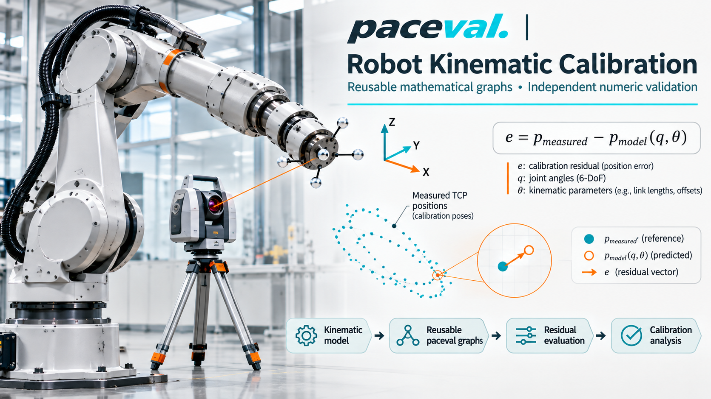
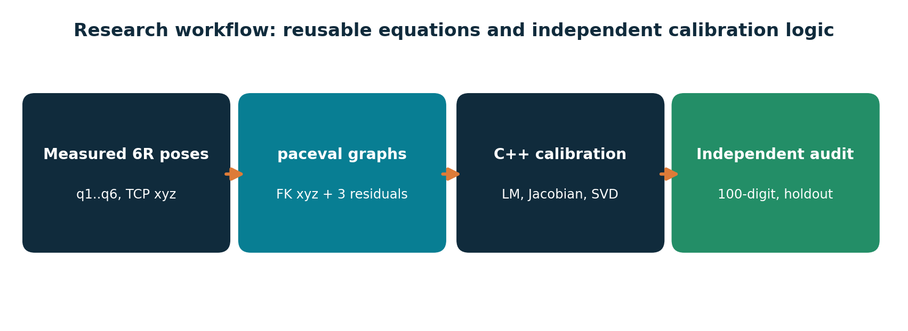
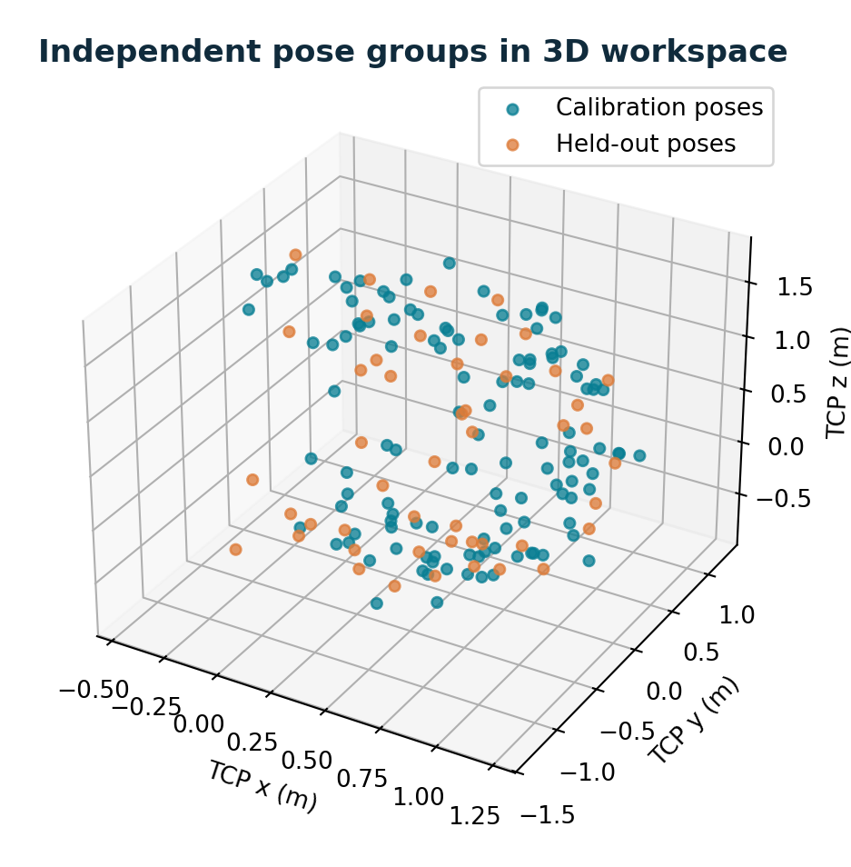
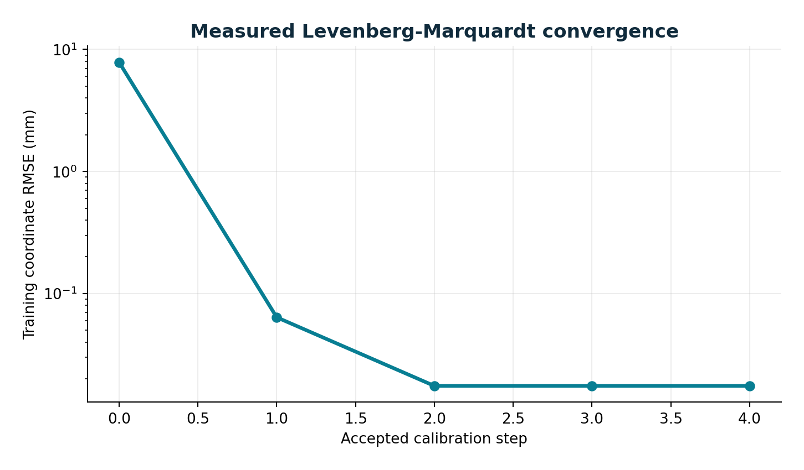
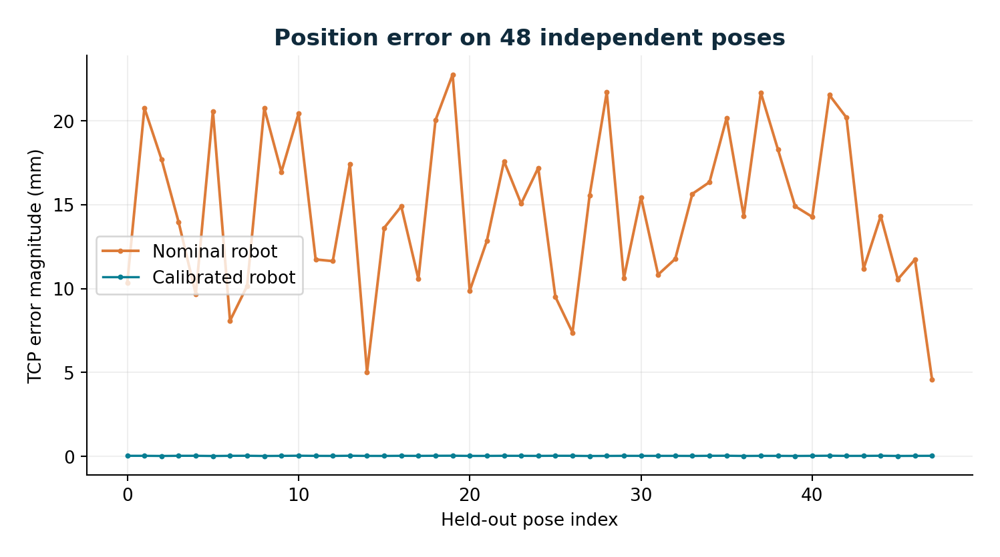
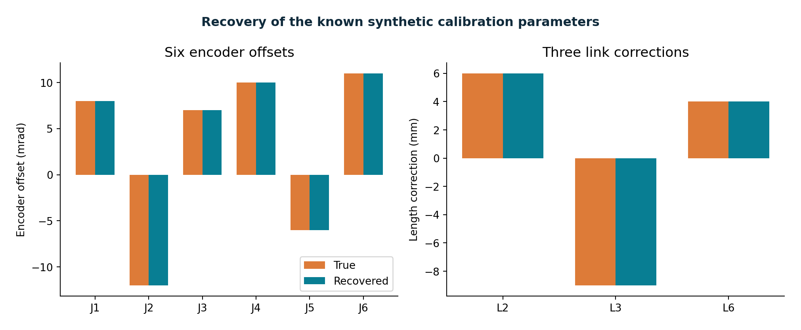
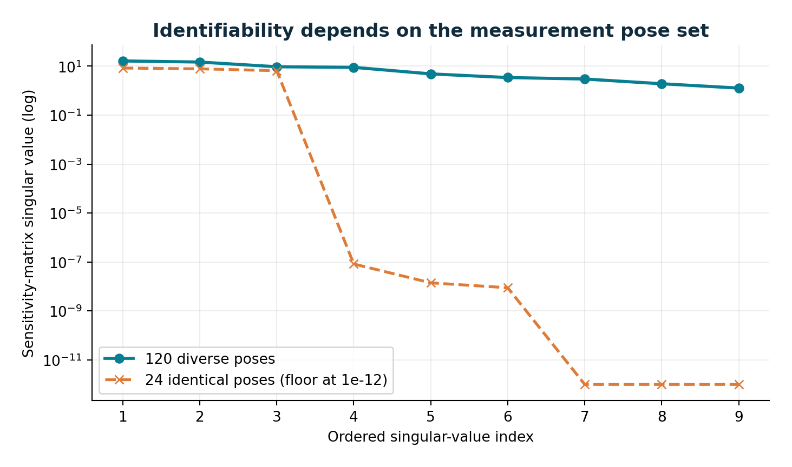
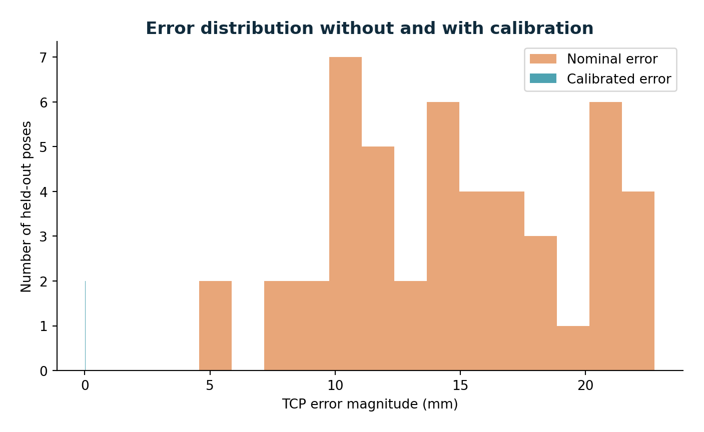
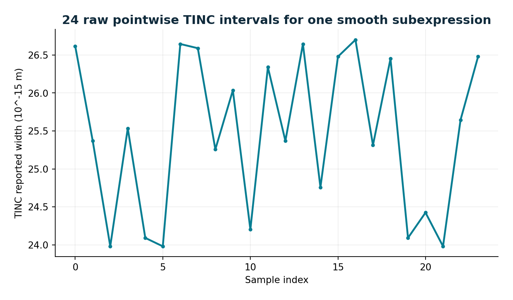
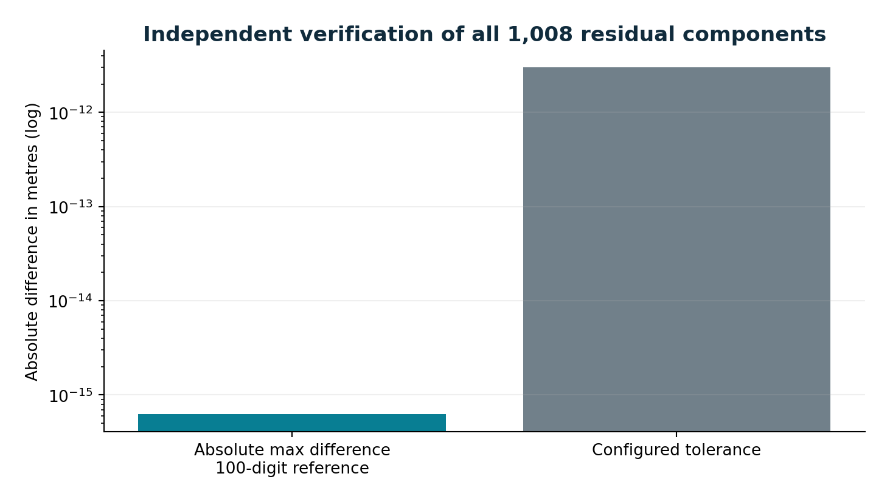

# paceval | Parameterized Robot Calibration Residuals



**An experimentally verified, C++-based research demonstrator of reusable 6-axis robot kinematic residuals and position-only parameter calibration using the original paceval Mathematical Engine.**

The application calculates forward kinematics and measured-minus-predicted Cartesian residuals with six persistent paceval execution graphs. A separate C++ Levenberg-Marquardt optimizer identifies six encoder offsets and three link-length corrections; an independent matrix-kinematics implementation and a 100-digit reference independently validate the calculations. Synthetic measurements, full source, audit reports and charts are included.

[English research whitepaper](paceval_Robot_Calibration_Whitepaper_EN.pdf) · [Source code](src/robot_calibration.cpp) · [CMake build](src/CMakeLists.txt) · [Verified example results](examples/summary.json)

## Scientific scope and mathematical model

The experiment uses an explicitly documented **six revolute-joint, three-dimensional position model**. Local joint rotations follow `Z-Y-Y-X-Y-Z` in the fixed base/tool-frame convention used by the program; subsequent link translations are either along local Z (links 1 and 4) or along local X (links 2, 3, 5 and 6). This illustrative kinematic chain is not claimed to be the geometry of a commercial robot.

The measured tool-center-point (TCP) position is modeled as

\[
\mathbf r_i = \mathbf p^{\mathrm{measured}}_i - \mathbf f(\mathbf q_i,\boldsymbol\theta),\quad
\boldsymbol\theta=(o_1,\ldots,o_6,\Delta l_2,\Delta l_3,\Delta l_6).
\]

Every `q` and encoder offset is in **radians**, every length and coordinate in **metres**. The base coordinate system, link-length values other than `l2,l3,l6`, and tool frame are fixed; the calibration fits **position measurements only**, not full six-dimensional end-effector poses. There is no separate base-frame registration or orientation-error identification.

### What paceval actually computes

The [generated mathematical formulas](src/generated_formulas.h) contain three symbolic expressions for Cartesian TCP position and three for **signed Cartesian residual components**. They are reproducibly derived with the optional [SymPy generator](src/generate_formulas.py), but no Python dependency is needed at runtime. The original [SDK header](src/paceval_main.h) and [SDK C++ implementation](src/paceval_main.cpp) are compiled directly with the application, which links the independently provided Linux engine `.so`.

Persistent handles are created with `paceval_CreateComputation`. `paceval_dGetMultipleComputationsResultsExt` evaluates the three residual graphs for batches of observed poses and repeatedly for new parameter vectors during calibration and Jacobian finite differences. Separate position graphs are used for the native-model agreement test. `paceval_dGetComputationResult` provides the pointwise TINC subexpression samples. Handles are deleted and the library is released upon shutdown.

The C++ host owns measurement loading, normal-equation assembly, the bounded damped least-squares parameter update, finite-difference step sizes, the pose-design diagnostic, output CSVs and experiment orchestration. It does **not** substitute its native forward-kinematics implementation for the paceval results inside the solver.



## Reproducible results

The deterministic default experiment creates 120 calibration poses, 48 separate holdout poses, and 24 deliberately identical, non-informative poses. The synthetic ground truth has small encoder-offset and link-length errors plus bounded sinusoidal coordinate noise. All numeric results below were obtained with the separately supplied **original paceval 4.25 Linux runtime** on x86-64 Linux.

| Independent observation | Verified result |
|---|---:|
| Persistent ordinary paceval graphs | 6 (3 position, 3 residual) |
| Additional pointwise TINC graph | 1 |
| Fitted calibration parameters | 9 |
| Calibration / holdout / degenerate pose records | 120 / 48 / 24 |
| Holdout coordinate RMSE, nominal | **8.85665 mm** |
| Holdout coordinate RMSE, calibrated | **0.017797 mm** |
| Accepted Levenberg-Marquardt update steps | 4 |
| Independent 100-digit residual checks | **1,008 / 1,008** |
| Maximum absolute high-precision residual discrepancy | **6.26 × 10^-16 m** |
| Raw TINC inclusions on the smooth kinematic term | **24 / 24** |
| Minimum singular value, diverse training poses | **1.2766** |
| Minimum singular value, identical poses | **0** (rank-deficient) |

The modest remaining fitted residual is consistent with the synthetic noise in this controlled example; these results do not imply equivalent accuracy for physical metrology systems. The TINC check covers `l2*cos(q2+o2)` at the 24 supplied binary64 samples, not an interval guarantee for the entire six-axis calibration.










### Model identifiability is tested, not assumed

The host derives the 3-by-9 residual sensitivity matrix for each measured pose by **central finite differences of paceval-calculated residuals**, assembles its normal matrix, and identifies nine parameter updates with a damped Gauss-Newton/Levenberg-Marquardt scheme. It computes singular values for the full pose stack and a repeated-pose control. The training experiment has full numerical column rank; 24 identical poses are rank-deficient. The diagnostic concerns *calibration parameters* and is distinct from a robot's instantaneous manipulator-Jacobian singularity.

The solved parameters remain inside predefined demonstration bounds, and no held-out measurements enter parameter fitting. Training and holdout results are exported separately. Reusing the same six formula graphs for the nominal and calibrated parameter versions demonstrates the benefit of **parameterized reusable mathematical models** without claiming a speedup.

## Build and run

**Requirements:** Linux x86-64, C++17 compiler, CMake >= 3.16, and a compatible original paceval Linux shared runtime supplied **separately**. Python 3 with `numpy`, `mpmath`, `matplotlib` and `sympy` is needed only for optional audits, chart/formula regeneration (`sympy` only for regeneration). The `.so` is deliberately not bundled.

From the extracted repository root:

```bash
export PACEVAL_LIB="/absolute/path/to/libpaceval_linux_sharedLIB.so"
cmake -S src -B build -DCMAKE_BUILD_TYPE=Release
cmake --build build --parallel
ctest --test-dir build --output-on-failure
./build/robot_calibration --out results --batch 128
python3 src/validate_outputs.py --examples results
python3 src/make_figures.py --examples results --figures figures
```

The primary run regenerates all CSV files and `summary.json`. To regenerate the committed 100-digit audit, run the `validate_outputs.py` command; its output is also written as `high_precision_audit.json`. If Python's optional packages are unavailable, the C++ binary and its first two CTests remain usable.

### Import your own measurement CSVs

Use a header exactly equal to `split,id,q1,q2,q3,q4,q5,q6,mx_m,my_m,mz_m` with strictly increasing IDs. Two separate files must identify `training` and `holdout` rows; all coordinates must be finite, radians within `[-pi, pi]`, positions within the research input envelope, and each split must contain at least 12 observations. The included CSVs demonstrate this format:

```bash
./build/robot_calibration \
  --train-csv examples/training_observations.csv \
  --holdout-csv examples/holdout_observations.csv \
  --out replay --batch 37
```

Replaying the supplied CSV inputs produces **byte-identical train/holdout predictions and calibration history**. The [CSV validation tests](src/test_csv_validation.py) also reject nonfinite inputs, illegal joint angles and misplaced split names. External CSV imports are a software interface demonstration: no physical sensor measurements were used in the reported results, and the synthetic `true` parameter field is not populated for external data.

### Files

- [`src/`](src/) contains the direct SDK integration, CMake, 6R calibration C++ code and independent Python scripts.
- [`examples/training_observations.csv`](examples/training_observations.csv) and [`examples/holdout_observations.csv`](examples/holdout_observations.csv) provide separate observation splits.
- [`examples/degenerate_observations.csv`](examples/degenerate_observations.csv) records the intentionally uninformative pose set.
- [`examples/train_predictions.csv`](examples/train_predictions.csv) and [`examples/holdout_predictions.csv`](examples/holdout_predictions.csv) contain measured Cartesian residuals before and after fitting.
- [`examples/parameters.csv`](examples/parameters.csv), [`examples/calibration_trace.csv`](examples/calibration_trace.csv) and [`examples/observability.csv`](examples/observability.csv) document parameter estimates, convergence and rank diagnostics.
- [`examples/tinc_samples.csv`](examples/tinc_samples.csv) and [`examples/high_precision_audit.json`](examples/high_precision_audit.json) contain the numerical audit.
- [`figures/`](figures/) provides the complete hero image plus nine directly reproducible PNG/SVG research diagrams.

## Scientific interpretation and references

Kinematic parameter identification, joint-axis geometry and informative measurement poses are central themes in modern six-axis robot calibration. This illustrative **position-only** experiment establishes correct and reusable mathematical execution inside that research workflow. It is not a full pose-calibration method, a field-validated industrial measurement system, an absolute robot accuracy certification or a physically deployed optimizer. The optimizer's statistical properties and performance under actual sensor errors would require an independent study.

Research references: [Modern Robotics, Lynch & Park](https://modernrobotics.northwestern.edu/nu-gm-book-resource/4-1-2-product-of-exponentials-formula-in-the-end-effector-frame/); [Okamura and Park, Kinematic calibration using POE, Robotica (2009)](https://www.cambridge.org/core/journals/robotica/article/kinematic-calibration-using-the-product-of-exponentials-formula/8D1CCCF7F714A624B26FE37042432B5A); [Six-DOF robot calibration with distance constraints, Measurement (2024)](https://www.sciencedirect.com/science/article/pii/S0263224124007917); [paceval C/C++ API](https://paceval.com/api/).

**Research release:** November 12, 2026. All source examples are for mathematical research and educational reproducibility. The original license notices in the two vendor SDK files are unchanged; no separate `LICENSE_NOTICE.md` is created.
