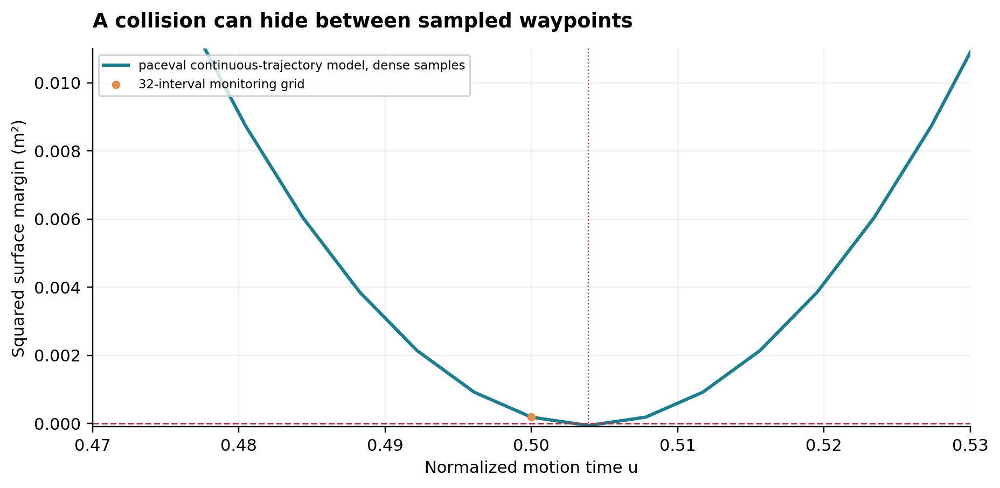
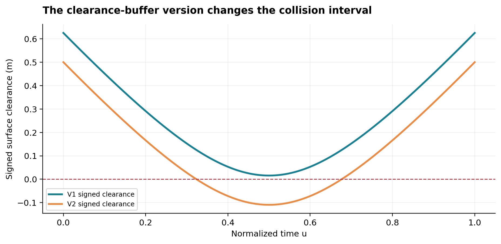
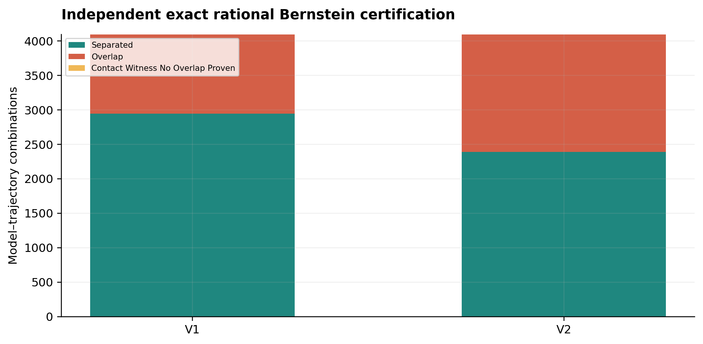
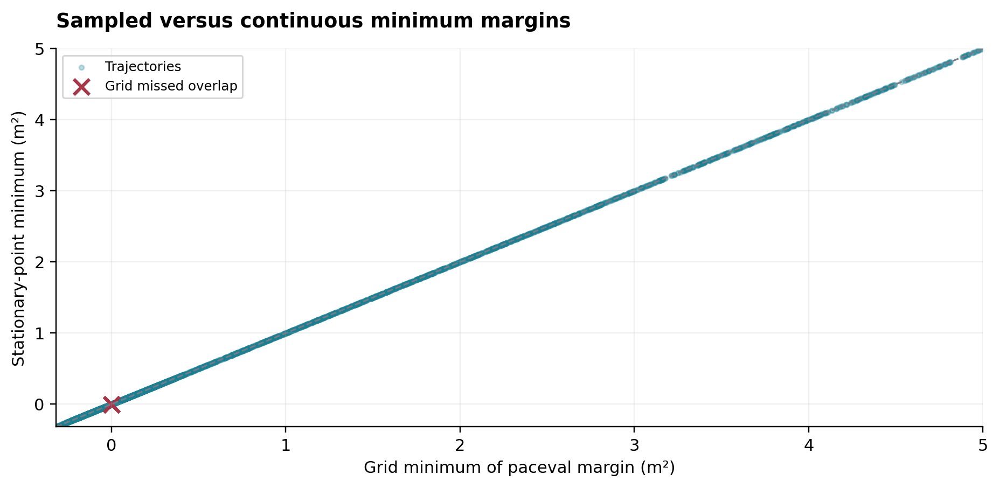
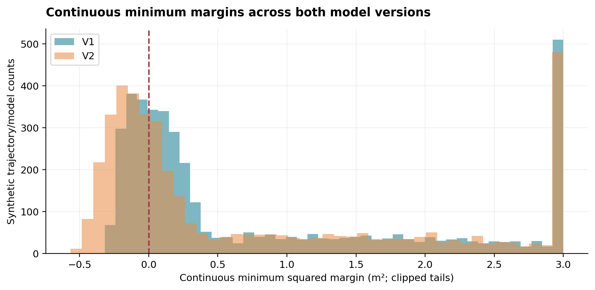
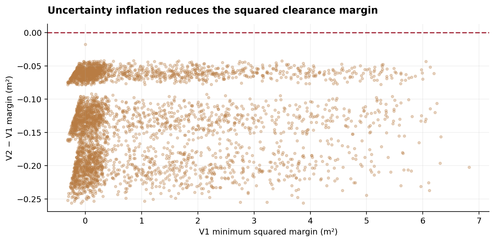
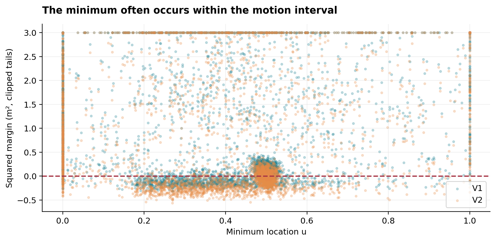
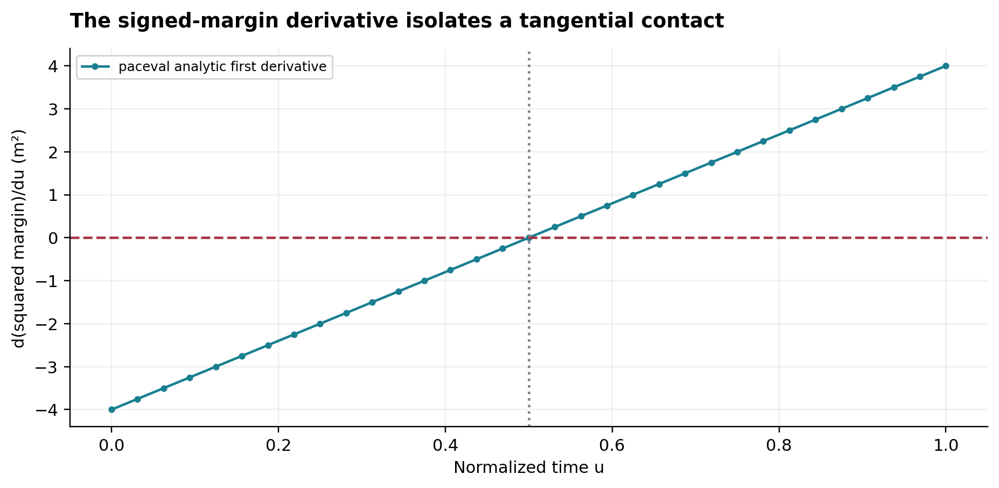
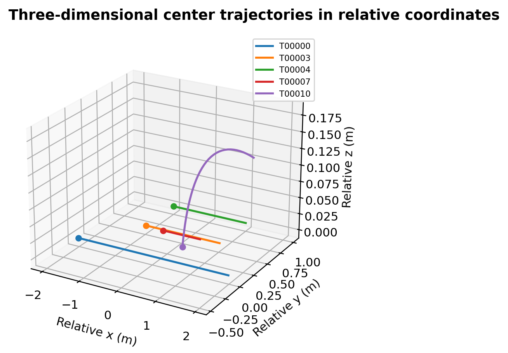
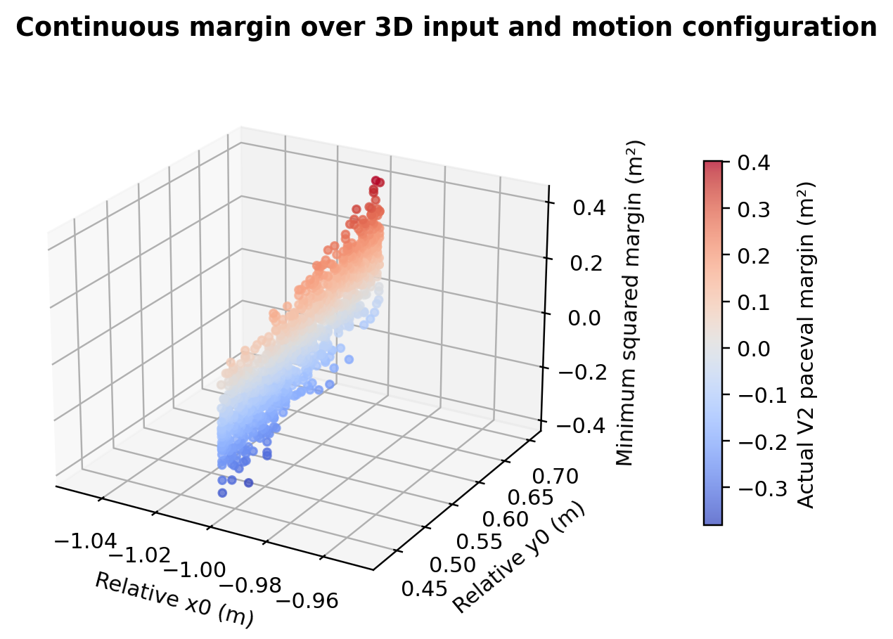

# Continuous Robot Swept-Volume Collision Margin Verification with paceval


**WP 26 | Robotics and automation | Original paceval 4.25 | Independent mathematical research demonstrator**

This project investigates whether explicit, reusable mathematical graphs can evaluate three-dimensional continuous-time collision-clearance expressions for moving bounding spheres. The original paceval engine evaluates physical formulas, derivatives, geometric margins, sensitivity expressions, logical guards and version comparisons. A C++ host locates stationary points. An independent **exact rational Bernstein** verifier separately determines whether the resulting degree-four polynomial is strictly positive throughout the entire motion interval or has a nonpositive witness. These computations were executed with the supplied original Linux x86-64 library, not substituted by an emulation.

**Scope:** This is a mathematically certified subproblem for two idealized spherical bounds moving along quadratic relative-center trajectories. It is not robot-system functional-safety certification, full articulated-body swept-mesh collision detection, a stopping-distance analysis or a validated real-world trajectory controller. The cover is a conceptual illustration.

## 1. Industrial use case and current state of the art

Motion planners in collaborative and industrial robot cells need to detect not only occupied space at selected waypoints but also possible intersections between those waypoints. This matters for two moving end-effectors, tool fixtures or conservatively bounded moving obstacles. A trajectory can miss all sampled collision positions while still briefly intersecting another moving object's swept region. A useful implementation begins with validated geometry and trajectories, evaluates continuous clearance, and passes a justified candidate classification to an independent cell safety and motion-planning architecture.

The Flexible Collision Library (FCL) supports continuous collision detection and contact queries, while MoveIt uses FCL and Bullet as collision-checking back ends [1, 2]. The MoveIt OMPL interface documentation explicitly identifies discretization limits in edge checks [3]. Recent research includes swept-volume neural collision detection (Jung et al., CoRL 2025) and continuous distance-based approaches (2026) [4, 5]. These technologies address broader geometry and motion domains than this experiment. The distinctive paceval question is whether an independently checkable analytic mathematical kernel can be evaluated repeatedly and versioned with the original execution-graph API.

ISO 10218-1:2025 and ISO 10218-2:2025 are key current industrial robot safety standards [6]. Their complete functional-safety, application-risk and validation requirements are **not** satisfied merely by proving one geometric inequality. ISO/TS 15066:2016 is also relevant to collaboration [7]. The focus here is a narrowly defined research verification step, not permission to actuate a robot.

## 2. Physical model and the source research question

The supplied original WP 26 describes a two-dimensional quadratic relative path, its squared distance margin, its derivative and continuous minimization. This study extends the relative motion to three dimensions, retains two persistent model versions, adds explicit sensitivities and detailed batch evaluation, and introduces an independent exact-interval method. The normalized time $u=t/T$ lies in $[0,1]$, with the demonstration taking $T=1$ second. The coefficients are expressed in metres for this normalized-time convention:

```math
p_j(u)=a_{j0}+a_{j1}u+a_{j2}u^2, \qquad j\in\{x,y,z\}.
```

Let $R_1=r_1+r_2$ and $R_2=r_1+r_2+b$, where $b\geq 0$ is a specified geometric clearance buffer. The nonnegative squared distance $D(u)$ and the **signed squared margin** are:

```math
D(u)=p_x(u)^2+p_y(u)^2+p_z(u)^2,\qquad
F_v(u)=D(u)-R_v^2.
```

$F_v(u)>0$ is strict separation of the idealized spheres, $F_v(u)=0$ is tangency and $F_v(u)<0$ is overlap. The familiar signed surface clearance is $c_v(u)=\sqrt{D(u)}-R_v$. Its sign agrees with $F_v$ when $R_v>0$. The time derivative that locates stationary points is:

```math
F_v'(u)=2\sum_{j\in\{x,y,z\}}p_j(u)(a_{j1}+2a_{j2}u).
```

$F_v$ is a quartic polynomial in $u$ and its derivative is cubic. For these *particular trajectories*, the global minimum is attained at an interval endpoint or a stationary point. The C++ host isolates all real roots of the cubic derivative within $[0,1]$ and evaluates each candidate's margin **through paceval**, rather than computing the final margin natively. Stationary-point isolation is a numerical host algorithm, not a built-in paceval solver.

### What the full-interval proof actually establishes

The separate Python verifier creates exact rational polynomial coefficients from the deliberately dyadic inputs, translates them to degree-four Bernstein form and recursively subdivides intervals with exact rational arithmetic. A subinterval is **strictly separated** if all Bernstein control coefficients are strictly positive. An exact negative rational evaluation is a valid **overlap witness**. An exact zero witness means a contact exists; the verifier checks other intervals before classifying it as a contact-only case. If a subdivision cannot resolve an interval by its predefined depth, it reports `UNRESOLVED` rather than asserting safety. This is a mathematical argument for the exact input polynomial, not a claim that paceval pointwise TINC proves a range property.

For this fixed dataset, the verifier resolved every case. The paceval numeric results were also independently checked with native C++ and 90-decimal mpmath reference calculations. These are **different levels of evidence**, not interchangeable claims of system safety.

## 3. Real numerical research results

The following quantities are read from [execution_evidence.json](results/execution_evidence.json), [exact_interval_audit.json](results/exact_interval_audit.json) and [high_precision_audit.json](results/high_precision_audit.json). All 4,096 trajectory pairs are synthetic with exact multiples of 1/256 metre.

| Evidence dimension | Recorded outcome |
|:--|--:|
| Unique domain graphs executed (V1, V2, version comparison) | 43 / 43 |
| Distinct motion scenarios | 4,096 |
| Version–scenario combinations examined | 8,192 |
| Exact rational Bernstein interval decisions | 8,192 |
| Independent native output assertions | 2,443 |
| Independent high-precision checks (90 decimal places) | 2,600 |
| Coarse 32-step grid overlaps missed (V1 / V2) | 2 / 3 |
| Model V1: strict separation / overlap / tangent | 2,945 / 1,148 / 3 |
| Model V2: strict separation / overlap / tangent | 2,391 / 1,705 / 0 |
| Unresolved exact-bound cases | 0 |

A deliberately constructed test has $p_x(u)=-2.015625+4u$, $p_y=p_z=0$ and total nominal radius $R_1=0.0078125$ m. The continuous minimum is at $u=0.50390625$ and $F_1=-0.00006103515625$ m², whereas the 32-interval grid gives a **positive** minimum, $0.00018310546875$ m². This directly exhibits a missed narrow collision. Another test creates exact tangency at $u=0.5$ in V1 but overlap in V2 when the buffer is included.







## 4. Execution responsibility: paceval and the C++ host

| Mathematical function / industrial purpose | Actual implementation | Version or rationale |
|:--|:--|:--|
| Three-axis center position and relative velocity | Actual paceval computation graphs | V1 and V2 |
| Center distance and signed surface clearance | Actual paceval computation graphs | V1 and V2 |
| Squared margin and first/second time derivatives | Actual paceval computation graphs | V1 and V2 |
| Negative margin penalty and normalized score | Actual paceval computation graphs | V1 and V2 |
| Explicit sensitivities to path coefficients and buffer | Actual paceval computation graphs | V1 and V2 |
| Parenthesized Boolean pointwise feasibility | Actual paceval computation graphs | V1 and V2; **pointwise only** |
| Between-version margin, clearance and Boolean comparison | Actual paceval computation graphs | COMPARE |
| Endpoints and stationary-point isolation | C++ host | Stateful root isolation of cubic polynomial |
| Global candidate selection | C++ host | Select minimum among paceval-evaluated values |
| Exact full-interval mathematical classification | Independent Python verifier | Fraction/Bernstein, deliberately separate proof path |
| Decimal CSV input/output conversion | Original paceval SDK functions | Strict literal/schema checks before conversion |
| Independent numerical checking | C++ and mpmath | Validation only, not production formula results |

The complete machine-readable [formula manifest](results/formula_manifest.csv) and [mathematical execution inventory](results/math_execution_inventory.csv) identify every graph, mathematical expression, version and execution owner. All actual main run results are produced with scalar and multi-graph-batch calls to the **original** paceval SDK 4.25. Version 1 and Version 2 handles remain independently accessible; the second version adds the geometric buffer to the collision radius. A batch-output-order probe is executed before each full run. Operator selftests check arithmetic, `AND`/`OR`/`NOT`, comparisons, infix `min`/`max`, signed `%` and mathematical `mod`.

The application uses `paceval_dConvertStringToFloat` only after validating each input CSV number as a decimal literal. An apparent numeric cell such as `1+2` is rejected rather than evaluated as an expression. `paceval_dConvertFloatToString` serializes numerical scientific CSV results; this text serialization is not claimed to preserve every arbitrary double's bits. Input coefficients in the published dataset are exact binary fractions, which also makes independent rational certification unambiguous.

## 5. Reproduce the experiment on Linux x86-64

Provide your own compatible original `libpaceval_linux_sharedLIB.so`. **The shared runtime is intentionally excluded from this publication.** The original `paceval_main.h` and `paceval_main.cpp` are provided under `src/`, with only the relative include location adjusted for project integration.

```bash
python3 scripts/generate_input.py
cmake -S src -B build -DCMAKE_BUILD_TYPE=Release \
  -DPACEVAL_RUNTIME=/absolute/path/to/libpaceval_linux_sharedLIB.so
cmake --build build -j
ctest --test-dir build --output-on-failure
./build/robot_continuous --run input/cases.csv results
python3 scripts/verify_interval_exact.py results input/cases.csv
python3 scripts/verify_high_precision.py results input/cases.csv
python3 scripts/make_figures.py
python3 scripts/make_whitepaper.py
python3 scripts/check_release.py .
```

Python prerequisites are in [requirements.txt](requirements.txt). Input and result schemas are described in [CSV_SCHEMA.md](docs/CSV_SCHEMA.md) and assumptions in [MODEL_SPECIFICATION.md](docs/MODEL_SPECIFICATION.md). The original proposal is retained [here](docs/original_WP26_brief.pdf). Technical failure logs and test limits are documented in [RESEARCH_VALIDATION.md](RESEARCH_VALIDATION.md). A GitHub-compatible archive-wide Markdown math and link checker validates every `.md` file, including negative regression cases; no online GitHub-rendered preview is claimed.

## 6. Scientific results and illustrations

The saved figures are direct visualizations of the actual paceval CSV records and the independently computed exact rational certificates. Each chart also has a vector PDF version.















## 7. Limitations and practical next steps

Sphere bounds are deliberately simple, do not reproduce the articulated links, collision meshes, joint limits, self-collision geometry, controller dynamics or emergency stops of a robot cell, and their assumed radius buffers are not calibrated. The quadratic center paths are predefined mathematical inputs rather than kinematic trajectories derived from a robot controller. Exact interval proof is given **only for the degree-four polynomial and exactly represented input coefficients**; it cannot independently establish the correctness of physical geometry, numerical robot-command execution, measurement errors or installed safeguards. Tangency is not considered strict separation.

A practical follow-up would ingest logged joint trajectories, apply verified forward kinematics and conservative per-link collision volumes, and validate continuous pairwise bounds against a specialist CCD implementation such as FCL and against physically measured robot clearances. A separate functional-safety engineering process is required for industrial use. The original source's proposed go/no-go economic or throughput thresholds are intentionally not reported here, consistent with the functionality-first Master Prompt v3.1.

## 8. Sources

See [RESEARCH_SOURCES.md](docs/RESEARCH_SOURCES.md) for dated source descriptions and direct links, and [LICENSE_NOTICES.md](LICENSE_NOTICES.md) for redistribution notes. Key references: [1] [FCL / ROS](https://index.ros.org/p/fcl/); [2] [MoveIt concepts](https://moveit.ai/documentation/concepts/developer_concepts/); [3] [MoveIt OMPL discretization](https://moveit.github.io/moveit_tutorials/doc/ompl_interface/ompl_interface_tutorial.html); [4] [Jung et al., NeuralSVCD, CoRL 2025](https://proceedings.mlr.press/v305/jung25e.html); [5] [Robot distance fields, Robotics and Autonomous Systems 2026](https://doi.org/10.1016/j.robot.2026.105394); [6] [ISO robotics standards](https://www.iso.org/sectors/engineering/robotics); [7] [ISO/TS 15066:2016](https://committee.iso.org/standard/62996.html); [8] [Bernstein polynomial bounds, Reliable Computing](https://interval.louisiana.edu/reliable-computing-journal/volume-14/reliable-computing-14-pp-117-137.pdf); [9] [paceval API](https://paceval.com/api/).
