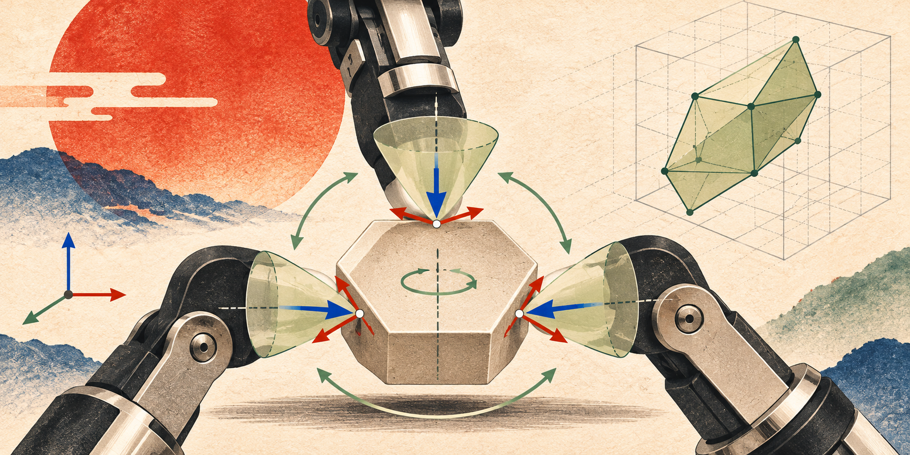
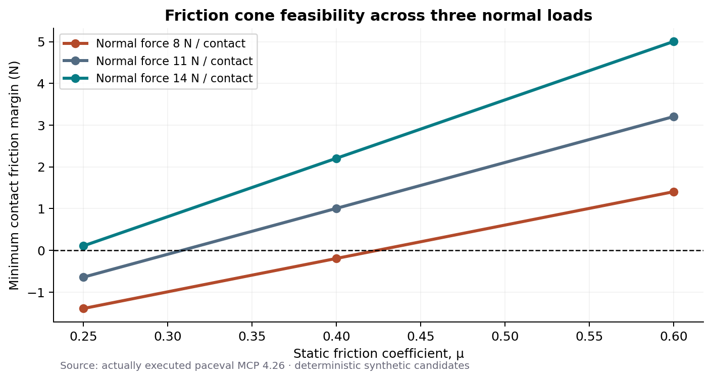
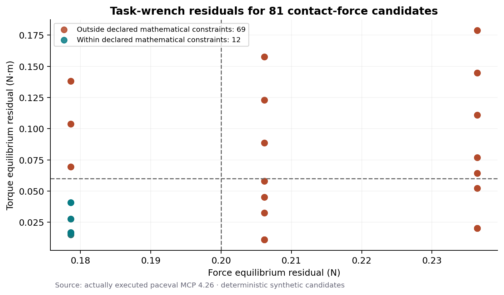
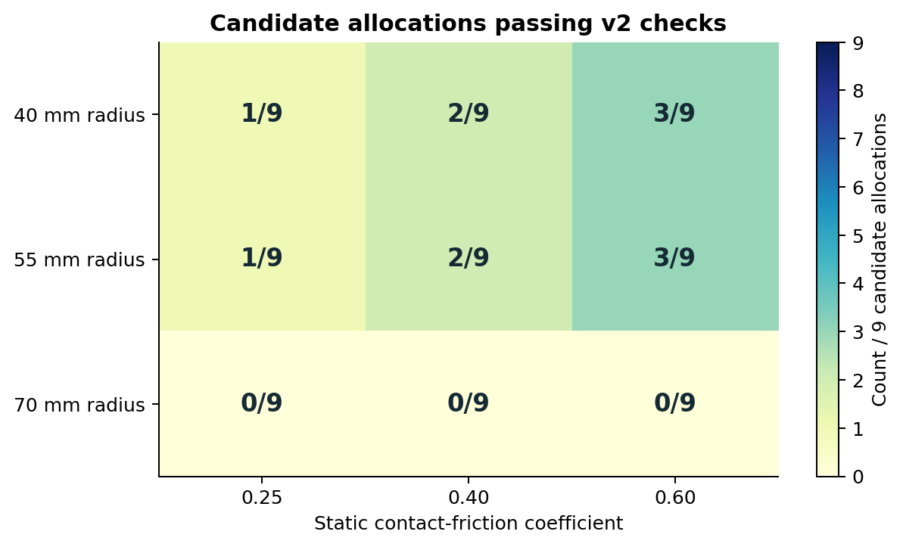

# Programmable Robotic Grasp Contact-Wrench Feasibility with paceval



*Industrial and scientific mathematical demonstrator | 15 November 2026 | Synthetic three-contact grasp experiment*

A robot that lifts a component must allocate compressive forces to its fingers while avoiding slip and balancing gravity, contact moments and external disturbances. This project demonstrates a **real, two-stage paceval mathematical execution workflow** that tests proposed contact-force allocations for a simplified three-finger grasp. The primary experiment executed **28 persistent paceval graph formulas over 81 synthetic candidates** via **remote paceval MCP 4.26** (2,430 contact-graph point evaluations plus 1,458 aggregate-graph point evaluations). These are observed remote execution counts, not benchmark timings. The independent high-precision audit passed for the selected archived outputs.

**This is fixed-allocation *contact-wrench feasibility*, not a general force-closure proof and not robot-hand safety certification.** The bundled original local paceval SDK C++ application was syntax-compiled but could not be linked or run without the separate compatible shared library.

[English scientific whitepaper](paceval_Robotic_Grasp_Wrench_Whitepaper_EN.pdf) | [Main C++ program](src/robot_grasp_wrench_paceval.cpp) | [Executed mathematical inventory](results/math_execution_inventory.csv) | [Actual remote observations](results/mcp_observed_main_selected.csv) | [Source proposal](docs/Original_WP25_Proposal_2026-11-13.pdf)

## 1. Industrial use case and current state of the art

Robot manipulation teams frequently handle parts with different surface materials, masses, geometries and disturbance loads. A candidate grasp requires contact geometry, surface normals, friction estimates and limits on each fingertip's normal force. Once a planner or grasp optimizer selects a proposed force allocation, it is valuable to compute whether the object has an acceptably small resultant six-dimensional force/torque residual and whether every contact force remains inside its Coulomb friction cone. A contact point that cannot exert a tensile normal load is unilateral: its normal force must be nonnegative.

**GraspIt!** provides grasp wrench space metrics and grasp force optimization with joint-force consistency, contact friction and object equilibrium. **Drake** models Coulomb friction and physical point or hydroelastic contacts, supporting richer dynamic scenarios. The **NIST Grasping and Manipulation** program develops comparable test methods for grip strength, slip resistance and other hardware metrics. A 2026 review discusses geometry, contact feasibility, and optimization-based grasp planning, while another 2026 study addresses the gap between static grasping and dynamic tool-use disturbances. These existing technologies solve significantly broader problems than this demonstrator. References appear below.

The mathematical role of **paceval** here is deliberately specific. Persistent expression graphs evaluate fingertip world-force transforms, friction margins, torque contributions, overall wrench residuals, score functions, limits and decision guards for many proposed force allocations. The C++ host owns candidate generation, typed CSV input, geometric frame validation, score interpretation and reproducible I/O. Independent Python and native C++ computations are only audit references. Unlike a full grasp planner, this experiment does not optimize finger placement, compute the entire grasp wrench space or certify force closure for arbitrary target wrenches.

## 2. Mathematical model and sign conventions

There are **three point contacts**. Contact $i$ has a unit outward radial vector $n_i=(n_{x,i},n_{y,i},0)$ and in-plane tangent $t_i=(-n_{y,i},n_{x,i},0)$. The force applied by each finger **onto the object** is

$$
f_i=-F_{n,i}n_i+F_{t,i}t_i+F_{z,i}e_z,\qquad F_{n,i}\ge 0.
$$

The contact position relative to the chosen object reference is $r_i=(R_i n_{x,i},R_i n_{y,i},z_i)$. Its moment is $\tau_i=r_i\times f_i$. The Coulomb point-contact friction margin is $m_{\mu,i}=\mu_i F_{n,i}-\sqrt{F_{t,i}^2+F_{z,i}^2}$, and the normal actuator margin is $m_{N,i}=F_{N,\max,i}-F_{n,i}$. Negative friction or normal-capacity margin denotes a failed mathematical constraint.

The nominal v1 model balances gravity $(0,0,-mg)$ against the contact forces and their torques. The v2 model includes an explicitly prescribed external disturbance wrench $(f_{\mathrm{ext}},\tau_{\mathrm{ext}})$ while retaining the same contacts. The force and moment residuals are

$$
r_F=\left\|\sum_{i=1}^3 f_i+(0,0,-mg)+f_{\mathrm{ext}}\right\|_2,
\qquad
r_T=\left\|\sum_{i=1}^3\tau_i+\tau_{\mathrm{ext}}\right\|_2.
$$

**v1** sets the external wrench to zero, whereas **v2** uses the specified nonzero disturbance. Both versions test the three friction margins, positive normal loads, normal capacity limits and separate force and torque residual tolerances. The illustration-independent composite score is

$$
J=w_F r_F^2+w_T(r_T/L_{\mathrm{ref}})^2+
 w_M\sum_{i=1}^3\max(0,-m_{\mu,i})^2.
$$

Here $L_{\mathrm{ref}}$ converts torque to an equivalent force scale; all three summands then have units of N², for dimensionless weights. A combined signed margin uses the minimum of force margin, torque margin divided by $L_{\mathrm{ref}}$, contact friction margin, compression margin and normal capacity margin. The Boolean guard returns 1 exactly when all declared inequalities pass. **A small value of $J$ alone does not prove feasibility**, because all hard guards still apply.

The original WP25 term “force closure residual” is more precisely named *force-equilibrium residual* in this implementation. Feasible contact forces for **one prescribed wrench** do not imply origin-interior grasp-wrench-space force closure. Moreover, candidate pass/fail outcomes are mathematical screens only, not measured hardware decisions.

## 3. Actual mathematical ownership and graph execution

| Mathematical function / industrial purpose | Actual implementation | Graph / version or rationale |
|---|---|---|
| World-frame force components and $r\times f$ torque components for each finger | paceval MCP, executed | Stage 1: `fx`, `fy`, `fz`, `tx`, `ty`, `tz` |
| Coulomb friction, compression and normal-capacity margins | paceval MCP, executed | Stage 1: `friction_margin`, `compression_margin`, `capacity_margin` |
| Contact frame unit-normal residual | paceval MCP, executed | Stage 1: `contact_normal_unit_residual` |
| Six-dimensional object force/torque residual norms | paceval MCP, executed | Stage 2: `force_residual_v1/v2`, `torque_residual_v1/v2` |
| Minimum friction, compression and capacity margins | paceval MCP, executed | Stage 2: `friction_margin_min`, `normal_margin_min`, `capacity_margin_min` |
| Residual force and torque tolerance margins | paceval MCP, executed | Stage 2: `force_margin_v1/v2`, `torque_margin_v1/v2` |
| Friction violation penalty and task scores | paceval MCP, executed | Stage 2: `friction_violation_squared`, `cost_v1/v2` |
| Boolean candidate guards, continuous combined margin and disturbance score difference | paceval MCP, executed | Stage 2: `candidate_guard_v1/v2`, `joint_margin_v2`, `external_disturbance_cost_delta` |
| Data validation, geometric plausibility, selected candidate status, I/O, handle lifecycle | Original C++ host source | Structured code, not attributed to paceval |
| High-precision mechanics reference | Separate Python + native C++ | Independent checking, never used to substitute results |

The host transports only the **actual stage-1 graph outputs** (three sets of nine physical quantities) into a second set of 18 persistent paceval graphs. The 10th stage-1 graph, a unit-normal residual, independently documents the supplied contact coordinate basis. The full function inventory and exact stage-1/stage-2 expression strings are in [`src/formula_manifest.json`](src/formula_manifest.json) and [`results/math_execution_inventory.csv`](results/math_execution_inventory.csv). Each stage uses a multi-graph batch; the local SDK additionally includes a scalar check and layout verification in the source path, but the local executable has not yet been run.

## 4. Reproduced synthetic experiment and observations

Three synthetic contact arrangements have nominal radial distances of **40, 55 and 70 mm**. Each is examined at friction coefficients **0.25, 0.40 and 0.60**, common normal loads of **8, 11 and 14 N per contact**, and three specified axial-force perturbations. The three fingers support a hypothetical **1 kg** object. A **0.20 N** force residual limit and **0.06 N·m** moment limit are specified solely for this mathematical investigation. The v2 disturbance is a specified force $(0.13,-0.035,0)$ N and torque $(0.01,-0.002,0.004)$ N·m. The contact-normal capacity is 16 N per finger. No load parameters have been calibrated from a robot.

The real remote run created and executed **10 stage-1 graphs on 243 contact input vectors** and **18 stage-2 graphs on 81 candidate input vectors**, for **3,888 graph-point evaluations in total** without reported graph errors. The main observation file contains a selected text transcription of the returned values for every candidate; it is not a bit-exact binary archive of the complete remote response. Under these declared mathematical rules, **21 of 81** cases pass the nominal v1 guard, **12 of 81** pass the v2 disturbance guard, and **9 of 81** change classification. The model-version contrast is a property of the declared hypothetical inputs, not evidence of a measured difference in robotic performance.







For the particular candidate `G2M2F2D1`, v2 returns a **force residual of about 0.179 N** and a **torque residual of about 0.0278 N·m**, with a positive combined margin of about **0.0214 N**. Candidate `G2M2F2D2`, with the same geometry and normal load but different axial force distribution, passes v1 yet has a v2 force residual around **0.206 N**, exceeding the declared 0.200 N limit. These values are actual paceval results, not independent Python-generated replacements. See the [complete main observations](results/mcp_observed_main_selected.csv) and [source inputs](examples/synthetic_contact_candidates.csv).

Additional research figures show the [v1/v2 comparison](figures/04_model_version_feasibility.png), [composite score](figures/05_wrench_score_by_geometry.png), [signed margins](figures/06_signed_wrench_margin.png), [3D paceval score surface](figures/07_score_surface_actual_mcp.png) and [TINC point-interval widths](figures/08_tinc_point_interval_widths.png). The [contact-coordinate figure](figures/09_contact_frame_schematic.png) is an illustrative geometry diagram, not a computed paceval result. The hero artwork is a concept illustration only.

## 5. Independent verification and TINC

An independent **90-decimal-digit** `mpmath` reference evaluates world-space forces, moment arms, friction conditions, residual norms, score functions and discrete guards without executing or parsing any paceval expression. **567 values and Boolean outputs across all 81 candidates passed** the documented audit. Four additional distinct candidates were evaluated in interval mode for both v2 force residual and combined margin: **8 printed TINC point intervals passed independent point-inclusion checks**. Another remote operator self-test checked `%` versus `mod`, `min`/`max`, relational and Boolean operator results. Independent detailed numerical tolerances remain in `results/` rather than serving as a public performance or numerical-comparison table.

**TINC bounds here relate to particular fixed inputs.** They are not certified ranges for uncertain surface friction, force sensors, placement error or an entire continuum of possible contacts. Uncertainty propagation, closed-loop sensing and experimental calibration are subsequent research stages.

## 6. Original paceval C++ SDK reproduction

The original `paceval_main.h` and `paceval_main.cpp` are included in `src/`, preserving the original notices. The corresponding ABI-compatible **Linux shared library must be supplied separately** and is not redistributed. From the project root:

```bash
cmake -S src -B build -DCMAKE_BUILD_TYPE=Release \
  -DPACEVAL_RUNTIME=/absolute/path/to/libpaceval_linux_sharedLIB.so
cmake --build build -j
ctest --test-dir build --output-on-failure
./build/robot_grasp_wrench_paceval .
python validation/high_precision_reference.py .
python validation/check_project.py .
python src/make_figures.py
```

The executable, when actually linked and run with the original SDK, checks a strict **numeric-literal-only CSV schema** before converting input numbers through `paceval_dConvertStringToFloat`; that API can otherwise interpret mathematical strings, which is not acceptable for a fixed numeric CSV field. It creates persistent graph handles, validates scalar/batch result layout, executes both stages and converts finite output values with `paceval_dConvertFloatToString`. A lossless IEEE-754 binary archive is not claimed from the text representation. C++ handles record identity and errors; direct numeric domain mathematics is kept in paceval except the separate independent C++ verification code.

**Actual verification status:** The original bridge and new C++ source passed `g++ -std=c++17 -fsyntax-only -Wall -Wextra -Wpedantic`. No local link, runtime demonstration or CTest success is claimed; the compatible Linux runtime was unavailable. All machine-readable experiment outputs cited above were returned by the **remote paceval MCP 4.26** service.

## 7. Scientific scope and limitations

This study **tests fixed, specified candidate force allocations** for exactly three point contacts with linear world-frame transforms and Coulomb friction constraints. It does not choose or optimize contact positions, derive a grasp matrix rank certificate, compute a Ferrari–Canny epsilon metric, establish force closure, include soft-finger moments, solve robot joint torques, simulate impacts, prove dynamic stability or certify robot operations. The geometry, friction and disturbance inputs are synthetic. Real manipulators would also require calibrated surface friction, contact localization uncertainty, sensor dynamics, elastic compliance and contact-mode switching.

A worthwhile next pilot would combine measured fingertip contact poses, force sensors and a real task-wrench log with an established optimizer or contact simulator. paceval could then repeatedly evaluate documented candidates and margins, while physical stability, force closure and safety remain independently assessed with appropriate robotic methods. NIST's documented test-method program supplies relevant motivation for meaningful independent hardware validation.

## 8. Scientific and technical references

- NIST, *Grasping, Manipulation, and Contact Safety Performance of Robotic Systems* (updated 1 October 2026): https://www.nist.gov/programs-projects/grasping-manipulation-and-contact-safety-performance-robotic-systems
- NIST, *Grasping Performance Metrics and Test Methods*: https://www.nist.gov/el/intelligent-systems-division-73500/robotic-grasping-and-manipulation-assembly/grasping
- GraspIt! User Manual, *Grasp Force Optimization*: https://graspit-simulator.github.io/build/html/gfo.html
- GraspIt! User Manual, *Collision and Contact Detection*: https://graspit-simulator.github.io/build/html/collision.html
- Drake, *Modeling of Dry Friction*: https://drake.mit.edu/doxygen_cxx/group__friction__model.html
- Drake, *Hydroelastic Contact User Guide*: https://drake.mit.edu/doxygen_cxx/group__hydroelastic__user__guide.html
- *A Review of Language-Guided Dexterous Grasping with Human-in-the-Loop Adaptation*, Mathematics 14 (2026): https://www.mdpi.com/2227-7390/14/15/2709
- *Grasp to Act: Dexterous Grasping for Tool Use in Dynamic Settings*, IEEE Robotics and Automation Letters (2026): https://doi.org/10.1109/LRA.2026.3677744
- paceval Mathematical Engine, official API and Product Brief: https://paceval.com/api/ and https://paceval.com/product-brief/

The [full English scientific whitepaper](paceval_Robotic_Grasp_Wrench_Whitepaper_EN.pdf) is a standalone report. All results are explicitly labeled as a mathematical research demonstration on **synthetic** scenarios.
