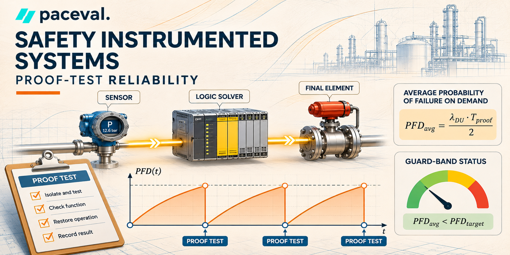
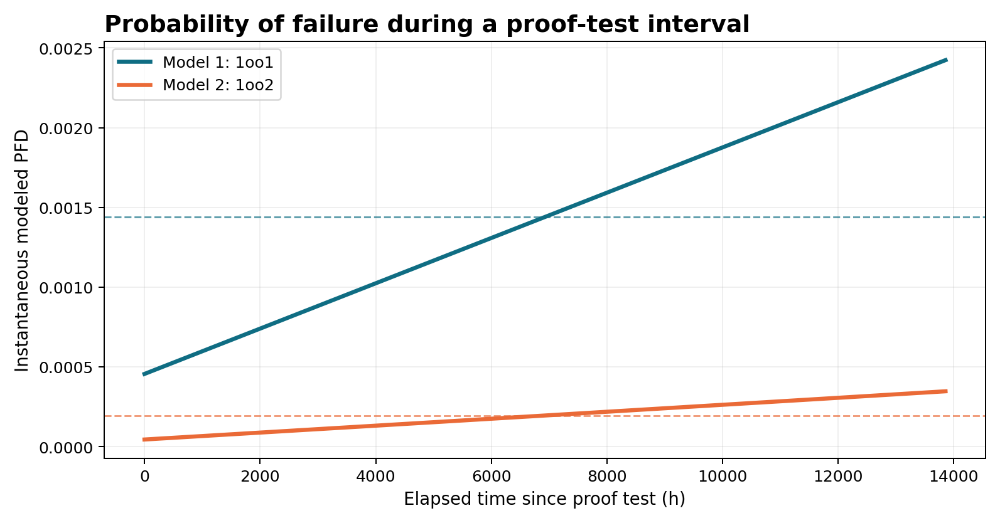
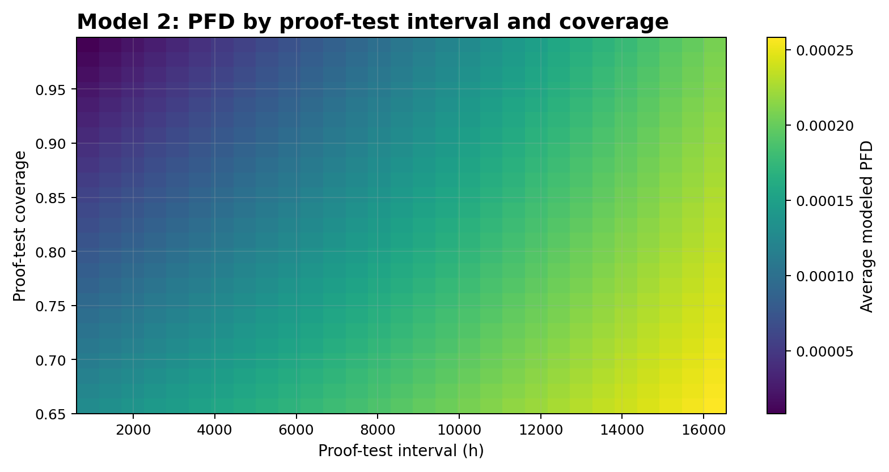
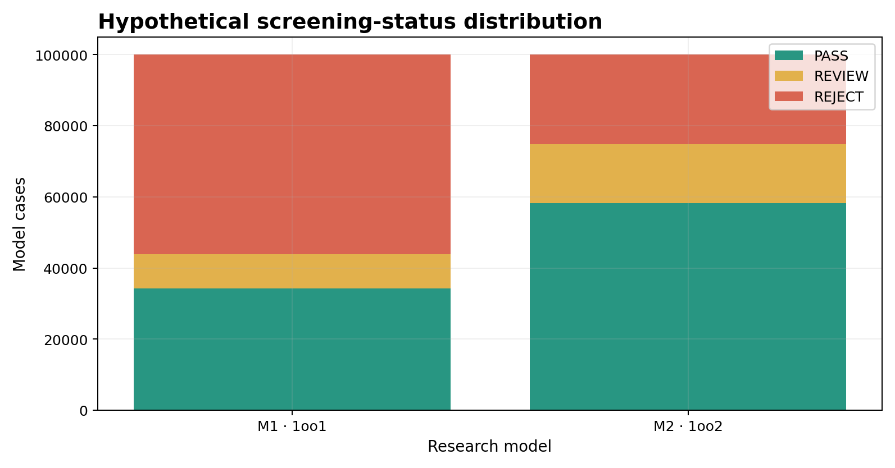

# paceval. | Safety Instrumented System Proof-Test Reliability Kernels



**WP 29 | Original paceval Mathematical Engine | C++17 | Reproducible mathematical feasibility research**

> This is **not a certified functional-safety calculation**, IEC 61508/61511 compliance statement, safety lifecycle assessment, SIL determination, or permission to modify real proof-test schedules. All failure rates, screening targets, detection coverages and mitigation assumptions are synthetic.

## 1. Industrial use case and current state of the art

In chemical and energy-processing facilities, a safety instrumented function (SIF) typically receives signals from sensors, applies logic in a safety controller, and brings equipment to a defined state using a final element. The operating organisation periodically tests the function. A proof test may reveal failures that routine diagnostics do not detect. Engineers therefore need to evaluate dangerous failure rates, diagnostic coverage, test effectiveness, test intervals, repair times and potential common-cause failures before proposing a schedule.

The relevant international framework is **IEC 61508**, with the process-industry application in **IEC 61511** and the ISA-84 series. These are lifecycle and safety assurance frameworks, not just numerical formula collections. The ISA-TR84.00.02-2022 technical report covers SIL-verification methods. Proof-test coverage can be materially less than 100%, as the functional-safety industry emphasises. The complete physical SIF, its operating environment, independence, systematic failures, maintenance constraints and evidence base are **not** modelled by this research. See [scientific boundaries](docs/SCIENTIFIC_SCOPE.md).

WP29 extends a simple low-demand proxy into two **explicitly hypothetical** mathematical architectures: a *single-channel 1oo1 model* with imperfect proof testing and a detected-failure repair proxy, and a *parallel 1oo2 model* with a separately parameterised common-cause fraction. Both use the same validated synthetic inputs. The research question is whether real, persistent paceval computation graphs can execute their probability, sensitivity, margin and screening formulas and be independently checked.

## 2. Mathematical formulation

All time units are **hours**. Rate $\lambda_D$ has units $\mathrm{h}^{-1}$; $DC$, proof-test coverage $c$ and $\beta$ are dimensionless. The covered and uncovered dangerous-undetected rates are:

```math
\lambda_{DU}=\lambda_D(1-DC),\quad \lambda_c=c\lambda_{DU},\quad \lambda_u=(1-c)\lambda_{DU}.
```

The starting low-demand approximation from WP29 is:

```math
PFD_{avg,approx}=\frac{\lambda_{DU}T}{2}.
```

The extended models define $A(z)=(1-e^{-z})/z$ for $z>0$, a detected-availability proxy $B=1/(1+\lambda_D DC\,MTTR)$, and an assumed frozen uncovered-failure age $H$.

**M1: single channel (1oo1), independently specified exponential screen**

```math
PFD_{avg,1}=1-B\exp(-\lambda_u H)A(\lambda_c T).
```

**M2: parallel pair (1oo2), simplified independent/common-cause decomposition**

```math
PFD_{avg,2}=1-2B e^{-\lambda_u H} A(\lambda_c T)+B^2 e^{-(2-\beta)\lambda_u H}A((2-\beta)\lambda_c T).
```

These are **model-specific mathematical expectations**, not generic IEC 61508/61511 proof-test formulae. In particular, uncovered modes use a frozen mission-age approximation within the representative proof cycle, the repair proxy is simplified, and both proof tests are assumed synchronized. Actual independent-channel imperfections, test-induced unavailability and common-cause maintenance effects need much richer models.

Numerical domains for the main experiment require positive rates and intervals, finite input values, $0\leq DC<1$, $0<c\leq1$, $0\leq\beta\leq1$ and nonnegative mission age and repair time. The $A(0)=1$ limit is mathematically known but is **not** represented by these positive-domain quotient graphs. Zero-rate and zero-interval analytical limits must not be passed silently through the main SDK quotient expressions.

Each model also provides analytic derivatives with respect to $T$ and $c$, the instantaneous PFD within the representative proof cycle, a hypothetical expected-loss proxy, the signed project target margin $m=PFD_{target}-PFD_{avg}$, and a Boolean screen using an explicitly chosen test-effectiveness policy. `SCREEN_PASS`, `SCREEN_REVIEW` and `SCREEN_REJECT` are **synthetic research statuses only**, not ACCEPT/REJECT decisions for an industrial SIF.

## 3. What really runs in paceval

| Mathematical function / industrial purpose | Actual implementation | Graph or rationale |
|---|---|---|
| $\lambda_{DU}$, detected rate, covered/uncovered rates | Real paceval graphs | M1/M2 `dangerous_*`, `proof_detectable_rate_h`, `uncovered_rate_h` |
| Low-demand comparison proxy and exponential survival | Real paceval graphs | M1/M2 `simple_low_demand_proxy`, `average_proof_survival` |
| 1oo1 and 1oo2 PFD average and instantaneous probability | Real paceval graphs | M1/M2 `pfd_average`, `instantaneous_pfd` |
| Analytic proof-interval and coverage sensitivities | Real paceval graphs | M1/M2 `interval_sensitivity_per_hour`, `coverage_sensitivity` |
| Signed policy margins, review scores and relational/logical conditions | Real paceval graphs | M1/M2 `target_margin`, `score_for_review`, `screen_guard` |
| Per-demand consequence-weighted loss illustration | Real paceval graphs | M1/M2 `expected_loss_proxy` |
| Input schema checks, independent candidate/screening statuses, output data | C++ host | Strict CSV I/O contract, orchestration and human-review-only categorisation |
| Independent equations and high-precision integration | Separate C++ and Python | Reference verification, not the published mathematics execution path |

The application creates **40 formula graphs**, 20 per model, and evaluates them using `paceval_dGetMultipleComputationsResultsExt` on the production dataset. Additional scalar and multi-graph tests exercise the same real SDK. The real `paceval_dConvertStringToFloat` and `paceval_dConvertFloatToString` routines provide the numeric CSV read/write path; the input parser rejects arithmetic expressions hidden in numeric fields. Graph lifecycle and error status are checked; no alternate mathematical engine is substituted for paceval.

## 4. Research results and plotted evidence

In the deterministic synthetic main experiment, **100,000 input scenarios** are evaluated for each model, giving **200,000 model-point cases**. The [execution evidence](results/execution_evidence.json) records exactly 40 created/executed domain graphs and **4,003,704 graph-point evaluations**, including the extra proof-cycle and two-dimensional surface calculations. The initial large run passed independent C++ checks and the [separate 85-digit check](results/high_precision_audit.json), including numerical integration and analytic-sensitivity checks.

The research produces two sets of hypothetical screening results. A positive model margin means only that the arithmetic result lies below a **selected synthetic project target**; the status additionally applies a synthetic coverage threshold and review buffer. M1 and M2 describe **different hardware voting assumptions**, not independently certified SIF design revisions.







All 13 scientific and architectural figures are in [figures](figures/figure_manifest.json), generated by [make_figures.py](src/make_figures.py) from the recorded `results/*.csv`, rather than invented performance claims. The English [research whitepaper](paceval_SIS_Proof_Test_Reliability_Whitepaper_EN.pdf) contains the modelling explanation and figures.

## 5. Build and rerun

A compatible **original local paceval shared library** must be supplied externally; no redistributable runtime is embedded in this repository.

```bash
cmake -S src -B build -DCMAKE_BUILD_TYPE=Release \
  -DPACEVAL_RUNTIME=/absolute/path/to/libpaceval_linux_sharedLIB.so
cmake --build build -j
ctest --test-dir build --output-on-failure
./build/sis_reliability --run 100000 replay_results
python3 validation/check_mpmath.py replay_results
```

The C++ program generates, writes and reads its numeric input CSV through the **original paceval converters**, executes persistent mathematical graphs, and saves `formula_registry.csv`, `math_execution_inventory.csv`, `scenario_results.csv`, `model_summary.csv`, `proof_cycle.csv`, `parameter_surface.csv`, `audit_samples.csv` and `execution_evidence.json`. The source and output columns are fixed. See [reproducibility instructions](docs/REPRODUCIBILITY.md). Python verification requires `mpmath`; scientific figures additionally require `numpy`, `pandas`, `matplotlib` and `Pillow`. The whitepaper generation uses ReportLab.

## 6. Scientific boundaries and context

This is a **mathematical-function execution demonstration** for low-demand reliability screening. It deliberately does **not** establish a SIL, prove any risk-reduction target, validate the empirical rates, certify proof-test coverage, or justify modifying a real test interval. Assumed channel independence, mission age, synchronized proof testing, simplified repair handling and beta-based common causes are insufficient for a comprehensive SIF assessment. The current laws are not intended for high-demand/PFH service and do not model full sensor–logic–final-element failure data.

Relevant public context: [ISA-84 standards](https://www.isa.org/standards-and-publications/isa-standards/isa-84-standards), [IEC 61508-6 explained by the 61508 Association](https://61508.org/wp-content/uploads/2024/11/10B-SIL-Calculations-and-use-of-IEC-61508-6.pdf), [Offshore Norge guidance Rev.06 (2023)](https://www.offshorenorge.no/contentassets/adc7e1512f90400cb7fe9f314600bed6/070---recommended-guidelines-for-the-application-of-iec-61508-and-iec-61511-rev.-06.pdf), [exida proof-test coverage (2023)](https://www.exida.com/webinars/recordings/predicting-proof-test-coverage-with-an-fmeda), and [paceval API](https://paceval.com/api/). These are background sources, **not endorsements or verifications of this mathematical screen**.

No runtime comparison, CPU/GPU benchmark, energy-consumption claim, financial benefit claim, or actual SIL certificate is part of the publication. See [scientific-scope statement](docs/SCIENTIFIC_SCOPE.md).
