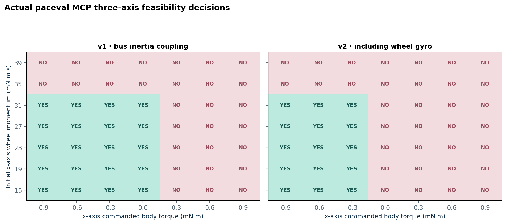
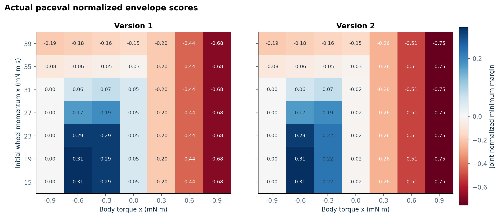
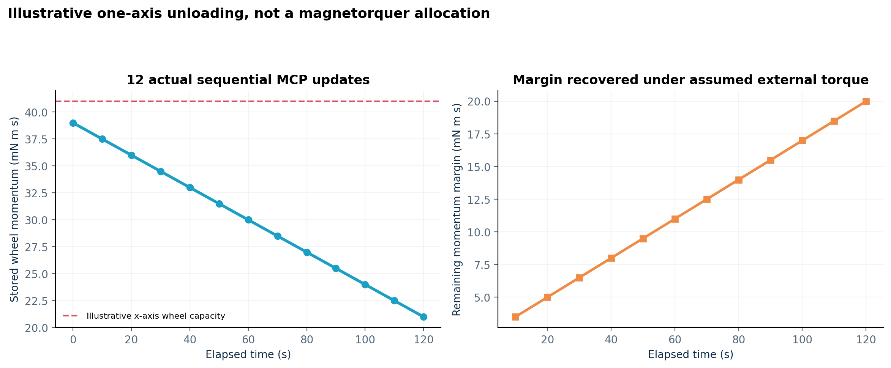

# Satellite Attitude Actuator Torque and Momentum Envelopes with paceval

**WP 32 | Reproducible mathematical research demonstrator | 15 November 2026**


A spacecraft's **attitude** is its orientation in space. A reaction wheel accelerates a rotating rotor inside the spacecraft and applies an equal and opposite control torque to the body. This can support precise pointing, but the wheel has both a finite motor torque and a finite stored angular momentum. External disturbances and coupling between body rates and stored wheel momentum make a planned maneuver's remaining margins depend on the current state. Reaction wheels may eventually need **momentum desaturation** using an external torque source such as a magnetorquer or thruster. This project's purpose is to show how a reusable mathematical engine can screen such constraints with explicit, versioned formulas.

This repository implements a **synthetic, diagonal-inertia, three-orthogonal-wheel model** with real remote evaluations of **paceval MCP 4.26** and independent high-precision checks. It is **not flight software, a full guidance-navigation-control solution, a complete magnetic actuator model, or a satellite hardware qualification**.

The starting specification was the [original WP 32 proposal](docs/Original_WP32_Proposal_2026-11-13.pdf), which provided four candidate kernels. The study extends them with full three-axis Euler coupling, an optional wheel gyroscopic term, rate prediction, normalized candidate scores, independent model versions, quaternion normalization and a host-orchestrated desaturation example.

## Physical model and sign conventions

For a spacecraft with a diagonal bus inertia $I=\mathrm{diag}(I_x,I_y,I_z)$ and three ideal orthogonal reaction wheels, define the wheel's axial momentum vector $\mathbf h$ and body angular velocity $\boldsymbol\omega$. The rigid bus plus wheel momentum, expressed in body coordinates, is

$$
\mathbf H_B=I\boldsymbol\omega+\mathbf h.
$$

**Positive** $\boldsymbol\tau_{rw}$ is the torque acting on the spacecraft body; the corresponding wheel torque is negative. External torque $\boldsymbol\tau_{ext}$ acts on the full spacecraft. The reduced continuous dynamics are

$$
I\dot{\boldsymbol\omega}=\boldsymbol\tau_{rw}+\boldsymbol\tau_{ext}-\boldsymbol\omega\times(I\boldsymbol\omega+\mathbf h),\qquad
\dot{\mathbf h}=-\boldsymbol\tau_{rw}.
$$

Version **v1** retains the rigid-body inertia cross-coupling but omits the wheel gyroscopic cross-term. Version **v2** includes $\boldsymbol\omega\times\mathbf h$. For example, on the x-axis:

$$
\dot\omega_{x,1}={\tau_x+\tau_{ext,x}-(I_z-I_y)\omega_y\omega_z\over I_x},\qquad
\dot\omega_{x,2}={\tau_x+\tau_{ext,x}-(I_z-I_y)\omega_y\omega_z-\omega_y h_z+\omega_z h_y\over I_x}.
$$

A **one-step forward-Euler screening prediction** for step size $\Delta t$ gives $\omega_{x,next}=\omega_x+\dot\omega_x\Delta t$ and $h_{x,next}=h_x-\tau_x\Delta t$. The expressions are exact for the *declared discrete update*, but a single large Euler step is not a reliable physical trajectory propagation method.

The componentwise mathematical envelope is defined by three inequalities:

$$
M_\tau=\tau_{max}-|\tau_{rw}|,\quad
M_h=h_{max}-|h_{next}|,\quad
M_\omega=\omega_{max}-|\omega_{next}|.
$$

An axis is **screen-eligible** only when all three margins are nonnegative. The three-axis decision requires all three axes to qualify. The joint score is the minimum among *normalized* component margins, so different physical units are never incorrectly minimized against each other. These functions, their sensitivities, model deltas, and both versions of the Boolean decisions are **real persistent paceval graphs**, not hidden native C++ calculations.

## Quaternion kinematics

A separate group of five paceval graphs evaluates the first-order Hamilton scalar-first quaternion update for the supplied angular velocity, calculates the candidate norm and divides all four components by that norm. The original quaternions are unit length; all twelve observed new quaternions also normalize to unit length within the independently tested numerical tolerance. Quaternion normalization is not proof of accurate long-term attitude integration.

## What the demonstrator actually executed

The connected **paceval MCP 4.26** service successfully registered 43 mathematical graphs and evaluated the following datasets:

| Stage | Graphs | Input vectors | Graph-point evaluations |
|---|---:|---:|---:|
| Axis dynamics and envelopes | 30 | 147 (49 triplets) | 4,410 |
| Combined three-axis decisions | 8 | 49 | 392 |
| Quaternion updates | 5 | 12 | 60 |
| Sequential desaturation illustration (five reused graphs) | 5 reused | 12 steps | 60 |
| **Total** | **43 distinct** | | **4,922** |

The main remote evaluations returned **zero reported calculation errors**. In the synthetic 49-scenario screening grid, model v1 classified **20** cases as eligible and v2 classified **15** cases as eligible. **Five decisions changed** when the wheel gyroscopic coupling was included.





The explicitly orchestrated desaturation demonstration uses an assumed external torque of $-0.00015$ N m on one axis and an equal opposing reaction-wheel body torque of $+0.00015$ N m. Over twelve 10-second steps, the wheel momentum calculated through paceval decreased from **0.039 to 0.021 N m s** while body angular acceleration remained zero in this special idealized zero-rate case. This is **not** an Earth magnetic field simulation, magnetorquer command allocation, or demonstration of global controllability.



## Numerical validation and interval evidence

The independent 90-digit `mpmath` validator performs **585 recorded scalar, Boolean, unit-norm and invariant checks** on the archived observed response values. All 585 pass within the declared reference tolerances. Independently reconstructed results are stored separately from the selected actual MCP output transcriptions.

The two interval-enabled graphs generated **12 pointwise TINC outputs**. Of these, **7** can be strictly confirmed to contain the high-precision reference using the returned decimal bounds; **3** have displayed bounds too narrowly rounded for strict inclusion to be established from text alone; **2** returned paceval error **144**. These latter five are explicitly **not** claimed as successful interval proofs. Even the seven confirmed results are pointwise checks and do **not** certify a full uncertain-input range.

A separate real remote operator suite checked `%` versus `mod`, `min`/`max`, relational conditions, AND, OR, NOT and XOR: **21 executions** returned their expected numerical results without error.

## Architecture and runnable C++ project

`src/satellite_attitude_paceval.cpp` is a C++17 implementation using the **original, unchanged** `paceval_main.h` and `paceval_main.cpp`. It validates CSV numerical literals before using `paceval_dConvertStringToFloat`, creates persistent handles through `paceval_CreateComputation`, evaluates independent inputs with `paceval_dGetMultipleComputationsResultsExt`, and formats the resulting numbers using `paceval_dConvertFloatToString`. The host orchestrates the axis-to-aggregate handoff and a sequential momentum-desaturation example. Explicit native checks verify key physical invariants independently.

Source-code syntax verification completed successfully with a C++17 compiler and warnings enabled. **No local SDK executable was linked, no local CTest was run, and no performance measurements were taken** because the compatible original `libpaceval.so` is not available here. The local library is intentionally not included in this research package.

When the original compatible library is available, build and test on Linux with:

```bash
cmake -S src -B build -DPACEVAL_SHARED_LIB=/absolute/path/to/libpaceval.so
cmake --build build --config Release
ctest --test-dir build --output-on-failure
```

Or run the complete CSV-to-CSV path explicitly:

```bash
./build/satellite_attitude_paceval \
  examples/axis_snapshots.csv \
  examples/quaternion_snapshots.csv \
  build/local_axis.csv \
  build/local
```

This generates the local axis CSV, `build/local_joint.csv`, `build/local_quaternion.csv` and `build/local_desaturation.csv`. Local results will only be confirmed after running that executable with the actual shared library. Numeric formatting using the original SDK is not assumed bit-for-bit reversible for every IEEE-754 double; original numeric input literals and result-provenance files are retained.

## Data, figures, and reproduction

* [`src/formula_manifest.json`](src/formula_manifest.json) identifies **every** graph, expression, variable and mathematical owner. Three generated headers are included without requiring any custom hand-written paceval parser.
* [`examples/axis_snapshots.csv`](examples/axis_snapshots.csv) contains all 147 exact input rows for the 49 grid cases, and [`examples/quaternion_snapshots.csv`](examples/quaternion_snapshots.csv) contains the twelve quaternion cases.
* [`results/README_DATA.md`](results/README_DATA.md) explains the provenance: selected literal transcriptions of actual remote response values versus independently reconstructed reference results. **The full 4,410-value axis RPC response was not archived as raw protocol JSON.**
* [`validation/check_research.py`](validation/check_research.py) checks the actually observed subset with 90-digit arithmetic. Run `python validation/check_research.py` after installing the packages from [`requirements.txt`](requirements.txt).
* [`validation/markdown_preflight.py`](validation/markdown_preflight.py) checks every Markdown file in the package, uses a real Markdown parser and runs negative regression cases that previously exposed broken GitHub math.
* The [full English PDF report](paceval_Satellite_Attitude_Actuator_Whitepaper_EN.pdf) contains the scientific figures, full physical model, evidence hierarchy, results, limitations and references.

## Scientific limits and further validation

The demonstrator assumes three orthogonal fixed wheel axes, constant diagonal spacecraft inertia, ideal reaction torque allocation, no flexible appendages or wheel friction/jitter and no saturation dynamics beyond algebraic limits. Quaternion integration is first-order and independent test scenarios are **not** an attitude controller. A real GNC pilot requires disturbance models, torque allocation for an actual wheel geometry, high-order numerical propagation, realistic momentum dumping, sensor/estimator errors and validation against Basilisk or hardware-in-the-loop measurements.

NASA's [2026 Small Spacecraft Guidance, Navigation and Control review](https://www.nasa.gov/smallsat-institute/sst-soa/guidance-navigation-and-control/) summarizes reaction wheels and momentum unloading. The open-source [Basilisk spacecraft dynamics](https://avslab.github.io/basilisk/Documentation/simulation/dynamics/spacecraft/spacecraft.html) and [reaction-wheel effectors](https://avslab.github.io/basilisk/Documentation/simulation/dynamics/reactionWheels/reactionWheelStateEffector.html) provide important independent validation comparators. A [2026 study of combined magnetic and reaction-wheel control](https://www.sciencedirect.com/science/article/pii/S096706612600136X) highlights the continuing research into wheel failure, momentum management and nonlinear control. None of those sources independently validates this synthetic paceval demonstration.

**Release claim:** Reproducible mathematical functional screening with actual remote paceval MCP execution and independent point-reference checks. **Not** mission-qualified software, certified momentum margins, guaranteed flight safety, full attitude control, or measured engine acceleration.
