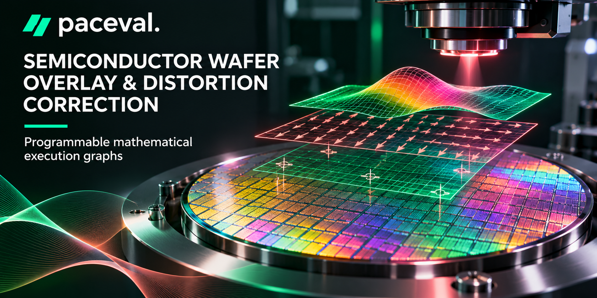
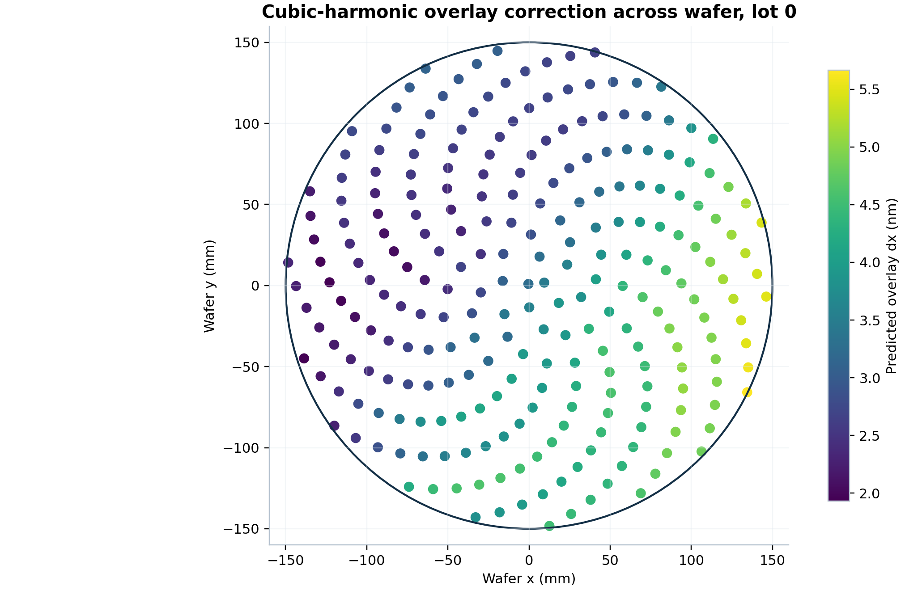
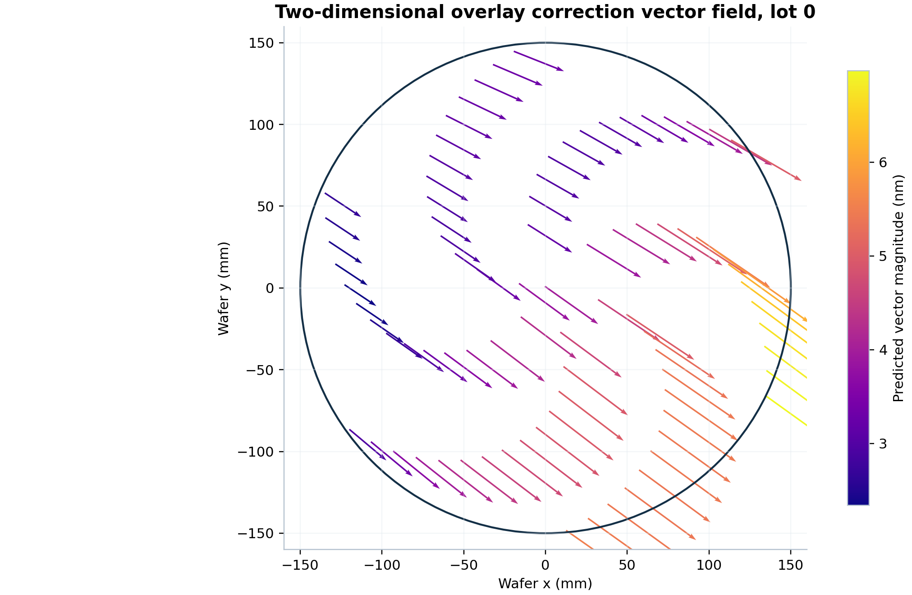
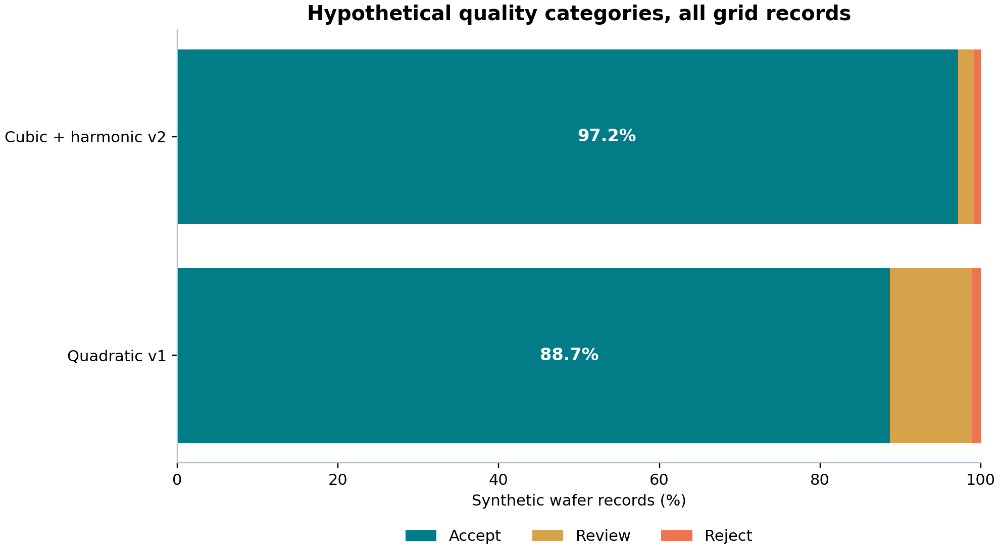
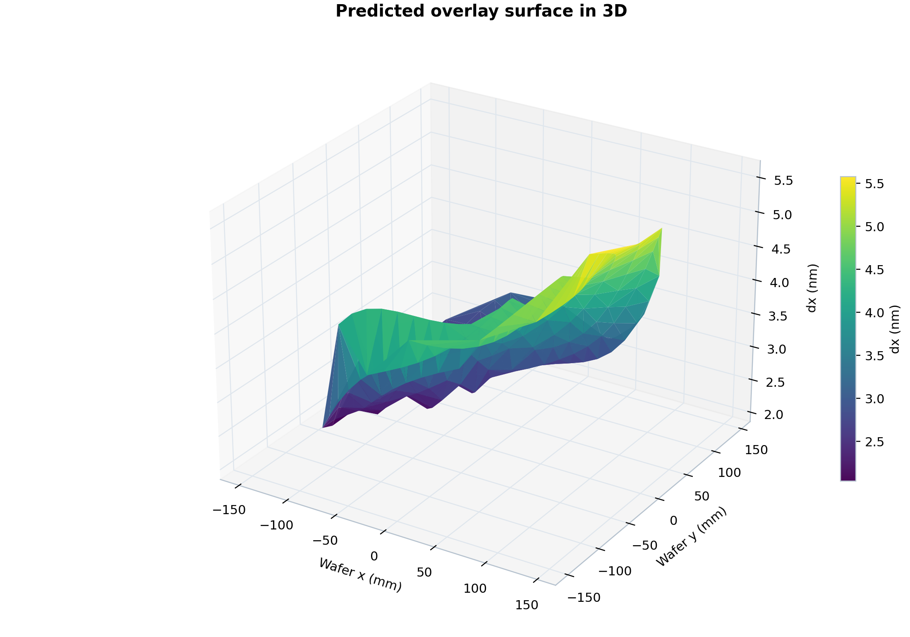
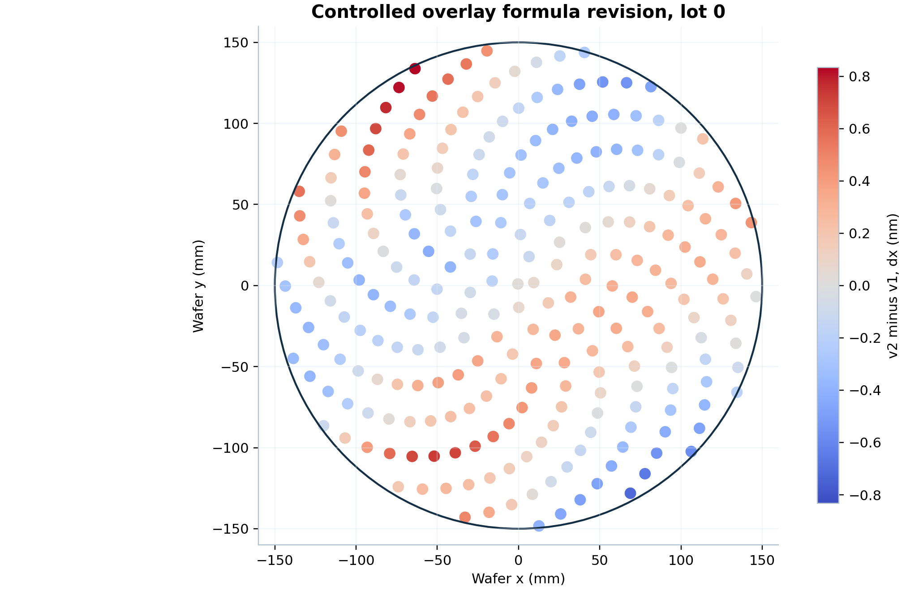

# Semiconductor Wafer Overlay & Distortion Correction with paceval



*Concept illustration; not a computed research result.*

A **reproducible industrial mathematical research demonstrator** for model-versioned semiconductor wafer overlay correction, based on the **original paceval Mathematical Engine 4.25** and its real Linux shared-library API. It uses synthetic overlay metrology and never controls a lithography scanner.

**Research files:** [English scientific whitepaper](paceval_Semiconductor_Wafer_Overlay_Whitepaper_EN.pdf) · [C++ main source](src/wafer_overlay.cpp) · [Complete execution inventory](results/math_execution_inventory.csv) · [Independent numerical audit](results/independent_numerical_audit.json).

## 1. Industrial use case and current state of the art

Modern integrated circuits comprise many stacked patterned layers. Even a small displacement between corresponding patterns in adjacent layers can impair circuit yield. **Overlay metrology** estimates these relative two-dimensional alignment errors at designated targets distributed across a semiconductor wafer. A correction model transforms wafer position, operating temperature and other qualified inputs into overlay predictions or compensation recommendations, with the resulting map subject to an independent metrology and quality review.

The industrial measurement step can involve diffraction-based optical metrology and electron-beam approaches; integrated measurement, modeling, and correction workflows are described in ASML's public metrology documentation. A 2025 open-access publication examines **higher-order two-dimensional polynomial overlay correction** rather than merely quadratic maps. NIST's ongoing 2026 project is researching **physics- and AI-informed SEM overlay measurement**, highlighting the need to distinguish reliable metrology from numerical formula execution. These are contextual sources, **not validation of the synthetic numbers in this project**. [ASML](https://www.asml.com/en/technology/lithography-principles/measuring-accuracy) · [High-order overlay study, 2025](https://doi.org/10.1039/d5na00682a) · [NIST project, 2026](https://www.nist.gov/programs-projects/overlay-metrology-using-physics-and-ai-based-scanning-electron-microscopy).

**This demonstration:** the C++ host synthesizes 10 independent wafer lots, with train/holdout metrology points and ten corresponding coefficient sets, then fits two distinct model families for each lot. For every stable model it registers persistent paceval graphs, evaluates 10,000 synthetic wafer positions, and records physically interpretable correction vectors, residuals, Jacobian sensitivities, illustrative uncertainty and mathematical quality decisions. C++ performs I/O, QR fitting, orchestration, aggregation and policy enforcement. No live fab data, machine actuation or experimental scanner measurements are used.

## 2. Verified scope and actual executed measurements

| Executed capability | Verified output |
|---|---:|
| Distinct synthetic wafer lots | 10 |
| Simultaneously addressable model families for each lot | quadratic v1; cubic plus harmonics v2 |
| Actual persistent paceval computation graphs | 360 (18 per lot and model) |
| Wafer-grid model evaluations | 200,000 (10 lots × 2 versions × 10,000 points) |
| Additional metrology-record model evaluations | 7,540 |
| Actual paceval graph outputs | 3,735,720 |
| Multi-graph batch calls | 420 |
| Independently checked archived graph values | 117,144 |
| Exact comparisons of category/bin outputs | 26,032 |
| Independently checked 80-digit reference values | 4,000 |
| Independently checked fitted coefficients via NumPy/LAPACK | 480 |

Counts are from [the executed SDK log](results/sdk_execution.txt) and the independent audit. Each graph output is counted once per real batch cell. Previous matrix, MCP or calibration studies are not included in these numbers.

The test computes an explicit **300 mm wafer diameter** and reports overlay corrections and residuals in **nanometers**. Temperature is in degrees Celsius. All geometry, coefficients, quality limits, position uncertainty and noise are explicitly **synthetic**.

For example, the first lot's **quadratic model** yielded an RMS synthetic residual of **0.560 nm**, while the higher-order **cubic/harmonic model** yielded **0.359 nm** on the declared synthetic grid. These are fit-model differences on this particular generator, not an empirical advantage in real lithography.

## 3. Mathematical kernel

The normalized coordinates and temperature variable are

```math
u=x/(150\,\mathrm{mm}),\qquad v=y/(150\,\mathrm{mm}),\qquad \tau=(T-25\,^\circ\mathrm C)/(20\,^\circ\mathrm C),\qquad u^2+v^2\le1.
```

For each fitted lot and version, the **two component overlay model** is a linear combination of declared basis functions:

```math
\widehat{\Delta x}(u,v,T)=\sum_{k=0}^{p-1}a_k\phi_k(u,v,T),\qquad
\widehat{\Delta y}(u,v,T)=\sum_{k=0}^{p-1}b_k\phi_k(u,v,T).
```

The quadratic model has nine basis functions, including temperature interactions; the extended model has fifteen basis functions and adds cubic geometry and two trigonometric modes. Coefficients are **fitted independently for each lot** by host-side Householder QR and then serialized as formula text using paceval's own number-format routine. Each correction model becomes a *real*, reuseable paceval computation object. The original source proposal's two six-term quadratic models are present as the lower-order foundation, with temperature-aware and higher-order extensions.

The observed residual and its mathematical guard are calculated by paceval, not reconstructed by C++:

```math
r=\sqrt{(\Delta x_{\mathrm{obs}}-\widehat{\Delta x})^2+
          (\Delta y_{\mathrm{obs}}-\widehat{\Delta y})^2},\qquad
 g_r=3.5\sigma-r.
```

Likewise, *first derivatives* with respect to $u$ and $v$ are independently derived explicit paceval graph formulas, not a claim of automatic differentiation. A displayed illustrative combined uncertainty is based on a stipulated, non-certified position input uncertainty.

The quality regions are **hypothetical research policy**, not production authorization:

```math
\mathrm{route}(r)=
\begin{cases}
\mathrm{ACCEPT}, & r\le 2\sigma,\\
\mathrm{REVIEW}, & 2\sigma<r\le3.5\sigma,\\
\mathrm{REJECT}, & r>3.5\sigma.
\end{cases}
```

A separate circular wafer-domain condition is included in the actual Boolean paceval graphs. The C++ host checks their exclusivity and issues the final display category. In the implementation every comparison involving a product is explicitly parenthesized, e.g. `residual <= (2*sigma)`; this is verified by a regression test.

## 4. Auditable ownership of mathematical operations

| Mathematical function / industrial purpose | Actual implementation | Graph/version or reason |
|---|---|---|
| x/y quadratic and extended overlay predictions | **paceval** | `overlayDx`, `overlayDy`, both families, each lot |
| x/y residuals and Euclidean residual norm | **paceval** | `residualX`, `residualY`, `residualNorm` |
| Circular wafer domain and residual quality margins | **paceval** | `waferMargin`, `residualMargin` |
| Composite model risk score and Boolean categories | **paceval** | `riskScore`, `accept`, `review`, `reject` |
| Analytical first derivatives of both overlay components | **paceval** | `dDx_dU`, `dDx_dV`, `dDy_dU`, `dDy_dV` |
| First-order illustrative uncertainty and clamp | **paceval** | `illustrativeUncertainty`, `clampedResidual` |
| Deterministic metrology-record partition via `mod` | **paceval** | `fieldSlot` |
| Model fitting, QR factorization and selection of version | **C++ host** | Stateful numerical solver and orchestration |
| Physical units, finite inputs, CSV schema and final presentation | **C++ host** | Input safety and data lifecycle |
| Numerical and fitted-coefficient reference tests | **separate Python/NumPy/mpmath** | Audit only, not the published paceval execution path |

The exact formula definitions, lengths and graph ownership are archived in [graph_registry.csv](results/graph_registry.csv); [math_execution_inventory.csv](results/math_execution_inventory.csv) accounts for all 360 graphs. **There are no fake paceval graphs or native stand-ins in the productive mathematical result path.**

## 5. paceval number conversions, operators, CSV discipline

Both user-requested official conversion routines are **actually called**:

- `paceval_dConvertStringToFloat(...)` for every numeric token read from input CSV files, including coordinates, temperature, measured overlay and sigma.
- `paceval_dConvertFloatToString(...)` for numeric values written to CSV files, fitted coefficients and the numeric parts of the generated formula strings.

The engine's string converter can also evaluate expressions and accept a comma decimal separator. For integrity, the C++ host therefore applies a strict decimal-token validator **before** calling the official conversion routine: decimal point only, no expressions, no NaN/Inf, finite range, and schema/unit checks. The provided conversion routine formats floating-point numbers to approximately **15 significant decimal digits** in this tested SDK; exported numbers are independently audited with an appropriate tolerance. A CSV roundtrip is **not** claimed to reproduce every original 64-bit float exactly.

The real SDK was tested for `AND`, `OR`, `<`, `>`, `<=`, `>=`, `<>`, infix `min`/`max`, `mod`, `%`, `floor`, `round`, `sqr`, `pi` and trigonometric operations. The mathematical `(-1) mod 10` equals `9`, whereas symmetrical `(-1) % 10` equals `-1`; the two operators must not be conflated. `mod` is used for `fieldSlot` in the working batch, while `%` has its own explicit regression test. Operations without a scientific purpose are not artificially inserted into physical correction equations.

## 6. Industrial scenario results and images

The fourteen numbered figures are generated from [the executed numerical samples](results/wafer_grid_sample.csv), [holdout measurements](results/holdout_results.csv), [versioned coefficients](results/fitted_coefficients.csv) and [scenario summaries](results/wafer_summary.csv). The architecture figure is clearly labeled as a structural illustration.







Additional scientific figures: [architecture](figures/01_research_workflow.png), [residual histogram](figures/04_overlay_residual_histogram.png), [RMS across lots](figures/05_lot_residual_rms.png), [sensitivity](figures/08_spatial_sensitivity.png), [uncertainty](figures/10_uncertainty_propagation.png), [radial response](figures/11_radial_residual_profile.png), [temperature and holdout](figures/12_temperature_holdout_residual.png), [coefficients](figures/13_coefficient_versions.png) and [quality margin](figures/14_quality_margin_wafer.png). The corresponding vector PDFs are supplied, and every plot is regenerated with [make_figures.py](src/make_figures.py).

## 7. Reproduce on Linux

Build in a Linux x86-64 development environment with C++17, CMake and an **externally supplied compatible original paceval Shared Library**:

```bash
cmake -S src -B build -DCMAKE_BUILD_TYPE=Release \
  -DPACEVAL_RUNTIME=/absolute/path/to/libpaceval_linux_sharedLIB.so
cmake --build build -j
./build/wafer_overlay --generate
./build/wafer_overlay --run --lot-limit 10 --grid-limit 10000 --out results
python3 src/verify_results.py
python3 src/make_figures.py
ctest --test-dir build --output-on-failure
python3 src/check_readme_math.py README.md
```

Python NumPy, mpmath and Matplotlib are used **only** for the independent audit and publication graphics, not the productive C++ paceval path. The original SDK API source/header are in [`src/paceval_main.cpp`](src/paceval_main.cpp) and [`src/paceval_main.h`](src/paceval_main.h). Only its relative header include path was changed to work from `src/`; all original upstream copyright notices remain. The Shared Library is deliberately **excluded from the ZIP**.

The deterministic generator creates both [synthetic metrology](examples/synthetic_metrology.csv) and [100,000 input positions](examples/wafer_grid_inputs.csv). The complete experiment creates [CSV results](results/wafer_summary.csv), [a mathematical inventory](results/math_execution_inventory.csv), the [execution log](results/sdk_execution.txt) and the [high-precision technical audit](results/independent_numerical_audit.json).  The [scientific reproducibility notes](docs/RESEARCH_VALIDATION.md) explain the numerical and experimental limits. Every released file can be checked against the [SHA-256 manifest](SHA256SUMS.txt).

## 8. Scientific interpretation and limitations

The demonstrated functionality is **mathematical feasibility** with persistent and versioned paceval computation objects, independently verified scalar/multigraph batch execution, formula-generated first derivatives, user-defined logical quality policies, and use of the engine's own numeric-string converters. The synthetic dataset does not determine real scanner physics, metrology traceability, experimental calibration accuracy, acceptability of any particular overlay specification or the value of the method in a commercial fab. The QR fitting algorithm is hosted in C++; paceval evaluates the corrected mathematical models and scores. No certification, customer deployment, machine control, speed advantage or FPGA implementation is claimed. TINC was not employed.

Prior public works such as the original 2-page WP 01 are proposals and should not be confused with the newly executed research. Physical model validity must be established from qualified measurements and independent site- or lot-held-out validation before any fab deployment.

## 9. Sources and additional context

- [NIST (2026), Overlay Metrology Using Physics and AI-Based Scanning Electron Microscopy](https://www.nist.gov/programs-projects/overlay-metrology-using-physics-and-ai-based-scanning-electron-microscopy).
- [ASML, Measuring accuracy - lithography principles](https://www.asml.com/en/technology/lithography-principles/measuring-accuracy).
- [Nanoscale Advances (2025), Method of high-order advanced lithography overlay correction](https://doi.org/10.1039/d5na00682a).
- [NIST (2025), Detection limits of AI-based SEM dimensional metrology](https://www.nist.gov/publications/detection-limits-ai-based-sem-dimensional-metrology).
- [paceval Official API](https://paceval.com/api/) and [Product Brief](https://paceval.com/product-brief/).

*Research status: complete reproducible mathematical demonstration with synthetic data; no industrial fab qualification.*
