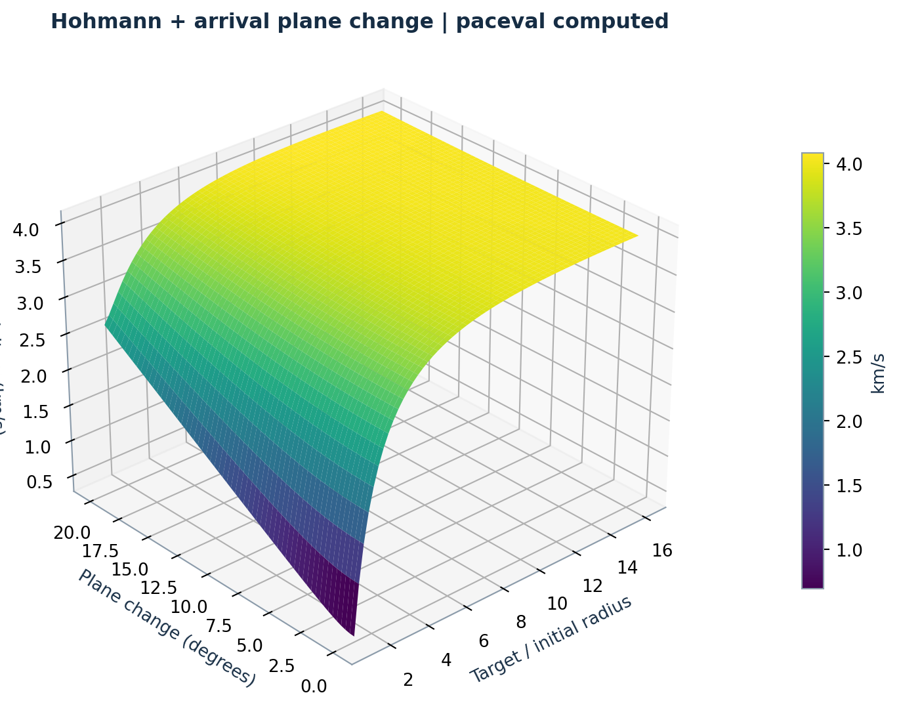
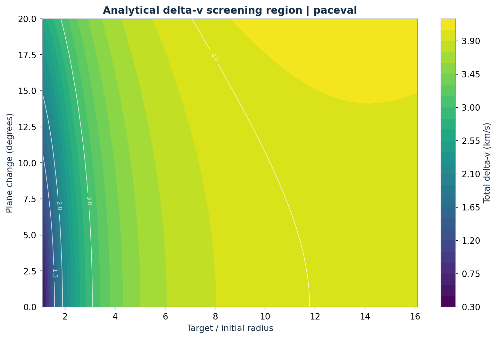
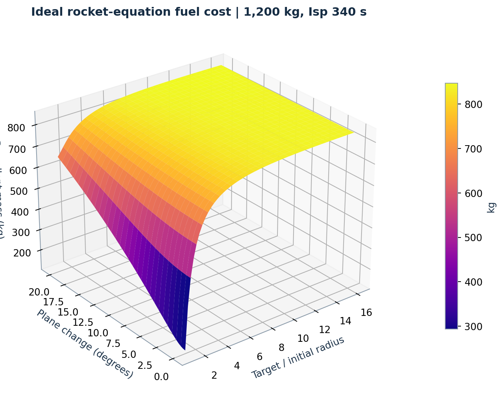
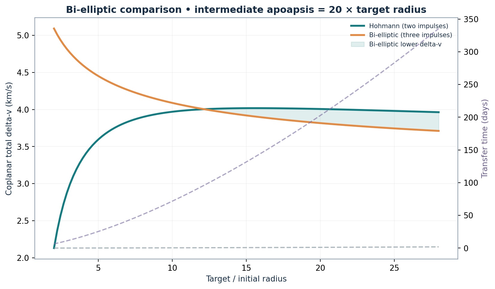

# WP_037 · Analytical Costs for Space Transfer Screening with paceval


*Concept illustration; not a computed ephemeris or a numerical result. Research figures below use actual paceval calculation results except the explicitly labelled orbital-geometry sketch.*

**An executed C++/paceval research demonstration of reusable, versioned mathematical expressions for two-body orbital transfer screening.** The project screens thousands of transfer candidates, calculates the two Hohmann impulses, optional target-orbit plane change, transfer time, ideal rocket-equation propellant, and a strictly separate coplanar bi-elliptic comparison.

[**English research whitepaper**](paceval_Space_Transfer_Screening_Whitepaper_EN.pdf) · [Commented C++ demonstrator](src/space_transfer.cpp) · [CMake project](src/CMakeLists.txt) · [Executed results](examples/) · [Technical audit](results/)

## 1. Industrial use case and current state of the art

Spacecraft operators and mission analysts often need to evaluate many preliminary orbital-transfer alternatives before investing in numerical targeting, detailed force models, actual ephemerides, launch windows and hardware-dependent maneuver design. A first-stage analytical screening calculation can answer useful but deliberately limited questions: How large is the idealized impulsive velocity budget? What is the half-ellipse transfer time? How does an assumed inclination difference affect the arrival burn? How much propellant would an ideal rocket equation require?

Established tools already solve considerably harder mission-design problems. [NASA's General Mission Analysis Tool (GMAT)](https://software.nasa.gov/software/GSC-19640-1) supports trajectory optimization and high-fidelity mission analysis. [ESA's pykep](https://esa.github.io/pykep/) provides Lambert and interplanetary-trajectory algorithms. [JPL NAIF SPICE](https://naif.jpl.nasa.gov/) supplies time-dependent geometry and ephemerides, while [Orekit](https://test.orekit.org/site-orekit-13.0/architecture/maneuvers.html) models maneuver events and propagation. The classical two-impulse transfer equations are documented in [NASA/JPL orbital mechanics notes](https://spsweb.fltops.jpl.nasa.gov/portaldataops/mpg/MPG_Docs/MPG%20Book/Release/Chapter7-OrbitalMechanics.pdf) and [Hohmann transfer technical notes](https://help.agi.com/stk/12.7.1/Content/training/tq-hohmann.htm).

The contribution tested here is narrower: **paceval stores and reuses the analytical formula graphs**, evaluates many parameters via its actual batch APIs, and preserves both versions of a changeable screening policy. The host validates inputs, creates deterministic candidates, compares outputs independently and interprets the results. The demonstration is not a Lambert solver, finite-thrust optimizer or real-spacecraft deployment.

## 2. Executed scope and outcomes

| Verified property | Result |
|---|---:|
| Persistent paceval graphs, including two separately retained cost policies | **17** |
| Synthetic screened candidates | **8,000** |
| Actual multi-graph batch result values | **136,000** |
| Additional single-graph surface batch result values | **11,163** |
| Independently checked native C++ mathematical quantities | **7,831** |
| Independently rechecked quantities with 80-digit arithmetic | **3,026 (178 candidates)** |
| Candidates passing all three illustrative host thresholds | **1,244** |
| Candidates where tested bi-elliptic option has lower coplanar Δv | **4,538** |
| Actual SDK integration test | **1/1 passed** |

These counts refer to the deterministic synthetic workload and the specific model assumptions below, **not** production mission feasibility or statistically calibrated success probabilities. Bi-elliptic comparisons are **coplanar only**; they are not incorrectly compared to the inclined Hohmann total.

## 3. Physical model and equations

For positive gravitational parameter $\mu$ and two **circular**, Earth-centered radii $r_2>r_1$, the Hohmann transfer semi-major axis is $a=(r_1+r_2)/2$. Define circular velocities and transfer-endpoint velocities using the vis-viva equation:

```math
v_{c,i}=\sqrt{\frac{\mu}{r_i}},\qquad
v_{t,i}=\sqrt{\mu\left(\frac{2}{r_i}-\frac{1}{a}\right)}.
```

The first and second coplanar impulses are $\Delta v_1=|v_{t,1}-v_{c,1}|$ and $\Delta v_2=|v_{c,2}-v_{t,2}|$. For an idealized final velocity-direction change of angle $\theta$ at arrival, a stable combined vector impulse is evaluated:

```math
\Delta v_{2,\theta}=\sqrt{(v_{c,2}-v_{t,2})^2+
4v_{c,2}v_{t,2}\sin^2\left(\frac{\theta}{2}\right)}.
```

This treats the velocity-vector angle as a prescribed endpoint condition. It does **not** establish attainable orbital-plane alignment at a specific epoch or nodal geometry. The two-burn total, half-orbit transfer duration and ideal rocket-equation mass are:

```math
\Delta v_{\mathrm{total}}=\Delta v_1+\Delta v_{2,\theta},\qquad
t_{\mathrm{transfer}}=\pi\sqrt{\frac{a^3}{\mu}},\qquad
m_p=m_0\left(1-\exp\left(-\frac{1000\Delta v_{\mathrm{total}}}{I_{\mathrm{sp}}g_0}\right)\right).
```

In the C++ project, radii are in **km**, velocity in **km/s**, time is exported in **days**, initial and propellant masses are in **kg**, $I_{\mathrm{sp}}$ in **seconds**, $g_0=9.80665\;\mathrm{m/s^2}$, and $\theta$ in **radians**. The explicit factor 1000 converts km/s into m/s for the rocket equation.

A second, explicitly coplanar, three-impulse **bi-elliptic** calculation uses intermediate apoapsis $r_b>r_2$ with the corresponding two half-ellipses and absolute endpoint velocity changes. This calculation supplies a legitimate first-pass energy/time comparison, not a global search over $r_b$ or a plane-change-optimized alternative.

The two versions of the dimensionless screening policy are deliberately illustrative: version 1 emphasizes ideal fuel fraction more strongly, and version 2 increases the transfer-time penalty. Both original mathematical graph handles remain available after the revision.

## 4. Reproducible industrial scenario

For an illustrative Earth-centered $r_1=7000\;\mathrm{km}$ to $r_2=42164\;\mathrm{km}$ transfer, $\theta=5^\circ$, initial mass 1200 kg and $I_{\mathrm{sp}}=340\;\mathrm{s}$, the defined two-body equations give approximately **3.784 km/s total impulse**, **5.33 hours transfer duration**, and **814 kg ideal propellant**. This illustrates the magnitude and interpretation of the mathematical result; it is not a flight-qualified design, and propellant masses exclude tanks, reserves, steering losses and other real-world factors.

The deterministic 8,000-candidate workload explores positive Earth-centered outward transfers with varying target-radius ratios, plane-change angles, specific impulse, starting mass and optional intermediate bi-elliptic apoapsis. The illustrative host screening constraints are total Hohmann-with-plane Δv ≤ 5 km/s, propellant mass ≤ 650 kg and transfer time ≤ 1.5 days. Input validity and policy decisions are handled by C++, not automatically by paceval.

## 5. Scientific diagrams from executed calculations

| Figure | Content | Computed PNG |
|---|---|---|
| 1 | Orbit geometry, explicitly **schematic host reconstruction** | [Geometry](figures/01_orbital_transfer_geometry.png) |
| 2 | Three-dimensional Hohmann Δv response surface |  |
| 3 | Δv contour map for target radius and inclination |  |
| 4 | Three-dimensional propellant-demand surface |  |
| 5 | Plane-change sensitivity by radius ratio | [Sensitivity](figures/05_plane_change_sensitivity.png) |
| 6 | Coplanar Hohmann vs bi-elliptic Δv and time |  |
| 7 | Candidate screening decisions | [Screening](figures/07_candidate_screening.png) |
| 8 | Two persistently stored formula versions | [Formula versions](figures/08_policy_versions.png) |
| 9 | Ideal propellant-fraction distribution | [Fuel distribution](figures/09_fuel_fraction_distribution.png) |

All nine numbered figures exist as [PNG and vector PDF](figures/). Figures 2–9 derive from actual C++/paceval output CSVs, while Figure 1 is a labelled geometrical sketch using the defined orbital radii and not a propagated spacecraft trajectory. The cover image is a separate conceptual illustration (2400 × 1200 pixels).

## 6. Build, reproduce and independently audit

Requires Linux x86-64, CMake >= 3.16, a C++17 compiler and a compatible **externally supplied** paceval shared runtime. The original `paceval_main.h` and `paceval_main.cpp` SDK interface files are in `src/`. The shared library is **not** included.

```bash
cmake -S src -B build -DCMAKE_BUILD_TYPE=Release \
  -DPACEVAL_RUNTIME=/absolute/path/to/libpaceval_linux_sharedLIB.so
cmake --build build -j
ctest --test-dir build --output-on-failure
./build/space_transfer --out . --cases 8000
python3 src/high_precision_reference.py
python3 src/make_figures.py
python3 src/make_whitepaper.py
python3 src/verify_results.py
python3 src/check_readme_math.py
```

Python scripts require `numpy`, `matplotlib`, `Pillow`, `mpmath` and `reportlab` (see [`src/requirements.txt`](src/requirements.txt)). Data and formula definitions are in [`examples/`](examples/), and execution / precision checks in [`results/`](results/). Source formulas are truly executed through `paceval_dGetComputationResult`, `paceval_dGetComputationResultExt` and `paceval_dGetMultipleComputationsResultsExt`. The host maintains live handles and destroys them correctly on completion. CTest uses an actual, smaller SDK execution instead of a mock implementation.

`src/check_readme_math.py` validates GitHub-compatible Markdown math and locally linked files and includes negative regression tests for malformed math. Automated checking does not imply that the rendered README has been inspected directly on github.com.

## 7. Scope, limitations and follow-up research

The actual result is a **reproducible, independently verified analytical calculation kernel** integrated into a meaningful early screening workflow. It does not provide launch windows, third-body gravity, atmospheric drag, non-spherical gravity, rendezvous phasing, finite burns, plane-node feasibility, perturbation propagation, trajectory targeting or validated mission propellant reserves. An ideal bi-elliptic energy advantage can entail a large flight-time penalty. Each candidate's admissibility in a real mission must be assessed with actual ephemerides, spacecraft hardware and an appropriate mission-design tool.

A next scientific step would be to run **the same candidates** through GMAT, a Lambert solver or a mission dynamics tool; refine by true boundary conditions and multi-objective constraints; then test paceval as a replaceable symbolic/analytical screening stage within that larger workflow. No measured performance, numerical superiority or hardware acceleration is claimed here.

## 8. External references

1. NASA/JPL, *Fundamentals of Orbital Mechanics*, [Chapter 7](https://spsweb.fltops.jpl.nasa.gov/portaldataops/mpg/MPG_Docs/MPG%20Book/Release/Chapter7-OrbitalMechanics.pdf).
2. [Hohmann Transfer Technical Notes, Ansys STK](https://help.agi.com/stk/12.7.1/Content/training/tq-hohmann.htm).
3. [NASA GMAT R2026, Software Catalog](https://software.nasa.gov/software/GSC-19640-1).
4. [ESA pykep 3.1, mission-trajectory toolbox](https://esa.github.io/pykep/).
5. [NASA/JPL NAIF SPICE](https://naif.jpl.nasa.gov/).
6. [Orekit 13, Maneuver Architecture](https://test.orekit.org/site-orekit-13.0/architecture/maneuvers.html).
7. [paceval Mathematical Engine and public API](https://paceval.com/api/).

**Research scope:** independent synthetic demonstration, November 2026. The C++/paceval mathematical functionality was executed and validated; no real mission optimization or certification is implied.
