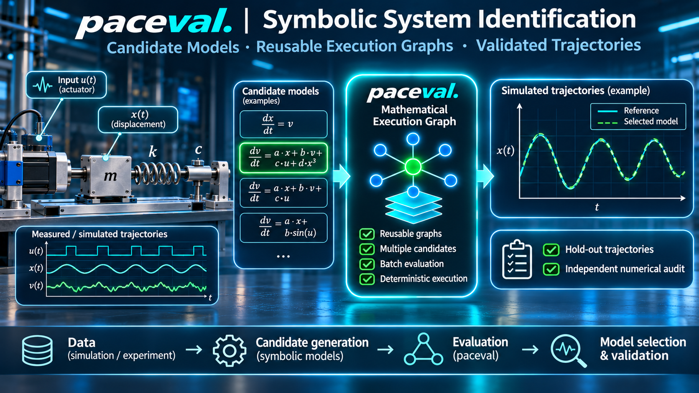
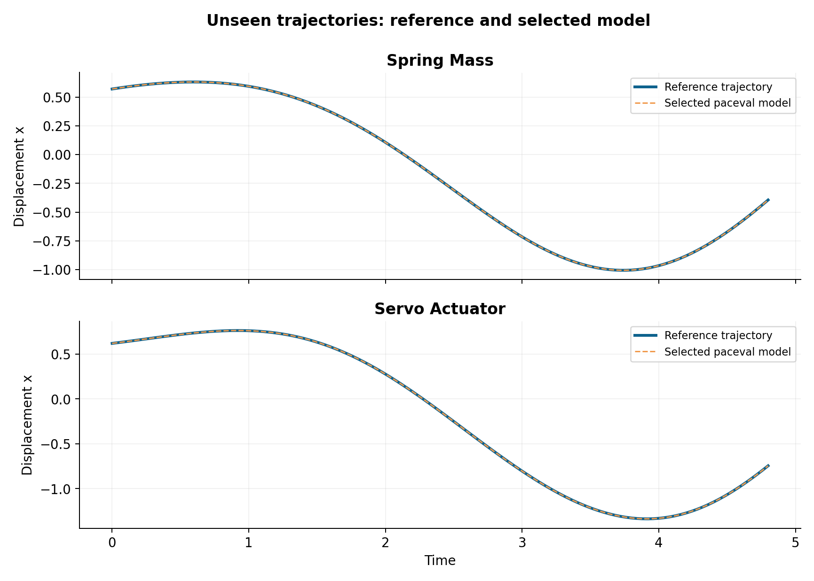

# paceval | Symbolic System Identification Research



**Candidate Models · Reusable Execution Graphs · Independently Validated Trajectories**

A reproducible, **offline C++ research demonstrator** for screening explicit mathematical candidates in nonlinear dynamical-system identification. The mathematical expressions are executed by the real paceval engine through its official C/C++ interface. Data generation, differentiation, selection, integration and scientific checks remain independent host responsibilities.

**[Read the English research whitepaper (PDF)](paceval_Symbolic_System_Identification_Whitepaper_EN.pdf)** · **[C++ source](src/system_identification.cpp)** · **[Reproduction files](examples/validation.json)**

## Scientific motivation

The 2016 SINDy work and the PySINDy practical guidance emphasize that identifying dynamical equations involves choosing candidate functions, estimating derivatives and validating models, not simply evaluating expressions. paceval can serve as a reusable mathematical execution layer inside this workflow without replacing the symbolic search or the ODE solver. The study is a **controlled synthetic feasibility demonstration**, not experimental identification of an unknown physical law.

The first system is a forced nonlinear spring–mass–damper and the second is a synthetic servo actuator with cubic velocity damping. Both use state `x` (position) and `v` (velocity), controlled input `u(t)`, and `dx/dt = v`. For the second state equation, the tested model families share the base `dv/dt = a*x + b*v + c*u`, optionally extended by one of `d*x^3`, `d*x^2`, `d*sin(x)`, `d*v^3`, `d*x*v`, or `d*tanh(x)`.

The dimensionless parameterization is deliberately synthetic. The word **servo** names an illustrative second-order control model; the parameters are not claimed to come from an identified physical actuator. It is not a hardware-ready control system.

## What paceval actually implements

- **Seven persistent computation graphs**, one for each candidate mathematical family, constructed using `paceval_CreateComputation()` and evaluated repeatedly with `paceval_dGetComputationResultExt()`.
- **Two additional TINC computation graphs** for a pointwise interval diagnostic of the two selected formula families.
- All 3,000 versioned candidate instances share these seven mathematical structures and vary their parameter inputs without reconstructing the graphs.
- The selected candidates are integrated with RK4 while evaluating each acceleration through `paceval_dGetComputationResult()`.
- A model-version update changes a coefficient and demonstrates reuse of the existing graph.

The C++ host generates samples, computes second-order finite-difference acceleration targets, ranks candidates, selects models using training/validation splits and checks the held-out trajectories. This is intentionally distinct from the role of paceval.

## Reproduced results

| Measurement | Validated result |
|:--|:--|
| Candidate pool | 3,000 variants (1,500 per system) across seven formula families |
| Data partitions, per system | 3 training, 2 validation, 2 fully held-out trajectories |
| Model selection | Prespecified ground-truth family recovered for both systems |
| Spring–mass held-out displacement RMSE | 7.52 × 10⁻⁸ (synthetic state units) |
| Servo held-out displacement RMSE | 4.36 × 10⁻⁸ (synthetic state units) |
| Native C++ numerical checks | 7,325 comparisons, no tolerance failures |
| Independent 110-decimal-digit audit | 144/144 RHS evaluations within specified tolerance |
| TINC pointwise reference containment | 24/24 tested samples |
| Batch reproducibility | Size 37 and size 128 produced byte-identical CSV/JSON outputs |
| Test environments | GCC 14.2, Clang 17 and AddressSanitizer/UndefinedBehaviorSanitizer: all 3/3 CTests passed |

**Interpretation.** The correct model structures and their coefficients were explicitly planted in the candidate pools. The reference data are noise-free simulations, and their acceleration targets are estimated using finite differences. Thus the strong held-out agreement demonstrates faithful model screening, mathematical evaluation and numerical integration **within this controlled setting**, not a guarantee of parameter identifiability, real-world accuracy or model discovery. The TINC figure is a sampled containment observation, not a general interval certification. No performance superiority is asserted.

## Build and run on Linux

Prerequisites: C++17 compiler, CMake 3.16 or newer, and a compatible externally supplied `libpaceval_linux_sharedLIB.so` binary. The official `paceval_main.h` and `paceval_main.cpp` are already included under `src/`; **the proprietary `.so` is deliberately not redistributed**.

```bash
export PACEVAL_LIB="/absolute/path/to/libpaceval_linux_sharedLIB.so"
cmake -S src -B build -DCMAKE_BUILD_TYPE=Release -DPACEVAL_RUNTIME="$PACEVAL_LIB"
cmake --build build -j
ctest --test-dir build --output-on-failure
./build/system_identification --candidates 1500 --batch 128 --output results
```

The program creates reproducible CSV/JSON files under `results/`. It also supports `--batch 37` for a second, byte-identical execution. To perform the independent high-precision check, use Python with `mpmath`:

```bash
python -m pip install mpmath
python src/high_precision_reference.py results --output results/high_precision_audit.json
```

For figures, install `pandas`, `numpy` and `matplotlib`:

```bash
python -m pip install pandas numpy matplotlib
python src/make_figures.py results figures
```

Optional Clang: configure a separate CMake build with `-DCMAKE_CXX_COMPILER=clang++`. The `build/` directory and local generated `results/` are ignored by Git.

## Project sources and examples

| Asset | Purpose |
|---|---|
| [`src/CMakeLists.txt`](src/CMakeLists.txt) | Direct official SDK compilation and external runtime linkage |
| [`src/system_identification.cpp`](src/system_identification.cpp) | Candidate evaluation, data splits, independent native oracle and RK4 |
| [`src/paceval_main.h`](src/paceval_main.h), [`src/paceval_main.cpp`](src/paceval_main.cpp) | Official paceval C/C++ API layer; original license comments retained |
| [`src/high_precision_reference.py`](src/high_precision_reference.py) | Independent 110-decimal-digit numerical audit |
| [`src/make_figures.py`](src/make_figures.py) | Rebuilds scientific figures from published CSV files |
| [`examples/observations.csv`](examples/observations.csv) | Deterministic simulated trajectories and finite-difference targets |
| [`examples/candidates.csv`](examples/candidates.csv) | 3,000 candidate definitions, coefficients and training errors |
| [`examples/selection.csv`](examples/selection.csv) | Selected candidates and split-specific errors |
| [`examples/heldout_trajectories.csv`](examples/heldout_trajectories.csv) | Independent trajectory predictions versus simulation |
| [`examples/model_updates.csv`](examples/model_updates.csv) | Controlled coefficient-version update |
| [`examples/audit_samples.csv`](examples/audit_samples.csv), [`examples/tinc_samples.csv`](examples/tinc_samples.csv) | Independently audited numerical samples |
| [`examples/validation.json`](examples/validation.json), [`examples/high_precision_audit.json`](examples/high_precision_audit.json) | Machine-readable scientific evidence |

## Scientific illustrations

The publication contains eight data-derived charts. Click each figure to inspect the full-size PNG or use the corresponding SVG for editable vector graphics.

| Figure | PNG | SVG |
|---|---|---|
| Whole-trajectory train/validation/test partition | [01](figures/01_data_splits.png) | [SVG](figures/01_data_splits.svg) |
| Candidate family screening | [02](figures/02_candidate_error_landscape.png) | [SVG](figures/02_candidate_error_landscape.svg) |
| Held-out displacement trajectories | [03](figures/03_heldout_displacement.png) | [SVG](figures/03_heldout_displacement.svg) |
| Held-out velocity trajectories | [04](figures/04_heldout_velocity.png) | [SVG](figures/04_heldout_velocity.svg) |
| Independent trajectory residuals | [05](figures/05_heldout_residuals.png) | [SVG](figures/05_heldout_residuals.svg) |
| Mathematical model update | [06](figures/06_parameter_update.png) | [SVG](figures/06_parameter_update.svg) |
| TINC interval diagnostics | [07](figures/07_tinc_interval_widths.png) | [SVG](figures/07_tinc_interval_widths.svg) |
| Train/validation/test error comparison | [08](figures/08_split_errors.png) | [SVG](figures/08_split_errors.svg) |



## Research references

1. Brunton, Proctor & Kutz (2016), *Discovering governing equations from data by sparse identification of nonlinear dynamical systems*, PNAS, DOI: https://doi.org/10.1073/pnas.1517384113
2. PySINDy practical guidance on differentiation and data quality: https://pysindy.readthedocs.io/en/latest/tips.html
3. paceval official API: https://paceval.com/api/
4. paceval source repository: https://github.com/paceval/paceval

The external paceval runtime and the original SDK licenses are governed by their own terms; those original source-file notices have been preserved. No separate `LICENSE_NOTICE.md` is included. The banner is a conceptual marketing illustration; every numbered scientific figure is produced from the included test data.
