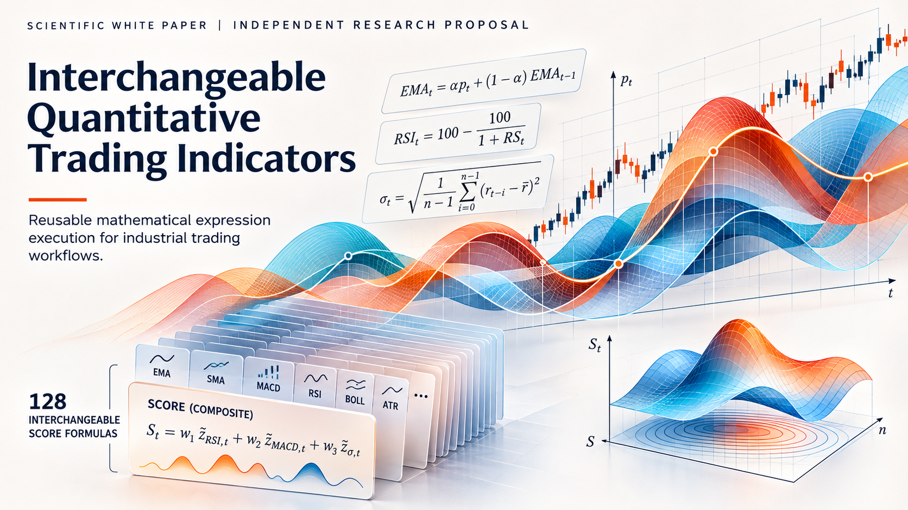
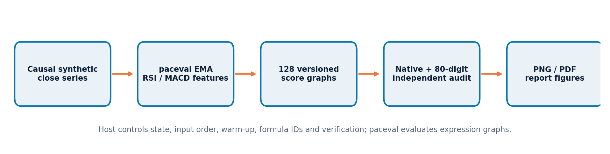
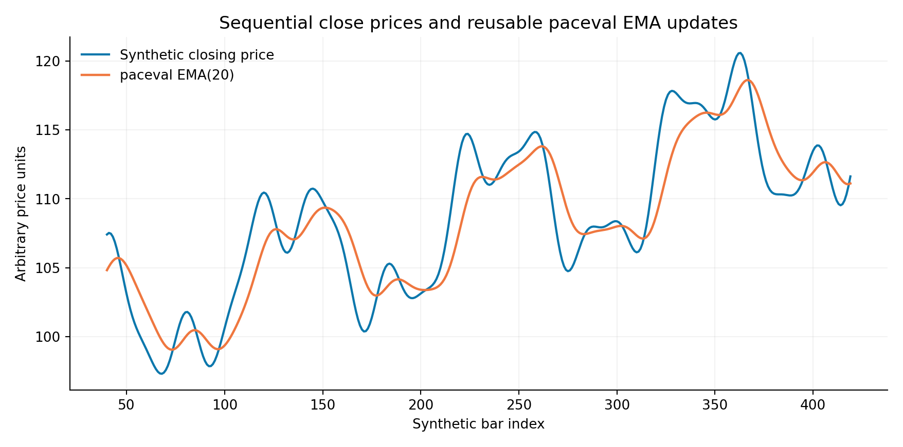
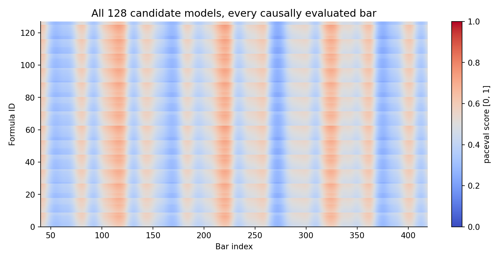
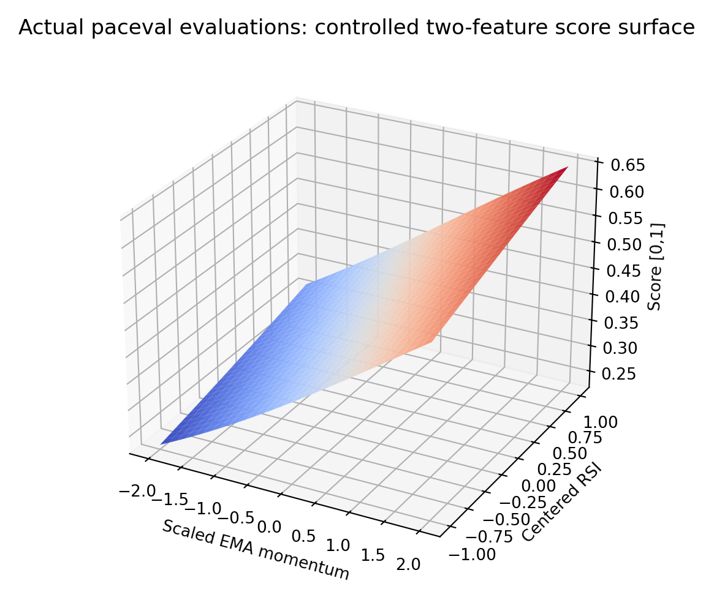

# paceval. | Interchangeable Quantitative Trading Indicators



**A reproducible C++ mathematical feasibility demonstrator using the original paceval C/C++ SDK.** The project evaluates stateful indicators and **128 different, versioned composite mathematical scores** over deterministic synthetic price bars. The aim is to test reliable interchange, formula reuse, input causality and numerical auditability, **not** to identify a profitable trading strategy or give investment advice.

[English research whitepaper (PDF)](paceval_Interchangeable_Trading_Indicators_Whitepaper_EN.pdf) · [Documented C++ implementation](src/trading_indicators.cpp) · [CMake build](src/CMakeLists.txt) · [Independent audit](results/independent_audit.json)

## 1. Industrial application and research question

A research team, financial-data software company, model-risk function, indicator-library provider, or quantitative analytics platform can maintain many independently versioned scoring expressions on top of a **shared stream of causal market features**. One indicator update may be reused by dozens of mathematical score formulas without changing its smoothing state. The project tests that component architecture with fixed, reproducible inputs.

The originating **WP_021** proposal studies interchangeable quantitative trading indicators, originally illustrating the exponential moving average `EMA_t = a * p_t + (1-a) * EMA_(t-1)`. This implementation expands the demonstration to EMA, Wilder-style RSI, MACD, rolling volatility, 128 explicitly different combined score expressions, a controlled version update, scalar calculation, batch evaluation, and independent numerical auditing. The mathematical scope is **an expression-execution kernel**, not a trading or backtesting engine.



## 2. Mathematical contracts

The host supplies bars in increasing time order; paceval evaluates the declared mathematical graphs. `p` is the current synthetic close in arbitrary price units.

| Function | Mathematical definition and implementation |
|---|---|
| EMA(n) | `EMA_t = α*p_t + (1-α)*EMA_(t-1)`, `α = 2/(n+1)`; first close seeds each EMA. The paceval EMA graph is reused for EMA(12), EMA(20), EMA(26), EMA(9) signal updates and Wilder average updates. |
| MACD(12,26,9) | `MACD_t = EMA12_t - EMA26_t`; `signal_t = EMA9(MACD)_t`; `hist_t = MACD_t - signal_t`. |
| RSI(14), Wilder | Mean gains and mean losses are initialized from the first 14 price changes; thereafter `G_t = (13*G_(t-1)+gain_t)/14` and similarly for `L_t`, then `RSI = 100*G/(G+L)` in paceval. If `G=L=0`, the host convention is `RSI=50`. |
| Realized volatility | Sample standard deviation of the **20 trailing log returns**, multiplied by `sqrt(252)`. The rolling reduction is deliberately in the C++ host, not claimed to run inside paceval. |
| Normalized factors | `m = 100*(p/EMA20-1)/5`, `h = 100*(MACD-signal)/p/1.5`, `q = (RSI-50)/50`, `v = annualized_volatility_percent/20`. Several transformations are computed by paceval expression graphs. |
| Composite score j | `score_j = 1/(1+exp(-z_j))`, where `z_j = a_j+b_j*m+c_j*h+d_j*q+e_j*v+k1_j*m*q+k2_j*h*v`. Model-specific interaction constants are embedded into **128 distinct expression strings**; model weights remain version-controlled numeric inputs. Score is a bounded descriptor in `[0,1]`, not a probability of profit. |

The score graph contains nine variables: `a b c d e m h q v`. Variables passed to each graph are finite and dimensionless after normalization. The host chooses `40` bars of warm-up before emitting score values. The synthetic series contains `420` indexed bars; `380` bars yield score outputs.

## 3. Observed execution and independent audit

| Executed verification | Observed outcome |
|---|---:|
| Distinct version-one score expressions | **128** persistent paceval graphs |
| Controlled version-two score | 1 additional persistent graph |
| Reusable base mathematical operation graphs | 6 |
| Emitted score evaluations | **48,640 / 48,640** matched separately coded native C++ within `1e-9*(1+abs(reference))` |
| Packed batch SDK checks | **2,048 / 2,048** passed with per-item error codes |
| 3D score-surface evaluations | **3,721 / 3,721** agreed with separate native formulas |
| 80-digit Python Decimal audit | **1,014 / 1,014** passed |
| Prefix-causality test | 200 overlapping state records and **25,600 overlapping score records exactly identical** between 240-bar and 420-bar runs |
| SDK CMake / CTest integration | **1 / 1 passed** on compatible x86-64 Linux runtime |

These are **observations from synthetic inputs**, not statements about investment performance, trading profit, model validity on actual securities, or a system-wide floating-point accuracy proof. Original SDK headers retain upstream notices. No proprietary shared library is included.

[Full state CSV](examples/indicator_states.csv) · [All 48,640 scores](examples/score_results.csv) · [Model registry](examples/models.csv) · [Controlled version update](examples/version_comparison.csv) · [3D surface samples](examples/score_surface.csv) · [Verification JSON](results/independent_audit.json) · [SDK run log](results/sdk_execution.txt) · [CTest log](results/ctest_sdk.txt)



## 4. Build with the original paceval C/C++ API

The actual source files [`paceval_main.cpp`](src/paceval_main.cpp) and [`paceval_main.h`](src/paceval_main.h) are included in the `src/` directory, with their original upstream AGPL headers and function implementations; the relative include path in `paceval_main.cpp` is adjusted for this repository layout. `trading_indicators.cpp` compiles alongside the official API facade. It calls `paceval_InitializeLibrary`, `paceval_CreateComputation`, `paceval_dGetComputationResult`, `paceval_dGetComputationResultExt`, error reporting, deletion, and `paceval_FreeLibrary`. The runtime is supplied externally; this repository deliberately does not redistribute `libpaceval*.so`.

```bash
cmake -S src -B build -DCMAKE_BUILD_TYPE=Release \
  -DPACEVAL_RUNTIME=/absolute/path/to/libpaceval_linux_sharedLIB.so
cmake --build build -j
ctest --test-dir build --output-on-failure
./build/trading_indicators --out reproduced
./build/trading_indicators --bars 240 --out prefix_replay
python3 src/verify_results.py reproduced --prefix prefix_replay \
  --output reproduced_audit.json
python3 src/make_figures.py
python3 src/make_whitepaper.py
```

For the independent audit no third-party Python package is required (`Decimal` is in the Python standard library). Scientific figures require NumPy and Matplotlib; regenerating the whitepaper requires ReportLab. The scripts that recreate figures and the report read the **checked-in `examples/` exports**; to plot a new `reproduced/` run, copy its five CSV files to `examples/` or adapt the plot input path. Run tests with a runtime compatible with the target architecture and ABI. Original upstream SDK source copyright and licensing terms apply.

## 5. Scientific diagrams generated from actual paceval output

All numbered charts are generated from the verified C++ export and are available as PNG and vector PDF. The **cover graphic is a conceptual illustration**, not a numeric plot.

- [Causal execution architecture](figures/01_execution_architecture.png), [vector](figures/01_execution_architecture.pdf)
- [Synthetic close and paceval EMA](figures/02_price_and_ema.png), [vector](figures/02_price_and_ema.pdf)
- [RSI and MACD indicator traces](figures/03_rsi_macd.png), [vector](figures/03_rsi_macd.pdf)
- [Five representative distinct scoring graphs](figures/04_five_score_models.png), [vector](figures/04_five_score_models.pdf)
- [All 128 score families across all causal bars](figures/05_score_family_map.png), [vector](figures/05_score_family_map.pdf)
- [3D score response surface from **3,721 actual paceval evaluations**](figures/06_score_response_surface.png), [vector](figures/06_score_response_surface.pdf)
- [Model version 1 compared with version 2](figures/07_controlled_model_update.png), [vector](figures/07_controlled_model_update.pdf)
- [Native numerical-discrepancy distribution](figures/08_numerical_audit.png), [vector](figures/08_numerical_audit.pdf)





## 6. Reproducibility and interpretation

All model coefficients, distinct expression strings, computed states, score outputs, numerical comparison values and sample coordinates are in the repository. The prefix-invariance audit compares the first 240 source bars in a 420-bar run with a completely separate 240-bar run. It finds bit-for-bit identical overlapping exported CSV rows, providing a targeted no-future-data regression check. This does not replace historical event-time replay testing, data-feed timestamp checks, survivorship-bias audits, or forward-looking trading evaluations.

**Not claimed:** real market data validation, broker connectivity, live trading, risk management, signal predictive accuracy, portfolio returns, slippage/cost modeling, or hardware-independent speed improvements. No future-dependent training or model selection is used. Negative financial outcomes would not contradict the computational feasibility finding.

## 7. External sources

1. [paceval public C/C++ SDK API](https://paceval.com/api/)
2. [QuantConnect: indicator conventions, warm-up, and initialization](https://www.quantconnect.com/docs/v2/writing-algorithms/indicators/key-concepts)
3. [QuantConnect: rolling windows for past data](https://www.quantconnect.com/docs/v2/writing-algorithms/indicators/rolling-window)
4. [pandas-ta indicator taxonomy and MACD naming](https://github.com/aarigs/pandas-ta/blob/master/README.md)

These references are background sources for conventions and research practice, not claims of affiliation, third-party verification or a trading-system deployment.
