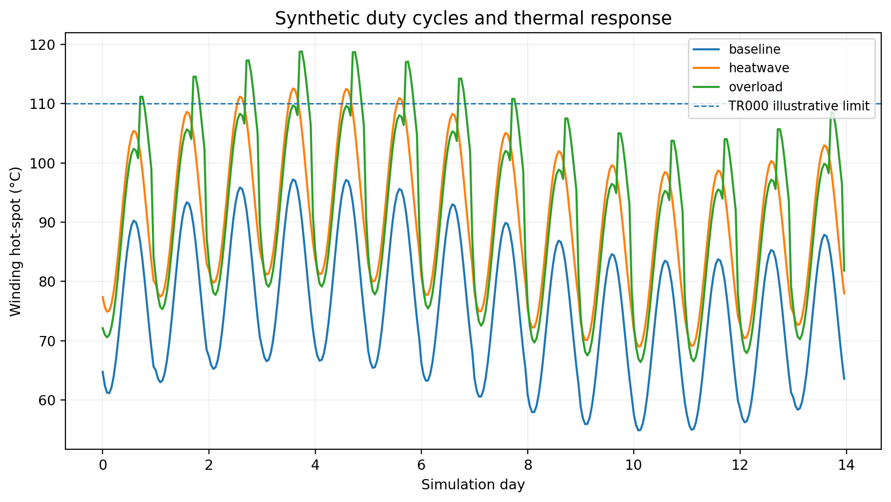
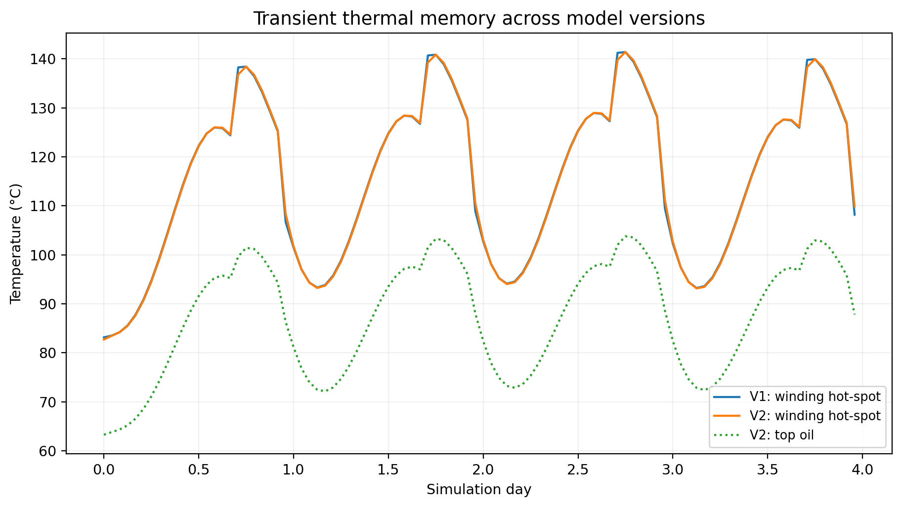
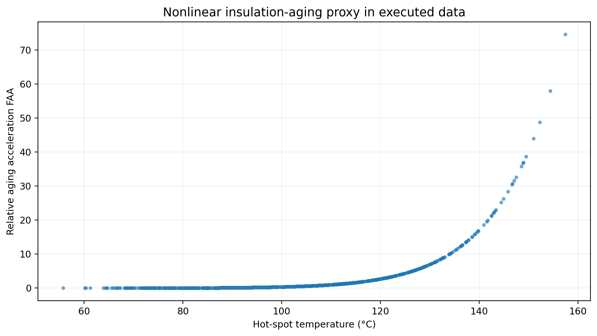
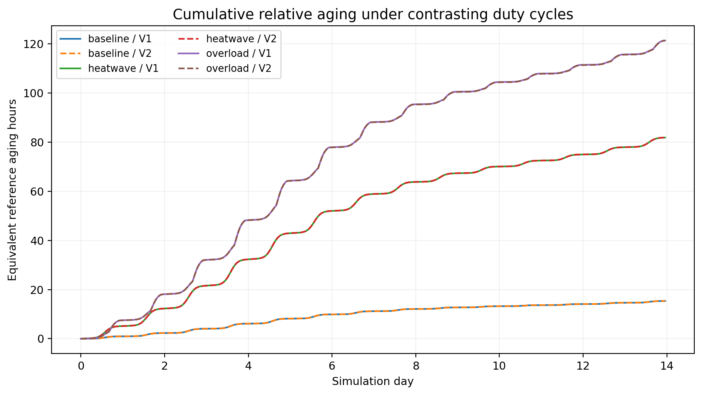
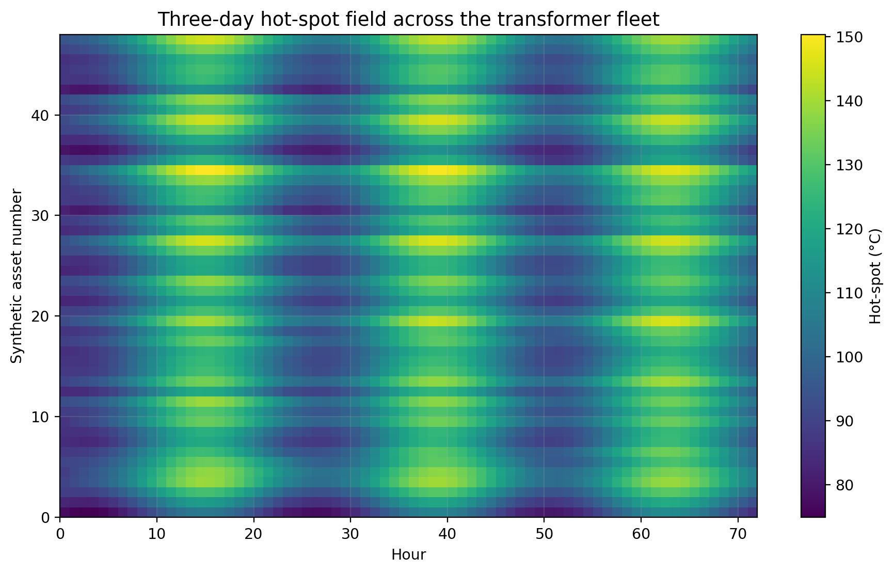
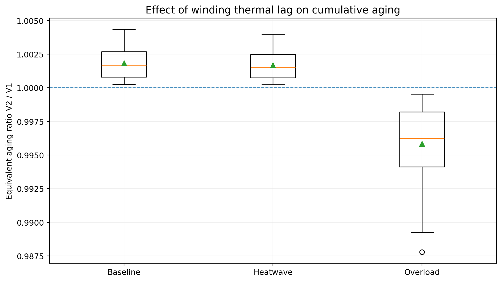
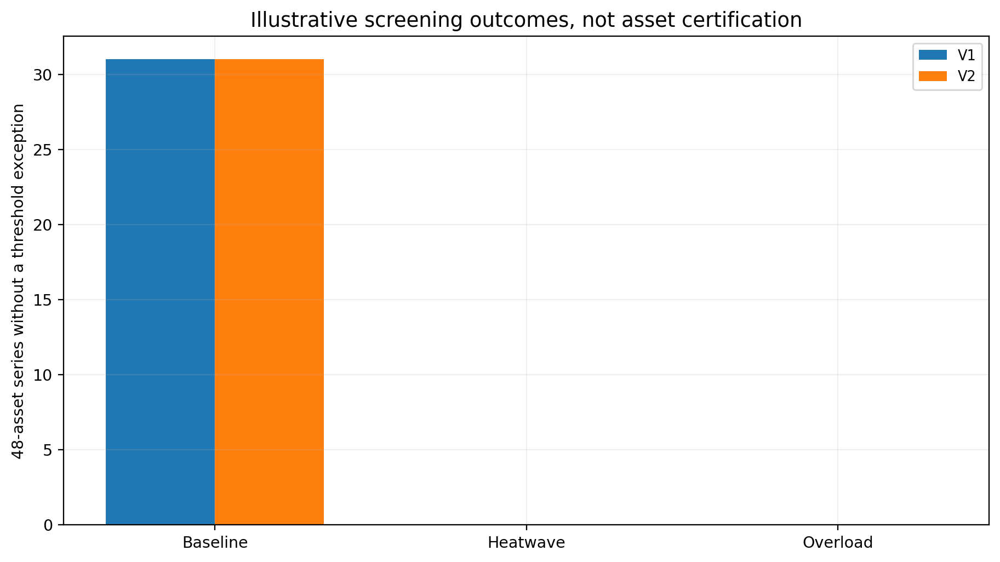
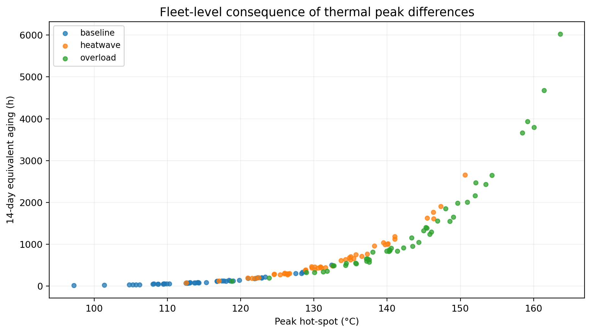
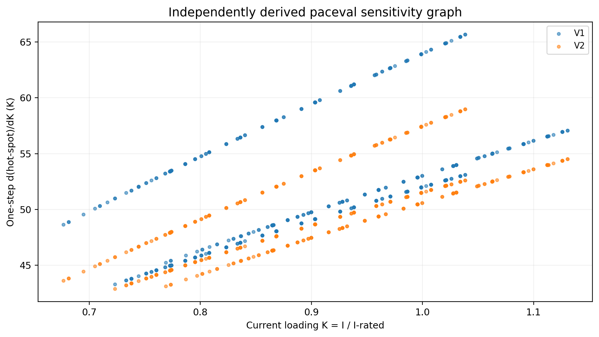
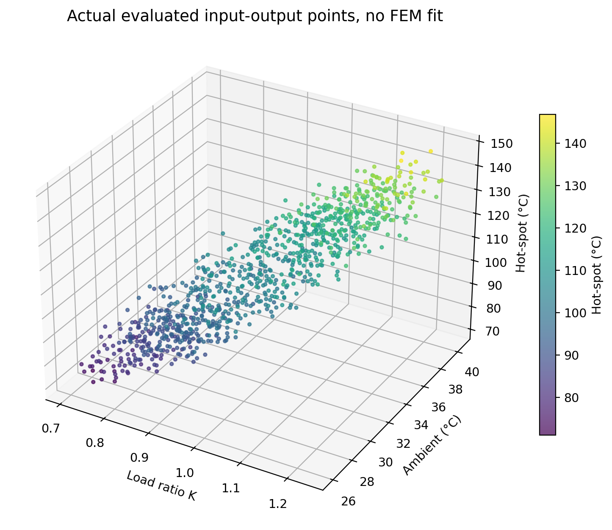

# Transformer Hot-Spot Temperature and Insulation Aging Screening with paceval


**WP 14 | Independent industrial mathematical-function research | 14 November 2026**

This is a complete, reproducible **synthetic-data research demonstrator**, implemented in C++ with the **original paceval 4.25 Mathematical Engine**. It evaluates two versioned thermal models, transient temperature states, relative insulating-paper aging, time-varying overload scenarios, mathematical margins and analytical sensitivities. It is not an approved transformer protection relay, asset-life predictor, IEEE/IEC conformity implementation, or regulatory loading assessment. The externally supplied Linux `libpaceval_linux_sharedLIB.so` is required to rerun; the shared library is deliberately excluded from this repository package.

## 1. Industrial use case and current state of the art

Transmission and distribution operators must decide how a transformer responds thermally to short-term peaks, changing ambient temperature and unusual seasonal loading. Electrical current causes winding losses and heating. Cooling oil, winding material, and the mechanical enclosure store and release heat at different rates. The **winding hot-spot temperature** is an important aging-related indicator: a brief high-temperature event can contribute disproportionately to the modeled thermal-aging integral. Engineers analyze loading cycles using measured nameplate, oil and winding-rise data, thermal time constants, cooling configuration and, where available, online sensors.

A typical workflow retrieves hourly (or finer) current and ambient-temperature data, associates it with transformer-specific thermal parameters, computes the thermal state sequentially, evaluates a hot-spot/aging model and reports violated engineering limits for further investigation. These mathematical calculations can be separated from data ingestion, monitoring systems, alarm policy, protection devices and asset-management decisions.

**Current standards and practice.** [IEEE C57.91-2025](https://standards.ieee.org/ieee/C57.91/7163/), approved in 2025 and published 5 March 2026, supersedes the 2011 edition. The new guide covers oil-immersed transformer loading and differing thermal-model levels, including duct-oil considerations. [IEC 60076-7:2018](https://webstore.iec.ch/en/publication/34351) provides a loading guide for mineral-oil-immersed transformers and relates changing ambient conditions and load to hot-spot temperature and thermal aging. A [2023 peer-reviewed study](https://ietresearch.onlinelibrary.wiley.com/doi/10.1049/hve2.12333) combines dynamic thermal-rating analysis with fibre-optic measurements. Commercial ecosystems such as [Hitachi Energy TXpert](https://www.hitachienergy.com/products-and-solutions/transformers/the-txpert-ecosystem/txpert-hub) support condition monitoring and transformer temperature or aging indicators. These products and standards are context, **not measured validation** for this study.

**The studied function.** For 48 synthetic mineral-oil-cooled transformer parameter sets and three 14-day loading scenarios, the original local paceval SDK executes persistent graphs for the top-oil state, winding thermal rise, hot-spot, Arrhenius-style relative-aging factor, signed engineering margins, cumulative equivalent-aging time and alternative models. A C++ host advances state from hour to hour while paceval evaluates the mathematically relevant transition and accumulation functions. Independent native C++ and 85-digit mpmath reference implementations check the physical calculations. The distinction is important: the demonstration establishes mathematical function execution and reference consistency, not transformer life expectancy.

## 2. Two scientific model versions and explicit equations

At every timestep the load ratio is **K = current / rated current**, and the illustrative ultimate top-oil rise above ambient is **Uoil = topRated × coolingFactor × ((R K² + 1)/(R + 1))^n**. The ultimate hot-spot rise above top oil is **Uwind = hotRated × K^(2m)**. Here R is the load-to-no-load loss ratio, while n and m are empirical exponents. All model coefficients are hypothetical and not calibrated to a particular transformer design.

- **V1, oil lag and instantaneous winding response:** `To_next = Uoil + (To_prev - Uoil) * exp(-dt / (tauOil * coolingFactor))`; `Hw_next = Uwind`.
- **V2, dual thermal lag:** The same oil equation applies, while `Hw_next = Uwind + (Hw_prev - Uwind) * exp(-dt / tauHot)`.

The predicted hot-spot in °C is `Ths = Tamb + To_next + Hw_next`. This separation distinguishes *top-oil rise* from *winding rise above top oil*, avoiding double counting. The Arrhenius-style proxy is `FAA = exp(15000/(TrefC+273.15) - 15000/(Ths+273.15))`; the reference temperature is explicitly **110 °C**, so `FAA = 1` at 110 °C, independent of the observation period. The paceval graph also evaluates the accumulated equivalent-aging state `A_next = A_previous + dt * FAA`, measured in **reference-equivalent hours**, not estimated years of remaining life. V2 is a controlled model extension, not a certified reproduction of the full IEEE C57.91-2025 thermal system.

For every interval paceval calculates signed margins `Mhs = limitHS - Ths`, `Moil = limitOil - TopOil`, `Mfaa = limitFAA - FAA`, and `Mk = limitLoad - K`. A Boolean graph declares a **mathematical screening pass** when all four margins are nonnegative, including equality. A separate composite penalty graph illustrates model-based prioritization. The C++ program reports whether all intervals in a complete time series met the *illustrative* thresholds. This is explicitly not an operating permission or a trip setting.

Analytical paceval sensitivity graphs include `dUoil/dK`, `dUwind/dK`, `dThs/dK`, `dFAA/dThs`, `dFAA/dK`, and state-memory/ambient derivatives. These were derived independently for the exact selected two models. No automatic differentiation is claimed.

## 3. What was genuinely executed

| Mathematical function or industry purpose | Actual execution owner | Graph/Version or reason |
|---|---|---|
| Current-to-rated ratio and ultimate oil/winding rise | paceval | `LOAD_RATIO`, `ULTIMATE_TOP_RISE`, `ULTIMATE_HOT_RISE`, V1/V2 |
| Oil/winding thermal memory and next state | paceval | `OIL_DECAY`, `HOT_DECAY`, `TOP_RISE_NEXT`, `HOT_RISE_NEXT`, V1/V2 |
| Top-oil/hot-spot temperature and aging factor | paceval | `TOP_TEMP`, `HOTSPOT`, `FAA`, V1/V2 |
| Period aging and full-series cumulative aging recurrence | paceval | `AGE_INCREMENT`, `AGE_ACCUM`, V1/V2 |
| Peak temperature and minimum signed margin recurrence | paceval | `PEAK_HOTSPOT`, `MIN_HOTSPOT_MARGIN`, V1/V2 |
| All four constraint margins, Boolean guard and risk score | paceval | `MARGIN_*`, `COMPOSITE_GUARD`, `RISK_SCORE`, V1/V2 |
| Analytical load and temperature sensitivities | paceval | `D_*`, V1/V2 |
| Temperature, FAA, aging and margin model comparison | paceval | Seven `V1_vs_V2` graphs |
| Hourly time ordering, CSV validation and final reporting | C++ | Stateful control flow and I/O, not algebraic formulas |
| Independent accuracy auditing | Native C++ and mpmath | Reference only, not substituted for paceval outputs |

The complete machine-readable manifest, graph execution inventory and observed API counters are in [results/formula_manifest.csv](results/formula_manifest.csv), [results/math_execution_inventory.csv](results/math_execution_inventory.csv) and [results/execution_evidence.json](results/execution_evidence.json). They distinguish creation, genuine execution, scenarios, batch calls and graph-point evaluations. The original public SDK calls used for research are `paceval_CreateComputation`, `paceval_dGetComputationResult`, `paceval_dGetMultipleComputationsResultsExt`, and the SDK's numeric text-conversion routines.

## 4. Experimental material and reproducible results

The [input generator](scripts/generate_input.py) deterministically creates 48 synthetic assets, with 336 hourly observations under **baseline, heatwave and overload** conditions. This yields **48,384 distinct hourly input records** and **96,768 model-hour records** across V1 and V2. The parameters are illustrative, and no utility, customer or operator measurements are represented.

The executed C++ experiment created and executed **63 of 63 domain graphs**, checked **23,916 native reference assertions** and passed **137,184 independent high-precision assertions** across 24 complete sampled asset/scenario/model time series. The five automatic CTests are run from the provided CMake build. Sample-level internal numeric differences and predeclared tolerances are recorded in [results/high_precision_audit.json](results/high_precision_audit.json) and [results/native_audit.csv](results/native_audit.csv), rather than promoted as a software comparison in this public README.

| Synthetic scenario | V1 mean peak hot-spot | V2 mean peak hot-spot | V1 mean equivalent aging | V2 mean equivalent aging | Complete series meeting *all* illustrative limits, V1/V2 |
|---|---:|---:|---:|---:|---:|
| Baseline | 115.18 °C | 115.20 °C | 123.90 h | 124.19 h | 31 / 31 of 48 |
| Heatwave | 132.22 °C | 132.24 °C | 663.30 h | 664.73 h | 0 / 0 of 48 |
| Overload | 142.70 °C | 142.64 °C | 1,403.06 h | 1,395.58 h | 0 / 0 of 48 |

These figures summarize **synthetic model outputs**, not observed utility fleet aging or a standards-compliant loading rating. The small V1/V2 differences for the chosen hourly sampling are scientifically meaningful sensitivity to model assumptions, not evidence of predictive superiority. In particular, the influence of winding memory can reverse with a different load trajectory. Equivalent aging hours are a temperature-weighted integral, **not elapsed operating hours or calendar life consumed**.





















For detailed captions, models, test interpretation and literature see the [scientific PDF](paceval_Transformer_Hotspot_Insulation_Aging_Whitepaper_EN.pdf).

## 5. Reproduce on Linux x86-64

The actual original `paceval_main.cpp` and `paceval_main.h` (SDK 4.25) are in `src/`, with only the original C++ include path adapted to the local `src/` layout. Their original AGPL notices remain intact. The prebuilt Linux shared library is **not included** in the ZIP. The library must be obtained separately under applicable license conditions.

```bash
python3 scripts/generate_input.py
cmake -S src -B build -DCMAKE_BUILD_TYPE=Release \
  -DPACEVAL_RUNTIME=/absolute/path/to/libpaceval_linux_sharedLIB.so
cmake --build build -j
ctest --test-dir build --output-on-failure
./build/transformer_hotspot --run input/transformer_profiles.csv \
  input/transformer_parameters.csv results/
python3 scripts/verify_high_precision.py results/ input/
python3 scripts/make_figures.py
python3 scripts/make_whitepaper.py
```

The required research runtime is an original compatible ELF x86-64 Linux library. Dependency details and limitations are documented in [docs/REPRODUCE.md](docs/REPRODUCE.md) and [docs/SDK_COMPATIBILITY.md](docs/SDK_COMPATIBILITY.md). [Input CSV conventions](input/SCHEMA.md) prescribe comma-separated UTF-8, LF, period decimal and schema-whitelisted numeric literals; invalid expressions embedded in CSV numerics are **rejected before** paceval numeric conversion. API conversions are used for numeric input and output, not for untrusted expression evaluation. CSV display precision is not claimed to roundtrip bit-for-bit; binary64 numeric checks are run separately.

## 6. Research boundaries and extensions

A two-state, first-order, non-calibrated temperature proxy cannot represent transformer-specific oil ducts, bottom-oil rise, viscous cooling, dynamic winding resistance, radiator/fan configuration switching, moisture and oxygen effects, dissolved-gas diagnostics, paper condition or protection settings. IEEE C57.91-2025 introduced a revised methodology beyond these equations. Neither the normal nor the overload cases are an engineering permission to exceed a nameplate rating; the project's thresholds are not official IEEE/IEC limits. **No life-in-years, residual useful life, or certified short-term overload rating is inferred.**

A future measured-data study should fit cooling-configuration-specific parameters using temperature-rise and fibre-optic observations, independently compare the exact normative thermal model, incorporate top/bottom oil and winding measurements, and evaluate uncertainty/measurement provenance. The paceval graph layer could then be connected to a dedicated transformer monitoring workflow, while engineering sign-off and protective actions remain external. [Research validation details](RESEARCH_VALIDATION.md) enumerate evidence and remaining gaps.

## 7. Primary references

1. IEEE Standards Association. *IEEE C57.91-2025: Guide for Loading Mineral-Oil-Immersed Transformers and Step-Voltage Regulators*. Published 5 March 2026. https://standards.ieee.org/ieee/C57.91/7163/
2. IEC. *IEC 60076-7:2018, Power transformers – Part 7: Loading guide for mineral-oil-immersed power transformers*. https://webstore.iec.ch/en/publication/34351
3. *Dynamic thermal rating assessment of oil-immersed power transformers for multiple operating conditions*. High Voltage, 2023, DOI 10.1049/hve2.12333. https://ietresearch.onlinelibrary.wiley.com/doi/10.1049/hve2.12333
4. Hitachi Energy. *TXpert Hub, monitoring and thermal condition indicators*. https://www.hitachienergy.com/products-and-solutions/transformers/the-txpert-ecosystem/txpert-hub
5. paceval. *API reference, original Mathematical Engine*. https://paceval.com/api/

The title image is a conceptual visual, not a measured thermal field or a simulation result. The scientific plots are generated from the real local paceval results. No engine speed, throughput, energy-saving or hardware efficiency benchmark is presented.
