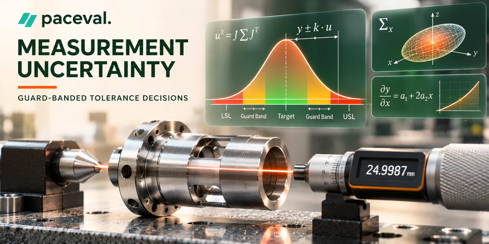
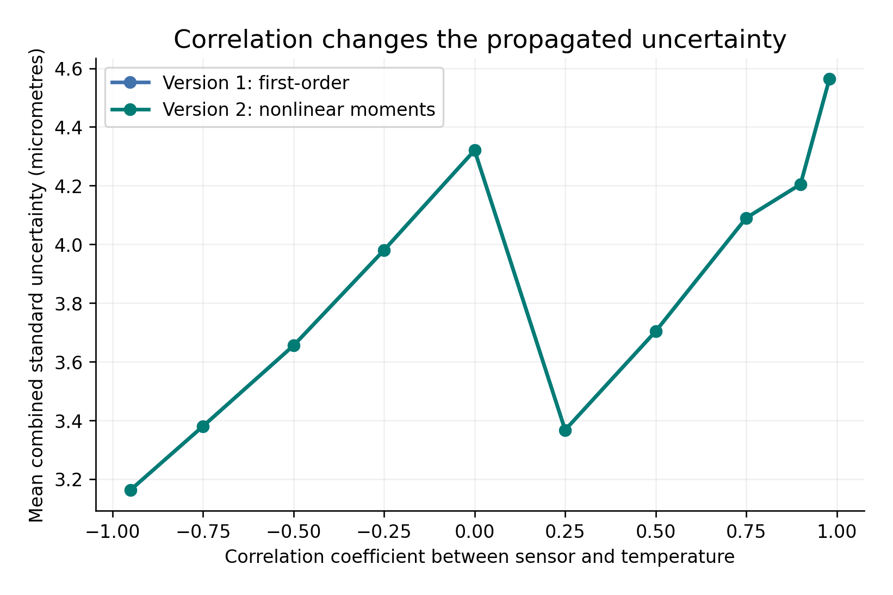
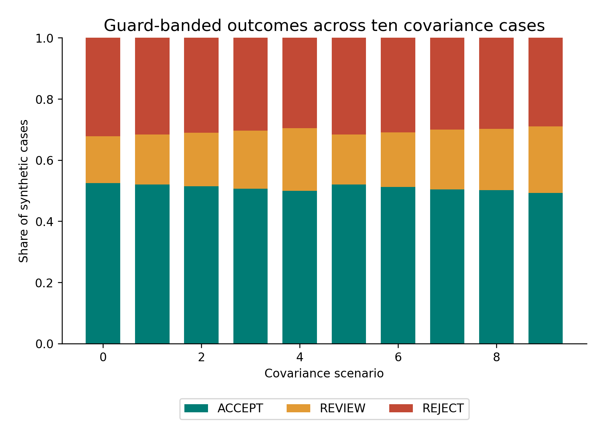

# WP 09 | Uncertainty-Aware Industrial Metrology and Tolerance Decisions



*Concept illustration, not a computed research result or a photograph of an installed system.*

**A reproduced, independently verified functional demonstrator using original paceval SDK 4.25.** This research turns calibration models, correlated standard uncertainty, nonlinear uncertainty correction, guard-banded tolerance assessment, analytical sensitivities and mathematical quality scores into reusable paceval execution graphs. The experiment uses **synthetic data** and does not perform an accredited inspection or authorize conformity statements.

[Full English whitepaper (PDF)](paceval_Uncertainty_Aware_Industrial_Metrology_Whitepaper_EN.pdf) · [Original research proposal](docs/original_WP09_proposal.pdf) · [Executable C++ program](src/metrology.cpp) · [CMake build](src/CMakeLists.txt) · [Executed function inventory](results/math_execution_inventory.csv) · [Evidence JSON](results/execution_evidence.json)

## 1. Industrial use case and current state of the art

An industrial metrology team measures machined components and has to determine whether the available evidence justifies accepting a part, rejecting it, or requesting further investigation. A calibrated numerical measurement is not sufficient on its own: sensor variation, temperature, calibration model revisions, correlated influences and measurement resolution contribute to uncertainty. Near a geometric tolerance boundary the decision rule matters as much as the corrected estimate.

For example, a hypothetical inspection station may use a normalized displacement-sensor signal `x` and the measured fixture temperature `T`. The calibrated displacement in millimetres is obtained by applying a controlled nonlinear formula. The system combines the uncertainty of `x`, temperature uncertainty, the covariance of both inputs and independent calibration and resolution components. A specified guard band then produces one of three **research statuses**, rather than pretending that a tolerance comparison is automatically certain.

The GUM framework (JCGM 100:2008) and the NIST TN 1297 treatment of combined uncertainty require relevant covariance contributions to be included. The 2026 JCGM 100 Amendment 1 addresses nonlinearity in measurement models. JCGM 101 describes propagation of distributions using Monte Carlo, JCGM 106 explains uncertainty in conformity assessment, and ISO 14253-1:2017 (confirmed in 2023) deals with decision rules for geometric product specifications. ILAC G8:09/2019 explains documented conformity decision rules. A January 2026 study on coordinate-measuring-machine guard-band charts provides a directly relevant example of current industrial research. The simulated rule here is not represented as implementing those standards in full. See the [official GUM guide collection](https://www.bipm.org/en/web/guest/publications/guides), [NIST combined uncertainty guidance](https://www.nist.gov/pml/nist-technical-note-1297/nist-tn-1297-5-combined-standard-uncertainty), [JCGM 106](https://www.bipm.org/en/doi/10.59161/JCGM106-2012), [ISO 14253-1](https://www.iso.org/standard/70137.html), [ILAC G8](https://ilac.org/publications-and-resources/ilac-guidance-series/) and [Choi & Hur (2026)](https://doi.org/10.1007/s12206-025-1244-8).

## 2. Defined mathematical model

The original WP 09 proposal specifies the quadratic measurement formula, first-order variance and a symmetric guard-band margin. The present extended study keeps that mathematical core and explicitly centers the temperature correction at 20 °C. For a normalized, dimensionless sensor signal `x`, temperature `T` in degrees Celsius, and a displacement output `y` in millimetres:

$$
 y_0 = a_0 + a_1 x + a_2 x^2 + b(T-20),\qquad J_x=\frac{\partial y_0}{\partial x}=a_1+2a_2x,\qquad J_T=b.
$$

The input correlation coefficient `rho` specifies `cov(x,T) = rho * u_x * u_T`. The two-input covariance matrix is positive semidefinite for nonnegative input standard uncertainties and `|rho| <= 1`. Independent additive calibration and resolution noise are included explicitly:

$$
 u_{1}^{2}=J_x^{2}u_x^{2}+b^{2}u_T^{2}+2J_xb\rho u_xu_T+u_{cal}^{2}+u_{res}^{2}.
$$

**Model v1** uses the first-order result, `y1 = y0` and `u1 = sqrt(u1²)`. **Model v2**, under the additional assumption of jointly Gaussian, zero-mean uncertainties in `x` and `T` and independent zero-mean Gaussian calibration and resolution noise, uses the exact first two moments of this quadratic mapping:

$$
 y_2=y_0+a_2u_x^2,\qquad u_2^2=u_1^2+2a_2^2u_x^4.
$$

The latter exact moment statement is conditional on the declared probability model, not an exact predictive distribution or certification of a metrology process. The full output distribution is generally non-Gaussian when `a2 != 0`.

### Documented guard-band research rule

With a synthetic symmetric tolerance `target ± tol` and a declared coverage factor `k = 2`, paceval evaluates both the *acceptance* and *rejection* margins:

$$
 m_A=tol-|y-target|-ku,\qquad m_R=|y-target|-tol-ku.
$$

If `mA >= 0`, the graph returns `ACCEPT = 1`; if `mR >= 0`, it returns `REJECT = 1`; otherwise the host reports `REVIEW`. Both guard indicators and the encoded decision `ACCEPT - REJECT` are genuine paceval graph outputs. The sign conventions are intentional: `REVIEW` is a nonempty uncertainty-overlap band, and a high numerical score is **not** an accredited nonconformity conclusion. The value `k = 2` is a declared convention; it does not automatically imply 95% coverage for every nonlinear or non-Gaussian case.

## 3. Actually executed paceval mathematics and host responsibilities

The host handles physical-domain checks, input schema, deterministic data generation, coefficient revision selection, graph handle ownership, batch routing, aggregation and the final text label. It cannot silently replace paceval's domain mathematics with native C++ arithmetic. The independent native calculation is a separate audit path, not the source of the published numerical outputs.

| Mathematical function and purpose | Actual executing component | Versions / graph stage |
| --- | --- | --- |
| Corrected measurand, derivatives, covariance and cross-covariance contribution | paceval | v1/v2 primary graphs |
| Model-dependent first-order or nonlinear-moment variance | paceval | v1/v2 primary graphs |
| Nonlinear mean correction and curvature variance contribution | paceval | v1/v2 primary graphs |
| Combined uncertainty and expanded uncertainty | paceval | v1/v2 secondary graphs |
| Acceptance and rejection margins, relational/logical guards | paceval | v1/v2 secondary graphs |
| Three-way numerical decision code and nonlinear quality score | paceval | v1/v2 secondary graphs |
| Output uncertainty sensitivity, target deviation and acceptance limits | paceval | v1/v2 secondary graphs |
| Covariance validity, input schema and final ACCEPT / REVIEW / REJECT string | C++ host | Validity and orchestration |
| All-entry reference and separate 80-digit mathematical verification | Native C++ / Python | Independent audit only |

The producer uses `paceval_dGetMultipleComputationsResultsExt` with graph-major output order, maintaining 42 different executed graph handles in the complete workload. The original `paceval_dConvertStringToFloat` and `paceval_dConvertFloatToString` are used on real numeric scenario CSV input/output. The C++ CSV schema rejects mathematical expressions masquerading as numeric literals before the input converter is invoked. Other operator self-tests verify `%` versus `mod`, relational comparisons, logical `AND`/`OR`/`NOT` and infix `min`/`max`. See the [graph registry](results/formula_registry.csv) and [exact execution evidence](results/execution_evidence.json).

## 4. Executed synthetic experiment

The complete run creates **10 controlled calibration revisions**, **10 predefined covariance scenarios**, and **5,000 synthetic sensor values** for each scenario. There are **500,000 distinct synthetic measurement inputs**, and both model versions are evaluated for each one, producing **1,000,000 model-point records**. This design does not use actual machine measurements and therefore cannot establish industrial measurement accuracy or traceability.

| Verified execution property | Actual result |
| --- | ---: |
| Original engine | paceval SDK 4.25 (compatible Linux library) |
| Persistently created and executed computation graphs | 42 |
| Multi-graph batches | 8,000 |
| Graph-point outputs | 21,000,000 |
| Independent native C++ numerical checks | 21,000,000 |
| 80-digit reference checks | 31,200 |
| Independent Monte Carlo checks | 14 scenarios, 60,000 draws per scenario |

The categorical results of the synthetic exercise, across both versions, are **509,567 ACCEPT**, **184,329 REVIEW** and **306,104 REJECT**. These counts are model outputs for predetermined hypothetical rules, not an industrial yield estimate. The archived [scenario summary](results/scenario_summary.csv) allows every scenario-specific count to be inspected.

## 5. Scientific figures

The following figures are reproducibly generated by [make_figures.py](src/make_figures.py). Except for the explicitly conceptual architecture and the separate independent Monte Carlo reference, they draw upon recorded paceval outputs.

- [01 | Architecture schematic (concept)](figures/01_architecture_concept.png)
- [02 | Combined standard uncertainty versus correlation](figures/02_correlation_uncertainty.png)
- [03 | Three-way decision distribution by covariance case](figures/03_status_shares_by_covariance.png)
- [04 | Calibrated output across coefficient revisions](figures/04_model_revision_shift.png)
- [05 | Standard uncertainty response field](figures/05_uncertainty_field.png)
- [06 | Guard-band geometry at an evaluated point](figures/06_guardband_geometry.png)
- [07 | Composite mathematical quality score](figures/07_quality_score_landscape.png)
- [08 | Parallel version decision outcomes](figures/08_versioned_decisions.png)
- [09 | Nonlinear mean correction](figures/09_nonlinear_bias.png)
- [10 | Analytical uncertainty sensitivity](figures/10_uncertainty_sensitivity.png)
- [11 | Independent Monte Carlo cross-check](figures/11_monte_carlo_reference.png)
- [12 | Decision map in sensor-correlation space](figures/12_decision_map.png)





## 6. Build and reproducibility

The project contains the unchanged original public SDK bridge files [paceval_main.h](src/paceval_main.h) and [paceval_main.cpp](src/paceval_main.cpp). A **compatible original shared runtime library is separately required**, and no `.so` binary is redistributed in this GitHub package.

```bash
cmake -S src -B build -DCMAKE_BUILD_TYPE=Release \
  -DPACEVAL_RUNTIME=/absolute/path/to/libpaceval_linux_sharedLIB.so
cmake --build build -j
ctest --test-dir build --output-on-failure

# Complete executed research workload
./build/metrology --run --revisions 10 --cases 10 --samples 5000 --out results/reproduced
python3 src/verify_reference.py results/reproduced
python3 src/monte_carlo_check.py results/reproduced/audit_samples.csv
python3 src/make_figures.py
```

Python dependencies are listed in [requirements.txt](src/requirements.txt). `make_figures.py` recreates the diagrams from the archived `results/` directory; the separate regenerated calculation is written to `results/reproduced/` by the above command and will not silently overwrite archived evidence. Additional quality checks are provided by [the README validator](src/check_readme.py), [the checksum verifier](src/verify_manifest.py) and the [SHA-256 inventory](results/sha256_manifest.txt).

## 7. Scientific interpretation and limitations

The measured-case experiments verify functional mathematical feasibility, model revision coexistence, covariance-sensitive uncertainty calculations and guard-banded three-way classification through the original paceval SDK. They do **not** prove calibration against physical reference standards, metrological traceability, a complete GUM-compliant uncertainty budget for a real instrument, an accredited decision rule, a robust coverage probability, or suitability for real process release. Version v2 moment formulas are exact only for the stipulated quadratic Gaussian model with independent additive Gaussian noise. The independent verification confirms the implementation and its model assumptions for the tested cases; it does not validate those assumptions for an actual CMM or gauge.

## 8. References and project provenance

1. [JCGM Guide suite, including JCGM 100:2008, 2026 Amendment 1 on nonlinearity, JCGM 101:2008 and JCGM 106:2012](https://www.bipm.org/en/web/guest/publications/guides).
2. [NIST TN 1297, combined standard uncertainty](https://www.nist.gov/pml/nist-technical-note-1297/nist-tn-1297-5-combined-standard-uncertainty) and [expanded uncertainty](https://www.nist.gov/pml/nist-technical-note-1297/nist-tn-1297-6-expanded-uncertainty).
3. [ISO 14253-1:2017, decision rules for geometric product specification, confirmed 2023](https://www.iso.org/standard/70137.html).
4. [ILAC G8:09/2019, guidelines for decision rules and conformity statements](https://ilac.org/publications-and-resources/ilac-guidance-series/).
5. [Choi & Hur (2026), experimental CMM guard-band charts, Journal of Mechanical Science and Technology](https://doi.org/10.1007/s12206-025-1244-8).
6. [Ferrero & Petri (2025), Measurement Uncertainty and Information Enabled Decision Making, IEEE Open Journal of Instrumentation and Measurement](https://doi.org/10.1109/OJIM.2025.3626105).
7. [paceval Mathematical Engine official API](https://paceval.com/api/) and [product brief](https://paceval.com/product-brief/).

*Research revision: 14 November 2026. All new quantitative experimental claims in this README come from the executed WP09 project and its accompanying audit files. The original WP09 PDF was a proposal and did not claim previous experimental results.*
