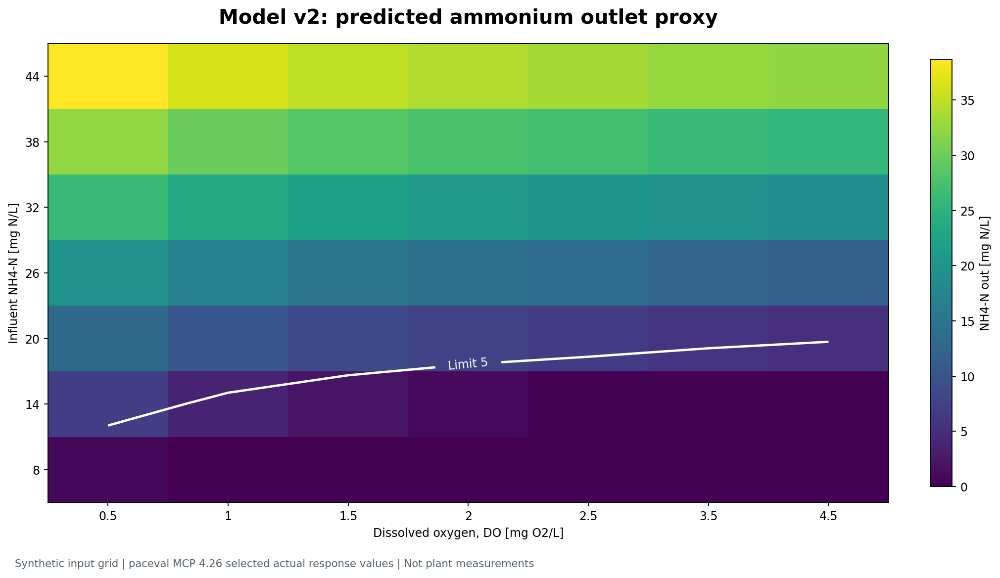
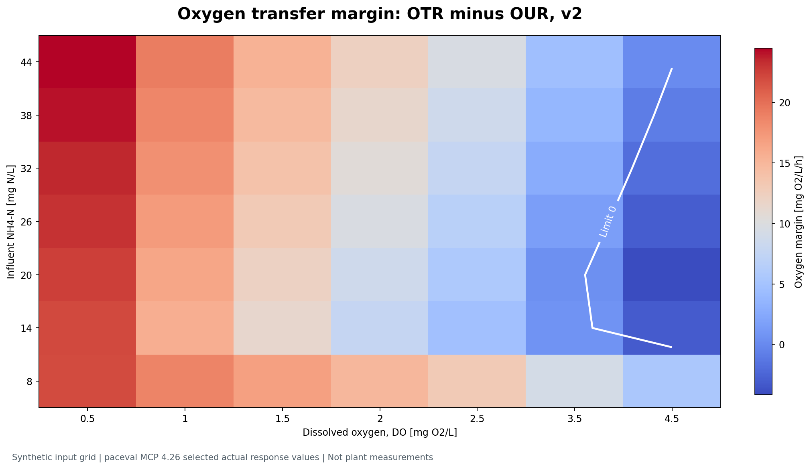
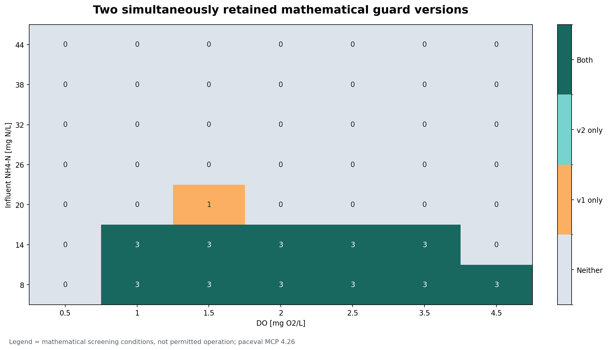
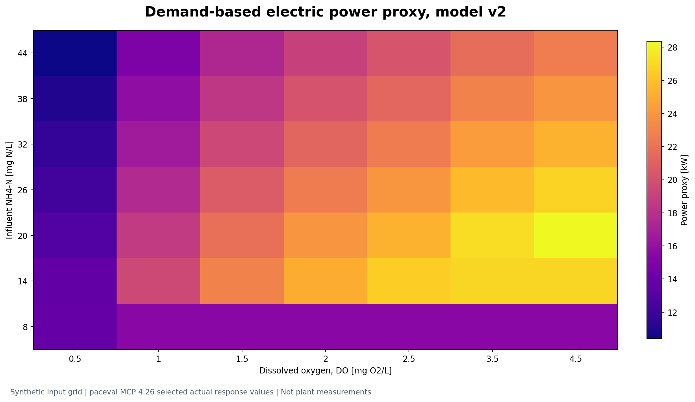
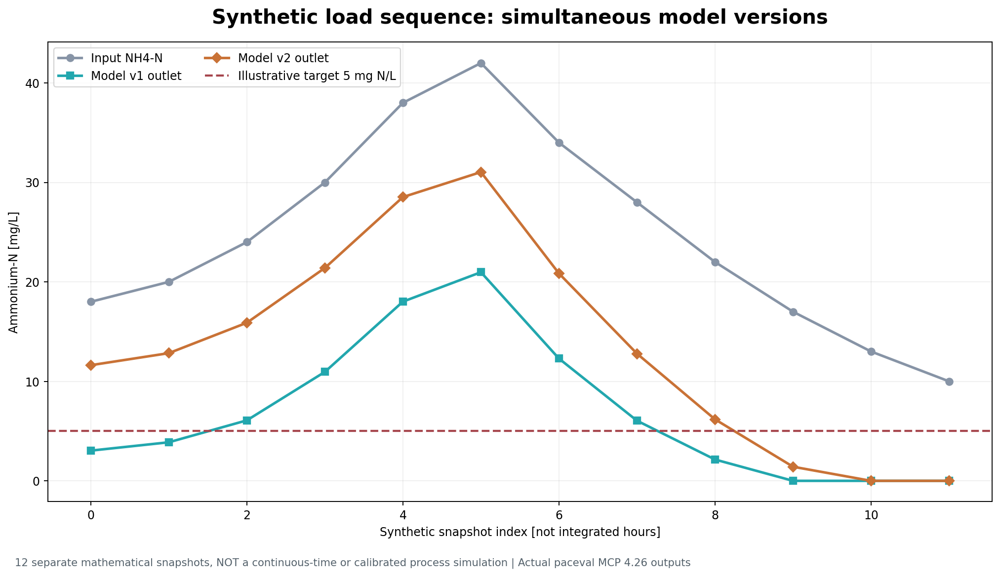
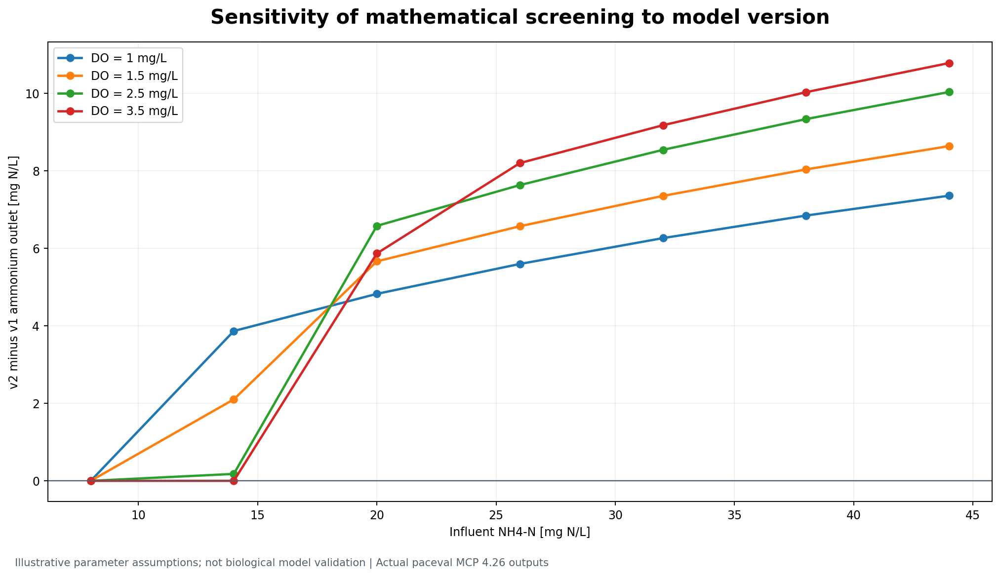

# Programmable Nitrification and Aeration Energy Models with paceval


*WP 18 | Industrial mathematical research demonstrator | 14 November 2026 | English edition | Synthetic operating conditions*

This project investigates a mathematical screening layer for wastewater nitrogen removal and aeration. It uses **real, persistent paceval computation graphs** to connect ammonium conversion, oxygen demand, oxygen transfer, a unit-consistent electric-power proxy and mathematical operating margins. The application provides two concurrently available model versions. The complete original paceval SDK bridge and C++ reproduction source are included. **Remote paceval MCP 4.26 mathematical execution succeeded; the local Linux SDK executable has not been linked or run.** This is not an operational wastewater controller or a calibrated activated-sludge model.

## 1. Industrial use case and current state of the art

Municipal and industrial biological wastewater treatment plants aerate microbial reactors so nitrifying organisms can convert ammonium nitrogen to nitrite and ultimately nitrate. Operators monitor influent ammonium, dissolved oxygen (DO), water temperature, biomass, aeration capacity and discharge targets. Large enough oxygen supply is essential for nitrification, but oversupplying air also has an operating cost. Comparing time-dependent loading, nitrification capability and oxygen transfer is therefore a natural mathematical screening task.

The International Water Association's ASM1 framework, its expanded benchmark models BSM1/BSM2, and modern process simulators represent much more of the physical treatment system than the deliberately compact expressions tested here. WaterTAP provides documented activated-sludge property and reaction models, while the publicly available BSM2-Python project implements reference wastewater plant workflows. A 2024 review examines ammonia-based aeration control and other strategies. Studies and reviews published in 2026 investigate oxygen gradients, digital twins and combined process and control models. These are **external research findings**, not results measured with this demonstrator. Citations appear in Section 8 and in the whitepaper.

A hypothetical operator may ask: *Given a specified nitrifier biomass concentration, ammonia load and DO sensor snapshot, is the computed effluent proxy below an illustrative nitrogen target? Does the specified oxygen-transfer rate cover the modeled demand, and what mathematical electric-power proxy does that imply?* This demonstrator answers only those mathematical questions using synthetic values. It does not predict total nitrogen, nutrient removal compliance, actual blower operation, or the effectiveness of a control policy.

## 2. Mathematical model and versions

The baseline Monod-type **potential** nitrification rate, using a consistent nitrogen/yield convention, is

$$
r_{N,1}=\frac{\mu_N X_n}{Y_N}\,\frac{N}{K_N+N}\,\frac{DO}{K_O+DO}.
$$

Here $N$ denotes influent ammonium as mg NH4-N/L; $r_N$ is in mg N/(L h); and $X_n$ is nitrifier biomass in mg VSS/L. The independent **v2** version adds an assumed Haldane-type substrate inhibition and a fixed temperature dependence:

$$
r_{N,2}=\frac{\mu_N X_n}{Y_N}\,\frac{N}{K_N+N+N^2/K_I}\,\frac{DO}{K_O+DO}\,\theta^{T-T_{ref}}.
$$

Neither version is fitted to plant data. Since a fixed snapshot cannot remove more nitrogen than is present during the assumed residence time $\tau$, each version uses a separate paceval `min` graph to obtain $r_{eff}=\min(r_N,N/\tau)$ and $N_{out}=N-\tau r_{eff}$. This is a screening cap, **not** a mass-balanced transient reactor simulation.

The oxygen-demand model is $OUR=a_N r_{eff}+b_X X_n$ and the available oxygen-transfer proxy is $OTR=k_La(C_{sat}-DO)$, both in mg O2/(L h). For a volume $V$ in m3 and an assumed transfer efficiency $\alpha$ in kg O2/kWh, the electric-power **demand proxy** is

$$
P_{proxy}=\frac{OUR\,V}{1000\alpha}\quad\text{kW}.
$$

The conversion factor 1000 accounts for mg/L = g/m3, followed by g-to-kg conversion. **This is not measured blower power**, and it does not establish an energy-saving claim. The simplified mathematical guard is 1 only when $N_{out}\le N_{limit}$, $OTR\ge OUR$, $DO\ge DO_{min}$ and $P_{proxy}\le P_{max}$. The C++ host is responsible for all engineering interpretation. Section 3 of the report explains why the nitrogen and oxygen assumptions are limited.

## 3. Original paceval execution and workflow

The full research path is **validated CSV numbers -> versioned paceval graphs -> full mathematical margins and guards -> C++ host status interpretation -> result CSV**. No native production formula substitutes for the paceval outputs. The C++ application uses the original SDK's `paceval_CreateComputation`, scalar result, batch result and multi-graph batch functions. It reads numeric CSV fields with `paceval_dConvertStringToFloat` **after strict literal validation**, and formats computed numeric outputs with `paceval_dConvertFloatToString`. The binary64-to-text conversion is not claimed to be bit-exact reversible.

| Mathematical function / Industrial purpose | Actual implementation | Graph or host rationale |
|---|---|---|
| Potential nitrification and two model versions | paceval MCP executed | `rate_v1`, `rate_v2` |
| Effective capped nitrification and effluent ammonium | paceval MCP executed | `effective_rate_*`, `nh4_out_*` |
| Oxygen uptake, transfer and continuous oxygen margin | paceval MCP executed | `oxygen_demand_*`, `oxygen_transfer`, `oxygen_margin_*` |
| Power proxy, budget margin, normalized transfer utilization | paceval MCP executed | `aeration_power_*`, `power_margin_v2`, `relative_oxygen_utilization_v2` |
| Nitrogen target, nitrogen conservation and logical guards | paceval MCP executed | `effluent_margin_*`, `mass_balance_residual_v2`, `guard_*` |
| Sensitivity and model-version change | paceval MCP executed | `rate_sensitivity_do_v2`, `power_delta_v2_v1` |
| Hypothetical one-hour energy-cost expression | paceval MCP executed | `energy_cost_v2` |
| Input schema, time indices, policy interpretation, graph lifetime | C++ host | I/O and state management, not engine calculations |
| High-precision and native physics formula calculations | Independent Python and C++ | Reference verification only |

The manifest at [`src/formula_manifest.json`](src/formula_manifest.json) and [`results/math_execution_inventory.csv`](results/math_execution_inventory.csv) list all **23 mathematical graphs** and their genuine execution ownership. Graphs used in the actual remote main experiment are not conflated with the prepared local SDK code. The sensitivity is analytically derived for the uncapped potential rate; it is not automatic differentiation and does not apply across the rate cap's nondifferentiable corner.

## 4. Actual numerical study

The main experiment evaluated **23 graphs over 49 synthetic ammonium/DO combinations and 12 additional synthetic process snapshots** through **two successful remote MCP 4.26 multi-graph batch requests**: 61 scenarios and 1,403 main graph-point evaluations. Both batch responses reported zero nonzero error codes. The two model versions remain available without overwriting any graph handle. The original tool outputs were represented as decimal strings; the included CSV files archive a **selected, rounded transcription**, not a lossless copy of all original returned values.

The 49-point illustrative mathematical guard is true for **12 cases under v1 and 11 under v2**. In the separate synthetic 12-snapshot sequence the corresponding counts are **4 and 3**. These are counts under declared hypothetical thresholds, not permitted discharge operation. The local C++ graph execution, PDF charts and high-precision references are separate artifacts with separate provenance.













The main selected-value audit contains **512 independently checked entries** using a separately implemented 90-decimal-digit `mpmath` model. All passed the predefined transcription-aware tolerance. Additional TINC mode queries returned **six printed pointwise interval bounds** for v2 effluent and power proxies, and all six passed independent inclusion checks against exact binary64 representations of their point inputs. **Neither finding establishes overall process-model validity or a continuous uncertainty-bound guarantee.** Detailed numerical comparisons are in `results/`, not in the public scientific presentation.

## 5. Original local SDK reproduction

This package contains the original `paceval_main.h` and `paceval_main.cpp` bridge files under `src/`, retaining their notices. The binary shared library is intentionally **not included**. On a Linux machine with the matching authorized `libpaceval_linux_sharedLIB.so`:

```bash
cmake -S src -B build -DCMAKE_BUILD_TYPE=Release \
  -DPACEVAL_RUNTIME=/absolute/path/to/libpaceval_linux_sharedLIB.so
cmake --build build -j
ctest --test-dir build --output-on-failure
./build/wastewater_paceval .
python validation/high_precision_reference.py .
python validation/check_project.py .
```

The host application reads both [`examples/observed_grid_inputs.csv`](examples/observed_grid_inputs.csv) and [`examples/observed_hourly_inputs.csv`](examples/observed_hourly_inputs.csv), evaluates the corresponding numerical vectors with the actual paceval SDK, and would write `results/local_sdk_grid.csv` and `results/local_sdk_hourly.csv` after successful execution. Those output files are **not pre-created or misattributed to a run that did not occur**.

The source code and original bridge passed a C++17 compiler **syntax-only** check in the research environment. The compatible Linux shared library was not available, so full linking, actual local SDK execution and CTest execution remain **unverified**. Source-level test declarations do not prove that CTest ran.

## 6. Domain boundaries and scientific interpretation

A realistic biological treatment model must also handle suspended solids retention time, heterotrophic substrate removal, alkalinity and pH, nitrite and nitrate states, denitrification, oxygen transfer efficiency at actual pressure and temperature, dynamic inflows, reactor mixing, microbial populations, sensor drift and calibration. The simple capped one-residence-time formula is not a substitute for ASM1, BSM2, a mechanistic simulator, operator oversight or a discharge permit. Likewise, a DO concentration is not controlled in these snapshots; it is provided as an input, so the guard is **not an optimization or control policy**. A different assumed transfer efficiency changes the power proxy directly without proving any engineering improvement.

The next useful research step would be a permitted plant-data pilot comparing holdout effluent ammonium, nitrate, DO, blower kWh and actual oxygen-transfer measurements with a calibrated process simulator. This would also test the robustness of changing formulas, sensor errors, seasonal nitrification and decision thresholds. Hardware acceleration is a prospective engineering direction, not a benchmark result of this project.

## 7. Audit and release-quality checks

- **Actual remote mathematical execution:** paceval MCP 4.26, 23 executed main graphs, two batches, 61 cases, 1,403 main graph-point evaluations, no nonzero remote main error codes.
- **Independent numerical checks:** 512 selected printed-decimal reference comparisons; six printed TINC point inclusion checks, all passed for tested inputs. There is no broad input-interval proof.
- **Source:** original SDK files retained; both source files syntax-checked as C++17; local runtime tests not performed.
- **Markdown:** every project Markdown file is checked with a CommonMark parser, math delimiter scan, local-link existence check, and five intentionally broken negative regression examples. GitHub website visual rendering is not claimed.
- **PDF:** each final PDF page is rendered and reviewed for cropping and formula presentation. Scientific figures come from the actual archived paceval values; the cover is explicitly an illustration.

See [`RESEARCH_VALIDATION.md`](RESEARCH_VALIDATION.md), [`results/execution_evidence.json`](results/execution_evidence.json) and the archived independent audits for more specific provenance.

## 8. Scientific references

- International Water Association benchmarking project: [IWA benchmark simulation models BSM1/BSM2](https://github.com/wwtmodels/Benchmark-Simulation-Models).
- WaterTAP (2026 documentation), [Activated Sludge Model No. 1](https://watertap.readthedocs.io/en/1.8.0/technical_reference/flowsheets/ASM1.html) and [Benchmark Simulation Model No. 2](https://watertap.readthedocs.io/en/latest/technical_reference/flowsheets/BSM2.html).
- Monday et al. (2024), *A Review of AI-Driven Control Strategies in the Activated Sludge Process with Emphasis on Aeration Control*, Water 16(2), 305, https://doi.org/10.3390/w16020305.
- US EPA (2010), *Nutrient Control Design Manual*, documented full nitrification oxygen stoichiometry, https://www.epa.gov/sites/production/files/2019-02/documents/nutrient-control-design-manual.pdf.
- Rodríguez-García et al. (2026), *A review of optimization systems and methods for wastewater treatment plants operation*, Environmental Modelling & Software, https://doi.org/10.1016/j.envsoft.2026.107051.
- Nikou et al. (2026), *Digital twins in wastewater treatment*, Journal of Water Process Engineering, https://doi.org/10.1016/j.jwpe.2026.110352.
- Asteriadis et al. (2026), *A simulation study of a twin aeration control strategy*, Journal of Water Process Engineering, https://doi.org/10.1016/j.jwpe.2026.109874. External reported gains are not paceval project results.
- European standard preview, EN 12255-15, *Oxygen transfer measurement in clean water*, https://cdn.standards.iteh.ai/samples/7281/5bb3351a0453482e8f2a816e00895391/SIST-EN-12255-15-2004.pdf.
- paceval documentation: https://paceval.com/api/ and https://paceval.com/product-brief/.

The original research proposal is archived as [`docs/Original_WP18_Proposal_2026-11-13.pdf`](docs/Original_WP18_Proposal_2026-11-13.pdf). The standalone English scientific publication is [`paceval_Wastewater_Nitrification_Aeration_Whitepaper_EN.pdf`](paceval_Wastewater_Nitrification_Aeration_Whitepaper_EN.pdf).
