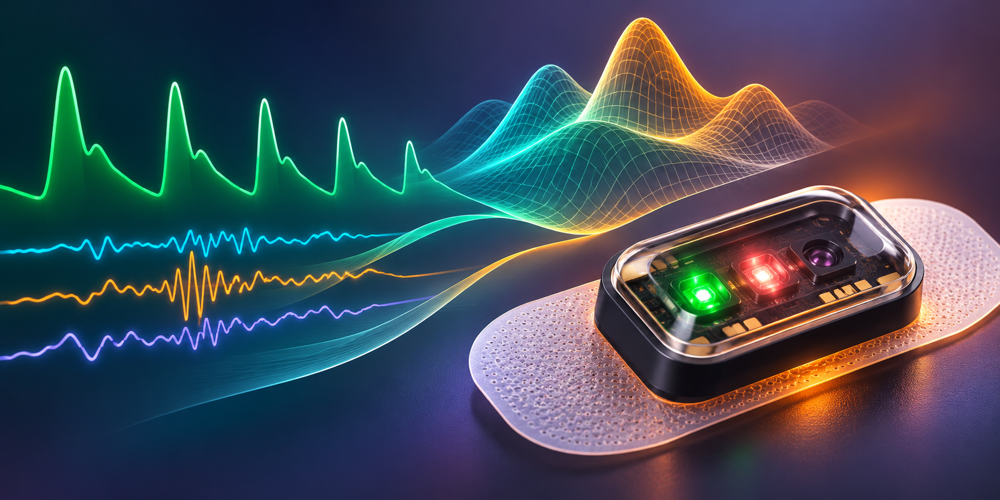
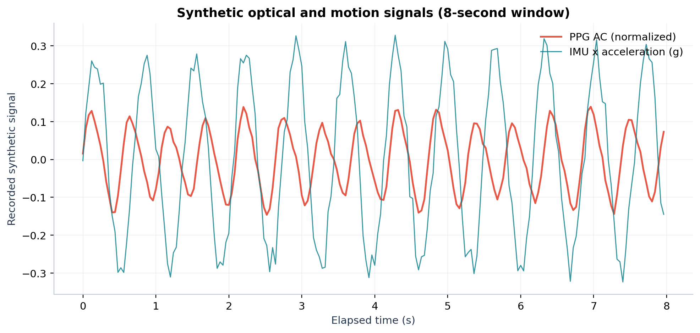
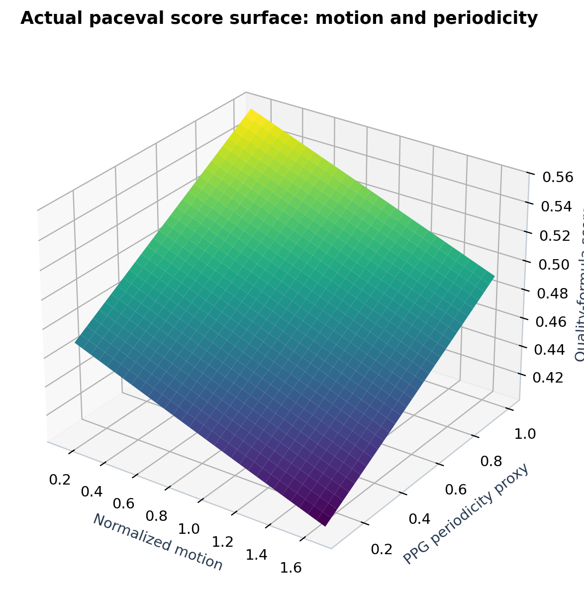
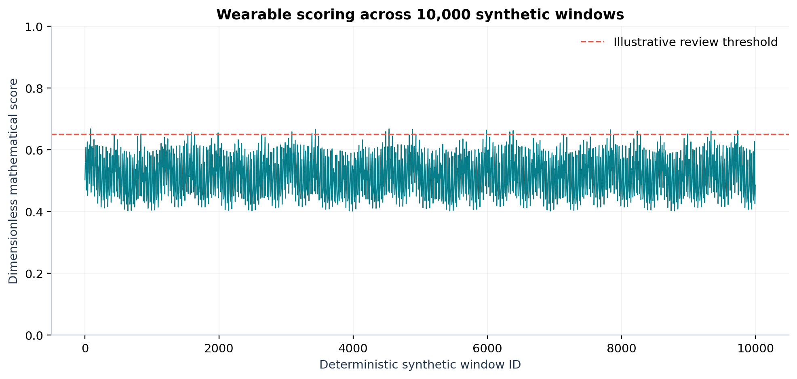
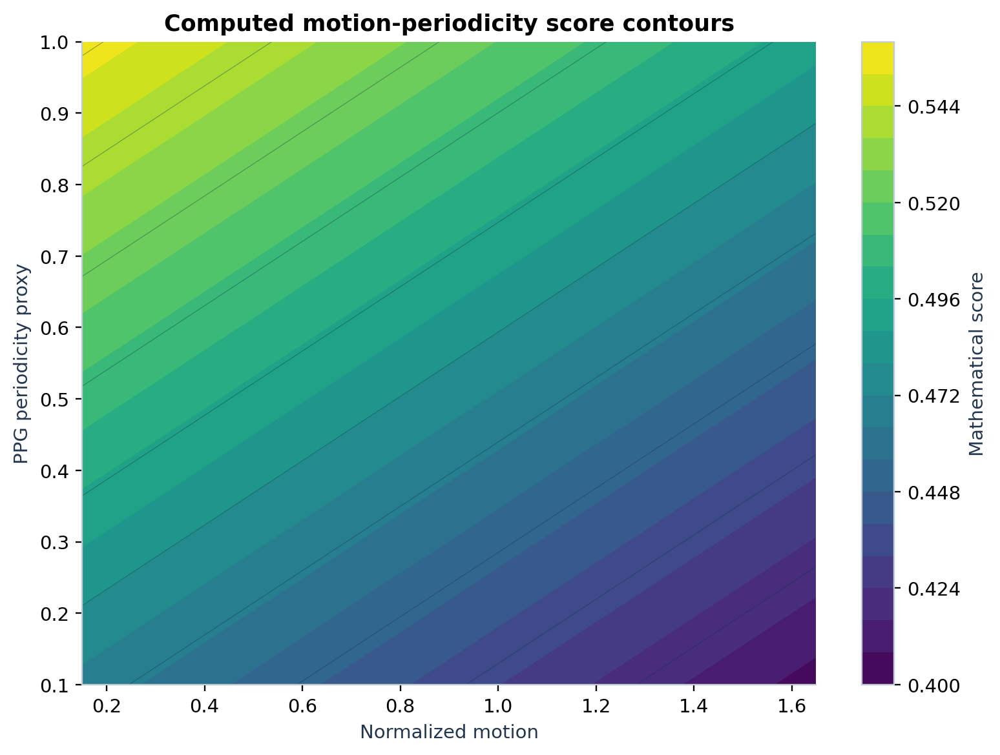
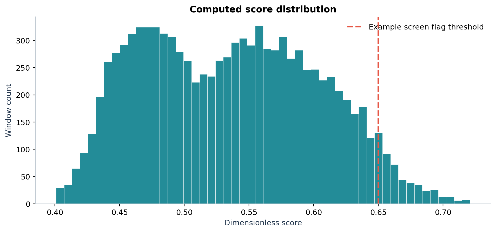
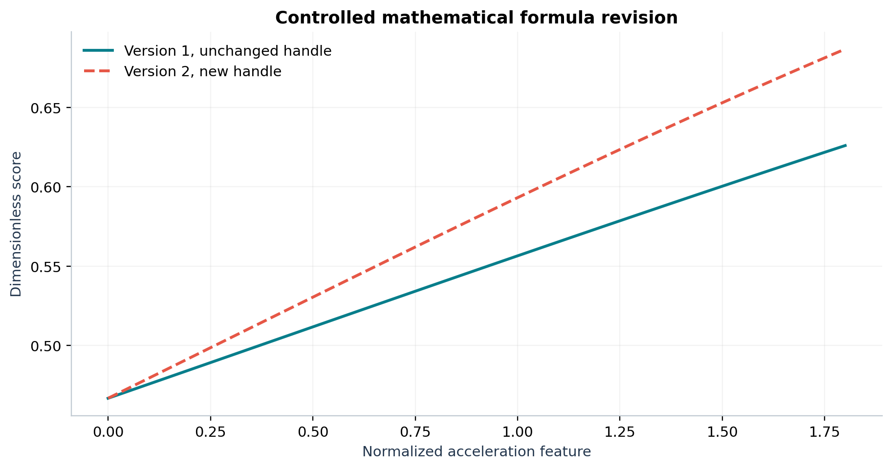

# WP_036 - Wearable Signal Scoring Expressions with paceval



*Concept illustration; not a recorded sensor measurement or computed research figure. The subsequent scientific plots are generated from actual paceval results.*

A reproducible **C++ / paceval research demonstrator** for configurable mathematical scores over windowed synthetic wrist-PPG and three-axis motion signals. The project creates **51 persistent execution graphs** (50 different formulas plus one independently stored revision), evaluates **10,000 eight-second IMU/PPG windows**, and exports interpretable non-clinical scores and real numerical figures. **It neither diagnoses medical conditions nor validates a wearable device.**

[**English whitepaper**](paceval_Wearable_Signal_Scoring_Whitepaper_EN.pdf) · [C++ implementation](src/wearable_scoring.cpp) · [CMake project](src/CMakeLists.txt) · [Raw synthetic traces](examples/) · [Executed numerical results](results/) · [Scientific figures](figures/)

## 1. Industrial use case and current state of the art

Modern consumer wearables combine wrist-based **photoplethysmography (PPG)** with an **inertial measurement unit (IMU)** to follow optical pulse patterns and movement. A practical engineering chain acquires sensor signals, checks their quality, extracts time-window features, applies a configurable mathematical function, and sends non-clinical technical scores into a user interface or analysis workflow. Motion and contact conditions can seriously distort optical measurements, so mathematical score computation must not be confused with validated pulse detection or medical conclusions.

A [2026 review of wearable ECG/PPG multimodal monitoring](https://www.mdpi.com/1424-8220/26/11/3477) describes motion artifacts, accelerometer-informed filtering and signal-quality indices. A [2025 PPG signal-quality study](https://pmc.ncbi.nlm.nih.gov/articles/PMC12736534/) examines signal quality and reconstruction for heart-rate applications. These sources describe established research challenges rather than verified performance of this demonstrator. The [PPG-DaLiA dataset](https://archive.ics.uci.edu/dataset/495/ppg-dalia) provides synchronized physiological and motion measurements from 15 people; [PhysioNet's Wrist PPG During Exercise](https://physionet.org/content/wrist/1.0.0/) also includes motion and ECG references. These are **possible later validation resources**, not sources of the data in this ZIP.

Here the C++ host generates and preprocesses a fully synthetic 25 Hz, 8-second PPG/IMU trace for every window, while **paceval evaluates mathematically explicit scoring formulas on the extracted features**. The host also manages input checking, the example review threshold, CSV output and independent audits. No de-identified patient or real-device data are redistributed in this experiment.

## 2. Scientific experiment and verified scope

| Executed component | Recorded result |
|---|---:|
| Synthetic time windows (200 samples each) | **10,000** |
| Generated raw sensor samples (PPG plus 3-axis acceleration) | **2,000,000 timestamps** |
| Different version-1 mathematical formulas | **50** |
| Reusable paceval graphs including immutable version 2 | **51** |
| Scalar paceval computations | **13,923** |
| Official paceval batch output values | **1,600** |
| Points in a paceval-computed 3D response surface | **3,721** |
| Independently checked 80-digit score values | **500 / 500 passed** |
| Independently reconstructed synthetic raw-trace feature values | **24 / 24 passed** |
| Synthetic threshold flags (score at least 0.65) | **420** |
| CMake / CTest original-SDK integration | **1 / 1 passed** |

The 420 flags are **technical demonstrations of a chosen threshold**, not clinical alerts or a medical false-positive rate. All signals are synthetic and all score coefficients are intentionally illustrative.

## 3. Mathematical signal preprocessing and 50 formulas

For each 200-sample window, host-side preprocessing computes a dynamic acceleration RMS (g), positive-crossing cadence proxy (events/min), optical autocorrelation-lag pulse proxy (bpm), motion-artifact proxy, modulation ratio, and PPG autocorrelation peak. These are normalized to six **dimensionless** features `a`, `c`, `h`, `m`, `p`, `q`. The pulse and cadence estimates are approximate engineering features from artificial data, not physiological ground truth.

A sample acceleration feature is:

```math
A_{\mathrm{RMS}}=\sqrt{\frac{1}{N}\sum_{i=1}^{N}\left(a_{x,i}^2+a_{y,i}^2+(a_{z,i}-1)^2\right)},\qquad N=200.
```

All five formula families map a mathematical intermediate `z` to a scalar score:

```math
S(z)=\frac{1}{1+\exp(-z)}.
```

The 50 expression strings are grouped into five industrially motivated formula families, ten distinct coefficient versions per family:

```math
z_{\mathrm{activity}}=\alpha a+\beta c+0.14h-0.37
```

```math
z_{\mathrm{quality}}=\alpha q-\beta m+0.27p-0.30
```

```math
z_{\mathrm{interaction}}=\alpha ac+\beta pq-0.28m-0.37
```

```math
z_{\mathrm{periodic}}=\alpha\sin(a)+\beta\cos(h)+0.32q-0.42m-0.43
```

```math
z_{\mathrm{logexp}}=\alpha\ln(1+a^2)+\beta\exp(-m^2)+0.19pq-0.66
```

Variant index `j = 0..9` and family index `f = 0..4` determine the fixed coefficients:

```math
\alpha=0.36+0.049j+0.031f,\qquad\beta=0.22+0.035j.
```

A separate revision increases `alpha` by 0.15 for model 1 and leaves the original expression and its handle untouched. The use of a sigmoid constrains scores between zero and one but **does not calibrate them as clinical probabilities**.

## 4. paceval execution and host-system boundary

The program uses **the original SDK files** [`src/paceval_main.h`](src/paceval_main.h) and [`src/paceval_main.cpp`](src/paceval_main.cpp), including `paceval_InitializeLibrary`, `paceval_CreateComputation`, `paceval_dGetComputationResult`, `paceval_dGetComputationResultExt`, and `paceval_DeleteComputation`. Every graph is created once and used repeatedly. The official batch entry point evaluates 32 distinct synthetic feature vectors for each of the 50 formulas.

The C++ host retains raw signal generation, sensor preprocessing, feature scaling and validity, threshold policy, file output, and audit implementation. **paceval does not perform filtering, time integration, data acquisition, clinical inference or device control in this experiment.** The compatible external Linux paceval shared library is required locally and deliberately not redistributed.

## 5. Eight scientific figures from executed results

| Recorded traces and replay | Mathematical response surfaces |
|---|---|
|  |  |
|  |  |
|  |  |

[Formula family flags](figures/06_formula_family_thresholds.png) · [Signal feature scatter](figures/08_feature_scatter.png)

These eight scientific figures are in PNG and vector PDF, generated by [`src/make_figures.py`](src/make_figures.py) from the recorded CSVs; they are not concept art. The new hero illustration intentionally uses a wearable optical sensor module rather than a wristwatch. It is exactly **2400 × 1200 pixels**, used without distortion in both the README and report. The device illustration is conceptual, and its electronics are not a validated production design.

## 6. Build, run and independently verify

From the root directory of the extracted project:

```bash
cmake -S src -B build -DCMAKE_BUILD_TYPE=Release \
  -DPACEVAL_RUNTIME=/absolute/path/to/libpaceval_linux_sharedLIB.so
cmake --build build -j
ctest --test-dir build --output-on-failure
./build/wearable_scoring --windows 10000 --out examples
python3 src/high_precision_reference.py
python3 src/verify_results.py
python3 src/make_figures.py
python3 src/make_whitepaper.py
python3 src/check_readme_math.py
```

For the Python scripts, install the packages listed in [`src/requirements.txt`](src/requirements.txt). The generated [`examples/wearable_feature_windows.csv`](examples/wearable_feature_windows.csv), [`examples/signal_quality_surface.csv`](examples/signal_quality_surface.csv), [`examples/formula_version_trace.csv`](examples/formula_version_trace.csv), [`examples/formula_registry.csv`](examples/formula_registry.csv), and the four raw synthetic trace CSVs are included in the ZIP. Complete technical checks are retained in [`results/high_precision_audit.json`](results/high_precision_audit.json), [`results/result_manifest.json`](results/result_manifest.json), [`results/sdk_execution.txt`](results/sdk_execution.txt) and [`results/ctest_sdk.txt`](results/ctest_sdk.txt). No numerical speedups or native-C++ versus paceval accuracy differences are published in this README or its whitepaper.

The automated [`src/check_readme_math.py`](src/check_readme_math.py) performs static checks of GitHub math fences and local links, including positive/negative regression tests. A live GitHub browser rendering check remains a separate verification step.

## 7. Scientific limitations and extension path

This is a **non-clinical software integration and mathematical-feasibility study**. It contains no real-device recordings, no participant data, no heart-rate validation against ECG, no diagnostic classification, no calibrations for demographics or devices, no physiological accuracy certification, and no medical-device clearance. Motion artifact and PPG autocorrelation features are simplified; their relevance on real wearables must be demonstrated separately. The [FDA's January 2026 General Wellness guidance](https://www.fda.gov/regulatory-information/search-fda-guidance-documents/general-wellness-policy-low-risk-devices) discusses the regulatory distinction between general wellness functions and medical device claims.

A meaningful industrial follow-up would use permitted PPG-DaLiA / PhysioNet recordings, independently locked preprocessing, participant-held-out evaluation and clearly defined, non-diagnostic signal-quality endpoints before considering any real deployment.

**Research status: original paceval SDK execution and independently checked synthetic results, November 2026.**
