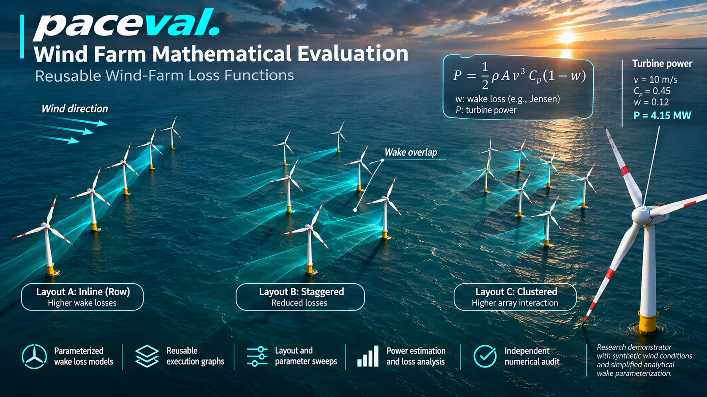

# paceval | Reusable Wind-Farm Loss Functions



**A tested C++ research demonstrator for reusable mathematical wake-loss and turbine-power execution graphs.** This repository transforms the WP-015 feasibility proposal into a reproducible numerical experiment using the official paceval C/C++ SDK files and an externally supplied Linux runtime. The demo intentionally uses transparent **synthetic** layouts and wind conditions; it does not claim wind-farm yield forecasts or validation against field measurements.

[**Research whitepaper (PDF)**](paceval_Wind_Farm_Loss_Functions_Whitepaper_EN.pdf) · [**C++ implementation**](src/wind_farm.cpp) · [**Build configuration**](src/CMakeLists.txt) · [**Input/output examples**](examples/wind_conditions.csv)

## Research scope and the paceval contribution

Three alternative eight-turbine layouts are evaluated at four free-stream wind speeds (6, 8, 10, 12 m/s) and eight wind directions (0–315 degrees). For each geometry, 100 distinct parameterized wake expressions are created as **100 separate reusable paceval computation graphs**. One additional graph calculates raw cubic turbine power, and one TINC graph provides a controlled numerical interval diagnostic.

The C++ host rotates the layouts into wind coordinates, determines which turbines are downstream, combines wake deficits with a root-sum-square rule, enforces the synthetic 5 MW turbine rating and aggregates farm totals. **paceval evaluates each nonlinear wake contribution and each aerodynamic power expression.** This preserves a clear and reproducible boundary between mathematical expression execution and the physical modeling assumptions.

The research intentionally uses a **Jensen-inspired expansion term with a Gaussian lateral taper**, not the exact canonical Jensen top-hat model or a calibrated PyWake/FLORIS wake solver. For an upstream/downstream turbine pair with downstream distance `dx > 0` and crosswind separation `dy`, the dimensionless deficit is

\[
\delta(dx,dy)=(1-\sqrt{1-C_T})\left(\frac{D}{D+2k\,dx}\right)^2\exp\left[-\frac12\left(\frac{dy}{D/2+k\,dx}\right)^2\right].
\]

The host combines contributions \(\delta_j\) to each turbine as \(v_{\mathrm{eff}}=v_\infty \max(0.20,1-\sqrt{\sum_j\delta_j^2})\); its separate rated-power cap is \(P_{\mathrm{delivered}}=\min(5\,\mathrm{MW},\tfrac12\rho A C_p v_{\mathrm{eff}}^3/10^6)\). The 20% velocity floor and selected coefficients are **deliberate synthetic experiment choices**, not validated turbine physics. Graph expressions are defined in [the C++ source](src/wind_farm.cpp).

## What was actually executed

| Item | Verified result |
|---|---:|
| Distinct wake parameter variants | **100** |
| Wind scenarios per layout | **32** |
| Turbine layouts and turbines per layout | **3 × 8** |
| Pairwise paceval wake evaluations compared with native C++ | **240,000** |
| Raw power graph evaluations compared with native C++ | **153,600** |
| Result rows (100 models × 3 layouts × 32 wind conditions) | **9,600** |
| Independent high-precision expression samples (110 decimal digits) | **384 / 384 within tolerance** |
| Raw TINC intervals enclosing the independently computed binary-input value | **24 / 24 tested** |
| Targeted graph version update | **Model 17 only; model 18 unchanged** |

The independent numerical audit reported a **maximum absolute difference of about 3.58 × 10⁻¹⁶** over the 384 audited expression samples. Tests do not establish general rounding guarantees or predictive accuracy for real wind farms.

At 10 m/s with wind direction 0° for synthetic model 0, the farm net power is 14.190 MW (inline), 17.747 MW (staggered), and 17.388 MW (wide-spaced). These are outcomes **only of the documented illustrative model**; they should not be interpreted as a general ranking of physical layouts.

## Build and test (Linux)

The proprietary paceval Linux `.so` is **not redistributed**. Install a compatible binary separately and supply its **absolute path**. The unmodified SDK facade [paceval_main.h](src/paceval_main.h) and [paceval_main.cpp](src/paceval_main.cpp) are compiled into the C++ program directly; their original license notices are retained.

```bash
cmake -S src -B build -DCMAKE_BUILD_TYPE=Release \
  -DPACEVAL_RUNTIME=/absolute/path/to/libpaceval_linux_sharedLIB.so
cmake --build build -j
ctest --test-dir build --output-on-failure
./build/wind_farm --variants 100 --batch 128 --out results
python3 src/high_precision_reference.py results
python3 src/make_figures.py --data results --output figures
```

CMake also accepts `PACEVAL_LIB` as an environment variable. For the independent mathematical check install `mpmath`; for figure recreation install `numpy`, `pandas` and `matplotlib`. For whitepaper recreation install `reportlab` and `Pillow`. A run with `--wind-input examples/wind_conditions.csv` reads the archived input instead of synthesizing it.

`--batch` changes how many input sets are passed in each call. A version update is performed for model 17 if at least 19 variants are requested. The program reports invalid input, compilation, numerical and domain errors instead of silently accepting them.

**Reproducibility:** Tests with GCC 14.2, Clang 17, AddressSanitizer and UndefinedBehaviorSanitizer succeeded on Linux x86-64. Results generated with batch sizes 1, 37 and 128 are expected to be byte-identical for the fixed sample set, and the shipped [validation summary](examples/validation.json) can be recreated by the Python check. This is a functional and accuracy study: no speedup, energy savings or real-world yield gains are claimed.

## Project structure

```text
paceval_Wind_Farm_Loss_Functions/
├── README.md
├── paceval_Wind_Farm_Loss_Functions_Whitepaper_EN.pdf
├── .gitignore
├── src/
│   ├── CMakeLists.txt
│   ├── wind_farm.cpp
│   ├── paceval_main.h
│   ├── paceval_main.cpp
│   ├── high_precision_reference.py
│   ├── make_figures.py
│   └── make_whitepaper.py
├── examples/
│   ├── wind_conditions.csv
│   ├── invalid_wind_conditions.csv
│   ├── layouts.csv
│   ├── models.csv
│   ├── farm_results.csv
│   ├── selected_turbines.csv
│   ├── audit_samples.csv
│   ├── model_update.csv
│   ├── tinc_samples.csv
│   └── validation.json
└── figures/
    ├── 00_wind_farm_hero.png
    └── 8 scientific diagrams in PNG and SVG
```

## Scientific figures

| Figure | Interpretation |
|---|---|
| [1. Wind-farm layouts](figures/01_wind_farm_layouts.png) ([SVG](figures/01_wind_farm_layouts.svg)) | Exact synthetic turbine coordinates |
| [2. Pairwise wake field](figures/02_wake_deficit_surface.png) ([SVG](figures/02_wake_deficit_surface.svg)) | Mathematical expansion and Gaussian taper |
| [3. Directional loss](figures/03_directional_wake_loss.png) ([SVG](figures/03_directional_wake_loss.svg)) | Wake fraction by direction at fixed speed |
| [4. Farm power by speed](figures/04_farm_power_by_wind_speed.png) ([SVG](figures/04_farm_power_by_wind_speed.svg)) | Net versus gross illustrative power |
| [5. Parameter variants](figures/05_model_variant_sensitivity.png) ([SVG](figures/05_model_variant_sensitivity.svg)) | Variations across 100 graph configurations |
| [6. Effective inflow](figures/06_turbine_inflow_comparison.png) ([SVG](figures/06_turbine_inflow_comparison.svg)) | Eight turbine-level inflow values |
| [7. Numerical audit](figures/07_numerical_audit_residuals.png) ([SVG](figures/07_numerical_audit_residuals.svg)) | Native-versus-paceval expression residuals |
| [8. Versioned model update](figures/08_model_version_update.png) ([SVG](figures/08_model_version_update.svg)) | Controlled replacement of model 17 |

## Background literature and model interpretation

The proposal in WP-015 begins with the rotor-power expression `P = 0.5*rho*A*v^3*Cp*(1-wake_loss)` and calls for repeatable loss evaluation. This demonstrator explicitly models the intermediate **velocity deficit** and then computes rotor power, so the wake-loss factor is not double-counted.

Useful independent references include [DTU PyWake's NOJ/Jensen documentation](https://topfarm.pages.windenergy.dtu.dk/pywake/api/PredefinedEngineeringWindFarmModels.html), [PyWake's wake-superposition models](https://topfarm.pages.windenergy.dtu.dk/pywake/notebooks/SuperpositionModels.html), and [NREL's FLORIS introduction](https://www.nrel.gov/docs/libraries/wind-docs/systems-engineering-workshop-2019-floris.pdf). They establish scientific context, **not** equivalence or validation of our simplified surrogate.

**Scope:** No power-curve calibration, atmospheric turbulence model, rotor integration, yaw steering, measured SCADA comparison, site-specific wind rose, grid constraints, annual energy production forecast or CFD/LES validation is implemented. The objective is a reproducible mathematical feasibility demonstration, not a deployment-ready wind-energy digital twin. The code and results are for research use only.
