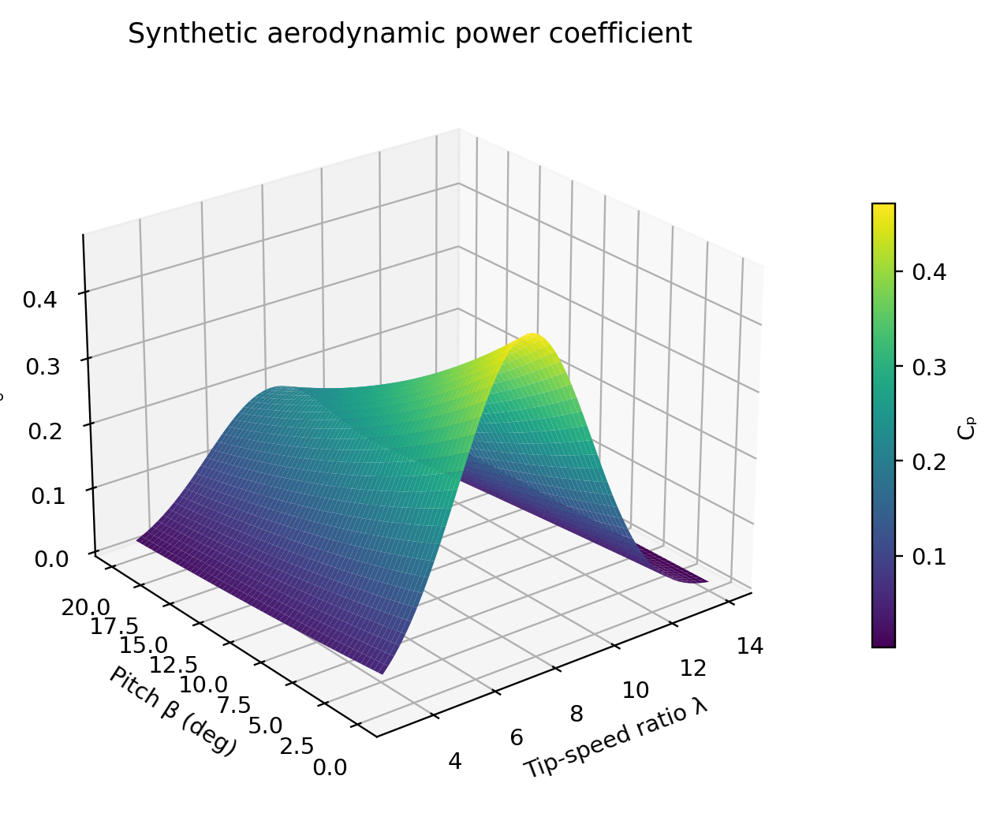
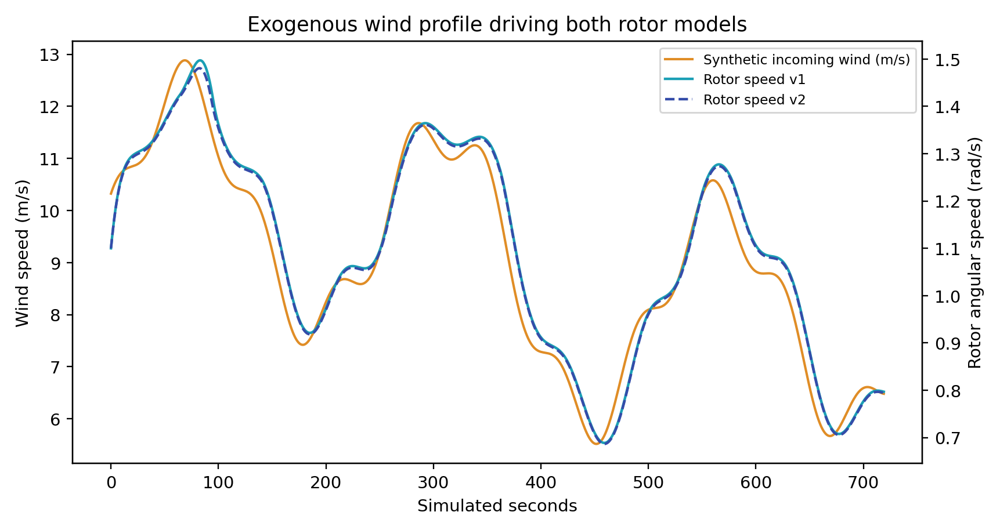

# Wind-Turbine Digital Twin Coefficient Functions with paceval


*Original illustrative cover artwork (2400 × 1200 px), not an image of real measurements or of a validated turbine. All scientific figures below use values actually computed by the original paceval engine.*

**WP_042 · Executed mathematical research demonstrator · November 13, 2026**

This repository demonstrates an original **paceval Mathematical Engine** computation kernel inside a small, reproducible, reduced-order wind-turbine rotor digital twin. It extends the proposal's `P = 0.5 ρ A v³ Cp(λ,β)` formula into **31 persistent mathematical expression graphs**, including two independently versioned aerodynamic coefficients, power, torque, thrust, sensitivity derivatives, a dimensionally consistent generator rating model, control torque, rotor angular acceleration, and an Euler state-update expression. The numerical graphs are executed by the **real paceval multi-graph batch API**, not by an emulation.

[**English research whitepaper (PDF)**](paceval_Wind_Turbine_Digital_Twin_Whitepaper_EN.pdf) · [C++ demonstrator](src/wind_turbine_twin.cpp) · [Original paceval SDK interfaces](src/paceval_main.h) · [CMake build](src/CMakeLists.txt) · [Actual results](examples/) · [Numerical validation](results/) · [Original proposal](references/WP_042_Wind_Turbine_Digital_Twin_Coefficient_Functions.pdf)

## 1. Industrial use case

Turbine manufacturers, operations teams and researchers need to evaluate how wind speed, rotor angular speed, blade pitch and drivetrain losses affect generated power, rotor torque, structural loads and admissible operation. A reusable mathematical engine can keep coefficient versions explicit and apply the same formulas consistently during parameter screening and time-domain integration.

An operational wind-turbine digital twin normally includes real measured SCADA data, a turbine-specific aerodynamic map, electrical and structural models, uncertainty quantification and calibrated environmental conditions. **This demonstrator is not such a validated operational twin.** It deliberately isolates a publishable, self-contained mathematical kernel and its interface to a fixed time integrator.

The scope is informed by the [OpenFAST coupled aero-hydro-servo-elastic framework](https://openfast.readthedocs.io/en/dev/) (v5.0.0, November 2026), [IEC 61400-12-1:2022](https://webstore.iec.ch/en/publication/68499), and reference dimensions of the [NREL 5-MW turbine family](https://github.com/NLRWindSystems/WISDEM/blob/master/examples/02_reference_turbines/nrel5mw.yaml). **Our synthetic coefficient functions are not OpenFAST output, measured lookup data or certified power curves.**

## 2. Physical definitions and declared approximations

The model uses a positive rotor radius `R = 63 m`, air density `ρ = 1.225 kg/m³`, a nominal 5-MW electrical rating, and a deliberately simplified generator/load law. All angles `β` are numerical degrees in the chosen empirical surrogate. The normalized tip-speed ratio is

```math
\lambda=\frac{\omega R}{v},\qquad A=\pi R^2.
```

The synthetic coefficient curves are explicit and bounded throughout the declared test interval:

```math
C_{p,1}(\lambda,\beta)=0.475\exp\left[-\left(\frac{\lambda-7.6}{3.1}\right)^2\right]\exp\left(-\frac{\beta}{22}\right).
```

```math
C_{p,2}=C_{p,1}\left[1+0.015\sin(0.5\lambda)\exp\left(-\frac{\beta}{25}\right)\right],\qquad C_t=0.03+0.78\exp\left[-\left(\frac{\lambda-7}{6}\right)^2\right]\exp\left(-\frac{\beta}{30}\right).
```

Both synthetic power coefficients satisfy `Cp < 16/27` over the tested input domain. This inequality is necessary but **not sufficient for an aerodynamically calibrated turbine model**; `Ct` likewise is only an illustrative thrust-loading coefficient. The formulas have never been fitted to airfoil data, power measurements or OpenFAST outputs.

## 3. Derived physical and mathematical kernels executed by paceval

Incident wind power, aerodynamic power, rotor torque and axial force are calculated as

```math
P_{\mathrm{wind}}=\frac12\rho\pi R^2v^3,\quad P_{\mathrm{aero}}=P_{\mathrm{wind}}C_p,\quad Q_{\mathrm{aero}}=\frac{P_{\mathrm{aero}}}{\omega},\quad F_{\mathrm{thrust}}=\frac12\rho\pi R^2v^2C_t.
```

The controlled generator *unconstrained* electric power is `e = η ω Q₀ (ω/ω₀)²`. A differentiable soft rating proxy `S` and the **corresponding physically consistent shaft torque** are both computed by paceval:

```math
S(e)=\frac12\left[e+P_r-\sqrt{(e-P_r)^2+\epsilon^2}\right],\qquad Q_g=\frac{S(e)}{\eta\omega}.
```

Here `η = 0.95`, `Pᵣ = 5 MW`, `ε = 1500 W`, `Q₀ = 2.3 MN m` and `ω₀ = 1.12 rad/s` are **declared synthetic reference values**. The smooth cap is not a physical inverter or brake model; it approximates a rated power limit while keeping a consistent torque-power balance.

The rotor ODE and explicitly registered Euler update are:

```math
J\dot\omega=Q_{\mathrm{aero}}-Q_g-D\omega,\qquad \omega_{n+1}=\omega_n+\Delta t\dot\omega_n.
```

`J = 4 × 10⁷ kg m²`, `D = 1.2 × 10⁵ N m s` and `Δt = 1 s` are fixed synthetic inputs. The time-integrator's ordering and energy summation remain in C++; the **full algebraic next-state formula** runs in paceval. Analytic expressions for `∂Cp/∂λ`, `∂Cp/∂β`, `∂Paero/∂v` at fixed omega, `∂Paero/∂omega`, and `∂Paero/∂β` likewise run as separate persistent graphs.

## 4. Real paceval execution: verified results

| Property | Actual executed result |
|---|---:|
| Persistent mathematical graphs | **31** |
| Multi-graph batch calls | **788** |
| Batch graph results | **308,791** |
| Cp/Ct coefficient surface points | 3,721 (61 × 61) |
| Synthetic operating sweep samples | 4,800 |
| Rotor steps and versions | 720 × 2 |
| Independent C++ oracle checks | **22,841 passed** |
| 80-decimal-digit mpmath checks | **1,760 passed** |
| Independent finite-difference checks | 80 passed |
| Independently checked dynamic equations | 7,200 reference checks |
| CMake / CTest | 1/1 passed |

In this synthetic 720-second wind trace (5.52–12.88 m/s), integrated electrical proxy production is **508.646 kWh for v1** and **504.387 kWh for v2**. The difference is a consequence of **two illustrative formula versions**, not a measured performance improvement and not a validated energy-yield forecast.

The independent bilinear Cp lookup experiment uses a 61 × 61 table computed by paceval; its 576 off-grid test points had a maximum absolute interpolation difference of roughly **0.000387** against the independent mathematical reference. This only measures approximation of *this synthetic smooth formula*, not accuracy of a physical wind-turbine model.

## 5. Real scientific figures

Every displayed scientific figure below is derived from the CSV outputs of the original SDK run, except Figure 11, which is explicitly an independently computed table-lookup reference from paceval's coefficient grid.

| Figure | Scientific result |
|---|---|
| 1 | [Three-dimensional Cp surface](figures/01_cp_surface_3d.png) |
| 2 | [Three-dimensional aerodynamic power](figures/02_rotor_power_surface_3d.png) |
| 3 | [Cp operating envelopes and contours](figures/03_cp_contour.png) |
| 4 | [Ct thrust-coefficient contours](figures/04_ct_contour.png) |
| 5 | [Analytical dCp/dλ surface](figures/05_analytical_sensitivity_3d.png) |
| 6 | [Wind input and simulated rotor speed](figures/06_wind_rotor_dynamics.png) |
| 7 | [Electrical power for two formula versions](figures/07_versioned_electrical_power.png) |
| 8 | [Integrated energy versus simulated time](figures/08_cumulative_energy.png) |
| 9 | [Cp formula revision difference](figures/09_formula_revision_difference.png) |
| 10 | [Wind/rotor operating point power sweep](figures/10_operating_sweep.png) |
| 11 | [Independent bilinear lookup reference difference](figures/11_tabulated_lookup_interpolation.png) |





The eleven numbered images are also available as vector PDF files under [`figures/`](figures/). Figure 11 is **not** a paceval evaluator output: it depicts the independently evaluated table-lookup interpolation difference.

## 6. Execution architecture: mathematical responsibility

[`results/math_execution_inventory.csv`](results/math_execution_inventory.csv) identifies the execution owner and API for each of the **31 formulas**, including the coefficient curves, powers, loads, gradients, generator rating, state derivative, and explicit state update. All these expressions were actually created using `paceval_CreateComputation` and evaluated using `paceval_dGetMultipleComputationsResultsExt`.

The C++ host handles chronological integration, input provenance, pitch policy, deterministic wind generation, cumulative sums, validation and file output. It does not silently substitute native calculations for paceval's declared mathematical graph outputs. The native C++ reference and independent Python/`mpmath` checks are used **only for validation**.

The coefficient curve versions v1 and v2 are **separate reusable paceval computation objects**. No in-place graph substitution or unlogged model change occurs.

## 7. Build and reproduce

Requires Linux x86-64, CMake ≥3.16, a C++17 compiler, and a separately obtained **compatible original paceval Linux shared runtime**. The original `src/paceval_main.h` and `src/paceval_main.cpp` are shipped unchanged, retaining their upstream copyright notices; the external `.so` binary is intentionally **not** redistributed.

```bash
cmake -S src -B build -DCMAKE_BUILD_TYPE=Release \
  -DPACEVAL_RUNTIME=/absolute/path/to/libpaceval_linux_sharedLIB.so
cmake --build build -j
ctest --test-dir build --output-on-failure
./build/wind_turbine_twin --out . --steps 720 --surface 61 --sweep 4800
python3 src/verify_results.py
python3 src/make_figures.py
python3 src/make_whitepaper.py
python3 src/check_readme_math.py
python3 src/check_release.py
```

Figure and reference regeneration requires `numpy`, `matplotlib`, `mpmath`, `Pillow` and `reportlab`. Requirements are listed in [`src/requirements.txt`](src/requirements.txt).

**Original-output files:** [`examples/formula_registry.csv`](examples/formula_registry.csv), [`examples/paceval_coefficient_surface.csv`](examples/paceval_coefficient_surface.csv), [`examples/paceval_operating_sweep.csv`](examples/paceval_operating_sweep.csv), [`examples/paceval_rotor_time_series.csv`](examples/paceval_rotor_time_series.csv), [`results/execution_summary.json`](results/execution_summary.json), [`results/sdk_execution.log`](results/sdk_execution.log).

**Verification:** [`results/high_precision_validation.json`](results/high_precision_validation.json), [`results/lookup_interpolation_audit.csv`](results/lookup_interpolation_audit.csv), and the human-readable [`results/validation_notes.md`](results/validation_notes.md). Reproducibility can be checked with the scripts; hardware throughput is not claimed or compared in the public paper.

## 8. Scientific limitations and follow-up

This study is a **reduced-order synthetic mathematical feasibility proof**; it is not an IEC 61400 certified turbine power curve, an operational condition-monitoring twin, an OpenFAST simulation, a validated blade-element-momentum solution, a wake model, a fatigue-load calculation or a turbine safety controller. The fixed exogenous wind/pitch inputs, generator torque law and smooth rated-power relation are declared simplifications. A mathematically accurate evaluation of a surrogate does not establish that the surrogate describes a real machine.

The most useful research extension would be to calibrate or replace Cp/Ct surfaces from a documented turbine-specific BEM/OpenFAST map or admissibly licensed measurement dataset, then test stateful output parity in an unchanged rotor simulator. Independent wind and pitch sweeps, air density variations, uncertainty intervals and cross-validation would precede any deployment claim.

## 9. Scientific references

1. [NREL / OpenFAST v5.0.0 documentation (Nov 2026)](https://openfast.readthedocs.io/en/dev/).
2. [IEC 61400-12-1:2022, power performance measurements](https://webstore.iec.ch/en/publication/68499).
3. [NLR Wind Systems WISDEM NREL-5MW YAML reference](https://github.com/NLRWindSystems/WISDEM/blob/master/examples/02_reference_turbines/nrel5mw.yaml).
4. [Original paceval project](https://github.com/paceval/paceval).
5. [Functional Mock-up Interface documentation](https://fmi-standard.org/docs/main/).
6. Original five-page WP_042 proposal included in the [`references/`](references/) directory.

**Publication scope:** self-contained synthetic industrial simulation demonstrator, November 2026. No customer endorsement, financial savings, hardware acceleration or physical certification is claimed.
